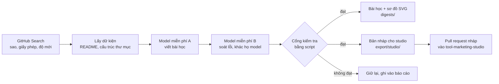

# GitHub Radar

Mỗi **thứ Tư và thứ Bảy** (08:00 giờ Việt Nam), repo này tự đi tìm các repo GitHub **miễn phí, được đánh giá cao** về
AI, phần mềm, giải pháp và khởi nghiệp, rồi biến mỗi repo thành một bài học **sâu nhưng dễ hiểu, có sơ đồ**.
Bài học nằm ngay trong repo này để bạn đọc; bản nháp bài đăng được chuyển sang
[`tool-marketing-studio`](https://github.com/vohoailinh90/tool-marketing-studio) để bạn duyệt rồi đăng Facebook và các kênh khác.



## Một bài học trông như thế nào

Mỗi repo thành một **hướng dẫn làm theo từng bước**, để người đọc chỉ cần nhìn tài liệu là tự làm được điều repo làm:
`digests/<ngày>/<repo>/vi.md` gồm: thẻ tóm tắt (ảnh), **bạn sẽ làm ra được gì**, vấn đề repo giải quyết, **lưu ý** (phần cứng, chi phí, bản quyền),
**chuẩn bị** (danh sách đánh dấu: phần mềm, phần cứng, tài khoản, khóa API, có liên kết lấy từ README), **lộ trình** (hình tóm tắt các bước),
**làm theo từng bước** (mỗi bước: mục đích, việc cần làm, khối lệnh chép nguyên văn từ README, khối cấu hình mẫu in đúng như README, *bạn sẽ thấy*, *nếu không được*, căn cứ),
**kiểm tra kết quả**, **lỗi thường gặp** (chỉ lỗi README tự nêu), **làm tiếp**; rồi mới đến phần giải thích bên trong (sơ đồ các mảnh ghép, bài học thiết kế, từ khóa).
Các hình (SVG) do script vẽ, không phải model vẽ. Ví dụ: [hướng dẫn làm video AI](docs/ai-video-guides.md) (5 repo, quét 16/10/2026).
Bài cũ (trước khi có hướng dẫn) vẫn được vẽ như trước: `draft` không có khóa `guide` dùng bố cục giải thích cũ.
Cạnh mỗi bài có `draft-<ngôn ngữ>.json`: câu trả lời của model (sau các cổng kiểm tra). Một bản nháp có khóa `note` (như bài Agent-Reach đầu tiên, "RECONSTRUCTED",
hay các hướng dẫn viết trong phiên tương tác) **không phải** câu trả lời gốc của model free. Có bản nháp thì khi bộ vẽ được cải thiện, `radar.py rerender` vẽ lại mọi bài cũ mà không tốn quota.
Mỗi lần quét còn có `stars.svg` so sánh số sao các repo đã chọn, và báo cáo `state/runs/*.json` ghi `coverage` (bài dùng bao nhiêu trong số lệnh của README).

## Vì sao tin được nội dung

Model chỉ viết lời giải thích; **script** quyết định bài có được dùng không (`radar/gates.py`):

| Cổng | Chặn điều gì |
|---|---|
| Số liệu | Số nào không có trong dữ kiện của repo (README, sao, fork, tuổi...) bị loại: không bịa "nhanh hơn 95%" |
| Căn cứ | Mỗi bước/mảnh ghép/yêu cầu/lỗi thường gặp phải ghi `README` hoặc một đường dẫn **có thật** trong repo |
| Lệnh | Mỗi lệnh trong hướng dẫn phải là **một dòng** (hoặc một đoạn mã nội dòng) của README; lệnh README chia nhiều dòng bằng `\` được ghép thành một |
| Chữ trong dấu backtick | Chữ model viết giữa dấu backtick (hiện ra như mã để chép) phải có trong README hoặc là đường dẫn có thật; không thể giấu một lệnh bịa trong câu văn |
| Có lệnh khi README có lệnh | README có từ 2 dòng lệnh trở lên mà hướng dẫn không đưa lệnh nào: bị chặn. README có từ 4 dòng lệnh mà hướng dẫn dùng dưới 2: cảnh báo |
| Liên kết | Không URL/tên miền do model viết. Link repo do script thêm; link khác (trang khóa API, địa chỉ cục bộ như `localhost:8080`) model chỉ **chọn theo số** trong danh sách liên kết README mà script trích, script in ra. Link có tham số theo dõi/affiliate hoặc có phần `user@` bị loại; `localhost` giả (`localhost.example.org`) không được coi là địa chỉ cục bộ |
| Khối cấu hình mẫu | File cấu hình/ví dụ (YAML, TOML...) model không gõ lại: nó chọn **theo số** một khối mã của README, script in nguyên văn kèm thụt lề |
| Văn bản lạ trong bài | Mọi `*` và `<` trong câu văn của model hiện ra như chữ thường (không thành chữ nghiêng hay HTML); bộ kiểm tra không bao giờ ném lỗi dù model trả JSON sai hình dạng, chỉ trả danh sách lỗi |
| Lời quảng cáo | "tốt nhất thế giới", "100%", "số 1"... bị chặn (vi/en/ja) |
| Ngôn ngữ, độ dài | Đúng ngôn ngữ; tiêu đề, hook Facebook ≤125 ký tự, số lượng bước, v.v. |

README dài được cắt **theo mục**, không cắt đầu: `radar/readme.py` giữ phần mở đầu và các mục về cài đặt, cấu hình, chạy, FAQ, bỏ trước
các mục ảnh demo, cảm ơn, giấy phép, lịch sử sao (một README dài 28.000 ký tự có mục cài đặt ở ký tự 20.500 trước đây bị cắt mất mục đó).
Bài vi phạm sau **một** vòng sửa sẽ bị giữ lại, không xuất. Model soát lỗi thuộc **họ model khác** model viết
(`python3 radar.py doctor` cảnh báo nếu trùng). Chi tiết nguồn model miễn phí: [`docs/models.md`](docs/models.md).

## Cài đặt (một lần)

1. **Secrets** (Settings → Secrets and variables → Actions). Tạo key **riêng** cho repo này, đặt hạn mức thấp:
   - `GOOGLE_GENERATIVE_AI_API_KEY` (model viết, mặc định) và `MISTRAL_API_KEY` (model soát lỗi, mặc định)
   - tùy chọn: `OPENROUTER_API_KEY`, `GROQ_API_KEY`, `NVIDIA_API_KEY` (model dự phòng)
   - `STUDIO_REPO_TOKEN` (tùy chọn): fine-grained token chỉ cho repo `tool-marketing-studio`, quyền *Contents* và
     *Pull requests* = Read and write. Không có token thì gói nháp vẫn nằm trong `export/studio/` để bạn chép tay.
2. **Chạy thử không tốn quota**: Actions → *Radar scan* → *Run workflow* (mặc định `dry_run = true`): chỉ quét và xếp hạng.
3. Sau khi xem danh sách ổn, chạy lại với `dry_run = false`; từ đó lịch tự chạy.
4. Chạy trên VPS (như `docs/vps-team.md`): đặt biến repo `CI_RUNNER` = nhãn runner. **Giữ repo ở chế độ private.**
5. Nếu bật branch protection cho `main`, bước commit của bot sẽ bị chặn: cho phép bot, hoặc đổi sang chạy qua PR.

## Lệnh

```bash
pip install -r requirements.txt
python3 radar.py doctor --ping      # key, model còn tồn tại không, họ model
python3 radar.py models google      # liệt kê model của nhà cung cấp (--free cho OpenRouter)
python3 radar.py scan               # xếp hạng ứng viên, không gọi model
python3 radar.py run --dry-run      # chọn repo sẽ viết, không ghi gì
python3 radar.py run                # chạy đầy đủ
python3 radar.py run --repo owner/tên   # chỉ viết bài cho đúng repo này (hoặc link github.com), không tìm kiếm
python3 radar.py check              # export/studio có hợp quy định của studio không
python3 radar.py rerender           # vẽ lại bài học, sơ đồ và bản nháp studio từ bản nháp đã lưu (không gọi model, không gọi GitHub)
python3 radar.py handoff            # mở PR nháp vào tool-marketing-studio
```

### Quét đúng một repo bạn chọn

`python3 radar.py run --repo owner/tên --dry-run` kiểm tra repo (không gọi model, không ghi gì); bỏ `--dry-run` để viết bài.
Trên GitHub: Actions → *Radar scan* → *Run workflow*, điền ô `repo` (ô `picks` bị bỏ qua), bỏ chọn `dry_run` để viết thật.

- Lựa chọn của bạn thay cho bộ lọc xếp hạng: số sao, độ mới, "đã viết rồi" chỉ cho **cảnh báo** trong báo cáo (`requested.warnings`), repo vẫn được viết.
  Repo đã viết trước đó được viết lại vào một thư mục chạy mới (`<ngày>-2`), bài cũ không bị ghi đè.
- Vẫn **bị từ chối**: repo riêng tư/bị khóa, hoặc giấy phép không nằm trong danh sách miễn phí (`licenses` trong `radar.yaml`), hoặc tên không hợp lệ.
- Nhóm (`ai`, `software`, `solutions`, `startup`) được đoán từ topic của repo; không khớp thì xếp vào `software`. Đổi bằng `--bucket` (hoặc ô `bucket`).
- Sau khi viết, `handoff` vẫn mở **pull request nháp** vào studio như các lần quét theo lịch.

Cấu hình trong [`radar.yaml`](radar.yaml) (số repo mỗi lần, ngôn ngữ `vi`/`en`/`ja`, chủ đề, model). Mặc định chỉ viết
**tiếng Việt**: mỗi ngôn ngữ thêm là một lượt gọi model nữa cho mỗi repo (viết riêng, không dịch), nên hãy tính quota
free trước khi bật `en`, `ja`. Ghi đè nhanh: `RADAR_LANGS=vi,en RADAR_PICKS=2`.

## Chuyển sang tool-marketing-studio

`export/studio/` có đúng cấu trúc studio đọc: `campaigns/radar-<ngày>/` (mỗi bài một file mỗi ngôn ngữ, trạng thái `draft`)
và `tools/github-radar/`. Link repo gốc đi qua `links:` và `{link}` ở bình luận đầu, đúng luật "không URL trong bài" của
studio. Bước `handoff` tạo **pull request nháp** vào studio; không bao giờ đẩy thẳng vào `main`, không ghi đè
file bạn đã sửa, không duyệt hay đăng bài. Duyệt và đăng vẫn là việc của bạn trong studio. Quy tắc studio được chép thành
[`contracts/studio-layouts.json`](contracts/studio-layouts.json); `python3 scripts/studio_contract.py diff <thư mục studio>` báo khi studio đổi luật.

## Đã kiểm chứng và chưa kiểm chứng

- Đã kiểm: toàn bộ pipeline chạy qua **GitHub giả và nhà cung cấp model giả** (HTTP thật trên localhost), gồm chuyển model
  khi bị giới hạn, thử lại, sửa một vòng, giữ bài lỗi, nhớ repo đã viết, bàn giao qua git; bộ xuất cho studio qua `studio.py check`
  **thật**, 0 lỗi 0 cảnh báo, và render ra ảnh bằng studio.
- **Chưa** chạy với GitHub thật, key thật, model free thật (môi trường dựng repo không có key). Chất lượng bài do model
  thật viết, tên model free hiện hành, topic trong `radar.yaml` và hạn mức free (đổi hằng tháng) cần xem ở lần chạy đầu.
  Hãy bắt đầu bằng `dry_run`, rồi một lần chạy thật với `RADAR_PICKS=1`.
- Bài do AI tóm tắt từ README và cấu trúc repo: không phải đánh giá bảo mật hay lời khuyên dùng. Mỗi bài có dòng nhắc đọc repo gốc.
