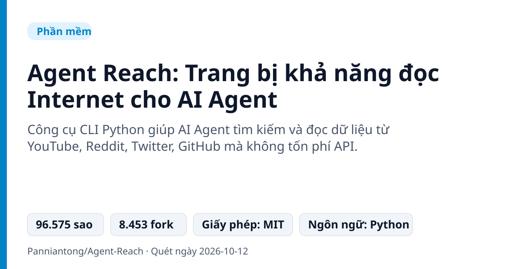
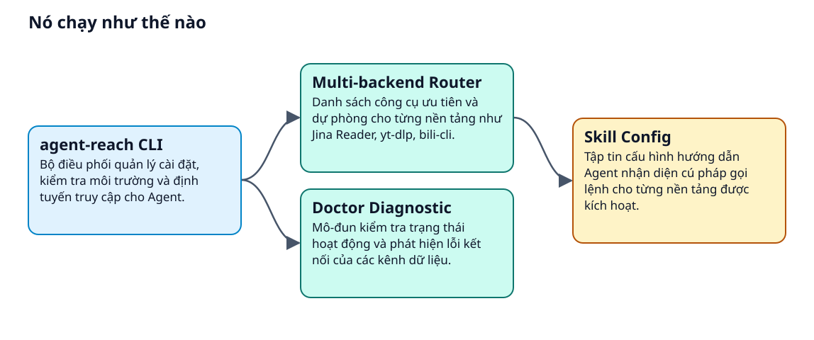
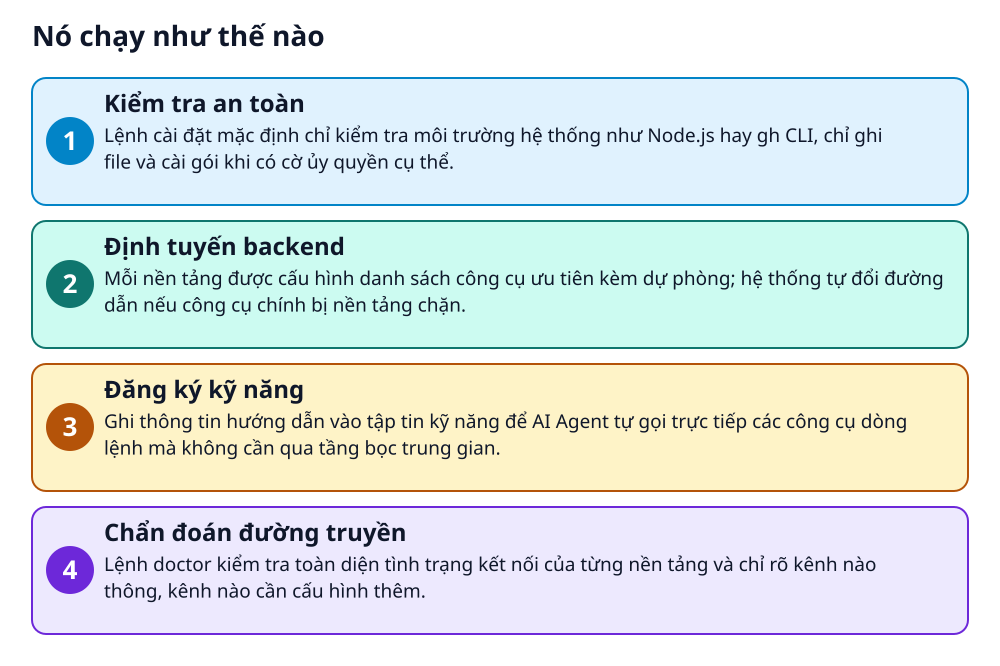

# Agent Reach: Trang bị khả năng đọc Internet cho AI Agent



> AI Agent biết viết code nhưng lại mù tịt khi cần tìm kiếm web? Agent Reach giúp kết nối đa nền tảng.

**Công cụ CLI Python giúp AI Agent tìm kiếm và đọc dữ liệu từ YouTube, Reddit, Twitter, GitHub mà không tốn phí API.**

## Vấn đề nó giải quyết

Người dùng AI Agent gặp khó khăn khi yêu cầu agent tra cứu thông tin thực tế trên mạng xã hội vì vướng tường lửa, lỗi 403 hoặc API yêu cầu trả phí. Tự cài đặt scraper, xử lý đăng nhập tài khoản và lọc mã HTML bẩn cho từng nền tảng tốn rất nhiều thời gian cấu hình.

> 💡 **Hình dung đời thường:** Giống như chiếc kính vạn năng tự xoay chuyển tròng kính phù hợp cho từng khung cảnh, giúp người đeo quan sát rõ ràng mà không phải tự mài kính thủ công mỗi lần đổi vị trí.

## Nó chạy như thế nào





1. **Kiểm tra an toàn**: Lệnh cài đặt mặc định chỉ kiểm tra môi trường hệ thống như Node.js hay gh CLI, chỉ ghi file và cài gói khi có cờ ủy quyền cụ thể. _(Căn cứ: `README`)_
2. **Định tuyến backend**: Mỗi nền tảng được cấu hình danh sách công cụ ưu tiên kèm dự phòng; hệ thống tự đổi đường dẫn nếu công cụ chính bị nền tảng chặn. _(Căn cứ: `README`)_
3. **Đăng ký kỹ năng**: Ghi thông tin hướng dẫn vào tập tin kỹ năng để AI Agent tự gọi trực tiếp các công cụ dòng lệnh mà không cần qua tầng bọc trung gian. _(Căn cứ: `README`)_
4. **Chẩn đoán đường truyền**: Lệnh doctor kiểm tra toàn diện tình trạng kết nối của từng nền tảng và chỉ rõ kênh nào thông, kênh nào cần cấu hình thêm. _(Căn cứ: `README`)_

## Các mảnh ghép

| | Các mảnh ghép | Căn cứ |
|---|---|---|
| **agent-reach CLI** | Bộ điều phối quản lý cài đặt, kiểm tra môi trường và định tuyến truy cập cho Agent. | `agent_reach/` |
| **Multi-backend Router** | Danh sách công cụ ưu tiên và dự phòng cho từng nền tảng như Jina Reader, yt-dlp, bili-cli. | `README` |
| **Skill Config** | Tập tin cấu hình hướng dẫn Agent nhận diện cú pháp gọi lệnh cho từng nền tảng được kích hoạt. | `README` |
| **Doctor Diagnostic** | Mô-đun kiểm tra trạng thái hoạt động và phát hiện lỗi kết nối của các kênh dữ liệu. | `README` |

## Học được gì từ thiết kế này

- Mô hình Capability Layer: Đóng vai trò chọn lọc, định tuyến và kiểm tra thay vì tự viết lại toàn bộ công cụ cào web từ đầu.
- Cơ chế Fallback nhiều tầng: Chuẩn bị sẵn backend thay thế giúp hệ thống tiếp tục chạy khi một công cụ bị nền tảng chặn.
- Bảo mật quyền hạn tối thiểu: Mặc định kiểm tra môi trường không can thiệp file, chỉ thay đổi hệ thống khi có xác nhận rõ ràng.

## Ai nên xem

- Người dùng Claude Code, Cursor, OpenClaw cần agent đọc tài liệu và nội dung mạng xã hội
- Lập trình viên muốn tích hợp dữ liệu từ Reddit, YouTube, Bilibili vào Agent mà không tốn phí mua API

## Tự thử

```bash
openclaw config set tools.profile "coding"
agent-reach doctor
```

Người dùng OpenClaw cần bật quyền coding trước khi chạy để Agent có thể thực thi lệnh shell.

## Lưu ý trước khi dùng

- Các nền tảng như Reddit, Twitter hay XiaoHongShu vẫn yêu cầu xuất cookie trình duyệt thủ công để truy cập sâu.
- Chỉ chạy lệnh cài đặt thực tế khi có cờ --system, mặc định chỉ là bước kiểm tra an toàn.
- Môi trường máy chủ có thể cần cấu hình thêm proxy nếu IP bị nền tảng chặn.

## Từ khóa

- **MCP**: Giao thức mở cho phép mô hình ngôn ngữ lớn kết nối với các công cụ và nguồn dữ liệu bên ngoài.
- **CDP**: Chrome DevTools Protocol, giao thức điều khiển trình duyệt Chrome phục vụ kiểm tra và tự động hóa.

---

Nguồn dữ kiện: [Panniantong/Agent-Reach](https://github.com/Panniantong/Agent-Reach) · Giấy phép: MIT · 96.575 sao · Quét ngày 2026-10-12

_Nội dung do AI tóm tắt từ README và cấu trúc repo; hãy đọc repo gốc trước khi dùng._
