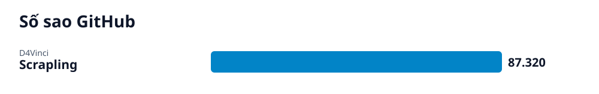

# Radar GitHub · 2026-10-13-2

## Các repo của lần quét này

- **[Scrapling: Framework web scraping tự thích ứng trên Python](scrapling/vi.md)** (Giải pháp) — Scrapling là framework Python hỗ trợ cào dữ liệu web tự thích ứng cấu trúc trang, vượt rào cản bot và mở rộng quy mô crawl.
