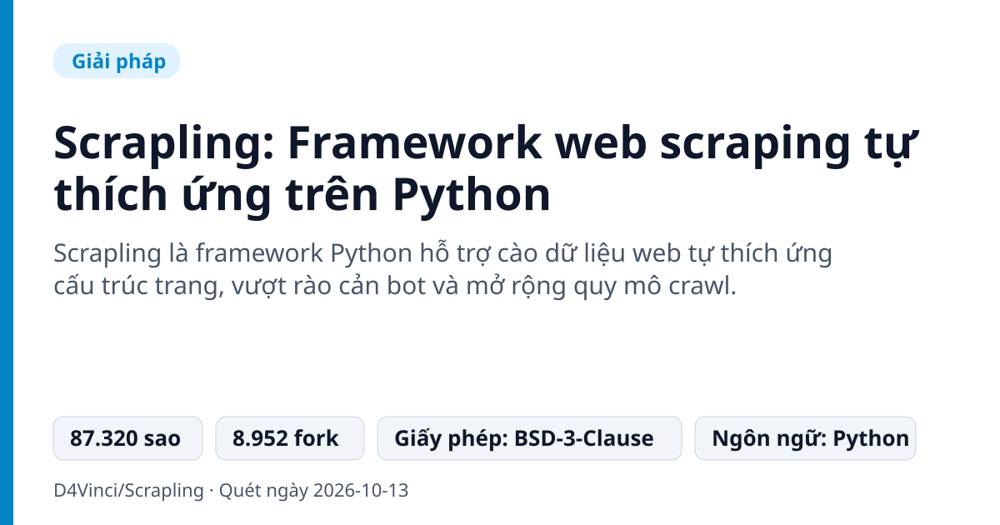
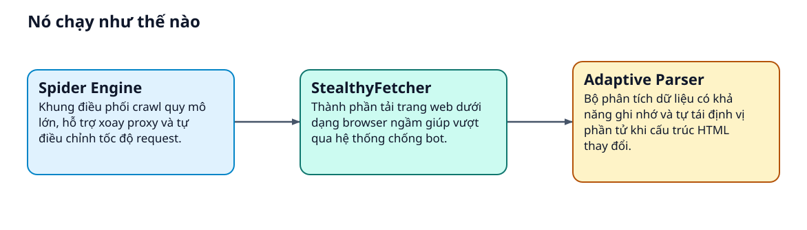
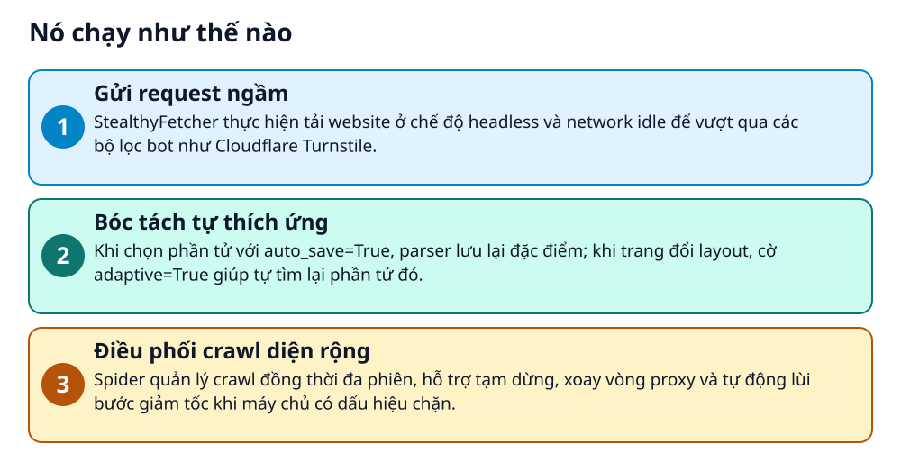

# Scrapling: Framework web scraping tự thích ứng trên Python

> Website đổi giao diện hay bật chống bot làm mã cào dữ liệu hỏng liên tục?

**Scrapling là framework Python hỗ trợ cào dữ liệu web tự thích ứng cấu trúc trang, vượt rào cản bot và mở rộng quy mô crawl.**

## Vấn đề nó giải quyết

Người cào dữ liệu thường xuyên gặp sự cố khi website đổi cấu trúc giao diện khiến bộ chọn CSS hoặc XPath bị hỏng. Ngoài ra, các cơ chế kiểm tra bot như Cloudflare Turnstile dễ dàng chặn đứng request, làm gián đoạn quá trình thu thập thông tin quy mô lớn.

> 💡 **Hình dung đời thường:** Giống như người giao hàng biết tự nhận diện lại số nhà dù mặt tiền vừa sửa, đồng thời biết tự đổi biển số và đi đường tránh khi gặp trạm kiểm soát.

## Nó chạy như thế nào

1. **Gửi request ngầm**: StealthyFetcher thực hiện tải website ở chế độ headless và network idle để vượt qua các bộ lọc bot như Cloudflare Turnstile. _(Căn cứ: `README`)_
2. **Bóc tách tự thích ứng**: Khi chọn phần tử với auto_save=True, parser lưu lại đặc điểm; khi trang đổi layout, cờ adaptive=True giúp tự tìm lại phần tử đó. _(Căn cứ: `README`)_
3. **Điều phối crawl diện rộng**: Spider quản lý crawl đồng thời đa phiên, hỗ trợ tạm dừng, xoay vòng proxy và tự động lùi bước giảm tốc khi máy chủ có dấu hiệu chặn. _(Căn cứ: `README`)_

## Các mảnh ghép

| | Các mảnh ghép | Căn cứ |
|---|---|---|
| **StealthyFetcher** | Thành phần tải trang web dưới dạng browser ngầm giúp vượt qua hệ thống chống bot. | `README` |
| **Adaptive Parser** | Bộ phân tích dữ liệu có khả năng ghi nhớ và tự tái định vị phần tử khi cấu trúc HTML thay đổi. | `README` |
| **Spider Engine** | Khung điều phối crawl quy mô lớn, hỗ trợ xoay proxy và tự điều chỉnh tốc độ request. | `README` |

## Học được gì từ thiết kế này

- Cơ chế tự phục hồi bộ chọn (self-healing selectors) giúp giảm chi phí bảo trì script.
- Tách biệt rõ ràng giữa tầng fetcher (thu thập), parser (bóc tách) và spider (điều phối).
- Chiến thuật backoff thích ứng theo phản hồi của server để duy trì kết nối ổn định.

## Ai nên xem

- Kỹ sư dữ liệu cần giải pháp cào web bền vững trước các đợt cập nhật UI.
- Lập trình viên Python gặp rào cản từ các cơ chế chặn bot cơ bản.
- Người xây dựng crawler đa luồng cần quản lý xoay proxy tự động.

## Tự thử

README không đưa lệnh cài đặt rõ ràng; hãy đọc README gốc.

Scrapling được sử dụng dưới dạng thư viện Python qua các lớp Fetcher, DynamicFetcher, StealthyFetcher hoặc Spider.

## Lưu ý trước khi dùng

- Chỉ tích hợp sẵn cơ chế vượt qua Cloudflare Turnstile, các hệ thống bảo vệ khác có thể cần giải pháp mở rộng.
- Khả năng thích ứng của bộ chọn yêu cầu phải lưu vết phần tử thành công từ trước.
- Phát hành theo giấy phép BSD-3-Clause.

## Từ khóa

- **Web Scraping**: Quá trình tự động trích xuất và thu thập thông tin từ các trang web.
- **Adaptive Selector**: Bộ chọn dữ liệu có khả năng tự định vị lại phần tử khi mã HTML của website thay đổi.
- **Proxy Rotation**: Kỹ thuật tự động thay đổi địa chỉ IP trung gian để tránh bị giới hạn hoặc chặn request.

---

Nguồn dữ kiện: [D4Vinci/Scrapling](https://github.com/D4Vinci/Scrapling) · Giấy phép: BSD-3-Clause · 87.320 sao · Quét ngày 2026-10-13

_Nội dung do AI tóm tắt từ README và cấu trúc repo; hãy đọc repo gốc trước khi dùng._
