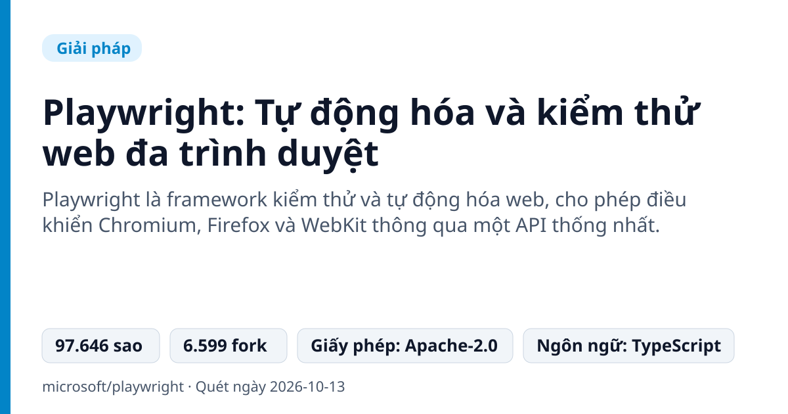
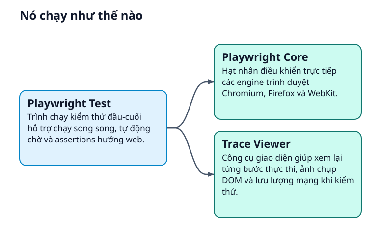
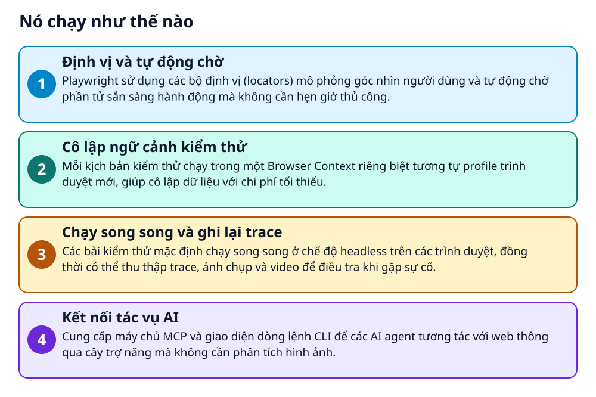

# Playwright: Tự động hóa và kiểm thử web đa trình duyệt



> Làm sao để test một website trên Chrome, Firefox và Safari mà chỉ cần viết kịch bản duy nhất một lần?

**Playwright là framework kiểm thử và tự động hóa web, cho phép điều khiển Chromium, Firefox và WebKit thông qua một API thống nhất.**

## Vấn đề nó giải quyết

Lập trình viên và kiểm thử viên web thường tốn nhiều công sức khi phải viết các kịch bản kiểm thử riêng cho từng trình duyệt khác nhau. Các bài kiểm thử tự động cũng dễ bị lỗi chập chờn do tốc độ phản hồi mạng và giao diện không đồng bộ. Ngoài ra, việc cô lập trạng thái dữ liệu và phiên đăng nhập giữa các lượt kiểm thử rất phức tạp.

> 💡 **Hình dung đời thường:** Playwright giống như chiếc điều khiển đa năng cho mọi dòng tivi, tự biết chờ màn hình tải xong nội dung rồi mới bấm nút tiếp theo.

## Nó chạy như thế nào





1. **Định vị và tự động chờ**: Playwright sử dụng các bộ định vị (locators) mô phỏng góc nhìn người dùng và tự động chờ phần tử sẵn sàng hành động mà không cần hẹn giờ thủ công. _(Căn cứ: `README`)_
2. **Cô lập ngữ cảnh kiểm thử**: Mỗi kịch bản kiểm thử chạy trong một Browser Context riêng biệt tương tự profile trình duyệt mới, giúp cô lập dữ liệu với chi phí tối thiểu. _(Căn cứ: `README`)_
3. **Chạy song song và ghi lại trace**: Các bài kiểm thử mặc định chạy song song ở chế độ headless trên các trình duyệt, đồng thời có thể thu thập trace, ảnh chụp và video để điều tra khi gặp sự cố. _(Căn cứ: `README`)_
4. **Kết nối tác vụ AI**: Cung cấp máy chủ MCP và giao diện dòng lệnh CLI để các AI agent tương tác với web thông qua cây trợ năng mà không cần phân tích hình ảnh. _(Căn cứ: `README`)_

## Các mảnh ghép

| | Các mảnh ghép | Căn cứ |
|---|---|---|
| **Playwright Test** | Trình chạy kiểm thử đầu-cuối hỗ trợ chạy song song, tự động chờ và assertions hướng web. | `packages/playwright-test/` |
| **Playwright Core** | Hạt nhân điều khiển trực tiếp các engine trình duyệt Chromium, Firefox và WebKit. | `packages/playwright-core/` |
| **Trace Viewer** | Công cụ giao diện giúp xem lại từng bước thực thi, ảnh chụp DOM và lưu lượng mạng khi kiểm thử. | `packages/trace-viewer/` |

## Học được gì từ thiết kế này

- Cơ chế auto-wait và web-first assertions giúp loại bỏ hoàn toàn các khoảng thời gian chờ cứng, giảm thiểu flaky test.
- Tạo Browser Context mới nhẹ hơn nhiều so với mở cả tiến trình trình duyệt mới, giúp cách ly dữ liệu kiểm thử hiệu quả.
- Dùng cây trợ năng (accessibility tree) để AI tương tác phần tử web chính xác và tiết kiệm token hơn so với nhận diện hình ảnh.

## Ai nên xem

- Kỹ sư kiểm thử phần mềm cần viết E2E test đáng tin cậy trên nhiều trình duyệt.
- Lập trình viên web cần viết mã tự động cào dữ liệu, chụp màn hình hoặc xuất file PDF.
- Người xây dựng AI agent cần công cụ điều khiển trình duyệt qua giao thức chuẩn.

## Tự thử

```bash
npm init playwright@latest
npx playwright test
```

Lệnh trên giúp khởi tạo nhanh dự án Playwright Test và thực thi các kịch bản kiểm thử mẫu.

## Lưu ý trước khi dùng

- Cần tải về các bản dựng trình duyệt đi kèm, có thể chiếm thêm dung lượng lưu trữ.
- Yêu cầu môi trường Node.js để cài đặt và chạy các gói kiểm thử.
- Được phát hành theo giấy phép mã nguồn mở Apache-2.0.

## Từ khóa

- **Headless mode**: Chế độ chạy trình duyệt ngầm trong nền mà không hiển thị cửa sổ giao diện đồ họa.
- **Browser Context**: Môi trường phiên duyệt web độc lập tương đương một hồ sơ người dùng mới hoàn toàn.
- **MCP**: Model Context Protocol, giao thức kết nối cho phép mô hình ngôn ngữ tương tác với công cụ bên ngoài.

---

Nguồn dữ kiện: [microsoft/playwright](https://github.com/microsoft/playwright) · Giấy phép: Apache-2.0 · 97.646 sao · Quét ngày 2026-10-13

_Nội dung do AI tóm tắt từ README và cấu trúc repo; hãy đọc repo gốc trước khi dùng._
