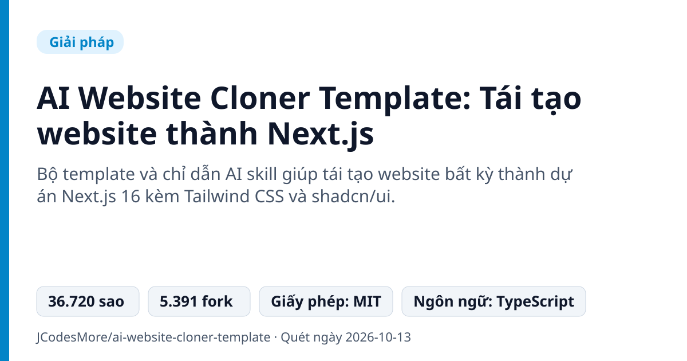
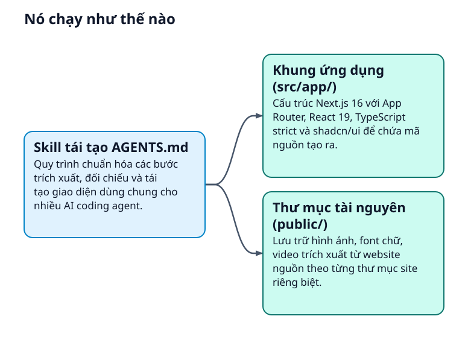
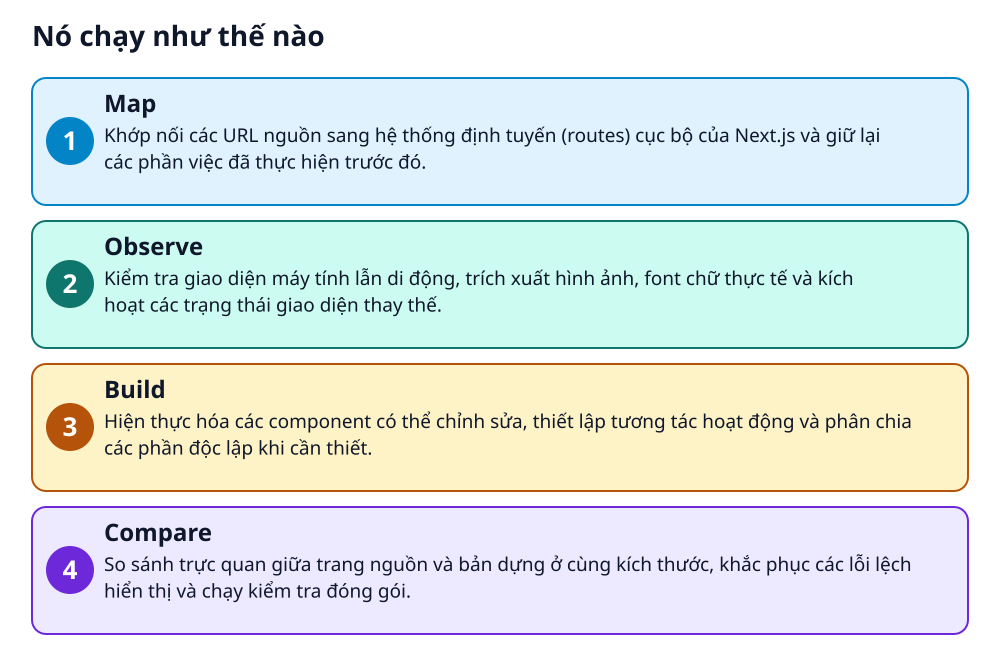

# AI Website Cloner Template: Tái tạo website thành Next.js



> Đưa URL cho AI agent để tái hiện giao diện web thành Next.js thay vì bóc tách CSS thủ công.

**Bộ template và chỉ dẫn AI skill giúp tái tạo website bất kỳ thành dự án Next.js 16 kèm Tailwind CSS và shadcn/ui.**

## Vấn đề nó giải quyết

Nhiều người cần chuyển website cũ từ nền tảng đóng sang Next.js nhưng tốn nhiều tuần để cắt lại giao diện. Trường hợp bị mất mã nguồn gốc chỉ còn trang trực tuyến, việc dựng lại từ đầu rất phức tạp. Soi mã nguồn và trích xuất từng tài nguyên bằng tay vừa chậm vừa dễ sai sót.

> 💡 **Hình dung đời thường:** Giống như giao bức ảnh ngôi nhà cho đội thợ đo đạc, họ xem xét kết cấu từng tầng rồi dùng khung thép hiện đại để dựng lại mô hình y hệt.

## Nó chạy như thế nào





1. **Map**: Khớp nối các URL nguồn sang hệ thống định tuyến (routes) cục bộ của Next.js và giữ lại các phần việc đã thực hiện trước đó. _(Căn cứ: `README`)_
2. **Observe**: Kiểm tra giao diện máy tính lẫn di động, trích xuất hình ảnh, font chữ thực tế và kích hoạt các trạng thái giao diện thay thế. _(Căn cứ: `README`)_
3. **Build**: Hiện thực hóa các component có thể chỉnh sửa, thiết lập tương tác hoạt động và phân chia các phần độc lập khi cần thiết. _(Căn cứ: `README`)_
4. **Compare**: So sánh trực quan giữa trang nguồn và bản dựng ở cùng kích thước, khắc phục các lỗi lệch hiển thị và chạy kiểm tra đóng gói. _(Căn cứ: `README`)_

## Các mảnh ghép

| | Các mảnh ghép | Căn cứ |
|---|---|---|
| **Skill tái tạo AGENTS.md** | Quy trình chuẩn hóa các bước trích xuất, đối chiếu và tái tạo giao diện dùng chung cho nhiều AI coding agent. | `AGENTS.md` |
| **Khung ứng dụng (src/app/)** | Cấu trúc Next.js 16 với App Router, React 19, TypeScript strict và shadcn/ui để chứa mã nguồn tạo ra. | `src/app/` |
| **Thư mục tài nguyên (public/)** | Lưu trữ hình ảnh, font chữ, video trích xuất từ website nguồn theo từng thư mục site riêng biệt. | `public/` |

## Học được gì từ thiết kế này

- Quy hoạch quy trình AI thành 4 giai đoạn rõ ràng (Map, Observe, Build, Compare) thay vì yêu cầu sinh code một lần
- Tổ chức Agent Skill độc lập ở một thư mục để các công cụ khác nhau như Codex, Cursor, Claude Code đều dùng chung được
- Phân tách ranh giới thư mục tài nguyên và component theo từng tên website để tránh đè lẫn mã nguồn

## Ai nên xem

- Lập trình viên muốn chuyển đổi nền tảng từ WordPress hoặc Webflow sang Next.js
- Nhóm phát triển cần khôi phục mã nguồn giao diện của website đang chạy
- Người học frontend muốn bóc tách layout, hiệu ứng động và bố cục responsive từ thực tế

## Tự thử

```bash
npm run dev
npm run check
docker compose up dev --build
```

Cần cài đặt Node.js 24 trở lên và chạy thông qua một AI coding agent có hỗ trợ duyệt web.

## Lưu ý trước khi dùng

- Phụ thuộc vào AI coding agent (như Claude Code, Codex, OpenCode, Cursor) và yêu cầu Node.js 24+
- Không dùng cho mục đích lừa đảo, giả mạo danh tính hoặc vi phạm điều khoản dịch vụ của trang nguồn
- Chỉ tái tạo cấu trúc giao diện và tài nguyên bề mặt, không tự động phục hồi mã nguồn phía máy chủ backend

## Từ khóa

- **Agent Skill**: Tệp chỉ dẫn chuyên biệt giúp AI agent nắm được quy trình và kỹ thuật thực hiện một nhiệm vụ cụ thể.
- **shadcn/ui**: Bộ thành phần giao diện người dùng tái sử dụng được, xây dựng trên nền Tailwind CSS.

---

Nguồn dữ kiện: [JCodesMore/ai-website-cloner-template](https://github.com/JCodesMore/ai-website-cloner-template) · Giấy phép: MIT · 36.720 sao · Quét ngày 2026-10-13

_Nội dung do AI tóm tắt từ README và cấu trúc repo; hãy đọc repo gốc trước khi dùng._
