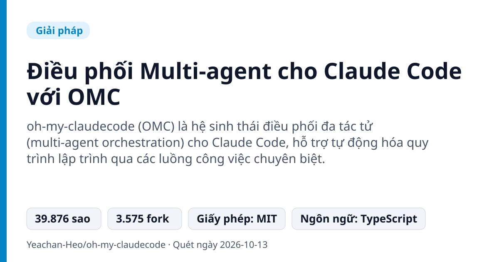
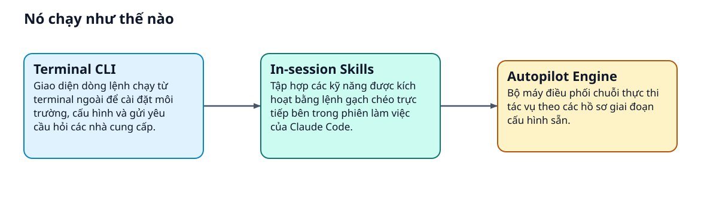
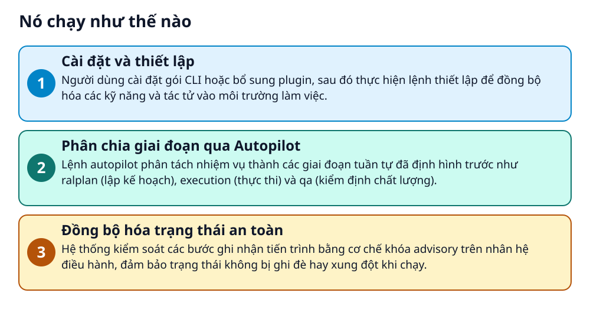

# Điều phối Multi-agent cho Claude Code với OMC



> Làm sao để AI tự chia giai đoạn lập kế hoạch, viết mã và kiểm thử thay vì làm dở dang?

**oh-my-claudecode (OMC) là hệ sinh thái điều phối đa tác tử (multi-agent orchestration) cho Claude Code, hỗ trợ tự động hóa quy trình lập trình qua các luồng công việc chuyên biệt.**

## Vấn đề nó giải quyết

Khi giao toàn bộ công việc lập trình phức tạp cho một phiên AI đơn lẻ, hệ thống dễ bị quá tải ngữ cảnh và làm việc thiếu nhất quán. Người phát triển phải liên tục theo dõi, can thiệp và ghép nối các bước thủ công từ lập kế hoạch đến kiểm thử. Thiếu một cơ chế khóa trạng thái và phân vai rõ ràng khiến các tác vụ tự động dễ phát sinh lỗi hoặc đè lẫn nhau.

> 💡 **Hình dung đời thường:** Giống như việc xây nhà không giao hết cho một người mà chia thành kiến trúc sư vẽ bản thiết kế, đội thợ thi công và kỹ sư giám sát kiểm định chất lượng.

## Nó chạy như thế nào





1. **Cài đặt và thiết lập**: Người dùng cài đặt gói CLI hoặc bổ sung plugin, sau đó thực hiện lệnh thiết lập để đồng bộ hóa các kỹ năng và tác tử vào môi trường làm việc. _(Căn cứ: `README`)_
2. **Phân chia giai đoạn qua Autopilot**: Lệnh autopilot phân tách nhiệm vụ thành các giai đoạn tuần tự đã định hình trước như ralplan (lập kế hoạch), execution (thực thi) và qa (kiểm định chất lượng). _(Căn cứ: `README`)_
3. **Đồng bộ hóa trạng thái an toàn**: Hệ thống kiểm soát các bước ghi nhận tiến trình bằng cơ chế khóa advisory trên nhân hệ điều hành, đảm bảo trạng thái không bị ghi đè hay xung đột khi chạy. _(Căn cứ: `README`)_

## Các mảnh ghép

| | Các mảnh ghép | Căn cứ |
|---|---|---|
| **Terminal CLI** | Giao diện dòng lệnh chạy từ terminal ngoài để cài đặt môi trường, cấu hình và gửi yêu cầu hỏi các nhà cung cấp. | `README` |
| **In-session Skills** | Tập hợp các kỹ năng được kích hoạt bằng lệnh gạch chéo trực tiếp bên trong phiên làm việc của Claude Code. | `README` |
| **Autopilot Engine** | Bộ máy điều phối chuỗi thực thi tác vụ theo các hồ sơ giai đoạn cấu hình sẵn. | `README` |

## Học được gì từ thiết kế này

- Tách biệt trách nhiệm bằng cách chia nhỏ quy trình AI thành các khâu riêng biệt thay vì dùng một câu lệnh duy nhất
- Hỗ trợ song song cả giao diện dòng lệnh bên ngoài lẫn kỹ năng bên trong môi trường phiên làm việc
- Sử dụng khóa hệ thống cấp kernel để bảo vệ tính toàn vẹn trạng thái khi thực thi quy trình phức tạp

## Ai nên xem

- Lập trình viên sử dụng Claude Code muốn tự động hóa các quy trình tạo mã nguồn nhiều bước
- Kỹ sư phần mềm cần chia tách giai đoạn lập kế hoạch và kiểm thử chất lượng mã nguồn

## Tự thử

```bash
npm i -g oh-my-claude-sisyphus@latest
omc setup
/autopilot "build a REST API for managing tasks"
```

Cài đặt CLI qua npm trên hệ thống, chạy lệnh setup để khởi tạo rồi kích hoạt chế độ autopilot trong phiên làm việc.

## Lưu ý trước khi dùng

- Tính năng named autopilot profiles hiện yêu cầu môi trường Linux có tiện ích flock
- Quá trình cài đặt qua npm có thể xuất hiện cảnh báo phiên bản cũ từ thư viện phụ thuộc better-sqlite3
- Dự án được phân phối dưới giấy phép nguồn mở MIT

## Từ khóa

- **Multi-agent**: Mô hình phối hợp giữa nhiều tác tử AI, mỗi tác tử đảm nhận một vai trò cụ thể
- **Autopilot**: Cơ chế tự động điều phối và chuyển tiếp các khâu công việc theo cấu hình định sẵn

---

Nguồn dữ kiện: [Yeachan-Heo/oh-my-claudecode](https://github.com/Yeachan-Heo/oh-my-claudecode) · Giấy phép: MIT · 39.876 sao · Quét ngày 2026-10-13

_Nội dung do AI tóm tắt từ README và cấu trúc repo; hãy đọc repo gốc trước khi dùng._
