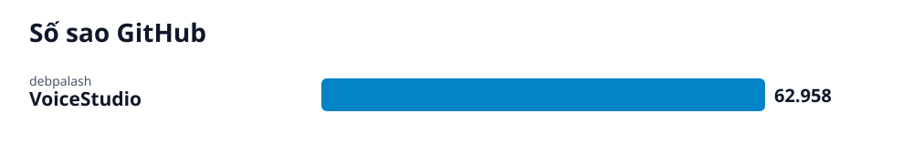

# Radar GitHub · 2026-10-13

## Các repo của lần quét này

- **[VoiceStudio: Bộ công cụ AI xử lý giọng nói cục bộ đa ngôn ngữ](voicestudio/vi.md)** (Giải pháp) — VoiceStudio là ứng dụng mã nguồn mở chạy hoàn toàn cục bộ, hỗ trợ nhân bản giọng, thiết kế giọng nói, lồng tiếng video và tạo sách nói trong 646 ngôn ngữ.
