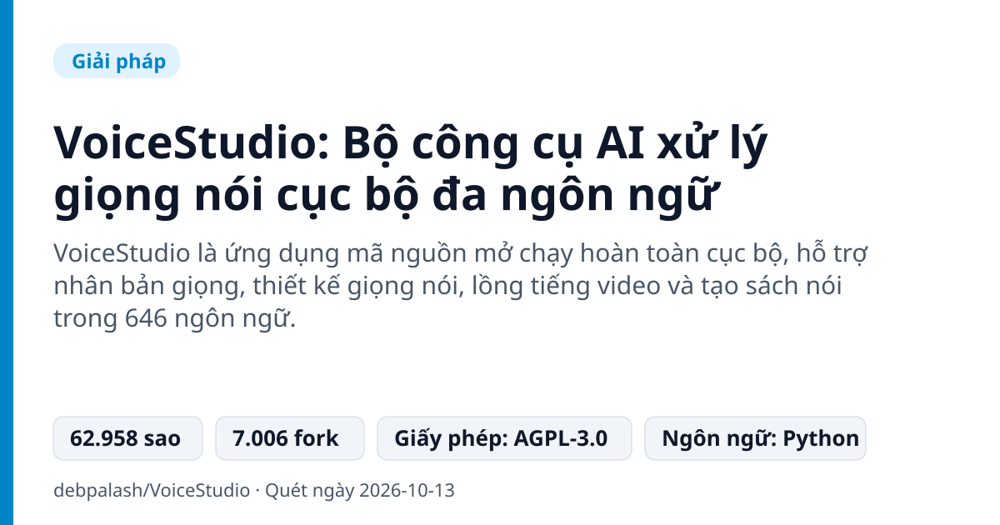
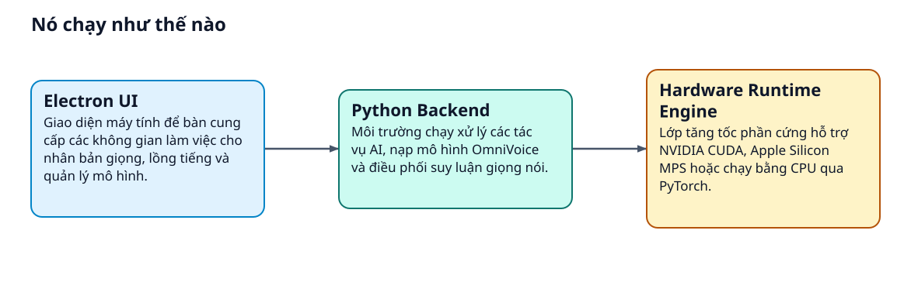
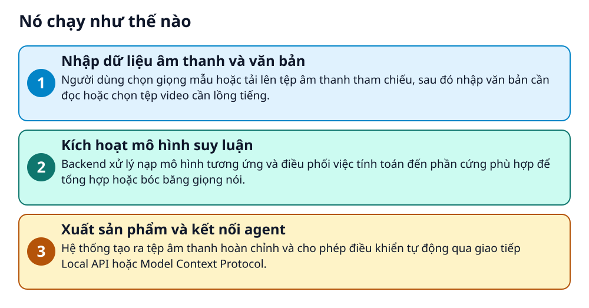

# VoiceStudio: Bộ công cụ AI xử lý giọng nói cục bộ đa ngôn ngữ



> Tự nhân bản giọng nói và lồng tiếng đa ngôn ngữ ngay trên máy tính mà không cần gửi dữ liệu lên đám mây.

**VoiceStudio là ứng dụng mã nguồn mở chạy hoàn toàn cục bộ, hỗ trợ nhân bản giọng, thiết kế giọng nói, lồng tiếng video và tạo sách nói trong 646 ngôn ngữ.**

## Vấn đề nó giải quyết

Nhiều người sáng tạo nội dung và lập trình viên muốn tạo giọng đọc, lồng tiếng hay phiên âm nhưng e ngại chi phí dịch vụ đám mây cùng rủi ro lộ dữ liệu âm thanh. Việc tự cấu hình các mô hình AI âm thanh trên máy tính cá nhân lại phức tạp về môi trường chạy và tương thích phần cứng. VoiceStudio giải quyết vấn đề này bằng một ứng dụng desktop trọn gói chạy khép kín trên máy.

> 💡 **Hình dung đời thường:** Giống như việc bạn sở hữu hẳn một phòng thu âm cá nhân ngay tại nhà, thay vì phải trả tiền thuê studio dịch vụ theo từng phút.

## Nó chạy như thế nào





1. **Nhập dữ liệu âm thanh và văn bản**: Người dùng chọn giọng mẫu hoặc tải lên tệp âm thanh tham chiếu, sau đó nhập văn bản cần đọc hoặc chọn tệp video cần lồng tiếng. _(Căn cứ: `README`)_
2. **Kích hoạt mô hình suy luận**: Backend xử lý nạp mô hình tương ứng và điều phối việc tính toán đến phần cứng phù hợp để tổng hợp hoặc bóc băng giọng nói. _(Căn cứ: `backend/`)_
3. **Xuất sản phẩm và kết nối agent**: Hệ thống tạo ra tệp âm thanh hoàn chỉnh và cho phép điều khiển tự động qua giao tiếp Local API hoặc Model Context Protocol. _(Căn cứ: `README`)_

## Các mảnh ghép

| | Các mảnh ghép | Căn cứ |
|---|---|---|
| **Electron UI** | Giao diện máy tính để bàn cung cấp các không gian làm việc cho nhân bản giọng, lồng tiếng và quản lý mô hình. | `electron/` |
| **Python Backend** | Môi trường chạy xử lý các tác vụ AI, nạp mô hình OmniVoice và điều phối suy luận giọng nói. | `backend/` |
| **Hardware Runtime Engine** | Lớp tăng tốc phần cứng hỗ trợ NVIDIA CUDA, Apple Silicon MPS hoặc chạy bằng CPU qua PyTorch. | `README` |

## Học được gì từ thiết kế này

- Phân tách kiến trúc rõ ràng giữa giao diện desktop Electron và backend AI bằng Python để dễ bảo trì.
- Thiết kế cơ chế linh hoạt tận dụng đa dạng phần cứng từ card đồ họa cao cấp đến chỉ chạy trên CPU.
- Mở rộng ứng dụng desktop truyền thống thành công cụ tự động hóa thông qua giao thức MCP cho các AI agent.

## Ai nên xem

- Nhà sáng tạo nội dung cần lồng tiếng video hoặc sản xuất sách nói riêng tư.
- Lập trình viên muốn tích hợp giọng nói AI vào quy trình làm việc thông qua Local API hoặc MCP.
- Người dùng văn phòng cần công cụ đọc chính tả và phiên âm âm thanh trực tiếp trên máy.

## Tự thử

```bash
bun install
bun run setup:api
bun run dev
```

Chuẩn bị trước môi trường Bun và các gói phụ thuộc Python để khởi chạy bản phát triển từ mã nguồn.

## Lưu ý trước khi dùng

- Mã nguồn dùng giấy phép AGPL-3.0, nhưng trọng số mô hình và dữ liệu giọng nói có điều kiện cấp phép riêng.
- Chạy trên CPU không có card đồ họa sẽ chậm hơn và yêu cầu khoảng 5 GB dung lượng trống để cài PyTorch.
- Hỗ trợ trên Windows on ARM vẫn ở mức thử nghiệm và backend Python phải chạy qua giả lập x64.

## Từ khóa

- **Voice cloning**: Kỹ thuật nhân bản giọng nói từ một đoạn âm thanh mẫu có sẵn để đọc văn bản mới.
- **MCP**: Giao thức tiêu chuẩn giúp các tác tử AI kết nối và điều khiển các công cụ bên ngoài.

---

Nguồn dữ kiện: [debpalash/VoiceStudio](https://github.com/debpalash/VoiceStudio) · Giấy phép: AGPL-3.0 · 62.958 sao · Quét ngày 2026-10-13

_Nội dung do AI tóm tắt từ README và cấu trúc repo; hãy đọc repo gốc trước khi dùng._
