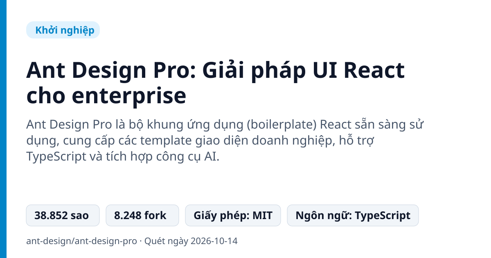
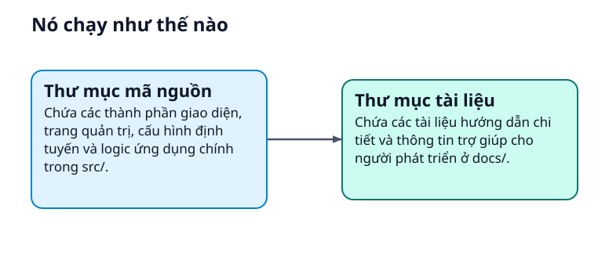
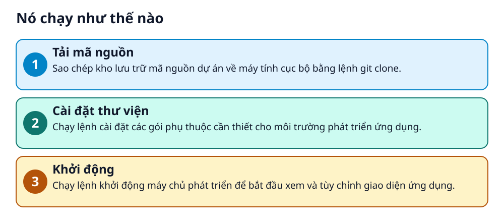

# Ant Design Pro: Giải pháp UI React cho enterprise



> Xây dựng dashboard doanh nghiệp cực nhanh với bộ template dựng sẵn cho React!

**Ant Design Pro là bộ khung ứng dụng (boilerplate) React sẵn sàng sử dụng, cung cấp các template giao diện doanh nghiệp, hỗ trợ TypeScript và tích hợp công cụ AI.**

## Vấn đề nó giải quyết

Lập trình viên khi phát triển ứng dụng quản trị doanh nghiệp thường mất nhiều thời gian tự dựng layout, trang đăng nhập, quản lý form và bảng biểu từ đầu. Việc thiếu một bộ khung chuẩn hóa khiến việc thiết kế giao diện thiếu đồng bộ và tốn nhân lực.

> 💡 **Hình dung đời thường:** Giống như việc mua một căn nhà đã được thiết kế nội thất cơ bản thay vì tự tay đóng từng chiếc bàn ghế từ con số không.

## Nó chạy như thế nào





1. **Tải mã nguồn**: Sao chép kho lưu trữ mã nguồn dự án về máy tính cục bộ bằng lệnh git clone. _(Căn cứ: `README`)_
2. **Cài đặt thư viện**: Chạy lệnh cài đặt các gói phụ thuộc cần thiết cho môi trường phát triển ứng dụng. _(Căn cứ: `README`)_
3. **Khởi động**: Chạy lệnh khởi động máy chủ phát triển để bắt đầu xem và tùy chỉnh giao diện ứng dụng. _(Căn cứ: `README`)_

## Các mảnh ghép

| | Các mảnh ghép | Căn cứ |
|---|---|---|
| **Thư mục mã nguồn** | Chứa các thành phần giao diện, trang quản trị, cấu hình định tuyến và logic ứng dụng chính trong src/. | `src/` |
| **Thư mục tài liệu** | Chứa các tài liệu hướng dẫn chi tiết và thông tin trợ giúp cho người phát triển ở docs/. | `docs/` |

## Học được gì từ thiết kế này

- Cách cấu trúc một dự án React quy mô doanh nghiệp lớn
- Ứng dụng TypeScript trong phát triển ứng dụng web quy mô lớn
- Tích hợp các template giao diện mẫu vào quy trình làm việc thực tế

## Ai nên xem

- Lập trình viên React
- Nhà phát triển frontend
- Đội ngũ xây dựng ứng dụng quản trị doanh nghiệp

## Tự thử

```bash
git clone --depth=1 https://github.com/ant-design/ant-design-pro.git myapp
cd myapp
npm install
npm start
```

Chạy các lệnh trên trong terminal để tải và chạy thử dự án trên máy tính của bạn.

## Lưu ý trước khi dùng

- Giấy phép sử dụng: MIT.
- Lệnh đơn giản hóa (npm run simple) sẽ xóa vĩnh viễn các thư mục trang mẫu và không thể hoàn tác.
- Yêu cầu môi trường phát triển Node.js và Git trên máy tính.

## Từ khóa

- **Boilerplate**: Bộ mã nguồn mẫu được thiết lập sẵn giúp lập trình viên bắt đầu dự án mới nhanh chóng mà không cần cấu hình từ đầu.
- **TypeScript**: Ngôn ngữ lập trình mở rộng của JavaScript, bổ sung tính năng kiểm tra kiểu dữ liệu tĩnh.

---

Nguồn dữ kiện: [ant-design/ant-design-pro](https://github.com/ant-design/ant-design-pro) · Giấy phép: MIT · 38.852 sao · Quét ngày 2026-10-14

_Nội dung do AI tóm tắt từ README và cấu trúc repo; hãy đọc repo gốc trước khi dùng._
