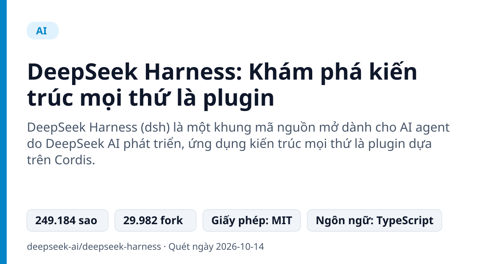
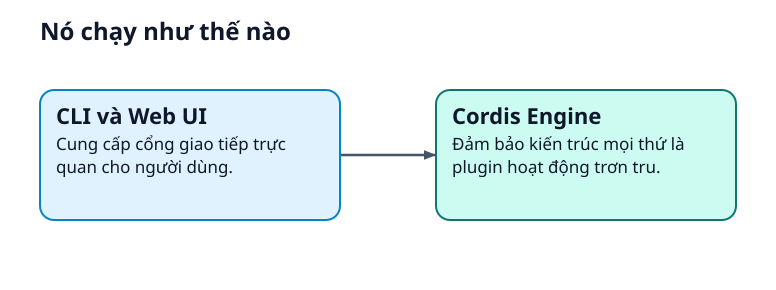
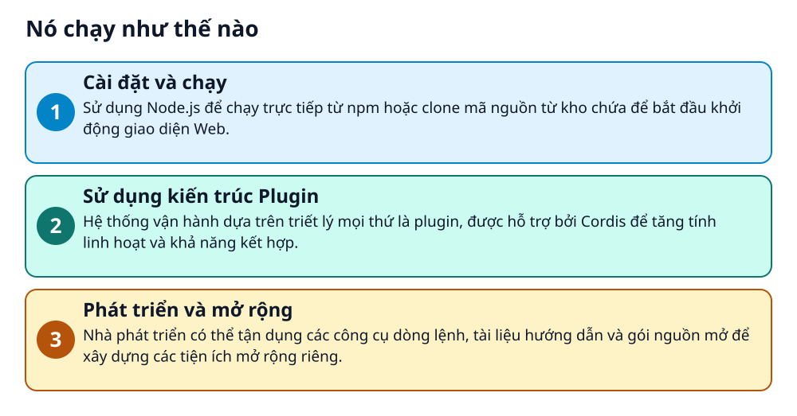

# DeepSeek Harness: Khám phá kiến trúc mọi thứ là plugin



> Tìm hiểu hệ thống AI agent mã nguồn mở từ DeepSeek với triết lý thiết kế module cực độc đáo.

**DeepSeek Harness (dsh) là một khung mã nguồn mở dành cho AI agent do DeepSeek AI phát triển, ứng dụng kiến trúc mọi thứ là plugin dựa trên Cordis.**

## Vấn đề nó giải quyết

Khi phát triển các ứng dụng AI agent phức tạp, việc mở rộng tính năng và quản lý các mô-đun thường trở nên khó khăn và rối rắm. DeepSeek Harness giải quyết bài toán này bằng cách mô-đun hóa toàn bộ hệ thống để dễ dàng tùy chỉnh.

> 💡 **Hình dung đời thường:** Giống như việc lắp ráp một chiếc máy tính từ các linh kiện rời (RAM, CPU, ổ cứng) thay vì dùng một khối liền mạch, bạn có thể thay thế hay nâng cấp từng phần của hệ thống một cách linh hoạt.

## Nó chạy như thế nào





1. **Cài đặt và chạy**: Sử dụng Node.js để chạy trực tiếp từ npm hoặc clone mã nguồn từ kho chứa để bắt đầu khởi động giao diện Web. _(Căn cứ: `README`)_
2. **Sử dụng kiến trúc Plugin**: Hệ thống vận hành dựa trên triết lý mọi thứ là plugin, được hỗ trợ bởi Cordis để tăng tính linh hoạt và khả năng kết hợp. _(Căn cứ: `README`)_
3. **Phát triển và mở rộng**: Nhà phát triển có thể tận dụng các công cụ dòng lệnh, tài liệu hướng dẫn và gói nguồn mở để xây dựng các tiện ích mở rộng riêng. _(Căn cứ: `docs/development.md`)_

## Các mảnh ghép

| | Các mảnh ghép | Căn cứ |
|---|---|---|
| **CLI và Web UI** | Cung cấp cổng giao tiếp trực quan cho người dùng. | `README` |
| **Cordis Engine** | Đảm bảo kiến trúc mọi thứ là plugin hoạt động trơn tru. | `README` |

## Học được gì từ thiết kế này

- Cách thiết kế kiến trúc phần mềm dựa hoàn toàn trên plugin
- Ứng dụng framework Cordis vào quản lý tính năng
- Tổ chức mã nguồn cho một dự án AI agent quy mô lớn

## Ai nên xem

- Lập trình viên TypeScript và Python quan tâm đến AI agent
- Nhà phát triển muốn tìm hiểu kiến trúc plugin mô-đun hóa
- Người dùng muốn khám phá công cụ mã nguồn mở từ DeepSeek AI

## Tự thử

```bash
npx @deepseek-ai/dsh web
```

Lệnh này sẽ khởi động Web UI tại cổng mặc định trên máy tính cục bộ của bạn.

## Lưu ý trước khi dùng

- Dự án đang trong giai đoạn developer preview và có thể thay đổi tính tương thích liên tục
- Phát hành theo giấy phép MIT
- Cần lưu ý kiểm tra các thông báo bảo mật trước khi chạy

## Từ khóa

- **Agent Harness**: Khung chương trình bao bọc và hỗ trợ việc vận hành các AI agent.
- **Cordis**: Thư viện nền tảng hỗ trợ mô hình lập trình kết hợp không gian - thời gian.

---

Nguồn dữ kiện: [deepseek-ai/deepseek-harness](https://github.com/deepseek-ai/deepseek-harness) · Giấy phép: MIT · 249.184 sao · Quét ngày 2026-10-14

_Nội dung do AI tóm tắt từ README và cấu trúc repo; hãy đọc repo gốc trước khi dùng._
