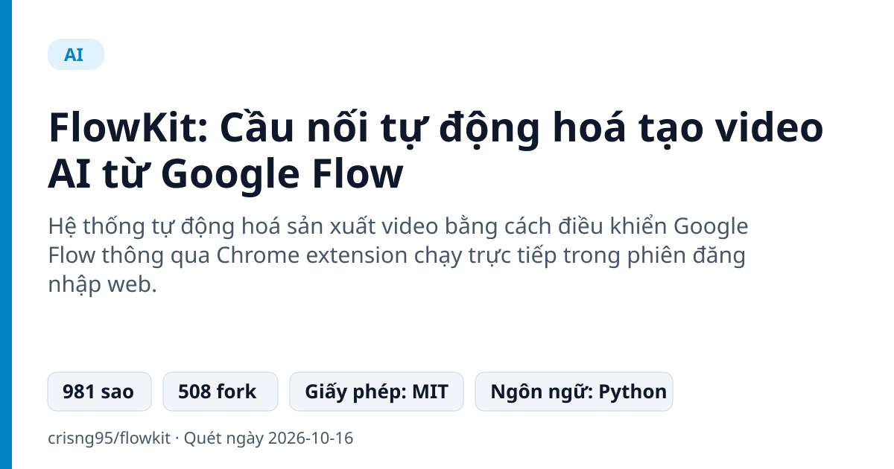
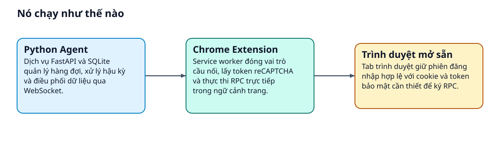
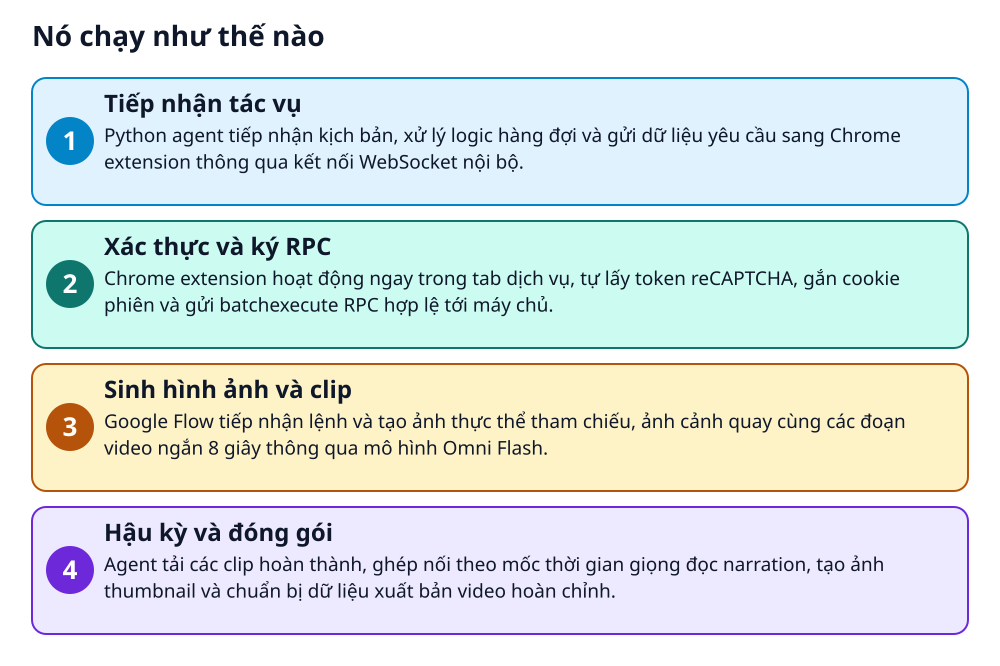

# FlowKit: Cầu nối tự động hoá tạo video AI từ Google Flow



> Làm sao gọi API của một dịch vụ web không có REST API mở và bắt buộc phải đăng nhập trên trình duyệt?

**Hệ thống tự động hoá sản xuất video bằng cách điều khiển Google Flow thông qua Chrome extension chạy trực tiếp trong phiên đăng nhập web.**

## Vấn đề nó giải quyết

Google Flow sử dụng cơ chế bảo mật nghiêm ngặt với cookie phiên, mã bảo mật trang và reCAPTCHA, khiến các lệnh gọi API thông thường không thể chạy độc lập. Người dùng phải thao tác tay từng cảnh quay rất tốn thời gian và khó giữ tính đồng quán nhân vật giữa các phân đoạn. FlowKit giải quyết việc tự động hoá quy trình này mà không cần API chính thức.

> 💡 **Hình dung đời thường:** Giống như việc bạn nhờ một trợ lý ngồi gõ lệnh trực tiếp trên trình duyệt đã đăng nhập sẵn của bạn, thay vì cố gắng tìm cách đột nhập qua cửa sổ không có chìa khóa.

## Nó chạy như thế nào





1. **Tiếp nhận tác vụ**: Python agent tiếp nhận kịch bản, xử lý logic hàng đợi và gửi dữ liệu yêu cầu sang Chrome extension thông qua kết nối WebSocket nội bộ. _(Căn cứ: `README`)_
2. **Xác thực và ký RPC**: Chrome extension hoạt động ngay trong tab dịch vụ, tự lấy token reCAPTCHA, gắn cookie phiên và gửi batchexecute RPC hợp lệ tới máy chủ. _(Căn cứ: `README`)_
3. **Sinh hình ảnh và clip**: Google Flow tiếp nhận lệnh và tạo ảnh thực thể tham chiếu, ảnh cảnh quay cùng các đoạn video ngắn 8 giây thông qua mô hình Omni Flash. _(Căn cứ: `README`)_
4. **Hậu kỳ và đóng gói**: Agent tải các clip hoàn thành, ghép nối theo mốc thời gian giọng đọc narration, tạo ảnh thumbnail và chuẩn bị dữ liệu xuất bản video hoàn chỉnh. _(Căn cứ: `README`)_

## Các mảnh ghép

| | Các mảnh ghép | Căn cứ |
|---|---|---|
| **Python Agent** | Dịch vụ FastAPI và SQLite quản lý hàng đợi, xử lý hậu kỳ và điều phối dữ liệu qua WebSocket. | `README` |
| **Chrome Extension** | Service worker đóng vai trò cầu nối, lấy token reCAPTCHA và thực thi RPC trực tiếp trong ngữ cảnh trang. | `README` |
| **Trình duyệt mở sẵn** | Tab trình duyệt giữ phiên đăng nhập hợp lệ với cookie và token bảo mật cần thiết để ký RPC. | `README` |

## Học được gì từ thiết kế này

- Kỹ thuật Browser Bridge: dùng extension để tương tác với web app bảo mật thay vì cố chạy headless
- Đồng nhất nhân vật đa cảnh: tạo ảnh tham chiếu một lần để áp dụng xuyên suốt chuỗi khung hình
- Thiết kế pipeline phân tầng: tách biệt rõ ràng giữa điều phối tác vụ, giao tiếp mạng và hậu kỳ media

## Ai nên xem

- Lập trình viên muốn tìm hiểu giải pháp Browser Bridge để tự động hoá ứng dụng web đóng
- Nhà sáng tạo nội dung cần tạo video nhiều cảnh có độ nhất quán nhân vật cao
- Kỹ sư phần mềm xây dựng quy trình tự động hoá đa bước từ kịch bản đến video thành phẩm

## Tự thử

```bash
./setup.sh
export FLOW_PROJECT_ID=<that uuid>
python -m agent.main
curl http://127.0.0.1:8100/health
```

Cần nạp extension vào Chrome, đăng nhập trang web Flow và giữ mở tab đó trước khi kích hoạt agent.

## Lưu ý trước khi dùng

- Không thể chạy headless độc lập vì bắt buộc duy trì một tab trình duyệt đã đăng nhập
- Cần tạo dự án thủ công trên giao diện web và sao chép mã FLOW_PROJECT_ID vào biến môi trường
- Một số tính năng mô hình Veo như video upscale hay start-and-end frame chưa hỗ trợ trên cơ chế batch

## Từ khóa

- **Browser Bridge**: Cầu nối dùng tiện ích mở rộng trình duyệt để chuyển tiếp lệnh từ backend vào phiên đăng nhập web
- **batchexecute**: Giao thức gọi thủ tục từ xa nội bộ của web app Google để gom nhóm và gửi yêu cầu
- **Reference Image**: Hình ảnh nhân vật hoặc bối cảnh gốc dùng làm mẫu chuẩn để AI giữ nguyên chi tiết qua nhiều cảnh

---

Nguồn dữ kiện: [crisng95/flowkit](https://github.com/crisng95/flowkit) · Giấy phép: MIT · 981 sao · Quét ngày 2026-10-16

_Nội dung do AI tóm tắt từ README và cấu trúc repo; hãy đọc repo gốc trước khi dùng._
