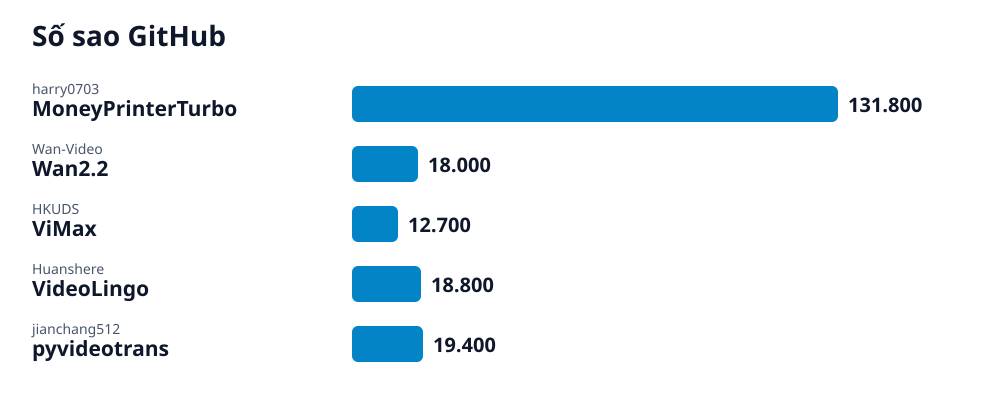

# Radar GitHub · 2026-10-16-3

## Các repo của lần quét này

- **[Tạo video ngắn từ một chủ đề với MoneyPrinterTurbo](moneyprinterturbo/vi.md)** (AI) — Công cụ mã nguồn mở nhận một chủ đề hoặc từ khóa, rồi tự tạo kịch bản, chọn clip, đọc lời, tạo phụ đề, thêm nhạc nền và ghép thành video ngắn.
  - 🎯 Một giao diện web chạy trên máy bạn: nhập chủ đề hoặc từ khóa là hệ thống tự tạo kịch bản, chọn clip, đọc lời, tạo phụ đề, thêm nhạc nền và ghép thành video ngắn. · 🪜 8 bước
- **[Tạo video từ chữ hoặc ảnh với Wan2.2 trên máy của bạn](wan2-2/vi.md)** (AI) — Bộ mô hình video mã nguồn mở của Wan: viết câu mô tả (hoặc đưa một ảnh) rồi chạy generate.py để sinh video ở 480P hoặc 720P.
  - 🎯 Một file video 720P do mô hình Wan2.2-TI2V-5B sinh ra từ câu mô tả của bạn (hoặc từ một ảnh kèm câu mô tả), chạy trên card đồ họa có ít nhất 24GB VRAM. · 🪜 6 bước
- **[Dựng video nhiều cảnh từ một ý tưởng với ViMax](vimax/vi.md)** (AI) — Khung làm việc mã nguồn mở nối kịch bản, phân cảnh, tạo ảnh, tạo video và ghép cuối thành một quy trình; có giao diện web, giao diện terminal (TUI) và script chạy thẳng.
  - 🎯 Một dự án ViMax chạy trên máy bạn: bạn nêu ý tưởng ngắn, agent lập kịch bản, nhân vật và phân cảnh, rồi dựng thành video mà bạn xem lại được. · 🪜 7 bước
- **[Làm phụ đề và lồng tiếng cho video với VideoLingo](videolingo/vi.md)** (AI) — Công cụ mã nguồn mở gom nhận dạng giọng nói, dịch phụ đề, cắt phụ đề và lồng tiếng trong một giao diện Streamlit, xuất tệp phụ đề và video có phụ đề hoặc lồng tiếng.
  - 🎯 Một giao diện VideoLingo chạy trên máy bạn, xuất tệp phụ đề đã dịch cho video của bạn, và tùy chọn video có phụ đề hoặc video lồng tiếng. · 🪜 7 bước
- **[Dịch video và lồng tiếng sang ngôn ngữ khác với pyVideoTrans](pyvideotrans/vi.md)** (AI) — Công cụ mã nguồn mở dịch video từ ngôn ngữ này sang ngôn ngữ khác: nhận dạng giọng nói, dịch phụ đề, lồng tiếng và ghép lại, dùng giao diện, dòng lệnh hoặc web.
  - 🎯 Một video đã dịch sang ngôn ngữ bạn chọn, có phụ đề và giọng lồng tiếng, tạo từ video gốc bằng pyVideoTrans trên máy của bạn. · 🪜 9 bước
