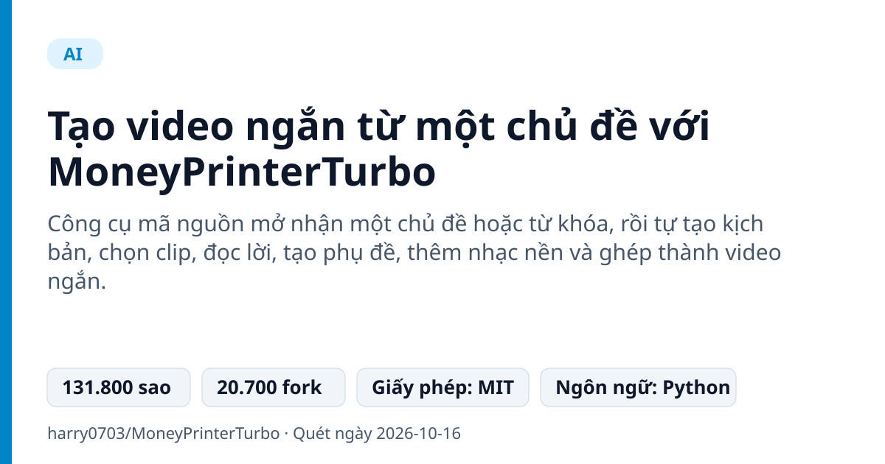
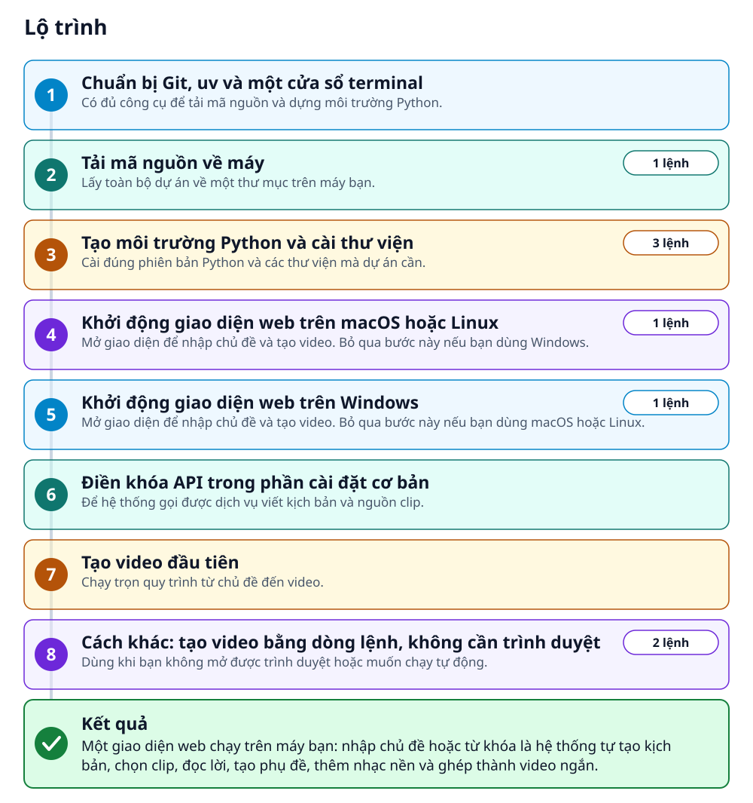
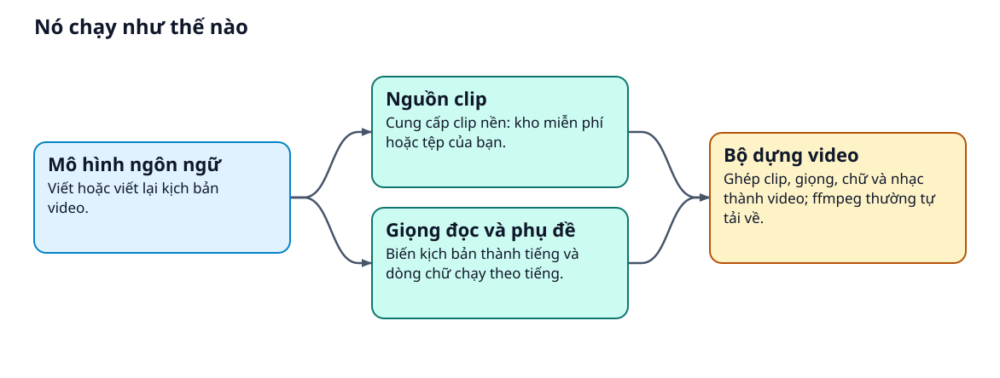
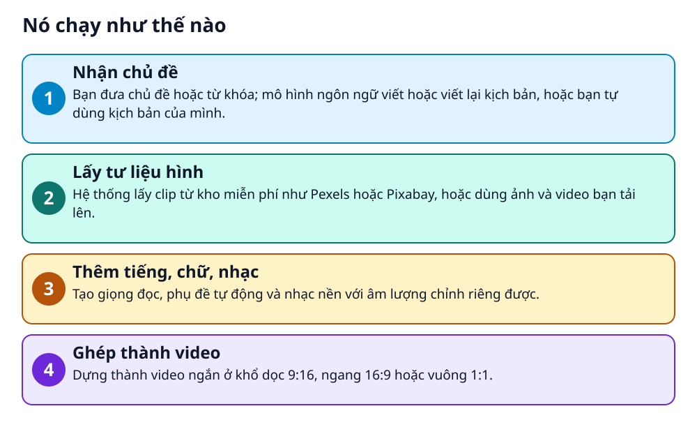

# Tạo video ngắn từ một chủ đề với MoneyPrinterTurbo



> Gõ một chủ đề, máy tự viết kịch bản, đọc lời, thêm phụ đề rồi ghép thành video

**Công cụ mã nguồn mở nhận một chủ đề hoặc từ khóa, rồi tự tạo kịch bản, chọn clip, đọc lời, tạo phụ đề, thêm nhạc nền và ghép thành video ngắn.**

## 🎯 Bạn sẽ làm ra được gì

Một giao diện web chạy trên máy bạn: nhập chủ đề hoặc từ khóa là hệ thống tự tạo kịch bản, chọn clip, đọc lời, tạo phụ đề, thêm nhạc nền và ghép thành video ngắn.

## Vấn đề nó giải quyết

Làm một video ngắn bằng tay đòi hỏi nhiều khâu: viết kịch bản, tìm clip, thu giọng đọc, gõ phụ đề, chọn nhạc rồi dựng. MoneyPrinterTurbo gom các khâu đó thành một quy trình tự động, bạn chỉ cần đưa chủ đề hoặc từ khóa.

> 💡 **Hình dung đời thường:** Giống một xưởng dựng phim nhỏ có sẵn biên kịch, người đọc lời và thợ dựng: bạn chỉ giao đề bài, xưởng làm các khâu còn lại.

## Ai nên xem

- Người làm nội dung muốn tạo nhiều video ngắn từ chủ đề
- Lập trình viên muốn nối việc tạo video vào quy trình tự động qua API hoặc dòng lệnh

## ⚠️ Lưu ý trước khi dùng

- Cần khóa API của dịch vụ mô hình ngôn ngữ và nguồn clip; README không nêu giá, hãy xem điều khoản của từng nhà cung cấp
- Nhạc nền mặc định lấy từ YouTube; README ghi nếu vi phạm bản quyền thì xóa. Hãy tự kiểm tra bản quyền clip, nhạc và font trước khi đăng
- GPU không bắt buộc, nhưng nên có nếu bạn bật faster-whisper hoặc tạo nhiều video

## 🧰 Chuẩn bị trước khi bắt đầu

_Đánh dấu từng mục khi đã có đủ._

- [ ] **Git**: Để chạy lệnh git clone tải mã nguồn về máy.
- [ ] **uv**: Công cụ README khuyên dùng để quản lý Python và thư viện; nó cũng cài giúp Python 3.11.  
  Lấy tại: [uv](https://docs.astral.sh/uv/) _(liên kết lấy từ README)_
- [ ] **Máy tính đủ sức chạy**: Windows 10, macOS 11.0 trở lên hoặc Linux. Tối thiểu CPU 4 nhân, RAM 4 GB; card đồ họa không bắt buộc.
- [ ] **Khóa API của một dịch vụ mô hình ngôn ngữ (LLM)**: Để viết kịch bản. README liệt kê OpenAI, Google Gemini, DeepSeek… và cả Ollama chạy ngay trên máy.  
  Lấy tại: [OpenAI](https://platform.openai.com/api-keys) _(liên kết lấy từ README)_
- [ ] **Khóa API của nguồn clip, ví dụ Pexels (miễn phí)**: Để tự lấy clip nền. README cũng liệt kê Pixabay (miễn phí) và Coverr.  
  Lấy tại: [Pexels（免费）](https://www.pexels.com/api/) _(liên kết lấy từ README)_
- [ ] **Trình duyệt Chrome hoặc Edge**: Nếu trang web mở ra trống, README khuyên đổi sang một trong hai trình duyệt này.

## 🗺️ Lộ trình



## 🪜 Làm theo từng bước

### Bước 1 · Chuẩn bị Git, uv và một cửa sổ terminal

**Mục đích:** Có đủ công cụ để tải mã nguồn và dựng môi trường Python.

1. Cài Git nếu máy chưa có.
2. Cài uv theo hướng dẫn ở trang uv.
3. Mở một cửa sổ terminal (trên Windows dùng CMD hoặc PowerShell).

🔗 Lấy tại: [uv](https://docs.astral.sh/uv/) _(liên kết lấy từ README)_

<sub>Căn cứ: `README`</sub>

### Bước 2 · Tải mã nguồn về máy

**Mục đích:** Lấy toàn bộ dự án về một thư mục trên máy bạn.

1. Đứng ở thư mục bạn muốn chứa dự án. Trên Windows, tránh đường dẫn có chữ Hán, ký tự đặc biệt hoặc dấu cách.
2. Chạy lệnh tải mã nguồn.

_Gõ hoặc dán từng dòng, theo thứ tự._

```bash
git clone https://github.com/harry0703/MoneyPrinterTurbo.git
```

<sub>Căn cứ: `README`</sub>

### Bước 3 · Tạo môi trường Python và cài thư viện

**Mục đích:** Cài đúng phiên bản Python và các thư viện mà dự án cần.

1. Vào thư mục dự án vừa tải.
2. Cài Python 3.11 bằng uv.
3. Cài thư viện theo file khóa; README khuyên mặc định dùng lệnh này.
4. Không dùng uv thì README có cách thay thế bằng `venv + pip` ở mục tạo môi trường ảo.

```bash
cd MoneyPrinterTurbo
uv python install 3.11
uv sync --frozen
```

<sub>Căn cứ: `README`</sub>

### Bước 4 · Khởi động giao diện web trên macOS hoặc Linux

**Mục đích:** Mở giao diện để nhập chủ đề và tạo video. Bỏ qua bước này nếu bạn dùng Windows.

1. Chạy lệnh dưới đây trong thư mục gốc của dự án (README nhấn mạnh phải ở thư mục gốc).
2. Chờ trình duyệt tự mở.

```bash
sh webui.sh
```

✅ **Bạn sẽ thấy:** Trình duyệt tự mở giao diện web của dự án.

🩹 **Nếu không được:** Nếu trang mở ra trống, hãy mở lại bằng Chrome hoặc Edge.

<sub>Căn cứ: `webui.sh`</sub>

### Bước 5 · Khởi động giao diện web trên Windows

**Mục đích:** Mở giao diện để nhập chủ đề và tạo video. Bỏ qua bước này nếu bạn dùng macOS hoặc Linux.

1. Chạy lệnh dưới đây trong thư mục gốc của dự án (PowerShell). Trong CMD bạn có thể chạy `webui.bat`.
2. Chờ trình duyệt tự mở.

```bash
.\webui.bat
```

✅ **Bạn sẽ thấy:** Trình duyệt tự mở giao diện web của dự án.

🩹 **Nếu không được:** Nếu trang mở ra trống, hãy mở lại bằng Chrome hoặc Edge.

<sub>Căn cứ: `webui.bat`</sub>

### Bước 6 · Điền khóa API trong phần cài đặt cơ bản

**Mục đích:** Để hệ thống gọi được dịch vụ viết kịch bản và nguồn clip.

1. Mở phần cài đặt cơ bản của giao diện web.
2. Chọn nhà cung cấp mô hình ngôn ngữ rồi dán khóa API của bạn vào.
3. Dán khóa API của nguồn clip, ví dụ Pexels.
4. Giọng đọc Azure TTS V1 dựa trên Edge TTS, miễn phí và không cần khóa, nên dùng được ngay.

🔗 Lấy tại: [Pexels（免费）](https://www.pexels.com/api/) _(liên kết lấy từ README)_

✅ **Bạn sẽ thấy:** Ở lần chạy đầu, dự án tự tạo file config.toml từ file mẫu config.example.toml, bạn không cần tạo tay.

<sub>Căn cứ: `README`</sub>

### Bước 7 · Tạo video đầu tiên

**Mục đích:** Chạy trọn quy trình từ chủ đề đến video.

1. Nhập chủ đề hoặc từ khóa cho video vào giao diện.
2. Chọn khổ video: dọc 9:16, ngang 16:9 hoặc vuông 1:1.
3. Bắt đầu tạo và chờ hệ thống làm lần lượt: kịch bản, giọng đọc, clip, phụ đề, nhạc nền, ghép video.

✅ **Bạn sẽ thấy:** Một video ngắn hoàn chỉnh có kịch bản, giọng đọc, phụ đề và nhạc nền.

<sub>Căn cứ: `README`</sub>

### Bước 8 · Cách khác: tạo video bằng dòng lệnh, không cần trình duyệt

**Mục đích:** Dùng khi bạn không mở được trình duyệt hoặc muốn chạy tự động.

1. Chạy lệnh đầu trong thư mục dự án. Thay chủ đề trong dấu ngoặc kép bằng chủ đề của bạn.
2. Muốn xem mọi tham số, chạy lệnh thứ hai.

```bash
uv run python cli.py --video-subject "人工智能如何改变日常生活"
uv run python cli.py --help
```

<sub>Căn cứ: `cli.py`</sub>

## ✔️ Kiểm tra kết quả

Bạn thấy giao diện web mở được và tạo ra một video ngắn từ chủ đề bạn nhập, đúng như README mô tả: có kịch bản, giọng đọc, phụ đề và nhạc nền.

## 🩹 Lỗi thường gặp

| Hiện tượng | Cách xử lý | Căn cứ |
|---|---|---|
| Báo lỗi No ffmpeg exe could be found | README nói ffmpeg thường tự tải về. Nếu không được, tải FFmpeg thủ công rồi đặt `ffmpeg_path` trong config.toml trỏ tới file thật, hoặc đặt biến môi trường `IMAGEIO_FFMPEG_EXE`. | `README` |
| Báo lỗi Too many open files | Hệ điều hành giới hạn số tệp được mở. Xem giới hạn bằng `ulimit -n`, rồi nâng lên, ví dụ `ulimit -n 10240`. | `README` |
| Tải mô hình Whisper thất bại | README có hướng dẫn tải mô hình thủ công từ Hugging Face, ở mục tạo phụ đề của README gốc. | `README` |

## 🚀 Làm tiếp

- Muốn môi trường tách biệt, thử chạy bằng Docker: README dùng `docker compose -f docker-compose.release.yml up`.
- Muốn tạo nhiều video một lượt, README nói dòng lệnh có tùy chọn `--batch-file`.

## 🔍 Bên trong nó hoạt động ra sao





1. **Nhận chủ đề**: Bạn đưa chủ đề hoặc từ khóa; mô hình ngôn ngữ viết hoặc viết lại kịch bản, hoặc bạn tự dùng kịch bản của mình. _(Căn cứ: `README`)_
2. **Lấy tư liệu hình**: Hệ thống lấy clip từ kho miễn phí như Pexels hoặc Pixabay, hoặc dùng ảnh và video bạn tải lên. _(Căn cứ: `README`)_
3. **Thêm tiếng, chữ, nhạc**: Tạo giọng đọc, phụ đề tự động và nhạc nền với âm lượng chỉnh riêng được. _(Căn cứ: `README`)_
4. **Ghép thành video**: Dựng thành video ngắn ở khổ dọc 9:16, ngang 16:9 hoặc vuông 1:1. _(Căn cứ: `README`)_

### Các mảnh ghép

| | Các mảnh ghép | Căn cứ |
|---|---|---|
| **Mô hình ngôn ngữ** | Viết hoặc viết lại kịch bản video. | `README` |
| **Nguồn clip** | Cung cấp clip nền: kho miễn phí hoặc tệp của bạn. | `README` |
| **Giọng đọc và phụ đề** | Biến kịch bản thành tiếng và dòng chữ chạy theo tiếng. | `README` |
| **Bộ dựng video** | Ghép clip, giọng, chữ và nhạc thành video; ffmpeg thường tự tải về. | `README` |

## Học được gì từ thiết kế này

- Chia việc lớn thành các khâu độc lập: kịch bản, tư liệu, giọng đọc, phụ đề, nhạc, dựng
- Một lõi xử lý, nhiều cửa vào: giao diện web, API và dòng lệnh
- Cho phép thay từng khâu bằng nhà cung cấp khác hoặc nội dung của chính bạn

## Từ khóa

- **LLM**: Mô hình ngôn ngữ lớn; ở đây dùng để viết kịch bản video.
- **TTS**: Chuyển văn bản thành giọng đọc.
- **Khóa API**: Mã bí mật để dịch vụ nhận ra tài khoản của bạn; hãy giữ kín.

---

Nguồn dữ kiện: [harry0703/MoneyPrinterTurbo](https://github.com/harry0703/MoneyPrinterTurbo) · Giấy phép: MIT · 131.800 sao · Quét ngày 2026-10-16

_Nội dung do AI tóm tắt từ README và cấu trúc repo; hãy đọc repo gốc trước khi dùng._
