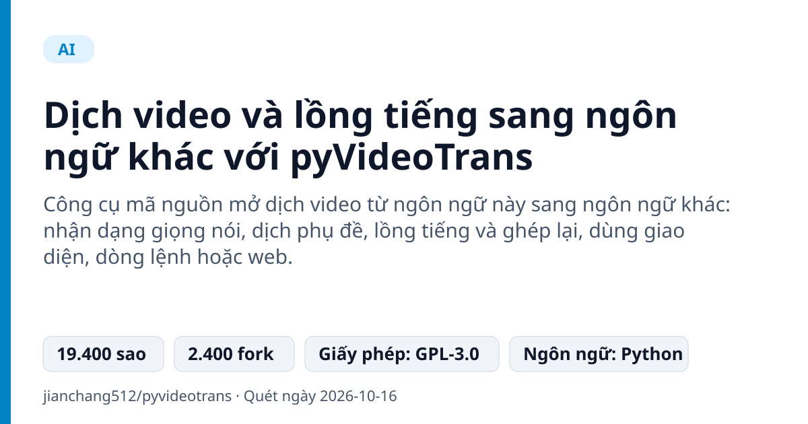
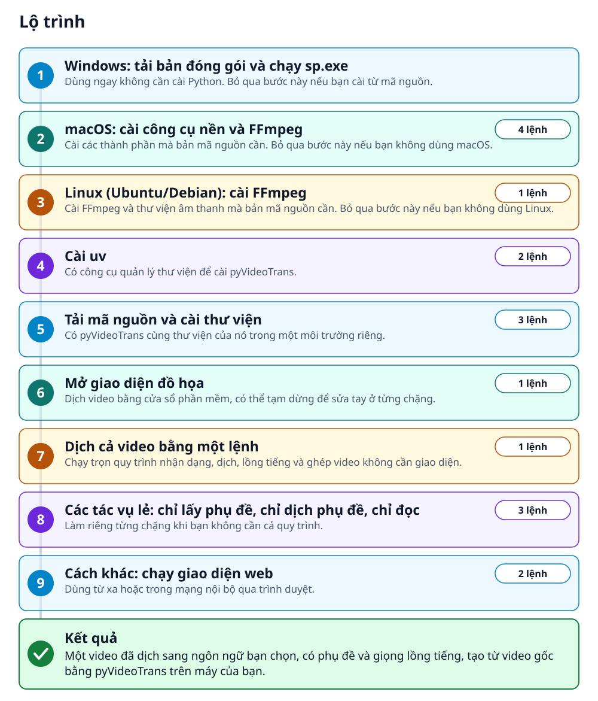
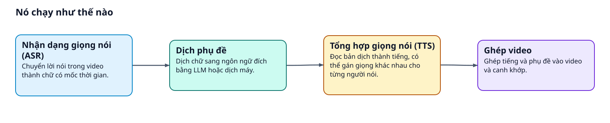
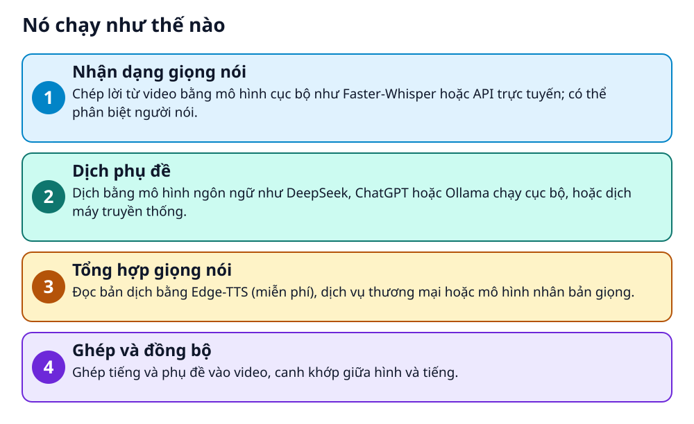

# Dịch video và lồng tiếng sang ngôn ngữ khác với pyVideoTrans



> Một video tiếng này, một lệnh, ra video có phụ đề và giọng đọc tiếng khác

**Công cụ mã nguồn mở dịch video từ ngôn ngữ này sang ngôn ngữ khác: nhận dạng giọng nói, dịch phụ đề, lồng tiếng và ghép lại, dùng giao diện, dòng lệnh hoặc web.**

## 🎯 Bạn sẽ làm ra được gì

Một video đã dịch sang ngôn ngữ bạn chọn, có phụ đề và giọng lồng tiếng, tạo từ video gốc bằng pyVideoTrans trên máy của bạn.

## Vấn đề nó giải quyết

Đưa một video sang ngôn ngữ khác nghĩa là chép lời, dịch, thu giọng rồi canh khớp hình và tiếng. pyVideoTrans nối các bước đó thành một quy trình, chạy được hoàn toàn trên máy bạn hoặc qua các API trực tuyến.

> 💡 **Hình dung đời thường:** Giống một dây chuyền lắp ráp: nguyên liệu là video gốc, qua từng trạm nhận dạng, dịch, đọc và ghép, ra thành phẩm bằng ngôn ngữ mới.

## Ai nên xem

- Người làm nội dung muốn đưa video sang ngôn ngữ khác kèm phụ đề và lồng tiếng
- Người cần chuyển hàng loạt âm thanh hoặc video thành phụ đề SRT

## ⚠️ Lưu ý trước khi dùng

- README nêu người dùng tự chịu trách nhiệm pháp lý khi gọi API bên thứ ba hoặc xử lý video có bản quyền
- Tăng tốc GPU chỉ dùng cho card NVIDIA; bản đóng gói cần CUDA 12.8 và cuDNN 9.11
- Giấy phép là GPL-3.0; hãy đọc điều khoản trước khi phân phối lại phần mềm
- Một số dịch vụ dịch và lồng tiếng là API trực tuyến của bên thứ ba có thể tính phí

## 🧰 Chuẩn bị trước khi bắt đầu

_Đánh dấu từng mục khi đã có đủ._

- [ ] **Windows 10/11 (cách nhanh nhất) hoặc macOS/Linux/Windows cho nhà phát triển**: Bản đóng gói sẵn chạy trên Windows, không cần cấu hình Python. Các hệ khác cài từ mã nguồn.  
  Liên kết trong README: [Click to download the latest pre-packaged version](https://github.com/jianchang512/pyvideotrans/releases)  
  <sub>Căn cứ: `README`</sub>
- [ ] **Python 3.10 (khi cài từ mã nguồn)**: README khuyên dùng bản 3.10.  
  <sub>Căn cứ: `README`</sub>
- [ ] **FFmpeg**: Phải được cài và khai báo trong biến môi trường. Trên Windows, có thể đặt ffmpeg.exe và ffprobe.exe vào thư mục dự án.  
  Liên kết trong README: [Download FFmpeg](https://ffmpeg.org/download.html)  
  <sub>Căn cứ: `README`</sub>
- [ ] **uv (khi cài từ mã nguồn)**: Công cụ quản lý thư viện README khuyên dùng.  
  Liên kết trong README: [uv](https://docs.astral.sh/uv/)  
  <sub>Căn cứ: `README`</sub>
- [ ] **Video cần dịch**: Bạn có quyền xử lý video đó; README nhắc người dùng tự chịu trách nhiệm pháp lý.  
  <sub>Căn cứ: `README`</sub>

## 🗺️ Lộ trình



## 🪜 Làm theo từng bước

### Bước 1 · Cách A, Windows: tải bản đóng gói và chạy sp.exe

**Mục đích:** Dùng ngay không cần cài Python. Chọn cách này thì làm xong bước này rồi xuống phần kiểm tra kết quả: các bước sau là cách B.

1. Tải bản đóng gói mới nhất ở trang phát hành.
2. Giải nén vào đường dẫn không có chữ Hán hay dấu cách, ví dụ `D:\pyVideoTrans`. Đừng chạy trực tiếp trong file nén.
3. Nhấp đúp `sp.exe` trong thư mục vừa giải nén.

🔗 Liên kết trong README: [Click to download the latest pre-packaged version](https://github.com/jianchang512/pyvideotrans/releases)

🩹 **Nếu không được:** Muốn dùng tăng tốc GPU thì README yêu cầu GPU NVIDIA đã cài CUDA 12.8 và cuDNN 9.11.

<sub>Căn cứ: `README`</sub>

### Bước 2 · Cách B, macOS: cài công cụ nền và FFmpeg

**Mục đích:** Cài các thành phần mà bản mã nguồn cần. Chỉ làm khi cài từ mã nguồn trên macOS; bỏ qua nếu dùng bản đóng gói hoặc hệ khác.

1. Chạy lần lượt bốn lệnh dưới đây trong terminal.

_Gõ hoặc dán từng dòng, theo thứ tự._

```bash
brew install libsndfile  git  python@3.10
brew uninstall --ignore-dependencies ffmpeg
brew tap homebrew-ffmpeg/ffmpeg
brew install homebrew-ffmpeg/ffmpeg/ffmpeg
```

<sub>Căn cứ: `README`</sub>

### Bước 3 · Cách B, Linux (Ubuntu/Debian): cài FFmpeg

**Mục đích:** Cài FFmpeg và thư viện âm thanh mà bản mã nguồn cần. Chỉ làm khi cài từ mã nguồn trên Linux; bỏ qua nếu dùng bản đóng gói hoặc hệ khác.

1. Chạy lệnh dưới đây trong terminal.

```bash
sudo apt-get install ffmpeg libsndfile1-dev
```

<sub>Căn cứ: `README`</sub>

### Bước 4 · Cách B: cài uv

**Mục đích:** Có công cụ quản lý thư viện để cài pyVideoTrans từ mã nguồn. Người dùng bản đóng gói bỏ qua bước này.

1. Chạy dòng đầu trên macOS hoặc Linux.
2. Chạy dòng thứ hai trong PowerShell trên Windows.
3. Nếu máy đã có uv thì bỏ qua bước này.

```bash
curl -LsSf https://astral.sh/uv/install.sh | sh
powershell -ExecutionPolicy ByPass -c "irm https://astral.sh/uv/install.ps1 | iex"
```

🔗 Liên kết trong README: [uv](https://docs.astral.sh/uv/)

<sub>Căn cứ: `README`</sub>

### Bước 5 · Cách B: tải mã nguồn và cài thư viện

**Mục đích:** Có pyVideoTrans cùng thư viện của nó trong một môi trường riêng. Người dùng bản đóng gói bỏ qua bước này.

1. Chạy ba lệnh dưới đây lần lượt: tải mã nguồn, vào thư mục dự án, cài thư viện.
2. Mặc định phần Whisper cho .NET và WebUI chưa được cài; README có các lệnh `uv sync --all-extras` và `uv sync --extra webui` nếu bạn cần.

```bash
git clone https://github.com/jianchang512/pyvideotrans.git
cd pyvideotrans
uv sync
```

<sub>Căn cứ: `pyproject.toml`</sub>

### Bước 6 · Cách B: mở giao diện đồ họa

**Mục đích:** Dịch video bằng cửa sổ phần mềm, có thể tạm dừng để sửa tay ở từng chặng. Bản đóng gói đã mở giao diện ở bước đầu, nên bỏ qua bước này.

1. Chạy lệnh dưới đây trong thư mục dự án.
2. README cho biết phần mềm cho phép tạm dừng và hiệu đính thủ công ở các chặng nhận dạng, dịch và lồng tiếng.

```bash
uv run sp.py
```

<sub>Căn cứ: `sp.py`</sub>

### Bước 7 · Cách B: dịch cả video bằng một lệnh

**Mục đích:** Chạy trọn quy trình nhận dạng, dịch, lồng tiếng và ghép video không cần giao diện. Cần bản cài từ mã nguồn.

1. Đặt file video vào thư mục dự án rồi sửa lệnh dưới đây cho khớp với video của bạn.
2. `--name` là đường dẫn video, `--source_language_code` là ngôn ngữ gốc, `--target_language_code` là ngôn ngữ đích, `--voice_role` là giọng đọc.
3. Chạy lệnh trong thư mục dự án. Mọi tham số được liệt kê trong tài liệu dòng lệnh của dự án.

```bash
uv run cli.py --task vtv --name "./video.mp4" --source_language_code zh-cn --target_language_code en --voice_role "en-US-GuyNeural"
```

<sub>Căn cứ: `docs/cli.md`</sub>

### Bước 8 · Cách B: các tác vụ lẻ: chỉ lấy phụ đề, chỉ dịch, chỉ đọc

**Mục đích:** Làm riêng từng chặng khi bạn không cần cả quy trình. Cần bản cài từ mã nguồn.

1. Lệnh đầu chuyển âm thanh thành phụ đề (`stt`).
2. Lệnh thứ hai dịch một file phụ đề (`sts`).
3. Lệnh thứ ba đọc một file phụ đề thành giọng (`tts`).

```bash
uv run cli.py --task stt --name "./audio.wav" --model_name large-v3
uv run cli.py --task sts --name "./subs.srt" --target_language_code en
uv run cli.py --task tts --name "./subs.srt" --voice_role "zh-CN-YunyangNeural"
```

<sub>Căn cứ: `cli.py`</sub>

### Bước 9 · Cách B: chạy giao diện web (tùy chọn)

**Mục đích:** Dùng từ xa hoặc trong mạng nội bộ qua trình duyệt. Cần bản cài từ mã nguồn.

1. Chạy lần lượt hai lệnh dưới đây trong thư mục dự án.

```bash
uv sync --extra webui
uv run webui.py
```

<sub>Căn cứ: `webui.py`</sub>

## ✔️ Kiểm tra kết quả

Bạn mở được phần mềm (giao diện, dòng lệnh hoặc web) và thu về video hoặc phụ đề đã dịch từ file gốc của mình. README nhấn mạnh có thể tạm dừng để hiệu đính ở từng chặng, nên hãy đọc lại phụ đề trước khi dùng.

## 🩹 Lỗi thường gặp

| Hiện tượng | Cách xử lý | Căn cứ |
|---|---|---|
| Bản Windows không chạy hoặc báo lỗi đường dẫn | Giải nén vào thư mục không có chữ Hán hay dấu cách và đừng chạy trực tiếp trong file nén. | `README` |
| Báo thiếu FFmpeg | Cài FFmpeg và khai báo trong biến môi trường. Trên Windows có thể đặt `ffmpeg.exe` và `ffprobe.exe` vào thư mục dự án. | `README` |
| Gặp lỗi khác | README trỏ tới tài liệu hỏi đáp `docs/faq.md` và diễn đàn hỏi đáp trực tuyến, nơi có thể gửi log lỗi để AI phân tích tự động. | `docs/faq.md` |

## 🚀 Làm tiếp

- Thử nhân bản giọng nói: README nhắc tới F5-TTS, CosyVoice và GPT-SoVITS.
- Muốn nhanh hơn trên card NVIDIA, README có mục cài PyTorch hỗ trợ CUDA ở bước tùy chọn thứ năm.

## 🔍 Bên trong nó hoạt động ra sao





1. **Nhận dạng giọng nói**: Chép lời từ video bằng mô hình cục bộ như Faster-Whisper hoặc API trực tuyến; có thể phân biệt người nói. _(Căn cứ: `README`)_
2. **Dịch phụ đề**: Dịch bằng mô hình ngôn ngữ như DeepSeek, ChatGPT hoặc Ollama chạy cục bộ, hoặc dịch máy truyền thống. _(Căn cứ: `README`)_
3. **Tổng hợp giọng nói**: Đọc bản dịch bằng Edge-TTS (miễn phí), dịch vụ thương mại hoặc mô hình nhân bản giọng. _(Căn cứ: `README`)_
4. **Ghép và đồng bộ**: Ghép tiếng và phụ đề vào video, canh khớp giữa hình và tiếng. _(Căn cứ: `README`)_

### Các mảnh ghép

| | Các mảnh ghép | Căn cứ |
|---|---|---|
| **Nhận dạng giọng nói (ASR)** | Chuyển lời nói trong video thành chữ có mốc thời gian. | `README` |
| **Dịch phụ đề** | Dịch chữ sang ngôn ngữ đích bằng LLM hoặc dịch máy. | `README` |
| **Tổng hợp giọng nói (TTS)** | Đọc bản dịch thành tiếng, có thể gán giọng khác nhau cho từng người nói. | `README` |
| **Ghép video** | Ghép tiếng và phụ đề vào video và canh khớp. | `README` |

## Học được gì từ thiết kế này

- Một quy trình nhiều chặng nhưng cho dừng lại sửa tay ở từng chặng để giữ độ chính xác
- Một lõi, ba cửa vào: giao diện đồ họa, dòng lệnh và web
- Cho thay từng chặng bằng mô hình cục bộ hoặc API trực tuyến tùy nhu cầu và ngân sách

## Từ khóa

- **ASR**: Nhận dạng giọng nói tự động: chép lời nói thành chữ.
- **TTS**: Chuyển chữ thành giọng đọc.
- **SRT**: Định dạng tệp phụ đề có mốc thời gian.

---

Nguồn dữ kiện: [jianchang512/pyvideotrans](https://github.com/jianchang512/pyvideotrans) · Giấy phép: GPL-3.0 · 19.400 sao · Quét ngày 2026-10-16

_Nội dung do AI tóm tắt từ README và cấu trúc repo; hãy đọc repo gốc trước khi dùng._
