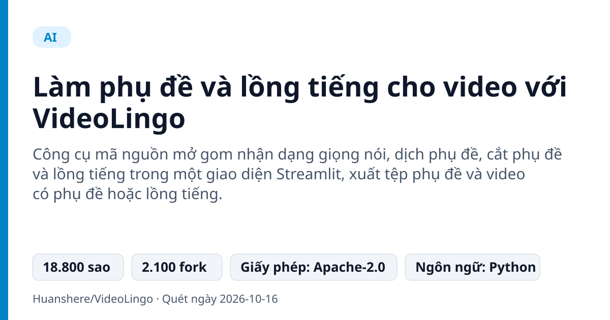
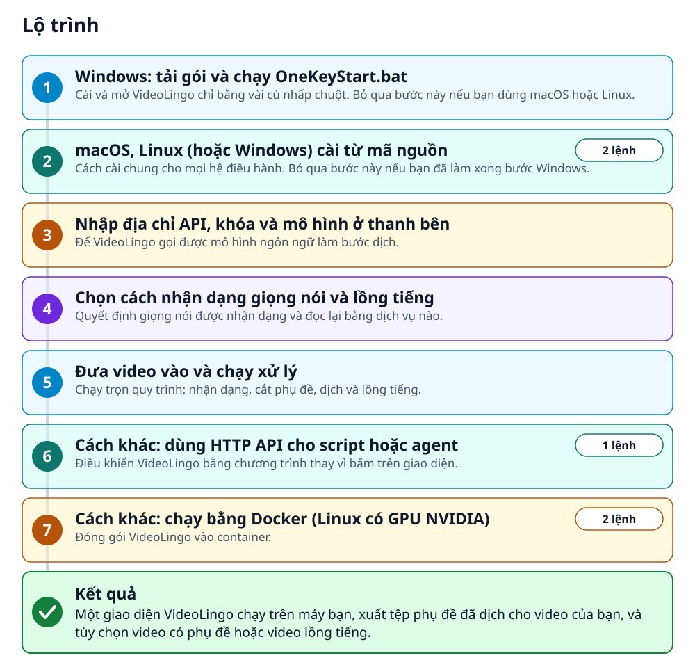
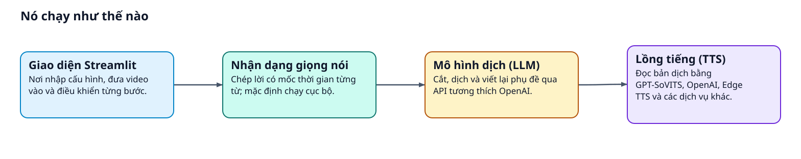
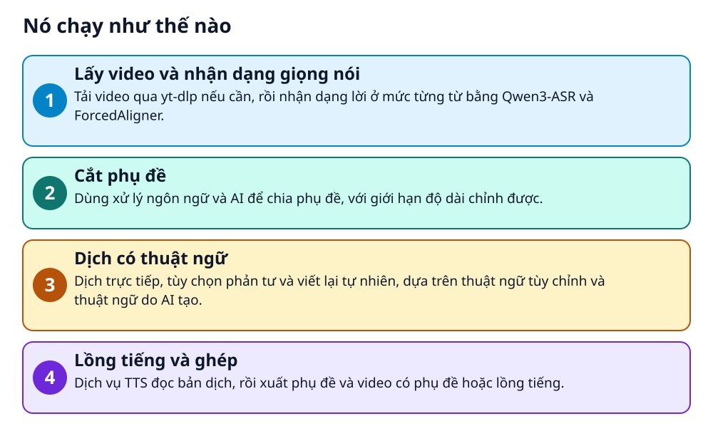

# Làm phụ đề và lồng tiếng cho video với VideoLingo



> Đưa một video vào, nhận phụ đề đã dịch và có thể cả bản lồng tiếng bằng ngôn ngữ khác

**Công cụ mã nguồn mở gom nhận dạng giọng nói, dịch phụ đề, cắt phụ đề và lồng tiếng trong một giao diện Streamlit, xuất tệp phụ đề và video có phụ đề hoặc lồng tiếng.**

## 🎯 Bạn sẽ làm ra được gì

Một giao diện VideoLingo chạy trên máy bạn, xuất tệp phụ đề đã dịch cho video của bạn, và tùy chọn video có phụ đề hoặc video lồng tiếng.

## Vấn đề nó giải quyết

Muốn đưa một video sang ngôn ngữ khác, bạn phải chép lời, cắt phụ đề cho vừa màn hình, dịch cho nhất quán rồi thu lại giọng đọc. VideoLingo nối các bước đó thành một quy trình, có ghi log và chạy tiếp được từ chỗ dừng.

> 💡 **Hình dung đời thường:** Giống một xưởng dịch phim thu nhỏ: có người nghe lời, người chia dòng phụ đề, người dịch và người lồng tiếng, bạn chỉ cần đưa phim vào.

## Ai nên xem

- Người làm nội dung muốn có phụ đề hoặc bản lồng tiếng cho video bằng ngôn ngữ khác
- Người học hoặc dạy ngoại ngữ cần phụ đề hai ngôn ngữ

## ⚠️ Lưu ý trước khi dùng

- Chất lượng bản dịch phụ thuộc âm thanh gốc, ngôn ngữ và mô hình bạn chọn; README tự nhắc phải kiểm tra phụ đề
- Bước lồng tiếng không tự gán giọng riêng cho từng người nói
- Nhận dạng cục bộ dùng một ngôn ngữ chính cho mỗi đoạn; lời nói trộn nhiều ngôn ngữ không được đảm bảo chính xác
- Dịch vụ LLM và một số dịch vụ nhận dạng, lồng tiếng là của bên thứ ba và có thể tính phí

## 🧰 Chuẩn bị trước khi bắt đầu

_Đánh dấu từng mục khi đã có đủ._

- [ ] **Windows, macOS hoặc Linux**: README nói hỗ trợ cả ba; macOS dùng được cả Apple Silicon lẫn Intel.
- [ ] **Kết nối Internet**: Lần chạy đầu tự tải và cài uv, Python 3.12, thư viện và FFmpeg nên cần mạng.
- [ ] **Một dịch vụ LLM tương thích OpenAI Chat Completions**: Cần địa chỉ API, khóa và tên mô hình trả được JSON có cấu trúc. README gợi ý OpenLux và liệt kê sẵn mã mô hình đề xuất.  
  Liên kết trong README: [api.openlux.ai](https://api.openlux.ai/v1)
- [ ] **Git và uv (khi cài từ mã nguồn)**: README không hướng dẫn cài hai công cụ này. Trên Windows, OneKeyStart.bat tự cài uv nên bạn không cần làm tay.
- [ ] **Video cần xử lý**: README nói công cụ có thể tải video YouTube bằng yt-dlp.

## 🗺️ Lộ trình



## 🪜 Làm theo từng bước

### Bước 1 · Windows: tải gói và chạy OneKeyStart.bat

**Mục đích:** Cài và mở VideoLingo chỉ bằng vài cú nhấp chuột. Bỏ qua bước này nếu bạn dùng macOS hoặc Linux.

1. Tải Source code (zip) ở bản Release mới nhất, giải nén ra Desktop hoặc thư mục khác rồi mở thư mục đó.
2. Nhấp đúp `OneKeyStart.bat` và giữ cửa sổ mở. Lần đầu nó tự cài uv, Python 3.12, thư viện và FFmpeg.

🔗 Liên kết trong README: [latest Release](https://github.com/Huanshere/VideoLingo/releases/latest)

✅ **Bạn sẽ thấy:** Cài xong, VideoLingo tự mở trên trình duyệt.

<sub>Căn cứ: `OneKeyStart.bat`</sub>

### Bước 2 · macOS, Linux (hoặc Windows) cài từ mã nguồn

**Mục đích:** Cách cài chung cho mọi hệ điều hành. Bỏ qua bước này nếu bạn đã làm xong bước Windows.

1. Cài Git và uv nếu máy chưa có: README không nêu cách cài, hãy dùng trang chính thức của từng công cụ.
2. Chạy lệnh đầu để tải mã nguồn và vào thư mục dự án.
3. Chạy lệnh thứ hai để cài thư viện còn thiếu và khởi động.
4. Lần sau muốn mở lại, chạy `uv run start.py` trong thư mục VideoLingo.

_Gõ hoặc dán từng dòng, theo thứ tự._

```bash
git clone https://github.com/Huanshere/VideoLingo.git && cd VideoLingo
uv run start.py
```

🩹 **Nếu không được:** README chỉ nói bản Windows tự mở trình duyệt, không nêu giao diện mở ở địa chỉ nào sau lệnh này; nếu không thấy, hãy xem thông báo trong terminal.

<sub>Căn cứ: `start.py`</sub>

### Bước 3 · Nhập địa chỉ API, khóa và mô hình ở thanh bên

**Mục đích:** Để VideoLingo gọi được mô hình ngôn ngữ làm bước dịch.

1. Trên giao diện, nhìn sang thanh bên (sidebar).
2. Nhập địa chỉ API, khóa và tên mô hình của dịch vụ LLM bạn chọn: dịch vụ tương thích OpenAI Chat Completions nào cũng được.
3. README gợi ý OpenLux; địa chỉ API của nó ở liên kết dưới. Mã mô hình README nêu: `gpt-6-luna` (hợp giá), `gpt-6-sol` (chất lượng tốt hơn), `claude-opus-5-5` (chất lượng cao nhất).

🔗 Liên kết trong README: [api.openlux.ai](https://api.openlux.ai/v1)

<sub>Căn cứ: `README`</sub>

### Bước 4 · Chọn cách nhận dạng giọng nói và lồng tiếng

**Mục đích:** Quyết định giọng nói được nhận dạng và đọc lại bằng dịch vụ nào.

1. Nhận dạng giọng nói: mặc định chạy cục bộ bằng Qwen3-ASR cùng ForcedAligner. Bạn có thể chọn ElevenLabs hoặc MAI-Transcribe-2 ở thanh bên; âm thanh khi đó được gửi tới nhà cung cấp và có thể tính phí.
2. Lồng tiếng: README liệt kê OpenAI, Fish Audio, SiliconFlow, GPT-SoVITS, Edge TTS và F5-TTS.

<sub>Căn cứ: `README`</sub>

### Bước 5 · Đưa video vào và chạy xử lý

**Mục đích:** Chạy trọn quy trình: nhận dạng, cắt phụ đề, dịch và lồng tiếng.

1. Thêm video cần xử lý vào giao diện (README nói có thể tải video YouTube).
2. Chạy các bước xử lý. Bạn có thể tạm dừng, tiếp tục hoặc dừng ở bất kỳ bước nào.
3. Mở kết quả: tệp phụ đề, và video có phụ đề hoặc lồng tiếng nếu bạn chọn. README nhắc thư mục `output/` khi nói về quy trình và log.

🩹 **Nếu không được:** README không mô tả từng nút trên màn hình; xem tài liệu bắt đầu nhanh trong thư mục docs của dự án.

<sub>Căn cứ: `docs`</sub>

### Bước 6 · Cách khác: dùng HTTP API cho script hoặc agent

**Mục đích:** Điều khiển VideoLingo bằng chương trình thay vì bấm trên giao diện.

1. Cấu hình file `config.yaml` rồi chạy lệnh dưới đây từ thư mục gốc dự án; lần đầu nó cài thêm thư viện còn thiếu.
2. Xem tài liệu tương tác của các điểm cuối ở địa chỉ bên dưới.

```bash
uv run start.py --api
```

🔗 Mở địa chỉ: `http://localhost:8000/docs`

<sub>Căn cứ: `api.py`</sub>

### Bước 7 · Cách khác: chạy bằng Docker (Linux có GPU NVIDIA)

**Mục đích:** Đóng gói VideoLingo vào container.

1. Cài Docker, trình điều khiển GPU tương thích và NVIDIA Container Toolkit (liên kết bên dưới).
2. Chạy lệnh dựng image, rồi lệnh chạy container.
3. Lệnh chạy mở cổng 8501 ra máy bạn (`-p 8501:8501`); hãy mở trình duyệt vào cổng đó.

```bash
docker build -t videolingo .
docker run -d -p 8501:8501 --gpus all videolingo
```

🔗 Liên kết trong README: [NVIDIA Container Toolkit](https://docs.nvidia.com/datacenter/cloud-native/container-toolkit/latest/install-guide.html)

<sub>Căn cứ: `Dockerfile`</sub>

## ✔️ Kiểm tra kết quả

Bạn mở được giao diện VideoLingo và lấy được tệp phụ đề đã dịch cho video của mình. README nhắc hãy kiểm tra lại phụ đề, vì chất lượng phụ thuộc âm thanh gốc, ngôn ngữ và mô hình bạn chọn.

## 🩹 Lỗi thường gặp

| Hiện tượng | Cách xử lý | Căn cứ |
|---|---|---|
| Một bước dùng LLM bị lỗi | Xem `output/gpt_log/error.json`. Kết quả đã thành công được dùng lại khi chạy lại, nên đừng xóa toàn bộ thư mục output ngay từ đầu. | `README` |
| Phụ đề nhận dạng sai hoặc lệch thời gian | Tạp âm nền và mô hình căn chỉnh theo ngôn ngữ ảnh hưởng kết quả; README nói tách giọng nói có thể giúp. Số và ký hiệu có thể thiếu mốc thời gian đáng tin, hãy kiểm tra phụ đề. | `README` |
| Giọng lồng tiếng nghe không tự nhiên hoặc lệch khớp | Chất lượng và thời lượng phụ thuộc bản dịch, dịch vụ TTS và tốc độ nói; README cho biết chỉnh tốc độ không đảm bảo tự nhiên hay khớp hoàn hảo. | `README` |

## 🚀 Làm tiếp

- Thử thuật ngữ tùy chỉnh để bản dịch nhất quán hơn: README nói công cụ kết hợp thuật ngữ của bạn với thuật ngữ do AI tạo.
- Thử các giọng lồng tiếng khác như GPT-SoVITS hoặc Edge TTS để so sánh.

## 🔍 Bên trong nó hoạt động ra sao





1. **Lấy video và nhận dạng giọng nói**: Tải video qua yt-dlp nếu cần, rồi nhận dạng lời ở mức từng từ bằng Qwen3-ASR và ForcedAligner. _(Căn cứ: `README`)_
2. **Cắt phụ đề**: Dùng xử lý ngôn ngữ và AI để chia phụ đề, với giới hạn độ dài chỉnh được. _(Căn cứ: `README`)_
3. **Dịch có thuật ngữ**: Dịch trực tiếp, tùy chọn phản tư và viết lại tự nhiên, dựa trên thuật ngữ tùy chỉnh và thuật ngữ do AI tạo. _(Căn cứ: `README`)_
4. **Lồng tiếng và ghép**: Dịch vụ TTS đọc bản dịch, rồi xuất phụ đề và video có phụ đề hoặc lồng tiếng. _(Căn cứ: `README`)_

### Các mảnh ghép

| | Các mảnh ghép | Căn cứ |
|---|---|---|
| **Giao diện Streamlit** | Nơi nhập cấu hình, đưa video vào và điều khiển từng bước. | `README` |
| **Nhận dạng giọng nói** | Chép lời có mốc thời gian từng từ; mặc định chạy cục bộ. | `README` |
| **Mô hình dịch (LLM)** | Cắt, dịch và viết lại phụ đề qua API tương thích OpenAI. | `README` |
| **Lồng tiếng (TTS)** | Đọc bản dịch bằng GPT-SoVITS, OpenAI, Edge TTS và các dịch vụ khác. | `README` |

## Học được gì từ thiết kế này

- Chia việc khó thành các chặng nối tiếp: nhận dạng, cắt, dịch, lồng tiếng
- Kết hợp thuật ngữ do người dùng đặt với thuật ngữ do AI tạo để bản dịch nhất quán
- Ghi log chi tiết và cho chạy tiếp từ chỗ dừng, dùng lại kết quả đã thành công
- Để mỗi khâu (nhận dạng, dịch, lồng tiếng) thay được bằng nhà cung cấp khác

## Từ khóa

- **ASR**: Nhận dạng giọng nói tự động: chép lời nói thành chữ.
- **TTS**: Chuyển chữ thành giọng đọc.
- **Streamlit**: Thư viện Python dựng giao diện web đơn giản.

---

Nguồn dữ kiện: [Huanshere/VideoLingo](https://github.com/Huanshere/VideoLingo) · Giấy phép: Apache-2.0 · 18.800 sao · Quét ngày 2026-10-16

_Nội dung do AI tóm tắt từ README và cấu trúc repo; hãy đọc repo gốc trước khi dùng._
