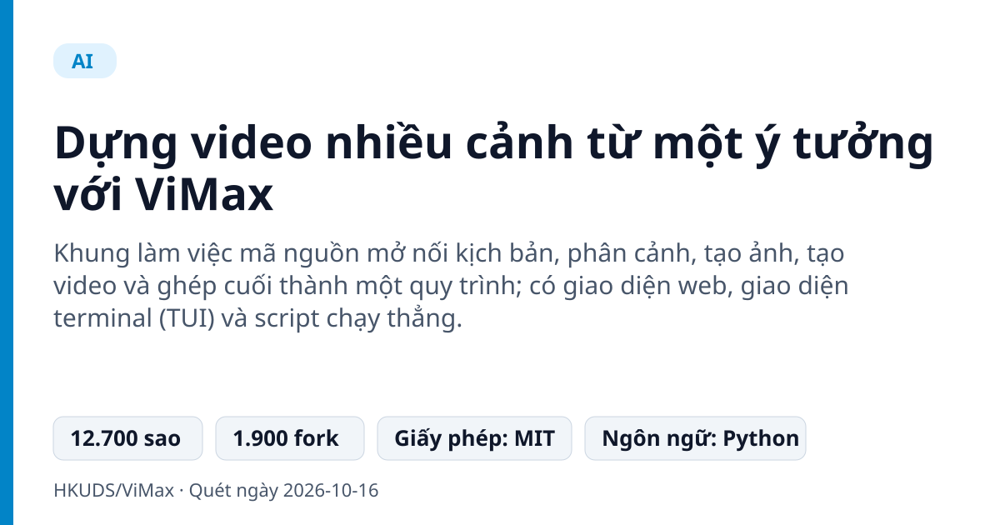
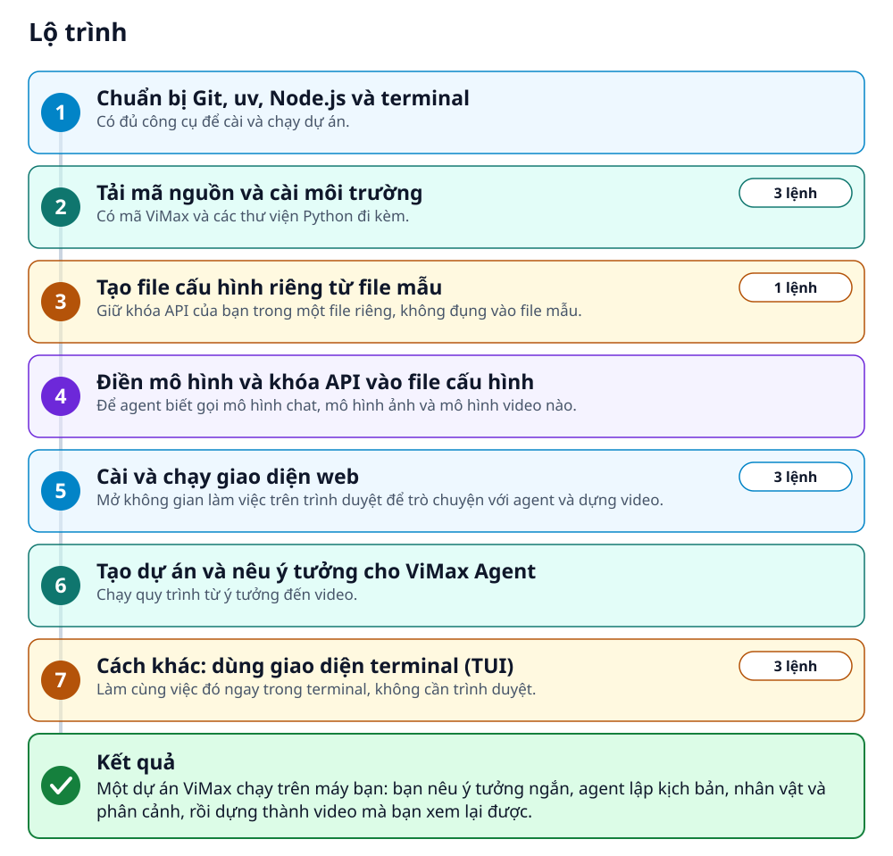
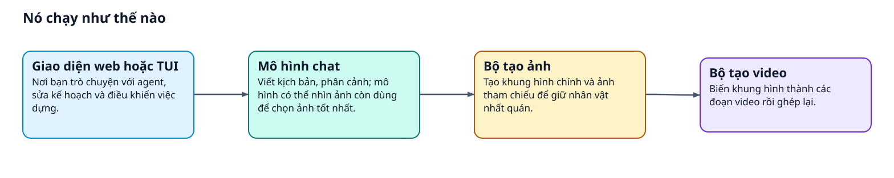
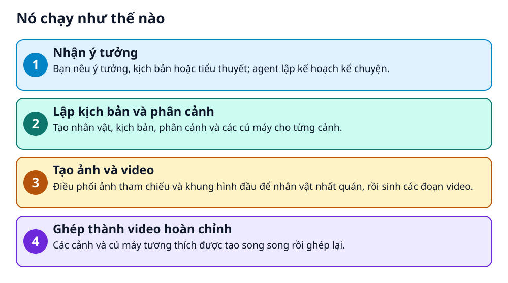

# Dựng video nhiều cảnh từ một ý tưởng với ViMax



> Bạn nêu ý tưởng, nhóm agent AI lo kịch bản, phân cảnh, nhân vật rồi dựng thành video

**Khung làm việc mã nguồn mở nối kịch bản, phân cảnh, tạo ảnh, tạo video và ghép cuối thành một quy trình; có giao diện web, giao diện terminal (TUI) và script chạy thẳng.**

## 🎯 Bạn sẽ làm ra được gì

Một dự án ViMax chạy trên máy bạn: bạn nêu ý tưởng ngắn, agent lập kịch bản, nhân vật và phân cảnh, rồi dựng thành video mà bạn xem lại được.

## Vấn đề nó giải quyết

Nhiều công cụ AI chỉ tạo vài giây hình, nhân vật dễ thay đổi giữa các khung và thiếu kịch bản, âm thanh, cấu trúc kể chuyện. ViMax điều phối cả chuỗi: viết kịch bản, phân cảnh, tạo nhân vật rồi dựng video.

> 💡 **Hình dung đời thường:** Giống một đoàn làm phim thu nhỏ: biên kịch, người vẽ phân cảnh, đạo diễn và nhà sản xuất đều là AI, còn bạn chỉ nêu ý tưởng.

## Ai nên xem

- Người muốn thử dựng video nhiều cảnh từ ý tưởng hoặc kịch bản
- Lập trình viên nghiên cứu hệ thống nhiều agent cho sản xuất nội dung

## ⚠️ Lưu ý trước khi dùng

- Cần khóa API cho mô hình chat, mô hình ảnh và mô hình video; chi phí tùy nhà cung cấp, README không nêu giá
- README chỉ ghi Linux và Windows làm môi trường; macOS không được nhắc đến
- Chọn ảnh khung hình chính tạo 2 ứng viên cùng lúc, README ghi cách này có thể làm chi phí API cao hơn
- README không mô tả từng nút trên giao diện web, nên hướng dẫn chỉ nêu những khả năng README liệt kê

## 🧰 Chuẩn bị trước khi bắt đầu

_Đánh dấu từng mục khi đã có đủ._

- [ ] **Hệ điều hành Linux hoặc Windows**: README ghi môi trường là Linux và Windows.
- [ ] **Git**: Để chạy lệnh git clone tải mã nguồn.
- [ ] **uv**: Công cụ README dùng để quản lý môi trường Python.  
  Lấy tại: [docs.astral.sh](https://docs.astral.sh/uv/getting-started/installation/) _(liên kết lấy từ README)_
- [ ] **Node.js 18 trở lên**: Cần cho giao diện web. Không dùng giao diện web thì có thể bỏ qua.
- [ ] **Khóa API cho ba loại mô hình: chat, tạo ảnh, tạo video**: Ví dụ trong README dùng OpenRouter cho mô hình chat, Nanobanana (Google API) cho ảnh và Veo (Google API) cho video.

## 🗺️ Lộ trình



## 🪜 Làm theo từng bước

### Bước 1 · Chuẩn bị Git, uv, Node.js và terminal

**Mục đích:** Có đủ công cụ để cài và chạy dự án.

1. Cài Git nếu máy chưa có.
2. Cài uv theo hướng dẫn cài đặt của uv.
3. Cài Node.js phiên bản 18 trở lên để dùng giao diện web.
4. Mở một cửa sổ terminal.

🔗 Lấy tại: [docs.astral.sh](https://docs.astral.sh/uv/getting-started/installation/) _(liên kết lấy từ README)_

<sub>Căn cứ: `README`</sub>

### Bước 2 · Tải mã nguồn và cài môi trường

**Mục đích:** Có mã ViMax và các thư viện Python đi kèm.

1. Chạy ba lệnh dưới đây lần lượt: tải mã nguồn, vào thư mục dự án, cài thư viện bằng uv.

_Gõ hoặc dán từng dòng, theo thứ tự._

```bash
git clone https://github.com/HKUDS/ViMax.git
cd ViMax
uv sync
```

<sub>Căn cứ: `README`</sub>

### Bước 3 · Tạo file cấu hình riêng từ file mẫu

**Mục đích:** Giữ khóa API của bạn trong một file riêng, không đụng vào file mẫu.

1. Chạy lệnh sao chép file mẫu thành file cấu hình cục bộ.

```bash
cp configs/agent.example.yaml configs/agent.local.yaml
```

<sub>Căn cứ: `configs`</sub>

### Bước 4 · Điền mô hình và khóa API vào file cấu hình

**Mục đích:** Để agent biết gọi mô hình chat, mô hình ảnh và mô hình video nào.

1. Mở file `configs/agent.local.yaml` bằng trình soạn thảo.
2. Điền ba nhóm `llm`, `image` và `video`; mỗi nhóm có `model`, `base_url` và `api_key` (nhóm `llm` còn có `model_provider`).
3. Thay các chỗ giữ chỗ trong dấu < > bằng giá trị thật của bạn.
4. Cách khác: để file trống và đặt khóa bằng biến môi trường `VIMAX_LLM_API_KEY`, `VIMAX_IMAGE_API_KEY`, `VIMAX_VIDEO_API_KEY`.

<sub>Căn cứ: `README`</sub>

### Bước 5 · Cài và chạy giao diện web

**Mục đích:** Mở không gian làm việc trên trình duyệt để trò chuyện với agent và dựng video.

1. Chạy ba lệnh dưới đây lần lượt, bắt đầu từ thư mục gốc ViMax: vào thư mục web, cài thư viện giao diện, khởi động máy chủ.
2. Mở địa chỉ bên dưới trong trình duyệt.

```bash
cd web
npm install
npm run dev
```

🔗 Mở địa chỉ: `http://127.0.0.1:4173`

✅ **Bạn sẽ thấy:** Giao diện web của ViMax mở được trên trình duyệt ở địa chỉ trên.

<sub>Căn cứ: `web`</sub>

### Bước 6 · Tạo dự án và nêu ý tưởng cho ViMax Agent

**Mục đích:** Chạy quy trình từ ý tưởng đến video.

1. Tạo một dự án có tên trong giao diện web.
2. Trò chuyện với ViMax Agent. README liệt kê hai cách bắt đầu: từ một ý tưởng ngắn (Idea2Video) hoặc từ kịch bản có sẵn (Script2Video).
3. Xem lại các sản phẩm trung gian như kịch bản, nhân vật và bản xem trước phân cảnh, rồi sửa kế hoạch nếu cần.
4. Cho phép dựng và xem bản xem trước video.

<sub>Căn cứ: `README`</sub>

### Bước 7 · Cách khác: dùng giao diện terminal (TUI)

**Mục đích:** Làm cùng việc đó ngay trong terminal, không cần trình duyệt.

1. Chạy lệnh đầu từ thư mục gốc ViMax để mở TUI.
2. Lệnh thứ hai bắt đầu phiên mới, lệnh thứ ba tiếp tục phiên gần nhất.

```bash
vimax tui
vimax tui new
vimax tui resume
```

<sub>Căn cứ: `README`</sub>

## ✔️ Kiểm tra kết quả

Bạn mở được giao diện web, tạo được một dự án và agent trả về kế hoạch cùng bản xem trước. README không mô tả từng nút trên màn hình, nên hãy làm theo gợi ý ngay trong giao diện.

## 🩹 Lỗi thường gặp

| Hiện tượng | Cách xử lý | Căn cứ |
|---|---|---|
| Chạy ViMax trên máy chủ từ xa nên không mở được địa chỉ trên máy bạn | Chuyển tiếp cổng từ máy của bạn bằng lệnh `ssh -N -L 4173:127.0.0.1:4173 <user>@<server>` rồi mở địa chỉ như bình thường. | `README` |
| Cần đổi cổng giao diện web | Đặt biến `VIMAX_WEB_PORT` khi chạy, ví dụ `VIMAX_WEB_PORT=4174 npm run dev`. | `README` |

## 🚀 Làm tiếp

- Muốn tiết kiệm chi phí API, README cho biết việc chọn ảnh khung hình chính có thể tắt bằng cách đặt `num_candidates` bằng 1.
- Thử chế độ Script2Video với kịch bản của bạn, hoặc chế độ AutoCameo đưa người hoặc thú cưng từ một ảnh vào truyện.

## 🔍 Bên trong nó hoạt động ra sao





1. **Nhận ý tưởng**: Bạn nêu ý tưởng, kịch bản hoặc tiểu thuyết; agent lập kế hoạch kể chuyện. _(Căn cứ: `README`)_
2. **Lập kịch bản và phân cảnh**: Tạo nhân vật, kịch bản, phân cảnh và các cú máy cho từng cảnh. _(Căn cứ: `README`)_
3. **Tạo ảnh và video**: Điều phối ảnh tham chiếu và khung hình đầu để nhân vật nhất quán, rồi sinh các đoạn video. _(Căn cứ: `README`)_
4. **Ghép thành video hoàn chỉnh**: Các cảnh và cú máy tương thích được tạo song song rồi ghép lại. _(Căn cứ: `README`)_

### Các mảnh ghép

| | Các mảnh ghép | Căn cứ |
|---|---|---|
| **Giao diện web hoặc TUI** | Nơi bạn trò chuyện với agent, sửa kế hoạch và điều khiển việc dựng. | `web` |
| **Mô hình chat** | Viết kịch bản, phân cảnh; mô hình có thể nhìn ảnh còn dùng để chọn ảnh tốt nhất. | `README` |
| **Bộ tạo ảnh** | Tạo khung hình chính và ảnh tham chiếu để giữ nhân vật nhất quán. | `README` |
| **Bộ tạo video** | Biến khung hình thành các đoạn video rồi ghép lại. | `README` |

## Học được gì từ thiết kế này

- Chia việc làm phim thành các vai nối tiếp nhau: biên kịch, phân cảnh, tạo ảnh, tạo video, ghép
- Giữ nhân vật nhất quán bằng ảnh tham chiếu, khung hình đầu và liên tục máy quay
- Một lõi, nhiều cửa vào: giao diện web, TUI và các script chạy thẳng
- Tạo nhiều ứng viên song song rồi nhờ mô hình chọn: đổi thêm chi phí lấy chất lượng

## Từ khóa

- **TUI**: Giao diện chạy ngay trong terminal, dùng bàn phím.
- **Storyboard**: Bảng phân cảnh: các khung hình phác thảo từng cảnh trước khi dựng.
- **Render**: Bước dựng ra tệp video cuối.

---

Nguồn dữ kiện: [HKUDS/ViMax](https://github.com/HKUDS/ViMax) · Giấy phép: MIT · 12.700 sao · Quét ngày 2026-10-16

_Nội dung do AI tóm tắt từ README và cấu trúc repo; hãy đọc repo gốc trước khi dùng._
