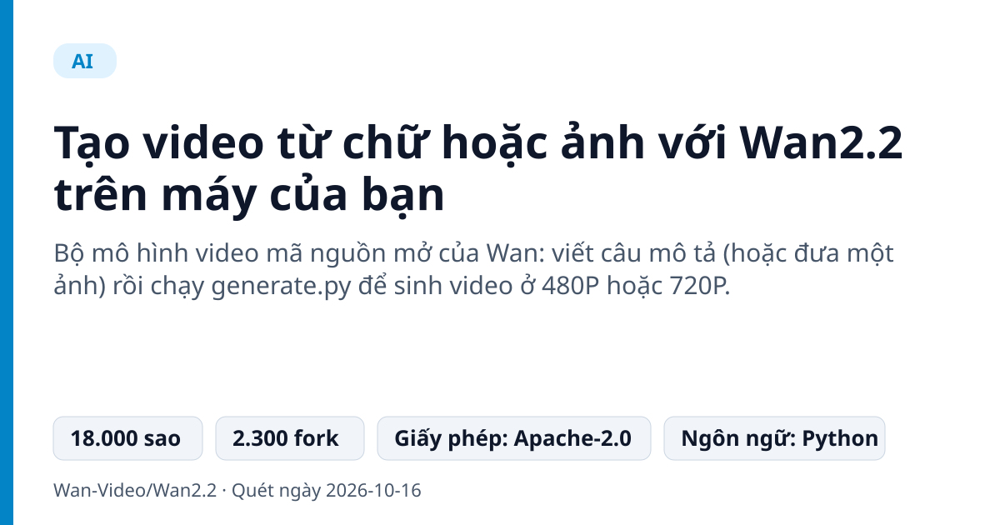
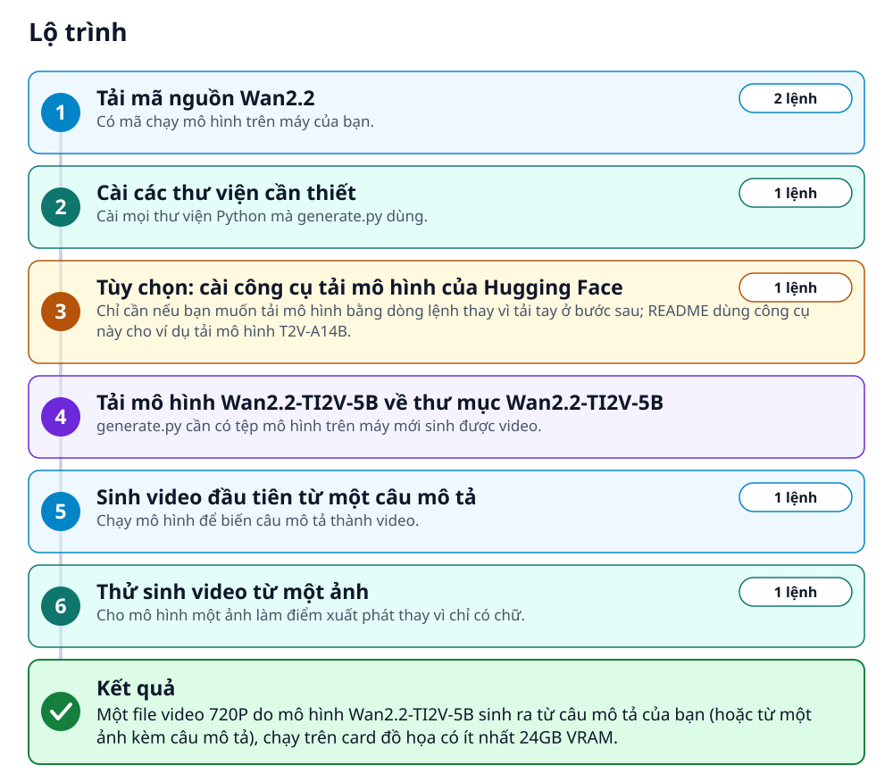
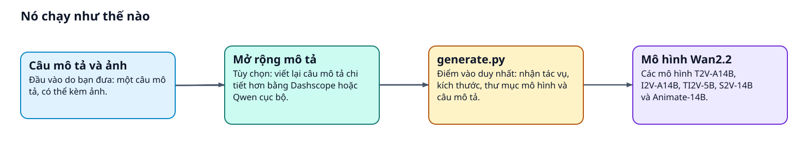
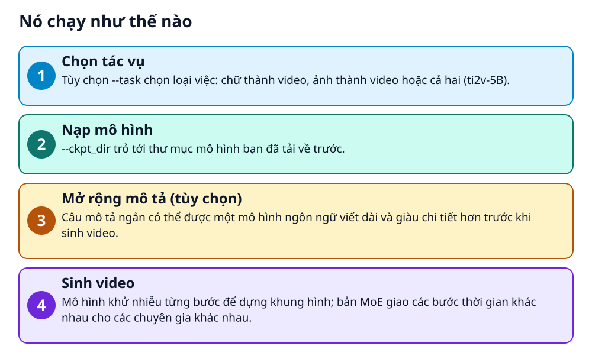

# Tạo video từ chữ hoặc ảnh với Wan2.2 trên máy của bạn



> Một dòng lệnh biến câu mô tả thành video 720P, chạy ngay trên card đồ họa của bạn

**Bộ mô hình video mã nguồn mở của Wan: viết câu mô tả (hoặc đưa một ảnh) rồi chạy generate.py để sinh video ở 480P hoặc 720P.**

## 🎯 Bạn sẽ làm ra được gì

Một file video 720P do mô hình Wan2.2-TI2V-5B sinh ra từ câu mô tả của bạn (hoặc từ một ảnh kèm câu mô tả), chạy trên card đồ họa có ít nhất 24GB VRAM.

## Vấn đề nó giải quyết

Các dịch vụ tạo video AI thường là dịch vụ trả phí chạy trên máy chủ của hãng. Wan2.2 cho bạn tải mô hình về và tự chạy bằng một lệnh, nên bạn kiểm soát cả mô tả lẫn dữ liệu đầu vào.

> 💡 **Hình dung đời thường:** Giống tự rang cà phê tại nhà thay vì mua ly ở quán: cần máy xịn (card đồ họa lớn) nhưng bạn tự chọn hạt, tự chỉnh công thức.

## Ai nên xem

- Người có card đồ họa lớn muốn tự chạy mô hình tạo video trên máy
- Lập trình viên muốn thử các mô hình video mở để tích hợp hoặc nghiên cứu

## ⚠️ Lưu ý trước khi dùng

- Cần card đồ họa lớn: lệnh T2V-A14B một GPU cần ít nhất 80GB VRAM, lệnh TI2V-5B cần ít nhất 24GB
- README chỉ ví dụ tải mô hình T2V-A14B; các mô hình khác tải theo cùng cách, đổi tên theo bảng mô hình
- README không nêu dung lượng tệp mô hình hay thời gian chạy; hãy chuẩn bị dư chỗ và thời gian

## 🧰 Chuẩn bị trước khi bắt đầu

_Đánh dấu từng mục khi đã có đủ._

- [ ] **Card đồ họa (GPU) có ít nhất 24GB VRAM**: README ghi lệnh mô hình TI2V-5B chạy được trên GPU 24GB, ví dụ RTX 4090. Lệnh mô hình T2V-A14B trên một GPU cần ít nhất 80GB.  
  <sub>Căn cứ: `README`</sub>
- [ ] **Python, pip và PyTorch từ bản 2.4.0 trở lên**: README dặn đảm bảo torch >= 2.4.0 trước khi cài thư viện.  
  <sub>Căn cứ: `requirements.txt`</sub>
- [ ] **Git**: Để chạy lệnh git clone tải mã nguồn.  
  <sub>Căn cứ: `README`</sub>
- [ ] **Chỗ trống ổ đĩa cho tệp mô hình**: README không nêu dung lượng cụ thể; mô hình tải về thư mục riêng, hãy chuẩn bị dư chỗ.  
  Liên kết trong README: [Huggingface](https://huggingface.co/Wan-AI/Wan2.2-TI2V-5B)  
  <sub>Căn cứ: `README`</sub>

## 🗺️ Lộ trình



## 🪜 Làm theo từng bước

### Bước 1 · Tải mã nguồn Wan2.2

**Mục đích:** Có mã chạy mô hình trên máy của bạn.

1. Mở terminal.
2. Chạy hai lệnh dưới đây: tải mã nguồn, rồi vào thư mục dự án.

_Gõ hoặc dán từng dòng, theo thứ tự._

```bash
git clone https://github.com/Wan-Video/Wan2.2.git
cd Wan2.2
```

<sub>Căn cứ: `README`</sub>

### Bước 2 · Cài các thư viện cần thiết

**Mục đích:** Cài mọi thư viện Python mà generate.py dùng.

1. Chắc chắn torch đã từ bản 2.4.0 trở lên.
2. Chạy lệnh cài thư viện.

```bash
pip install -r requirements.txt
```

🩹 **Nếu không được:** Nếu cài flash_attn bị lỗi, cài các gói khác trước và cài flash_attn sau cùng.

<sub>Căn cứ: `requirements.txt`</sub>

### Bước 3 · Tùy chọn: cài công cụ tải mô hình của Hugging Face

**Mục đích:** Chỉ cần nếu bạn muốn tải mô hình bằng dòng lệnh thay vì tải tay ở bước sau; README dùng công cụ này cho ví dụ tải mô hình T2V-A14B.

1. Bỏ qua bước này nếu bạn tải tay ở bước sau.
2. Chạy lệnh cài công cụ.

```bash
pip install "huggingface_hub[cli]"
```

<sub>Căn cứ: `README`</sub>

### Bước 4 · Tải mô hình Wan2.2-TI2V-5B về thư mục Wan2.2-TI2V-5B

**Mục đích:** generate.py cần có tệp mô hình trên máy mới sinh được video.

1. README chỉ có lệnh tải cho mô hình T2V-A14B (mô hình lớn hơn nhiều, đừng tải nhầm) và không có lệnh cho TI2V-5B, nên bước này không có khối lệnh.
2. Mở trang mô hình TI2V-5B ở liên kết dưới đây, lấy từ bảng mô hình của README, và tải các tệp của trang về một thư mục tên Wan2.2-TI2V-5B nằm trong thư mục Wan2.2.
3. Tên thư mục phải đúng như vậy, vì lệnh ở bước sau trỏ tới ./Wan2.2-TI2V-5B. Nếu Hugging Face khó truy cập, bảng mô hình của README còn có trang ModelScope.

🔗 Liên kết trong README: [Huggingface](https://huggingface.co/Wan-AI/Wan2.2-TI2V-5B)

✅ **Bạn sẽ thấy:** Thư mục Wan2.2-TI2V-5B trong thư mục Wan2.2 chứa các tệp mô hình đã tải từ trang mô hình.

<sub>Căn cứ: `README`</sub>

### Bước 5 · Sinh video đầu tiên từ một câu mô tả

**Mục đích:** Chạy mô hình để biến câu mô tả thành video.

1. Chạy lệnh dưới đây trong thư mục Wan2.2. Câu trong dấu ngoặc kép sau --prompt là mô tả cảnh bằng tiếng Anh; bạn thay bằng mô tả của mình.
2. README ghi 720P của tác vụ này là 1280\*704 hoặc 704\*1280, và lệnh chạy được trên GPU có ít nhất 24GB VRAM.

```bash
python generate.py --task ti2v-5B --size 1280*704 --ckpt_dir ./Wan2.2-TI2V-5B --offload_model True --convert_model_dtype --t5_cpu --prompt "Two anthropomorphic cats in comfy boxing gear and bright gloves fight intensely on a spotlighted stage"
```

🩹 **Nếu không được:** Nếu hết bộ nhớ (OOM), các tùy chọn --offload_model True, --convert_model_dtype và --t5_cpu đã có sẵn trong lệnh để giảm VRAM; trên GPU từ 80GB bạn có thể bỏ chúng để chạy nhanh hơn.

<sub>Căn cứ: `generate.py`</sub>

### Bước 6 · Thử sinh video từ một ảnh

**Mục đích:** Cho mô hình một ảnh làm điểm xuất phát thay vì chỉ có chữ.

1. Chạy lệnh dưới đây. Tùy chọn --image trỏ tới ảnh mẫu của dự án; bạn có thể thay bằng ảnh của mình.
2. README giải thích: có --image thì là tạo video từ ảnh, không có thì mặc định tạo video từ chữ.

```bash
python generate.py --task ti2v-5B --size 1280*704 --ckpt_dir ./Wan2.2-TI2V-5B --offload_model True --convert_model_dtype --t5_cpu --image examples/i2v_input.JPG --prompt "Summer beach vacation style, a white cat wearing sunglasses sits on a surfboard. The fluffy-furred feline gazes directly at the camera with a relaxed expression. Blurred beach scenery forms the background featuring crystal-clear waters, distant green hills, and a blue sky dotted with white clouds. The cat assumes a naturally relaxed posture, as if savoring the sea breeze and warm sunlight. A close-up shot highlights the feline's intricate details and the refreshing atmosphere of the seaside."
```

<sub>Căn cứ: `examples`</sub>

## ✔️ Kiểm tra kết quả

Lệnh chạy xong mà không báo lỗi và bạn mở được một video 720P tương ứng với câu mô tả đã đưa. README không nêu tên hay vị trí tệp đầu ra, nên hãy xem thông báo cuối của lệnh hoặc thư mục hiện tại.

## 🩹 Lỗi thường gặp

| Hiện tượng | Cách xử lý | Căn cứ |
|---|---|---|
| Hết bộ nhớ GPU (OOM) | Dùng các tùy chọn `--offload_model True`, `--convert_model_dtype` và `--t5_cpu` như trong lệnh mẫu. | `README` |
| Cài flash_attn bị lỗi | Cài các gói còn lại trước, cài flash_attn sau cùng. | `README` |

## 🚀 Làm tiếp

- Muốn chất lượng chi tiết hơn, README khuyên bật mở rộng câu mô tả bằng Dashscope API hoặc một mô hình Qwen chạy cục bộ (tùy chọn --use_prompt_extend).
- Có nhiều GPU thì README có lệnh torchrun dùng FSDP và DeepSpeed Ulysses để chạy nhanh hơn.
- Thử các mô hình khác trong bảng: I2V-A14B, S2V-14B (từ giọng nói) và Animate-14B.

## 🔍 Bên trong nó hoạt động ra sao





1. **Chọn tác vụ**: Tùy chọn --task chọn loại việc: chữ thành video, ảnh thành video hoặc cả hai (ti2v-5B). _(Căn cứ: `generate.py`)_
2. **Nạp mô hình**: \--ckpt_dir trỏ tới thư mục mô hình bạn đã tải về trước. _(Căn cứ: `README`)_
3. **Mở rộng mô tả (tùy chọn)**: Câu mô tả ngắn có thể được một mô hình ngôn ngữ viết dài và giàu chi tiết hơn trước khi sinh video. _(Căn cứ: `README`)_
4. **Sinh video**: Mô hình khử nhiễu từng bước để dựng khung hình; bản MoE giao các bước thời gian khác nhau cho các chuyên gia khác nhau. _(Căn cứ: `README`)_

### Các mảnh ghép

| | Các mảnh ghép | Căn cứ |
|---|---|---|
| **Câu mô tả và ảnh** | Đầu vào do bạn đưa: một câu mô tả, có thể kèm ảnh. | `README` |
| **Mở rộng mô tả** | Tùy chọn: viết lại câu mô tả chi tiết hơn bằng Dashscope hoặc Qwen cục bộ. | `README` |
| **generate.py** | Điểm vào duy nhất: nhận tác vụ, kích thước, thư mục mô hình và câu mô tả. | `generate.py` |
| **Mô hình Wan2.2** | Các mô hình T2V-A14B, I2V-A14B, TI2V-5B, S2V-14B và Animate-14B. | `README` |

## Học được gì từ thiết kế này

- Một điểm vào duy nhất (generate.py) phục vụ nhiều tác vụ qua tùy chọn --task
- Chia mô hình theo kích thước và nhu cầu: bản nhỏ cho GPU 24GB, bản lớn cho GPU 80GB
- Tách bước mở rộng mô tả khỏi bước sinh video để cải thiện chi tiết mà không đổi mô hình

## Từ khóa

- **VRAM**: Bộ nhớ của card đồ họa; mô hình lớn cần nhiều VRAM.
- **OOM**: Hết bộ nhớ (Out-of-Memory) khi chạy mô hình.
- **Checkpoint**: Tệp mô hình đã huấn luyện, tải về trước khi chạy.

---

Nguồn dữ kiện: [Wan-Video/Wan2.2](https://github.com/Wan-Video/Wan2.2) · Giấy phép: Apache-2.0 · 18.000 sao · Quét ngày 2026-10-16

_Nội dung do AI tóm tắt từ README và cấu trúc repo; hãy đọc repo gốc trước khi dùng._
