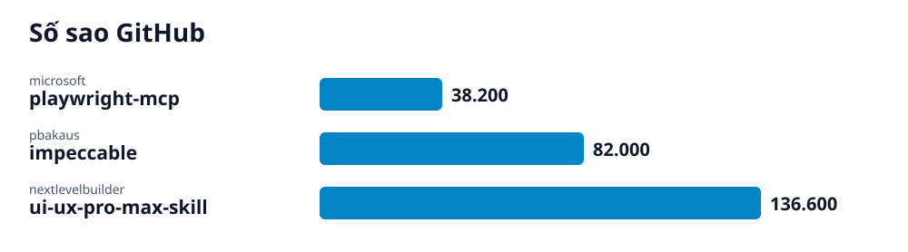

# Radar GitHub · 2026-10-16-4

## Các repo của lần quét này

- **[Playwright MCP: cho AI agent tự điều khiển trình duyệt](playwright-mcp/vi.md)** (AI) — Máy chủ MCP dùng Playwright để một agent AI mở trình duyệt, bấm, gõ, điền form và đọc trang qua ảnh chụp cấu trúc (accessibility snapshot) thay vì ảnh chụp màn hình.
  - 🎯 Một máy chủ Playwright MCP đã khai báo trong ứng dụng AI của bạn, để agent gọi các công cụ như browser_navigate và browser_snapshot điều khiển trình duyệt. · 🪜 9 bước
- **[Impeccable: bộ lệnh thiết kế giao diện cho AI coding agent](impeccable/vi.md)** (Phần mềm) — Skill thiết kế cho AI coding agent: một lệnh /impeccable với 24 lệnh con, chế độ sửa trực tiếp trên trình duyệt và 59 quy tắc dò lỗi thiết kế chạy không cần LLM.
  - 🎯 Skill Impeccable cài trong công cụ AI của bạn: gõ /impeccable init để ghi PRODUCT.md, rồi dùng /impeccable audit và npx impeccable detect để rà soát giao diện. · 🪜 8 bước
- **[UI UX Pro Max: kho tri thức thiết kế cho AI viết giao diện](ui-ux-pro-max-skill/vi.md)** (Phần mềm) — Skill cho AI coding agent gồm kho dữ liệu (79 phong cách UI có thể tìm, 50 đang dùng; 192 bảng màu; 74 cặp phông) và script Python tìm kiếm để sinh hệ thống thiết kế theo từng loại sản phẩm.
  - 🎯 Skill UI UX Pro Max cài trong công cụ AI của dự án; AI sinh hệ thống thiết kế (kiểu trang, màu, phông, hiệu ứng, điều cần tránh) rồi viết giao diện theo đó. · 🪜 9 bước
