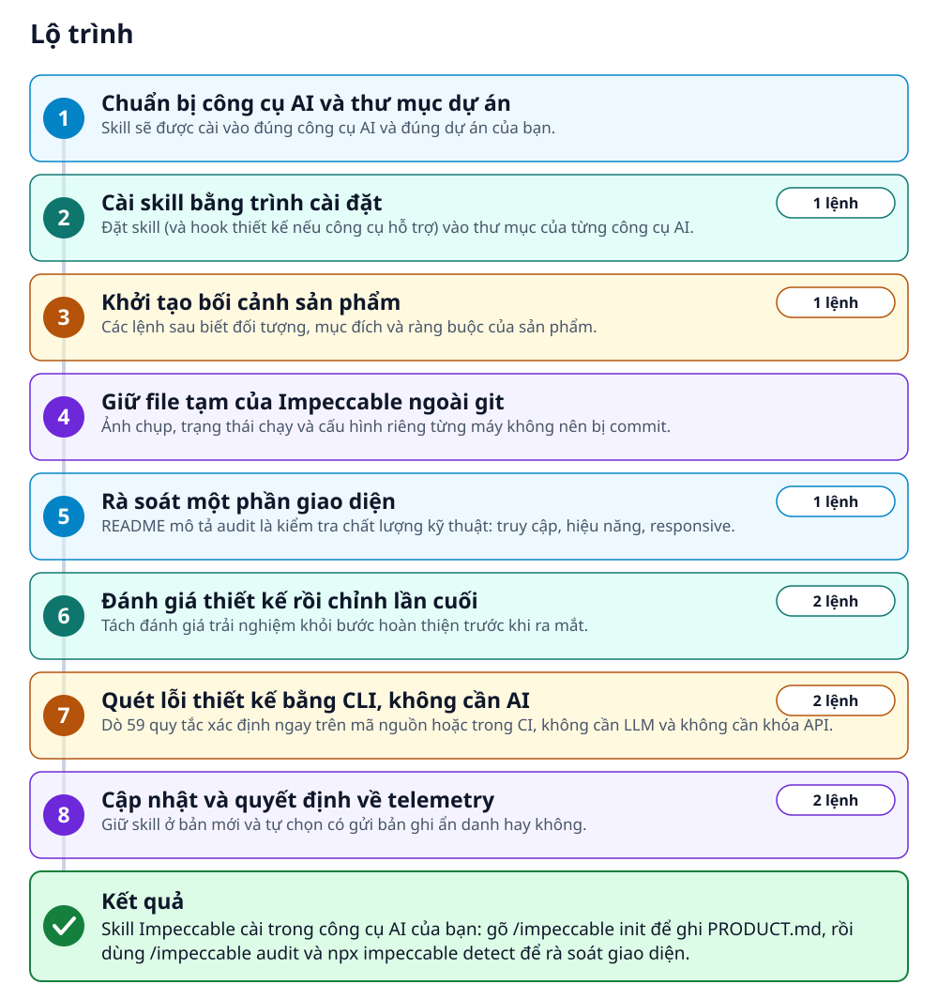
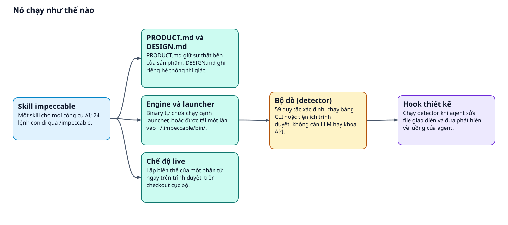
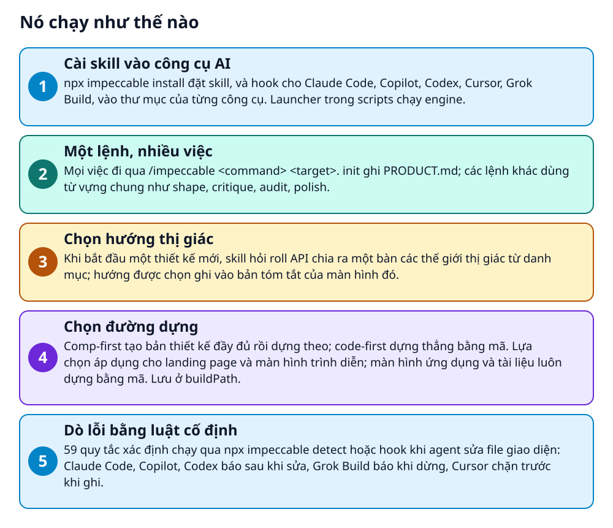

# Impeccable: bộ lệnh thiết kế giao diện cho AI coding agent


> 24 lệnh giúp AI vẽ giao diện bớt giống nhau, từ lập kế hoạch đến kiểm tra và chỉnh lần cuối

**Skill thiết kế cho AI coding agent: một lệnh /impeccable với 24 lệnh con, chế độ sửa trực tiếp trên trình duyệt và 59 quy tắc dò lỗi thiết kế chạy không cần LLM.**

## 🎯 Bạn sẽ làm ra được gì

Skill Impeccable cài trong công cụ AI của bạn: gõ /impeccable init để ghi PRODUCT.md, rồi dùng /impeccable audit và npx impeccable detect để rà soát giao diện.

## Vấn đề nó giải quyết

Mô hình AI đều học từ cùng các mẫu SaaS; thiếu chỉ dẫn thì dự án nào cũng lặp vài dấu hiệu: phông Inter, gradient tím sang xanh, thẻ lồng trong thẻ, chữ xám trên nền màu (README liệt kê). Impeccable thêm quy trình `init` ghi bối cảnh sản phẩm vào PRODUCT.md, 24 lệnh làm từ vựng chung với AI, và bộ dò 59 quy tắc chạy bằng CLI hoặc tiện ích trình duyệt. Phạm vi: thiết kế giao diện frontend do AI sinh ra.

> 💡 **Hình dung đời thường:** Giống một tổ biên tập có sẵn bảng từ vựng chung: bạn nói polish hay quieter, hai bên dùng cùng một từ cho cùng một việc, còn một máy soát lỗi (detector) kiểm lại theo luật cố định.

## Ai nên xem

- Dev hoặc designer dùng Claude Code, Cursor, Codex, Gemini CLI... muốn AI vẽ giao diện có chủ đích thay vì mẫu SaaS quen thuộc.
- Người đã có giao diện và cần rà soát: `audit` cho truy cập, hiệu năng, responsive; `critique` cho UX; `polish` trước khi ra mắt.
- Đội muốn dò lỗi thiết kế trong CI: `npx impeccable detect --json .` cho kết quả JSON và mã thoát để chặn.
- Không hợp nếu cần sửa trực tiếp site đã triển khai: chế độ live chỉ sửa checkout cục bộ, README nói không hỗ trợ site production.

## ⚠️ Lưu ý trước khi dùng

- Có telemetry ẩn danh khi bắt đầu thiết kế mới: yêu cầu roll luôn xảy ra, còn bản ghi gửi đi tắt được bằng `npx impeccable telemetry off` hoặc `DO_NOT_TRACK=1`.
- Hook trên Claude Code chạy độc lập với việc duyệt công cụ, nên lần sửa file đầu có thể tải engine về. README khuyên xem hook trước khi chạy không giám sát.
- Chế độ live chỉ sửa checkout cục bộ. Áp dụng chỉnh sửa chữ có thể chạy `impeccable:manual-edit-validate` trong package.json dưới quyền của bạn: hãy xem script đó.
- Lần quét sạch của detector chỉ là bằng chứng, không chứng minh chất lượng thị giác hay khả năng truy cập; vẫn phải xem giao diện thật ở các màn hình liên quan.

## 🧰 Chuẩn bị trước khi bắt đầu

_Đánh dấu từng mục khi đã có đủ._

- [ ] **Một công cụ AI được hỗ trợ**: Cursor, Claude Code, GitHub Copilot, Gemini CLI, Codex CLI, Grok Build, Hermes Agent... README có danh sách đầy đủ.  
  <sub>Căn cứ: `README`</sub>
- [ ] **Thư mục gốc của dự án giao diện**: README bảo chạy lệnh cài từ thư mục gốc của dự án.  
  <sub>Căn cứ: `README`</sub>
- [ ] **Node.js (chỉ để dùng npx)**: README nói Node chỉ cần cho trình cài `npx`, còn cách Git cũng chạy `npx impeccable link`, nên cứ chuẩn bị Node.  
  <sub>Căn cứ: `README`</sub>
- [ ] **Mạng cho lần chạy đầu**: Engine là một binary tự chứa; nếu chưa nằm cạnh launcher, nó được tải một lần vào `~/.impeccable/bin/`.  
  <sub>Căn cứ: `README`</sub>
- [ ] **Chrome, Chromium hoặc Edge (chỉ khi quét một địa chỉ web)**: Lệnh quét URL dùng trình duyệt đã cài trên máy.  
  <sub>Căn cứ: `README`</sub>

## 🗺️ Lộ trình



## 🪜 Làm theo từng bước

### Bước 1 · Chuẩn bị công cụ AI và thư mục dự án

**Mục đích:** Skill sẽ được cài vào đúng công cụ AI và đúng dự án của bạn.

1. Chọn công cụ AI bạn dùng trong danh sách README hỗ trợ.
2. Mở terminal tại thư mục gốc của dự án giao diện.

<sub>Căn cứ: `README`</sub>

### Bước 2 · Cài skill bằng trình cài đặt

**Mục đích:** Đặt skill (và hook thiết kế nếu công cụ hỗ trợ) vào thư mục của từng công cụ AI.

1. Chạy lệnh dưới đây từ thư mục gốc của dự án.
2. Trình cài hiện các thư mục hay CLI nó phát hiện, cho bạn giữ hoặc đổi nhà cung cấp, rồi hỏi cài cho dự án hay toàn cục.
3. Tải lại công cụ AI sau khi cài; README ghi: Reload your harness afterward.
4. Codex: mở `/hooks` rồi duyệt hook của dự án. Grok Build: tin cậy thư mục bằng `/hooks-trust` hoặc chạy với `--trust`. Gõ các lệnh này trong phiên của công cụ đó.

_Gõ hoặc dán từng dòng, theo thứ tự._

```bash
npx impeccable install
```

✅ **Bạn sẽ thấy:** Danh sách thư mục hoặc CLI của công cụ AI mà trình cài phát hiện được, để bạn giữ hoặc tùy chỉnh.

<sub>Căn cứ: `README`</sub>

### Bước 3 · Khởi tạo bối cảnh sản phẩm

**Mục đích:** Các lệnh sau biết đối tượng, mục đích và ràng buộc của sản phẩm.

1. Gõ lệnh dưới đây ngay trong công cụ AI, không gõ trong terminal.
2. `init` xem dự án, chỉ hỏi những chỗ thiếu về sự thật bền của sản phẩm rồi ghi PRODUCT.md.
3. Codex: README ghi Codex dùng skill, không dùng lệnh /prompts:, và gọi bằng `$impeccable` hoặc mở `/skills`. README không nêu cú pháp từng lệnh con; hãy đặt tên lệnh con sau `$impeccable`, như init.

```bash
/impeccable init
```

✅ **Bạn sẽ thấy:** File PRODUCT.md ghi đối tượng, mục đích, bối cảnh sử dụng, ràng buộc, giọng điệu và bằng chứng của sản phẩm.

<sub>Căn cứ: `README`</sub>

### Bước 4 · Giữ file tạm của Impeccable ngoài git

**Mục đích:** Ảnh chụp, trạng thái chạy và cấu hình riêng từng máy không nên bị commit.

1. Thêm khối bên dưới vào .gitignore của dự án.
2. Giữ theo dõi các file dùng chung: `.impeccable/config.json`, `.impeccable/live/config.json`, `.impeccable/design.json`, `.impeccable/surfaces/*.md`, `.impeccable/critique/*.md`.

_Nội dung mẫu trong README (thay giá trị giữ chỗ bằng giá trị của bạn)_

```gitignore
# impeccable-ignore-start
# Ephemeral output, runtime state, and per-dev overrides.
# The **/ prefix covers .impeccable at the repo root or in a nested workspace.
# Shared artifacts stay tracked: config.json, live/config.json,
# design.json, surfaces/*.md, critique/*.md.
**/.impeccable/config.local.json
**/.impeccable/hook.cache.json
**/.impeccable/hook.pending.json
**/.impeccable/*.png
**/.impeccable/review/
**/.impeccable/questions/
**/.impeccable/live/server.json
**/.impeccable/live/sessions/
**/.impeccable/live/previews/
**/.impeccable/live/annotations/
**/.impeccable/live/cache/
**/.impeccable/live/manual-edit-apply-transaction.json
**/.impeccable/live/manual-edit-events.jsonl
**/.impeccable/live/manual-edit-evidence/
**/.impeccable/live/pending-manual-edits.json
**/.impeccable/live/deferred-svelte-component-accepts.json
**/.impeccable/live/*.png
# impeccable-ignore-end
```

🩹 **Nếu không được:** File tạm đã lỡ commit trước khi thêm khối này: chạy `git rm --cached <path>` để ngừng theo dõi mà vẫn giữ bản trên máy.

<sub>Căn cứ: `README`</sub>

### Bước 5 · Rà soát một phần giao diện

**Mục đích:** README mô tả audit là kiểm tra chất lượng kỹ thuật: truy cập, hiệu năng, responsive.

1. Gõ lệnh trong công cụ AI (Codex: dùng `$impeccable` thay cho `/impeccable`, xem bước 3). Thêm tên vùng cần xem để thu hẹp phạm vi, như mẫu bên dưới.
2. Gõ `/impeccable` một mình để xem toàn bộ danh sách lệnh.

```bash
/impeccable audit
```

_Nội dung mẫu trong README (thay giá trị giữ chỗ bằng giá trị của bạn)_

```
/impeccable audit the header
/impeccable polish the checkout form
```

<sub>Căn cứ: `README`</sub>

### Bước 6 · Đánh giá thiết kế rồi chỉnh lần cuối

**Mục đích:** Tách đánh giá trải nghiệm khỏi bước hoàn thiện trước khi ra mắt.

1. Gõ hai lệnh dưới đây trong công cụ AI, lần lượt; Codex dùng `$impeccable` thay cho `/impeccable` (xem bước 3).
2. `critique` là bản đánh giá UX: thứ bậc, độ rõ ràng, cảm xúc.
3. `polish` là lượt chỉnh cuối, đồng bộ hệ thiết kế và sẵn sàng phát hành.
4. Lệnh hay dùng có thể ghim thành lệnh riêng, ví dụ `/impeccable pin audit` tạo lệnh `/audit`.

```bash
/impeccable critique
/impeccable polish
```

<sub>Căn cứ: `README`</sub>

### Bước 7 · Quét lỗi thiết kế bằng CLI, không cần AI

**Mục đích:** Dò 59 quy tắc xác định ngay trên mã nguồn hoặc trong CI, không cần LLM và không cần khóa API.

1. Chạy lệnh đầu để quét thư mục mã nguồn; có thể quét một file HTML hoặc một địa chỉ web.
2. Chạy lệnh thứ hai để có kết quả JSON cho CI. Phát hiện dạng đọc được ghi ra stderr.
3. Mã thoát 0 là quét xong và không có phát hiện chính, 2 là có phát hiện chính, 1 là có đích không quét được.

```bash
npx impeccable detect src/
npx impeccable detect --json .
```

🔗 Liên kết trong README: [impeccable.style/docs/detector](https://impeccable.style/docs/detector)

✅ **Bạn sẽ thấy:** Mã thoát 0 khi quét xong mà không có phát hiện chính.

<sub>Căn cứ: `README`</sub>

### Bước 8 · Cập nhật và quyết định về telemetry

**Mục đích:** Giữ skill ở bản mới và tự chọn có gửi bản ghi ẩn danh hay không.

1. Chạy dòng đầu để làm mới bản cài đã có.
2. Chạy dòng thứ hai nếu bạn muốn tắt telemetry; cách khác là đặt `DO_NOT_TRACK=1`.

```bash
npx impeccable update
npx impeccable telemetry off
```

<sub>Căn cứ: `README`</sub>

## ✔️ Kiểm tra kết quả

Gõ `/impeccable` một mình trong công cụ AI: README nói nó hiện đủ danh sách lệnh; chưa thấy skill thì khởi động lại. Codex: mở `/skills` hoặc gõ `$impeccable`. CLI: xem mã thoát ở bước 7.

## 🩹 Lỗi thường gặp

| Hiện tượng | Cách xử lý | Căn cứ |
|---|---|---|
| Codex không chạy hook thiết kế | Mở `/hooks` sau khi cài hoặc cập nhật và duyệt hook của dự án; cập nhật làm đổi `.codex/hooks.json` có thể cần duyệt lại. | `README` |
| Cài hoặc cập nhật dừng vì file hook bị hỏng | Chạy lại với `--force`: README nói file hỏng được sao lưu thành `.bak` rồi thay bằng bản mới. | `README` |
| Skill vừa cài chưa hiện trong công cụ | Khởi động lại công cụ. Cursor (cách sao chép thủ công) cần kênh Nightly và bật Agent Skills; Gemini CLI cần bản preview và bật Skills trong `/settings`. | `README` |
| Hermes chưa nạp skill cài theo dự án | Chạy `hermes skills trust` một lần tại thư mục gốc dự án; README nói cài toàn cục không cần bước này. | `README` |

## 🚀 Làm tiếp

- Thử `/impeccable craft`, luồng đầy đủ lập kế hoạch rồi dựng có lặp lại bằng hình ảnh.
- Khi `/impeccable init` hỏi đường dựng (chỉ hỏi nếu có tạo ảnh), chọn `comp` hay `code`; ghi đè riêng một máy ở `.impeccable/config.local.json`.
- Quét một trang thật bằng `npx impeccable detect` kèm địa chỉ web của bạn; cần Chrome, Chromium hoặc Edge.

## 🔍 Bên trong nó hoạt động ra sao





1. **Cài skill vào công cụ AI**: npx impeccable install đặt skill, và hook cho Claude Code, Copilot, Codex, Cursor, Grok Build, vào thư mục của từng công cụ. Launcher trong scripts chạy engine. _(Căn cứ: `README`)_
2. **Một lệnh, nhiều việc**: Mọi việc đi qua /impeccable &lt;command> &lt;target>. init ghi PRODUCT.md; các lệnh khác dùng từ vựng chung như shape, critique, audit, polish. _(Căn cứ: `README`)_
3. **Chọn hướng thị giác**: Khi bắt đầu một thiết kế mới, skill hỏi roll API chia ra một bàn các thế giới thị giác từ danh mục; hướng được chọn ghi vào bản tóm tắt của màn hình đó. _(Căn cứ: `README`)_
4. **Chọn đường dựng**: Comp-first tạo bản thiết kế đầy đủ rồi dựng theo; code-first dựng thẳng bằng mã. Lựa chọn áp dụng cho landing page và màn hình trình diễn; màn hình ứng dụng và tài liệu luôn dựng bằng mã. Lưu ở buildPath. _(Căn cứ: `README`)_
5. **Dò lỗi bằng luật cố định**: 59 quy tắc xác định chạy qua npx impeccable detect hoặc hook khi agent sửa file giao diện: Claude Code, Copilot, Codex báo sau khi sửa, Grok Build báo khi dừng, Cursor chặn trước khi ghi. _(Căn cứ: `README`)_

### Các mảnh ghép

| | Các mảnh ghép | Căn cứ |
|---|---|---|
| **Skill impeccable** | Một skill cho mọi công cụ AI; 24 lệnh con đi qua /impeccable. | `README` |
| **PRODUCT.md và DESIGN.md** | PRODUCT.md giữ sự thật bền của sản phẩm; DESIGN.md ghi riêng hệ thống thị giác. | `README` |
| **Engine và launcher** | Binary tự chứa chạy cạnh launcher, hoặc được tải một lần vào ~/.impeccable/bin/. | `README` |
| **Bộ dò (detector)** | 59 quy tắc xác định, chạy bằng CLI hoặc tiện ích trình duyệt, không cần LLM hay khóa API. | `README` |
| **Hook thiết kế** | Chạy detector khi agent sửa file giao diện và đưa phát hiện về luồng của agent. | `README` |
| **Chế độ live** | Lặp biến thể của một phần tử ngay trên trình duyệt, trên checkout cục bộ. | `README` |

## Học được gì từ thiết kế này

- Đặt tên cho từng việc: 24 lệnh như polish, quieter, distill tạo từ vựng chung giữa người và AI, nên yêu cầu ngắn mà vẫn rõ.
- Tách sự thật của sản phẩm (PRODUCT.md) khỏi hướng thị giác (DESIGN.md và bản tóm tắt từng màn hình), để lệnh sau không nhầm hai thứ.
- Phần dò lỗi dùng luật xác định, không cần LLM: 59 quy tắc lặp lại được, có mã thoát cho CI, không cần khóa API. Phần đánh giá thiết kế vẫn có kiểm tra bằng LLM.
- Nói rõ giới hạn của công cụ kiểm tra: README viết rằng lần quét sạch chỉ là bằng chứng, không thay việc xem giao diện thật.
- Một trình cài, nhiều công cụ AI: cùng nội dung được đóng gói theo từng nhà cung cấp, nên chuyển công cụ không phải học lại.

## Từ khóa

- **Skill**: Gói hướng dẫn để AI làm theo trong một công cụ như Claude Code hay Cursor.
- **Harness**: Từ README dùng cho công cụ bao quanh mô hình AI, ví dụ Cursor hay Claude Code.
- **Detector**: Bộ quy tắc xác định dò lỗi thiết kế, chạy không cần LLM.
- **Hook**: Đoạn tự chạy khi agent sửa file hoặc kết thúc lượt, dùng để đưa phát hiện về cho agent.

---

Nguồn dữ kiện: [pbakaus/impeccable](https://github.com/pbakaus/impeccable) · Giấy phép: Apache-2.0 · 82.000 sao · Quét ngày 2026-10-16

_Nội dung do AI tóm tắt từ README và cấu trúc repo; hãy đọc repo gốc trước khi dùng._
