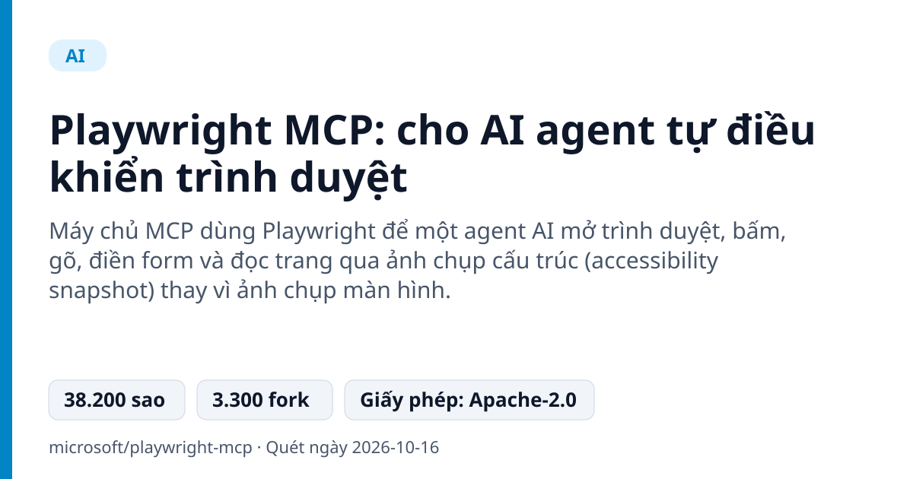
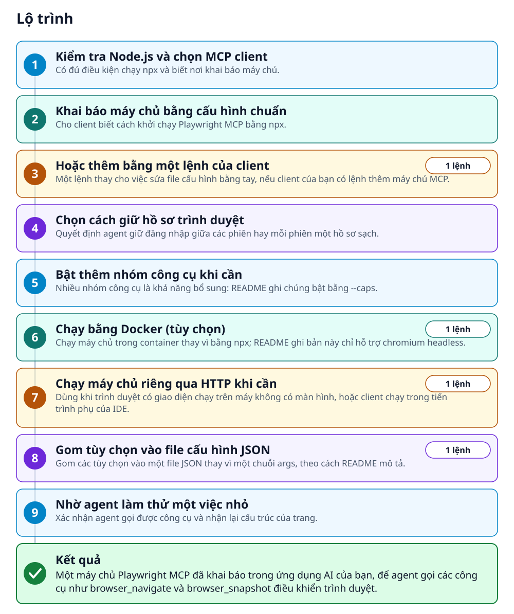
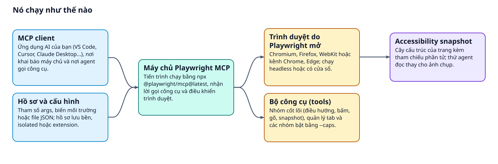
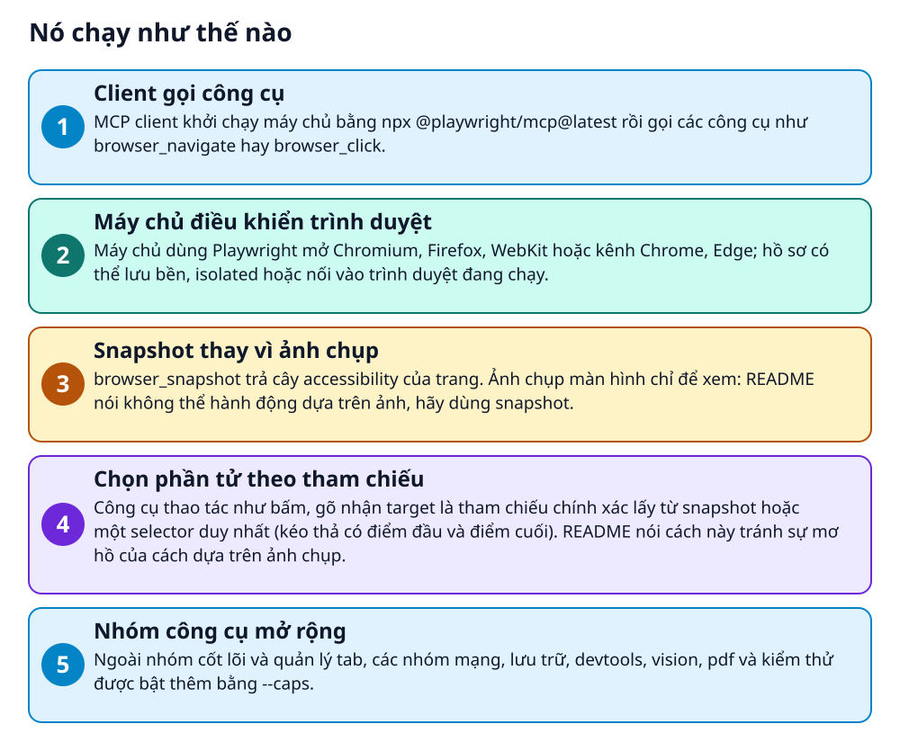

# Playwright MCP: cho AI agent tự điều khiển trình duyệt



> Agent AI đọc trang web bằng cấu trúc thay vì ảnh chụp, nên không cần mô hình xử lý hình

**Máy chủ MCP dùng Playwright để một agent AI mở trình duyệt, bấm, gõ, điền form và đọc trang qua ảnh chụp cấu trúc (accessibility snapshot) thay vì ảnh chụp màn hình.**

## 🎯 Bạn sẽ làm ra được gì

Một máy chủ Playwright MCP đã khai báo trong ứng dụng AI của bạn, để agent gọi các công cụ như browser_navigate và browser_snapshot điều khiển trình duyệt.

## Vấn đề nó giải quyết

Muốn agent AI thao tác trên website, cách quen thuộc là chụp màn hình rồi nhờ mô hình xem ảnh đoán chỗ cần bấm: dễ mơ hồ và cần mô hình biết xem ảnh. Playwright MCP đưa cho agent cấu trúc của trang (accessibility tree) cùng một bộ công cụ có tên rõ ràng như bấm, gõ, điều hướng. Phạm vi: điều khiển trình duyệt qua một MCP client; README nói thẳng đây không phải ranh giới bảo mật.

> 💡 **Hình dung đời thường:** Giống như đưa trợ lý một bản danh mục ghi sẵn từng nút và ô nhập của trang, thay vì đưa một bức ảnh rồi bắt đoán. Trợ lý chỉ cần nói: bấm mục này.

## Ai nên xem

- Người làm agent cần vòng lặp khám phá web: tự động hóa thăm dò, tự sửa test, quy trình tự chạy dài (ba ví dụ README nêu).
- Dev hoặc QA muốn agent kiểm tra giao diện: đổi giao diện sáng tối, giả lập thiết bị, đọc console và request mạng.
- Người cần agent dùng phiên đã đăng nhập: nối vào tab Chrome hoặc Edge đang mở, hoặc nạp storage state.
- Coding agent cần tiết kiệm ngữ cảnh có thể hợp hơn với Playwright CLI kèm SKILLS, theo README; MCP hợp vòng lặp cần giữ trạng thái.

## ⚠️ Lưu ý trước khi dùng

- Không phải ranh giới bảo mật, README nói rõ. Các tùy chọn chặn origin hay chặn file cũng không phải ranh giới bảo mật: hãy dựa vào quyền của MCP client.
- Tốn ngữ cảnh hơn CLI: README cho biết coding agent thường chuộng CLI kèm SKILLS vì tiết kiệm token, không phải nạp schema công cụ và cây accessibility dài.
- `browser_run_code_unsafe` chạy JavaScript tùy ý trong tiến trình máy chủ Playwright và README gọi là tương đương RCE; cân nhắc trước khi cho agent dùng.
- Hồ sơ lưu bền giữ đăng nhập trên đĩa và chỉ một trình duyệt dùng được một lúc. Bản Docker chỉ hỗ trợ chromium headless.

## 🧰 Chuẩn bị trước khi bắt đầu

_Đánh dấu từng mục khi đã có đủ._

- [ ] **Node.js 18 trở lên**: README ghi là điều kiện; máy chủ được khởi chạy bằng `npx`.  
  <sub>Căn cứ: `README`</sub>
- [ ] **Một MCP client**: README kể VS Code, Cursor, Windsurf, Claude Desktop, Goose, Grok, Junie hoặc client MCP khác.  
  <sub>Căn cứ: `README`</sub>
- [ ] **Docker (chỉ khi chạy bằng container)**: README ghi bản Docker hiện chỉ hỗ trợ chromium headless.  
  <sub>Căn cứ: `README`</sub>
- [ ] **Playwright Extension (chỉ khi nối vào trình duyệt đang chạy)**: Chỉ cho Edge hoặc Chrome; README dẫn tới trang cài đặt tiện ích.  
  Liên kết trong README: [microsoft/playwright › packages/extension](https://github.com/microsoft/playwright/tree/main/packages/extension#readme)  
  <sub>Căn cứ: `README`</sub>

## 🗺️ Lộ trình



## 🪜 Làm theo từng bước

### Bước 1 · Kiểm tra Node.js và chọn MCP client

**Mục đích:** Có đủ điều kiện chạy npx và biết nơi khai báo máy chủ.

1. Xem lại phiên bản Node.js trên máy: README yêu cầu 18 trở lên.
2. Chọn ứng dụng AI bạn dùng làm MCP client, ví dụ VS Code, Cursor, Claude Desktop hay Claude Code.

<sub>Căn cứ: `README`</sub>

### Bước 2 · Khai báo máy chủ bằng cấu hình chuẩn

**Mục đích:** Cho client biết cách khởi chạy Playwright MCP bằng npx.

1. Mở file cấu hình MCP của client; mỗi client để ở một chỗ khác nhau và README có mục riêng cho từng client.
2. Dán khối cấu hình mẫu bên dưới. README gọi đây là cấu hình chuẩn, chạy được trong hầu hết công cụ.
3. Claude Desktop, Gemini CLI, Windsurf, Warp và LM Studio được README bảo dùng đúng cấu hình chuẩn này.

_Nội dung mẫu trong README (thay giá trị giữ chỗ bằng giá trị của bạn)_

```js
{
  "mcpServers": {
    "playwright": {
      "command": "npx",
      "args": [
        "@playwright/mcp@latest"
      ]
    }
  }
}
```

<sub>Căn cứ: `README`</sub>

### Bước 3 · Hoặc thêm bằng một lệnh của client

**Mục đích:** Một lệnh thay cho việc sửa file cấu hình bằng tay, nếu client của bạn có lệnh thêm máy chủ MCP.

1. Chọn MỘT dòng đúng với công cụ bạn dùng, đừng chạy cả ba: Claude Code dùng `claude mcp add`, Codex dùng `codex mcp add`, VS Code dùng `code --add-mcp`.
2. Ứng dụng khác (Amp, Factory, Grok...) cũng có lệnh riêng trong README.

_Gõ hoặc dán từng dòng, theo thứ tự._

```bash
claude mcp add playwright npx @playwright/mcp@latest
codex mcp add playwright npx "@playwright/mcp@latest"
code --add-mcp '{"name":"playwright","command":"npx","args":["@playwright/mcp@latest"]}'
```

✅ **Bạn sẽ thấy:** Với VS Code, README nói máy chủ sau đó dùng được với agent GitHub Copilot.

<sub>Căn cứ: `README`</sub>

### Bước 4 · Chọn cách giữ hồ sơ trình duyệt

**Mục đích:** Quyết định agent giữ đăng nhập giữa các phiên hay mỗi phiên một hồ sơ sạch.

1. Mặc định là hồ sơ lưu bền (persistent): thông tin đăng nhập được giữ cho các phiên sau.
2. Muốn mỗi phiên sạch, thêm `--isolated` vào danh sách args như mẫu bên dưới. Mẫu có dòng `--storage-state` với đường dẫn giữ chỗ: thay bằng file thật hoặc bỏ dòng đó.
3. Muốn dùng tab đã đăng nhập sẵn, dùng `--extension` cùng Playwright Extension (chỉ Edge hoặc Chrome).

_Nội dung mẫu trong README (thay giá trị giữ chỗ bằng giá trị của bạn)_

```js
{
  "mcpServers": {
    "playwright": {
      "command": "npx",
      "args": [
        "@playwright/mcp@latest",
        "--isolated",
        "--storage-state={path/to/storage.json}"
      ]
    }
  }
}
```

🔗 Liên kết trong README: [microsoft/playwright › packages/extension](https://github.com/microsoft/playwright/tree/main/packages/extension#readme)

🩹 **Nếu không được:** Hai client cùng workspace dùng chung hồ sơ lưu bền sẽ xung đột: thêm `--isolated` hoặc đặt `--user-data-dir` riêng cho từng client.

<sub>Căn cứ: `README`</sub>

### Bước 5 · Bật thêm nhóm công cụ khi cần

**Mục đích:** Nhiều nhóm công cụ là khả năng bổ sung: README ghi chúng bật bằng --caps.

1. Thêm `--caps` vào danh sách args của client. README gắn từng nhóm với một giá trị, ví dụ `--caps=vision` (bấm theo tọa độ), `--caps=pdf` (lưu PDF), `--caps=devtools` (quay video, ghi trace).
2. Các nhóm mạng, lưu trữ (cookie, localStorage) và kiểm thử cũng bật theo cách này, ví dụ `--caps=network`.
3. Vài tùy chọn khác README mô tả: `--headless` chạy không hiện cửa sổ, `--browser` chọn trình duyệt, `--device` giả lập thiết bị.

<sub>Căn cứ: `README`</sub>

### Bước 6 · Chạy bằng Docker (tùy chọn)

**Mục đích:** Chạy máy chủ trong container thay vì bằng npx; README ghi bản này chỉ hỗ trợ chromium headless.

1. Chạy lệnh dưới đây để mở một container chạy lâu, lắng nghe cổng 8931 cho mọi MCP client nối vào.
2. README còn có cách để client tự khởi chạy container: khai báo `command` là `docker` trong cấu hình. Xem mục Docker của README để lấy đúng danh sách args.

```bash
docker run -d -i --rm --init --pull=always --entrypoint node --name playwright -p 8931:8931 mcr.microsoft.com/playwright/mcp /app/cli.js --headless --browser chromium --no-sandbox --port 8931 --host 0.0.0.0
```

<sub>Căn cứ: `README`</sub>

### Bước 7 · Chạy máy chủ riêng qua HTTP khi cần

**Mục đích:** Dùng khi trình duyệt có giao diện chạy trên máy không có màn hình, hoặc client chạy trong tiến trình phụ của IDE.

1. Chạy lệnh dưới đây trong môi trường có `DISPLAY`; cờ `--port` bật cách truyền HTTP.
2. Trong cấu hình client, thay `command` và `args` bằng `url` trỏ tới điểm cuối HTTP mà README in bên dưới.

```bash
npx @playwright/mcp@latest --port 8931
```

🔗 Mở địa chỉ: `http://localhost:8931/mcp`

<sub>Căn cứ: `README`</sub>

### Bước 8 · Gom tùy chọn vào file cấu hình JSON

**Mục đích:** Gom các tùy chọn vào một file JSON thay vì một chuỗi args, theo cách README mô tả.

1. Tạo file JSON theo lược đồ trong README, chia nhóm như `browser`, `server`, `network` và `timeouts`.
2. Thay path/to/config.json bằng đường dẫn file của bạn. README đưa lệnh dưới đây làm cách truyền file cấu hình, không phải bước kiểm tra; trong client thì thêm `--config` cùng đường dẫn vào args.

```bash
npx @playwright/mcp@latest --config path/to/config.json
```

<sub>Căn cứ: `README`</sub>

### Bước 9 · Nhờ agent làm thử một việc nhỏ

**Mục đích:** Xác nhận agent gọi được công cụ và nhận lại cấu trúc của trang.

1. Nhờ agent mở một trang web bất kỳ rồi lấy snapshot của trang; hai công cụ liên quan là `browser_navigate` và `browser_snapshot`.
2. Các công cụ như `browser_click` và `browser_type` nhận tham chiếu phần tử lấy từ snapshot làm `target`.

<sub>Căn cứ: `README`</sub>

## ✔️ Kiểm tra kết quả

README không mô tả màn hình xác nhận. Cách kiểm tra: agent gọi được `browser_navigate` và `browser_snapshot` rồi trả lại nội dung của trang bạn yêu cầu.

## 🩹 Lỗi thường gặp

| Hiện tượng | Cách xử lý | Căn cứ |
|---|---|---|
| Hai client cùng workspace tranh nhau hồ sơ trình duyệt | Chạy client thứ hai với `--isolated`, hoặc cho nó `--user-data-dir` riêng. | `README` |
| Cần trình duyệt có giao diện trên máy không có màn hình | Chạy máy chủ từ môi trường có `DISPLAY` và thêm `--port`, rồi trỏ client bằng `url`. | `README` |
| Bản Docker không chạy được Firefox hay WebKit | README ghi bản Docker chỉ hỗ trợ chromium headless; cần trình duyệt khác thì xem tùy chọn `--browser` khi chạy bằng `npx`. | `README` |
| Agent không đọc được file ngoài workspace | Mặc định truy cập file bị giới hạn trong workspace; `--allow-unrestricted-file-access` mở rộng, nhưng README cảnh báo đây không phải ranh giới bảo mật. | `README` |

## 🚀 Làm tiếp

- Thử `--caps=devtools` để quay video hay ghi trace, hoặc `--caps=testing` để agent kiểm tra chữ và phần tử hiển thị.
- Muốn dùng phiên đã đăng nhập sẵn, cài Playwright Extension và chạy với `--extension`.
- Nếu agent của bạn là coding agent, so sánh với Playwright CLI kèm SKILLS mà README đề xuất.

## 🔍 Bên trong nó hoạt động ra sao





1. **Client gọi công cụ**: MCP client khởi chạy máy chủ bằng npx @playwright/mcp@latest rồi gọi các công cụ như browser_navigate hay browser_click. _(Căn cứ: `README`)_
2. **Máy chủ điều khiển trình duyệt**: Máy chủ dùng Playwright mở Chromium, Firefox, WebKit hoặc kênh Chrome, Edge; hồ sơ có thể lưu bền, isolated hoặc nối vào trình duyệt đang chạy. _(Căn cứ: `README`)_
3. **Snapshot thay vì ảnh chụp**: browser_snapshot trả cây accessibility của trang. Ảnh chụp màn hình chỉ để xem: README nói không thể hành động dựa trên ảnh, hãy dùng snapshot. _(Căn cứ: `README`)_
4. **Chọn phần tử theo tham chiếu**: Công cụ thao tác như bấm, gõ nhận target là tham chiếu chính xác lấy từ snapshot hoặc một selector duy nhất (kéo thả có điểm đầu và điểm cuối). README nói cách này tránh sự mơ hồ của cách dựa trên ảnh chụp. _(Căn cứ: `README`)_
5. **Nhóm công cụ mở rộng**: Ngoài nhóm cốt lõi và quản lý tab, các nhóm mạng, lưu trữ, devtools, vision, pdf và kiểm thử được bật thêm bằng --caps. _(Căn cứ: `README`)_

### Các mảnh ghép

| | Các mảnh ghép | Căn cứ |
|---|---|---|
| **MCP client** | Ứng dụng AI của bạn (VS Code, Cursor, Claude Desktop...), nơi khai báo máy chủ và nơi agent gọi công cụ. | `README` |
| **Máy chủ Playwright MCP** | Tiến trình chạy bằng npx @playwright/mcp@latest, nhận lời gọi công cụ và điều khiển trình duyệt. | `README` |
| **Trình duyệt do Playwright mở** | Chromium, Firefox, WebKit hoặc kênh Chrome, Edge; chạy headless hoặc có cửa sổ. | `README` |
| **Accessibility snapshot** | Cây cấu trúc của trang kèm tham chiếu phần tử; thứ agent đọc thay cho ảnh chụp. | `README` |
| **Bộ công cụ (tools)** | Nhóm cốt lõi (điều hướng, bấm, gõ, snapshot), quản lý tab và các nhóm bật bằng --caps. | `README` |
| **Hồ sơ và cấu hình** | Tham số args, biến môi trường hoặc file JSON; hồ sơ lưu bền, isolated hoặc extension. | `README` |

## Học được gì từ thiết kế này

- Đưa cho mô hình dữ liệu có cấu trúc thay vì ảnh: ít mơ hồ hơn và không cần mô hình xem ảnh (README gọi là áp dụng công cụ có tính xác định).
- Chia khả năng thành nhóm bật thêm theo nhu cầu (`--caps`): nhóm cốt lõi có sẵn, các nhóm mạng, lưu trữ, devtools bật riêng.
- Một lõi, nhiều cách nối: stdio qua `npx`, HTTP qua `--port`, Docker, hoặc nhúng bằng `createConnection`: README liệt kê cả bốn cách chạy.
- Nói rõ giới hạn của mình: README phân biệt MCP với CLI kèm SKILLS và nhắc đây không phải ranh giới bảo mật, giúp người dùng chọn đúng công cụ.

## Từ khóa

- **MCP**: Model Context Protocol: giao thức mà máy chủ này dùng để đưa khả năng điều khiển trình duyệt cho ứng dụng AI.
- **Accessibility snapshot**: Bản chụp cấu trúc của trang theo cây accessibility, dùng thay cho ảnh chụp màn hình.
- **Headless**: Chạy trình duyệt không hiện cửa sổ.
- **Storage state**: Tệp lưu cookie và local storage của một phiên để nạp lại sau.

---

Nguồn dữ kiện: [microsoft/playwright-mcp](https://github.com/microsoft/playwright-mcp) · Giấy phép: Apache-2.0 · 38.200 sao · Quét ngày 2026-10-16

_Nội dung do AI tóm tắt từ README và cấu trúc repo; hãy đọc repo gốc trước khi dùng._
