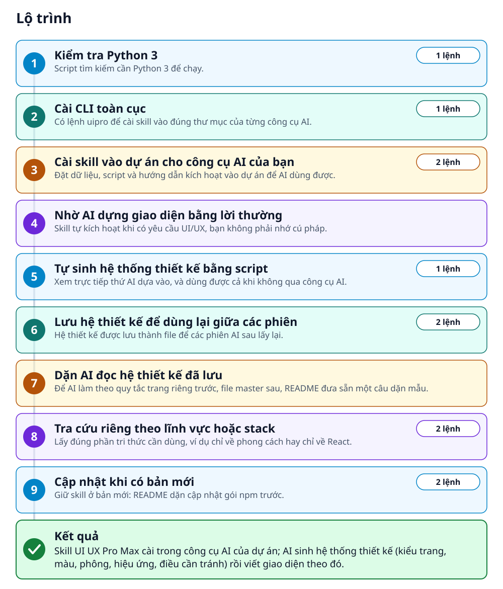
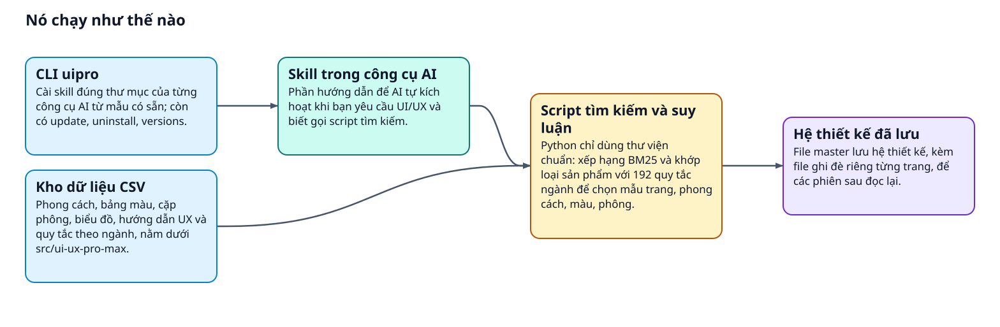
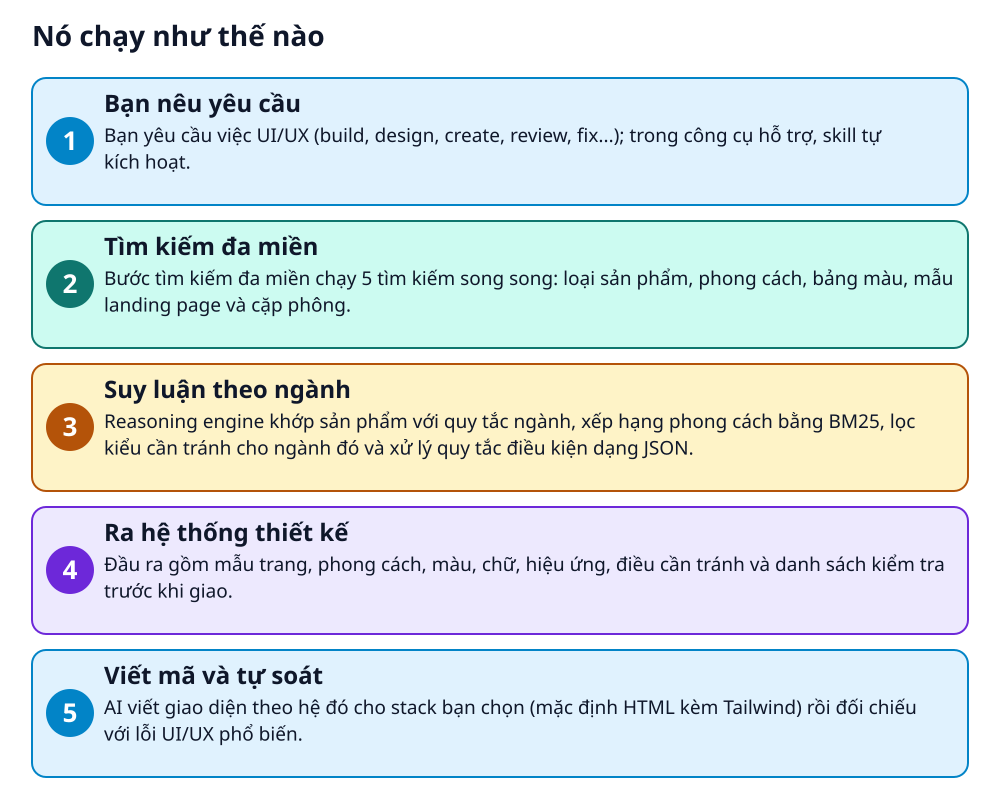

# UI UX Pro Max: kho tri thức thiết kế cho AI viết giao diện


> AI tự sinh cả hệ thống thiết kế từ mô tả sản phẩm: kiểu trang, màu, phông và điều cần tránh

**Skill cho AI coding agent gồm kho dữ liệu (79 phong cách UI có thể tìm, 50 đang dùng; 192 bảng màu; 74 cặp phông) và script Python tìm kiếm để sinh hệ thống thiết kế theo từng loại sản phẩm.**

## 🎯 Bạn sẽ làm ra được gì

Skill UI UX Pro Max cài trong công cụ AI của dự án; AI sinh hệ thống thiết kế (kiểu trang, màu, phông, hiệu ứng, điều cần tránh) rồi viết giao diện theo đó.

## Vấn đề nó giải quyết

UI UX Pro Max là skill đem design intelligence cho AI dựng UI/UX trên nhiều nền tảng. Thay vì bạn tự chọn phong cách, màu, phông cho từng dự án, bộ sinh hệ thống thiết kế phân tích yêu cầu và dùng 192 quy tắc theo ngành để ra mẫu trang, phong cách, màu, phông, hiệu ứng, điều cần tránh và danh sách kiểm tra. Phạm vi: UI/UX cho 22 tech stack; thương hiệu, logo, slide thuộc bản Premium.

> 💡 **Hình dung đời thường:** Giống một cuốn sổ tay phong cách có chỉ mục: bạn hỏi spa thư giãn thì sổ mở đúng trang gợi ý màu, phông, kiểu bố cục và điều nên tránh.

## Ai nên xem

- Người dùng Claude Code, Cursor, Windsurf, Copilot... cần AI dựng landing page, dashboard hay ứng dụng mobile với hệ màu, phông nhất quán.
- Dev dùng một trong 22 tech stack (React, Next.js, Vue, SwiftUI, Flutter, Jetpack Compose...) muốn gợi ý đúng theo stack.
- Đội muốn lưu hệ thiết kế thành file master cùng file ghi đè từng trang để các phiên AI sau dùng lại.
- Không hợp nếu cần tạo logo, nhận diện thương hiệu, slide hay ảnh: README xếp các việc đó vào bản Premium.

## ⚠️ Lưu ý trước khi dùng

- Cần Python 3 để chạy script tìm kiếm. README dặn AI không tự cài phần mềm giúp bạn mà sẽ hỏi; bạn tự cài Python nếu máy chưa có.
- Ví dụ trước và sau trong README chỉ là minh họa do cộng đồng đóng góp, không phải demo chính thức hay phép đo hiệu quả; đầu ra mẫu còn nhắc tự xác minh yêu cầu về khả năng tiếp cận (accessibility).
- Lỗi cài hay gặp theo README: tải cả ZIP repo lên trang tải skill của Claude bị từ chối vì quá 200 file, Marketplace trước v2.5.1 lỗi symlink, gói cũ `uipro-cli` đã lỗi thời.
- Bản miễn phí chỉ lo UI/UX. Thương hiệu, logo, slide, sinh ảnh và kiến trúc design token cho đội lớn thuộc bản Premium, bản nâng cấp mà README mô tả.

## 🧰 Chuẩn bị trước khi bắt đầu

_Đánh dấu từng mục khi đã có đủ._

- [ ] **Node.js và npm**: Để cài `ui-ux-pro-max-cli` bằng `npm install -g`; README không ghi phiên bản tối thiểu.  
  <sub>Căn cứ: `README`</sub>
- [ ] **Python 3**: Script tìm kiếm chỉ dùng thư viện chuẩn và không gọi mạng. Tự cài từ liên kết dưới đây hoặc bằng Homebrew, apt, winget.  
  Liên kết trong README: [python.org](https://www.python.org/downloads/)  
  <sub>Căn cứ: `README`</sub>
- [ ] **Một công cụ AI được hỗ trợ**: Claude Code, Cursor, Windsurf, Antigravity, Copilot, Kiro, Codex CLI, Gemini CLI... README liệt kê đầy đủ.  
  <sub>Căn cứ: `README`</sub>
- [ ] **Thư mục dự án của bạn**: Lệnh cài chạy từ thư mục dự án.  
  <sub>Căn cứ: `README`</sub>

## 🗺️ Lộ trình



## 🪜 Làm theo từng bước

### Bước 1 · Kiểm tra Python 3

**Mục đích:** Script tìm kiếm cần Python 3 để chạy.

1. Chạy lệnh dưới đây trong terminal.
2. Nếu máy chưa có Python, tự cài (xem liên kết bên dưới). README nhấn mạnh bước này dành cho bạn: AI dùng skill sẽ hỏi bạn chứ không tự cài phần mềm.

_Gõ hoặc dán từng dòng, theo thứ tự._

```bash
python3 --version
```

🔗 Liên kết trong README: [python.org](https://www.python.org/downloads/)

<sub>Căn cứ: `README`</sub>

### Bước 2 · Cài CLI toàn cục

**Mục đích:** Có lệnh uipro để cài skill vào đúng thư mục của từng công cụ AI.

1. Chạy lệnh dưới đây trong terminal; gói npm là `ui-ux-pro-max-cli` và nó vẫn cài lệnh `uipro`.
2. Gặp lỗi quyền? Xem mục lỗi thường gặp bên dưới.

```bash
npm install -g ui-ux-pro-max-cli
```

<sub>Căn cứ: `README`</sub>

### Bước 3 · Cài skill vào dự án cho công cụ AI của bạn

**Mục đích:** Đặt dữ liệu, script và hướng dẫn kích hoạt vào dự án để AI dùng được.

1. Chạy hai lệnh dưới đây: đổi đường dẫn thành thư mục dự án thật, rồi cài cho Claude Code.
2. Công cụ khác thì đổi `claude` thành tên tương ứng, ví dụ `cursor`, `windsurf`, `codex`, `gemini`, hay `all` cho mọi công cụ README hỗ trợ.
3. Muốn dùng cho mọi dự án, thêm `--global`; muốn xem trước mà chưa ghi file, thêm `--dry-run`.
4. Cách khác trên Claude Code: Marketplace bằng `/plugin marketplace add nextlevelbuilder/ui-ux-pro-max-skill` rồi `/plugin install ui-ux-pro-max@ui-ux-pro-max-skill`.

```bash
cd /path/to/your/project
uipro init --ai claude
```

<sub>Căn cứ: `README`</sub>

### Bước 4 · Nhờ AI dựng giao diện bằng lời thường

**Mục đích:** Skill tự kích hoạt khi có yêu cầu UI/UX, bạn không phải nhớ cú pháp.

1. Mở dự án trong công cụ AI vừa cài và gõ yêu cầu như mẫu bên dưới.
2. Trae: chuyển sang chế độ SOLO trước. Kiro, Roo Code và KiloCode dùng lệnh `/ui-ux-pro-max` đặt trước yêu cầu.

_Nội dung mẫu trong README (thay giá trị giữ chỗ bằng giá trị của bạn)_

```
Build a landing page for my SaaS product
```

✅ **Bạn sẽ thấy:** README mô tả: AI sinh hệ thống thiết kế bằng reasoning engine, chọn phong cách, màu và phông phù hợp, viết mã rồi kiểm tra lỗi UI/UX phổ biến.

<sub>Căn cứ: `README`</sub>

### Bước 5 · Tự sinh hệ thống thiết kế bằng script

**Mục đích:** Xem trực tiếp thứ AI dựa vào, và dùng được cả khi không qua công cụ AI.

1. Chạy lệnh dưới đây từ thư mục dự án đã cài cho Claude Code ở bước 3. Với Continue, Droid, ZCode, Amazon Q, README dặn đổi `.claude/skills/` thành thư mục skill của công cụ đó.
2. Cài với `--global` thì README ghi skill nằm ở ~/.claude/skills/, và README không nói Marketplace đặt script ở đâu, nên đường dẫn trong lệnh có thể khác.
3. Thay chuỗi mô tả sản phẩm và tên dự án bằng của bạn.

```bash
python3 .claude/skills/ui-ux-pro-max/scripts/search.py "beauty spa wellness" --design-system -p "Serenity Spa"
```

✅ **Bạn sẽ thấy:** Bảng RECOMMENDED DESIGN SYSTEM gồm mẫu trang, phong cách, màu, chữ, hiệu ứng, điều cần tránh và danh sách kiểm tra trước khi giao (README in ví dụ Serenity Spa).

<sub>Căn cứ: `README`</sub>

### Bước 6 · Lưu hệ thiết kế để dùng lại giữa các phiên

**Mục đích:** Hệ thiết kế được lưu thành file để các phiên AI sau lấy lại.

1. Chạy lệnh đầu để ghi hệ thiết kế vào thư mục `design-system/`; chạy lệnh sau để thêm file ghi đè riêng cho một trang.
2. README mô tả quy tắc lấy lại: dựng trang nào thì xem file riêng của trang đó trước; nếu không có thì chỉ dùng file master.

```bash
python3 .claude/skills/ui-ux-pro-max/scripts/search.py "SaaS dashboard" --design-system --persist -p "MyApp"
python3 .claude/skills/ui-ux-pro-max/scripts/search.py "SaaS dashboard" --design-system --persist -p "MyApp" --page "dashboard"
```

_Nội dung mẫu trong README (thay giá trị giữ chỗ bằng giá trị của bạn)_

```
design-system/
└── myapp/                  # One folder per project (slug of -p "MyApp")
    ├── MASTER.md           # Global Source of Truth (colors, typography, spacing, components)
    └── pages/
        └── dashboard.md    # Page-specific overrides (only deviations from Master)
```

✅ **Bạn sẽ thấy:** Thư mục design-system/myapp/ có file master, và thư mục pages có file riêng cho trang dashboard khi bạn chạy lệnh có --page.

<sub>Căn cứ: `README`</sub>

### Bước 7 · Dặn AI đọc hệ thiết kế đã lưu

**Mục đích:** Để AI làm theo quy tắc trang riêng trước, file master sau, README đưa sẵn một câu dặn mẫu.

1. Khi nhờ AI dựng một trang, dán câu dặn mẫu bên dưới vào yêu cầu.
2. Thay [Page Name], [project-slug] và [page-name] bằng tên trang và tên thư mục dự án thật của bạn.

_Nội dung mẫu trong README (thay giá trị giữ chỗ bằng giá trị của bạn)_

```
I am building the [Page Name] page. Please read design-system/[project-slug]/MASTER.md.
Also check if design-system/[project-slug]/pages/[page-name].md exists.
If the page file exists, prioritize its rules.
If not, use the Master rules exclusively.
Now, generate the code...
```

<sub>Căn cứ: `README`</sub>

### Bước 8 · Tra cứu riêng theo lĩnh vực hoặc stack

**Mục đích:** Lấy đúng phần tri thức cần dùng, ví dụ chỉ về phong cách hay chỉ về React.

1. Lệnh đầu tra theo lĩnh vực: README có các miền như style, typography, chart, ux và icons.
2. Lệnh sau tra hướng dẫn theo stack, ví dụ react hay html-tailwind.

```bash
python3 .claude/skills/ui-ux-pro-max/scripts/search.py "glassmorphism" --domain style
python3 .claude/skills/ui-ux-pro-max/scripts/search.py "form validation" --stack react
```

<sub>Căn cứ: `README`</sub>

### Bước 9 · Cập nhật khi có bản mới

**Mục đích:** Giữ skill ở bản mới: README dặn cập nhật gói npm trước.

1. Chạy lệnh đầu để cập nhật gói npm, vì lệnh cập nhật skill chỉ làm mới file từ gói đang cài.
2. Chạy lệnh thứ hai để làm mới file skill trong dự án; cài toàn cục thì thêm `--global`.
3. Muốn gỡ skill, README có `uipro uninstall`; chạy từ đúng thư mục dự án đã cài.

```bash
npm install -g ui-ux-pro-max-cli@latest
uipro update
```

🩹 **Nếu không được:** Gỡ báo không thấy thư mục skill: chạy lại từ thư mục dự án đã cài, hoặc thêm `--global` nếu bạn cài toàn cục.

<sub>Căn cứ: `README`</sub>

## ✔️ Kiểm tra kết quả

README không nêu cách xác nhận cài đặt. Chạy lệnh ở bước 5: README cho thấy ví dụ kết quả là bảng RECOMMENDED DESIGN SYSTEM; thấy bảng tương tự nghĩa là script chạy được.

## 🩹 Lỗi thường gặp

| Hiện tượng | Cách xử lý | Căn cứ |
|---|---|---|
| Claude Code báo response exceeded the output token maximum | Đây là giới hạn một câu trả lời của Claude Code, không phải lỗi cài đặt: chia nhỏ việc, hoặc đặt biến `CLAUDE_CODE_MAX_OUTPUT_TOKENS` rồi mở lại. | `README` |
| uipro báo unknown command uninstall hoặc update | Bản CLI đã cũ: chạy `npm install -g ui-ux-pro-max-cli@latest` rồi thử lại. | `README` |
| npm install -g báo lỗi quyền | Dùng trình quản lý phiên bản Node, hoặc chạy `npx ui-ux-pro-max-cli init --ai claude` mà không cần cài toàn cục. | `README` |
| Trang tải skill của Claude báo ZIP có quá nhiều file (tối đa 200) | Đừng tải ZIP cả repo lên. Với Claude Code, cài qua Marketplace hoặc bằng lệnh `uipro`. | `README` |
| Đầu ra của script tìm kiếm bị cắt các trường dài | Đầu ra đọc được cắt ở 300 ký tự; thêm `--json` để lấy đủ dữ liệu. | `README` |

## 🚀 Làm tiếp

- Thử `uipro init --ai all` để cài cho mọi công cụ AI README hỗ trợ.
- Nêu stack bạn dùng ngay trong yêu cầu gửi AI (mặc định là HTML kèm Tailwind), hoặc tra riêng bằng `--stack` như ở bước tra cứu.
- Đọc mục so sánh Basic và Premium trong README nếu cần thương hiệu, logo hay slide.

## 🔍 Bên trong nó hoạt động ra sao





1. **Bạn nêu yêu cầu**: Bạn yêu cầu việc UI/UX (build, design, create, review, fix...); trong công cụ hỗ trợ, skill tự kích hoạt. _(Căn cứ: `README`)_
2. **Tìm kiếm đa miền**: Bước tìm kiếm đa miền chạy 5 tìm kiếm song song: loại sản phẩm, phong cách, bảng màu, mẫu landing page và cặp phông. _(Căn cứ: `README`)_
3. **Suy luận theo ngành**: Reasoning engine khớp sản phẩm với quy tắc ngành, xếp hạng phong cách bằng BM25, lọc kiểu cần tránh cho ngành đó và xử lý quy tắc điều kiện dạng JSON. _(Căn cứ: `README`)_
4. **Ra hệ thống thiết kế**: Đầu ra gồm mẫu trang, phong cách, màu, chữ, hiệu ứng, điều cần tránh và danh sách kiểm tra trước khi giao. _(Căn cứ: `README`)_
5. **Viết mã và tự soát**: AI viết giao diện theo hệ đó cho stack bạn chọn (mặc định HTML kèm Tailwind) rồi đối chiếu với lỗi UI/UX phổ biến. _(Căn cứ: `README`)_

### Các mảnh ghép

| | Các mảnh ghép | Căn cứ |
|---|---|---|
| **CLI uipro** | Cài skill đúng thư mục của từng công cụ AI từ mẫu có sẵn; còn có update, uninstall, versions. | `cli` |
| **Skill trong công cụ AI** | Phần hướng dẫn để AI tự kích hoạt khi bạn yêu cầu UI/UX và biết gọi script tìm kiếm. | `README` |
| **Kho dữ liệu CSV** | Phong cách, bảng màu, cặp phông, biểu đồ, hướng dẫn UX và quy tắc theo ngành, nằm dưới src/ui-ux-pro-max. | `src/ui-ux-pro-max` |
| **Script tìm kiếm và suy luận** | Python chỉ dùng thư viện chuẩn: xếp hạng BM25 và khớp loại sản phẩm với 192 quy tắc ngành để chọn mẫu trang, phong cách, màu, phông. | `src/ui-ux-pro-max` |
| **Hệ thiết kế đã lưu** | File master lưu hệ thiết kế, kèm file ghi đè riêng từng trang, để các phiên sau đọc lại. | `README` |

## Học được gì từ thiết kế này

- Tách dữ liệu khỏi mã: README đặt cơ sở dữ liệu trong các file CSV và bộ tìm kiếm trong script riêng, nên mở rộng kho tri thức chủ yếu là sửa dữ liệu.
- Mẫu Master kèm Overrides: quy tắc chung nằm một file, từng trang chỉ ghi phần khác biệt, giống cách kế thừa cấu hình.
- Đầu ra luôn kèm điều cần tránh và danh sách kiểm tra, nên AI có sẵn tiêu chí để tự soát trước khi giao.
- Script chỉ dùng thư viện chuẩn, không gọi mạng, và AI được dặn hỏi người dùng thay vì tự cài phần mềm, theo đúng README.
- Tách phạm vi ngay trong README: bản mã nguồn mở này lo UI/UX, còn thương hiệu và logo thuộc bản Premium, nên người đọc biết trước nên kỳ vọng gì.

## Từ khóa

- **BM25**: Thuật toán xếp hạng kết quả tìm kiếm theo mức khớp từ khóa.
- **Design system**: Bộ quy tắc về màu, chữ, khoảng cách và thành phần để giao diện nhất quán.
- **Landing page**: Trang giới thiệu một sản phẩm hoặc dịch vụ để người xem hành động, ví dụ đăng ký.
- **Anti-pattern**: Cách làm thường gặp nhưng nên tránh; ở đây là điều AI được dặn không dùng cho ngành đó.

---

Nguồn dữ kiện: [nextlevelbuilder/ui-ux-pro-max-skill](https://github.com/nextlevelbuilder/ui-ux-pro-max-skill) · Giấy phép: MIT · 136.600 sao · Quét ngày 2026-10-16

_Nội dung do AI tóm tắt từ README và cấu trúc repo; hãy đọc repo gốc trước khi dùng._
