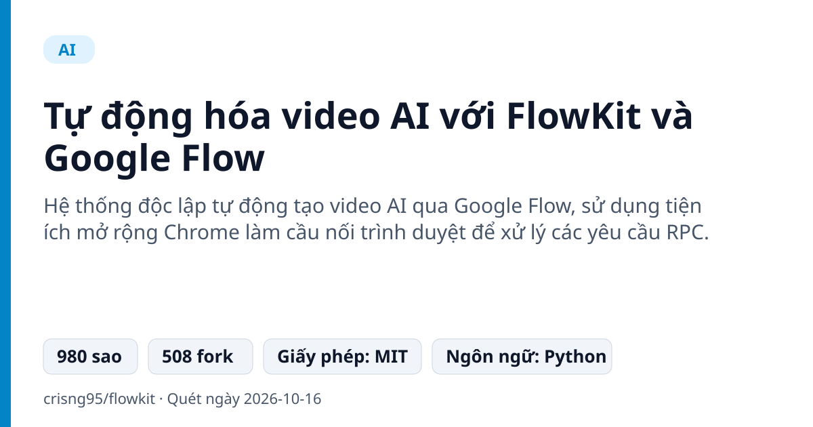
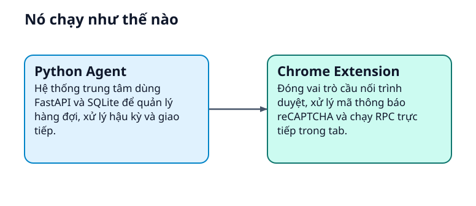
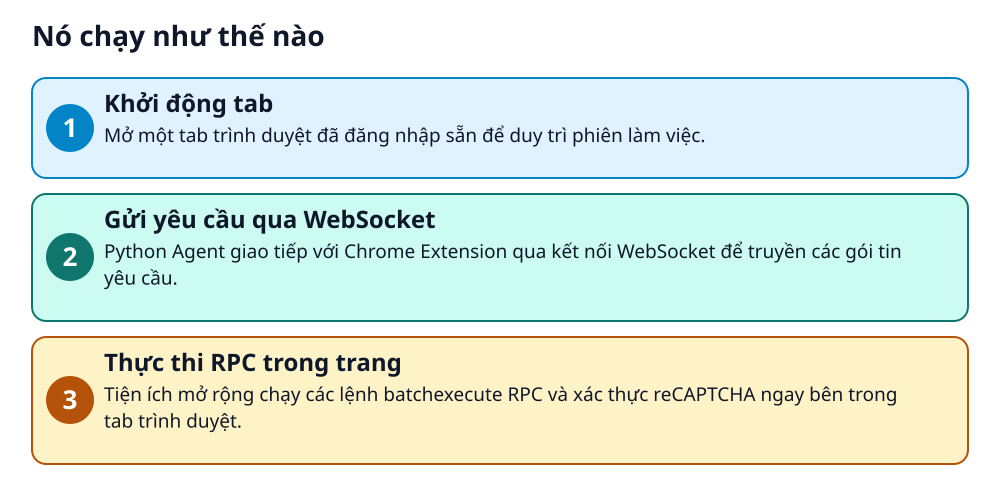

# Tự động hóa video AI với FlowKit và Google Flow

> Tạo video AI từ kịch bản đến YouTube hoàn chỉnh mà không cần thao tác thủ công từng bước trên web.

**Hệ thống độc lập tự động tạo video AI qua Google Flow, sử dụng tiện ích mở rộng Chrome làm cầu nối trình duyệt để xử lý các yêu cầu RPC.**

## Vấn đề nó giải quyết

Người làm nội dung tốn nhiều thời gian thao tác thủ công trên Google Flow để tạo hình ảnh, video clip, lồng tiếng và ghép nối. Việc thiếu tự động hóa khiến quá trình sản xuất video dài trở nên chậm và lặp lại.

> 💡 **Hình dung đời thường:** Giống như việc bạn thuê một trợ lý ảo ngồi bên cạnh máy tính, tự động bấm các nút trên trình duyệt thay vì bạn phải tự tay làm từng việc một.

## Nó chạy như thế nào

1. **Khởi động tab**: Mở một tab trình duyệt đã đăng nhập sẵn để duy trì phiên làm việc. _(Căn cứ: `README`)_
2. **Gửi yêu cầu qua WebSocket**: Python Agent giao tiếp với Chrome Extension qua kết nối WebSocket để truyền các gói tin yêu cầu. _(Căn cứ: `README`)_
3. **Thực thi RPC trong trang**: Tiện ích mở rộng chạy các lệnh batchexecute RPC và xác thực reCAPTCHA ngay bên trong tab trình duyệt. _(Căn cứ: `README`)_

## Các mảnh ghép

| | Các mảnh ghép | Căn cứ |
|---|---|---|
| **Python Agent** | Hệ thống trung tâm dùng FastAPI và SQLite để quản lý hàng đợi, xử lý hậu kỳ và giao tiếp. | `README` |
| **Chrome Extension** | Đóng vai trò cầu nối trình duyệt, xử lý mã thông báo reCAPTCHA và chạy RPC trực tiếp trong tab. | `README` |

## Học được gì từ thiết kế này

- Cách kết hợp Python Agent với tiện ích mở rộng Chrome qua WebSocket
- Kỹ thuật xử lý yêu cầu trang web yêu cầu phiên đăng nhập thực tế
- Tổ chức hệ thống tạo nội dung đa phương tiện tự động

## Ai nên xem

- Nhà sáng tạo nội dung YouTube
- Lập trình viên muốn tự động hóa quy trình AI
- Người dùng muốn tạo video hàng loạt

## Tự thử

README không đưa lệnh cài đặt rõ ràng; hãy đọc README gốc.

Cần cài đặt tiện ích mở rộng Chrome và giữ một tab trình duyệt đã đăng nhập luôn mở.

## Lưu ý trước khi dùng

- Cần mở sẵn tab trình duyệt đã đăng nhập, không chạy ngầm hoàn toàn headless được
- Một số tính năng Veo có thể không được hỗ trợ trên API hàng loạt mới

## Từ khóa

- **batchexecute**: Giao thức gọi hàm từ xa (RPC) mà Google sử dụng cho các ứng dụng web của mình.
- **WebSocket**: Giao thức truyền thông giúp Python Agent và tiện ích mở rộng Chrome trò chuyện với nhau theo thời gian thực.

---

Nguồn dữ kiện: [crisng95/flowkit](https://github.com/crisng95/flowkit) · Giấy phép: MIT · 980 sao · Quét ngày 2026-10-16

_Nội dung do AI tóm tắt từ README và cấu trúc repo; hãy đọc repo gốc trước khi dùng._
