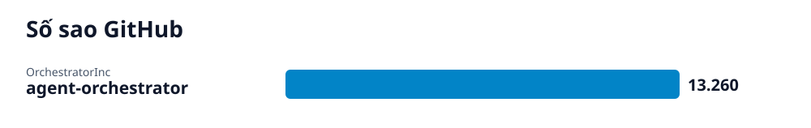

# Radar GitHub · 2026-10-17-2

## Các repo của lần quét này

- **[Điều phối đội ngũ AI coding agent đa nhiệm](agent-orchestrator/vi.md)** (Phần mềm) — Ứng dụng desktop điều phối và giám sát các coding agent từ khâu lập kế hoạch đến hợp nhất mã nguồn.
  - 🎯 Cài đặt thành công ứng dụng desktop trên máy tính, kết nối với kho mã nguồn Git và khởi tạo worker session đầu tiên cho coding agent. · 🪜 2 bước
