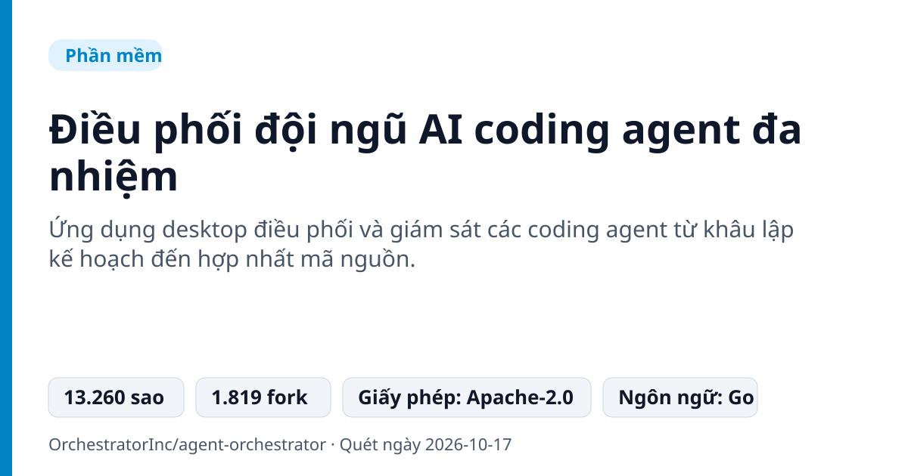
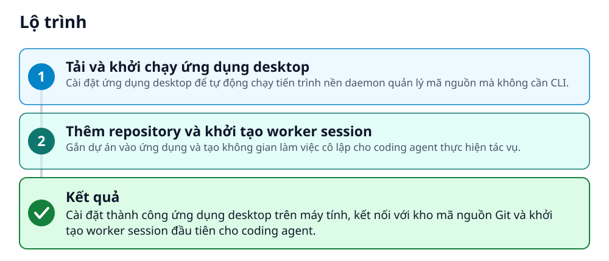
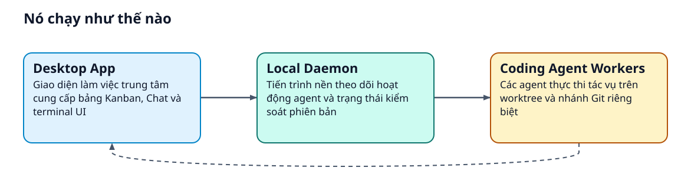
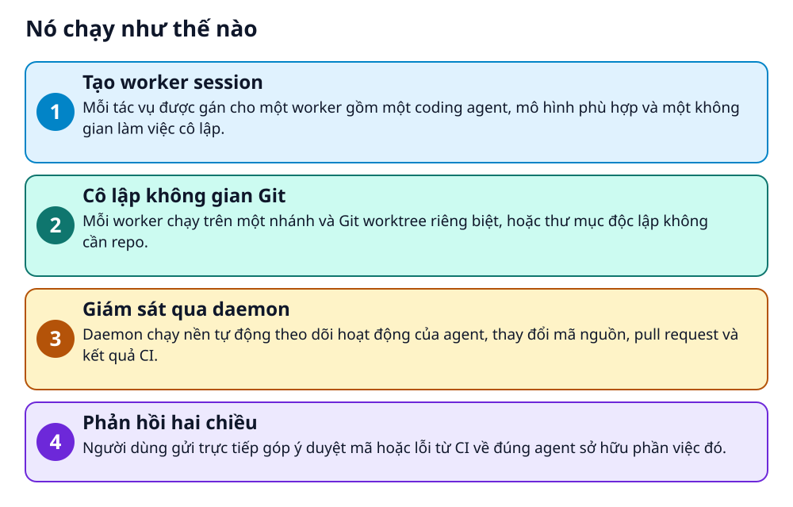

# Điều phối đội ngũ AI coding agent đa nhiệm

> Quản lý nhiều coding agent cùng lúc trên từng branch và worktree riêng biệt mà không lo xung đột.

**Ứng dụng desktop điều phối và giám sát các coding agent từ khâu lập kế hoạch đến hợp nhất mã nguồn.**

## 🎯 Bạn sẽ làm ra được gì

Cài đặt thành công ứng dụng desktop trên máy tính, kết nối với kho mã nguồn Git và khởi tạo worker session đầu tiên cho coding agent.

## Vấn đề nó giải quyết

Khi chạy nhiều AI coding agent trên cùng một dự án, lập trình viên gặp khó khăn trong việc phân chia công việc và cấp ngữ cảnh phù hợp. Việc nhiều tác vụ chạy song song dễ gây xung đột nhánh Git và mất dấu trạng thái kiểm thử.

> 💡 **Hình dung đời thường:** Giống như người quản đốc công trường chia mỗi nhóm thợ vào một phòng riêng biệt để thi công mà không cản trở nhau.

## Ai nên xem

- Lập trình viên muốn chạy song song nhiều AI coding agent mà không sợ xung đột mã nguồn
- Trưởng nhóm kỹ thuật cần giám sát trạng thái kéo mã, CI và tiến độ sửa đổi từ nhiều agent
- Người dùng các công cụ như Claude Code, Codex, Cursor muốn có giao diện quản lý tập trung

## ⚠️ Lưu ý trước khi dùng

- Mỗi agent harness (Claude Code, Codex, v.v.) có mức độ hỗ trợ Worker, Chat và reviewer khác nhau
- Cần cài đặt riêng CLI cho từng coding agent theo tài liệu hướng dẫn

## 🧰 Chuẩn bị trước khi bắt đầu

_Đánh dấu từng mục khi đã có đủ._

- [ ] **Hệ điều hành tương thích**: macOS (Apple silicon hoặc Intel), Windows, hoặc Linux (AppImage, deb, rpm)  
  Liên kết trong README: [installation guide](https://docs.orchestrator.inc/installation)  
  Căn cứ: `README`
- [ ] **Kho lưu trữ Git**: Dự án mã nguồn Git cục bộ để ứng dụng quản lý nhánh và worktree  
  Căn cứ: `README`

## 🗺️ Lộ trình

## 🪜 Làm theo từng bước

### Bước 1 · Tải và khởi chạy ứng dụng desktop

**Mục đích:** Cài đặt ứng dụng desktop để tự động chạy tiến trình nền daemon quản lý mã nguồn mà không cần CLI.

1. Tải tệp cài đặt phù hợp với hệ điều hành từ danh sách phát hành chính thức.
2. Mở tệp đã tải để khởi động ứng dụng trên máy tính.

🔗 Liên kết trong README: [github.com](https://github.com/OrchestratorInc/agent-orchestrator/releases/latest)

✅ **Bạn sẽ thấy:** Giao diện ứng dụng hiển thị thành công trên màn hình.

🩹 **Nếu không được:** Trên macOS nếu hệ thống báo không thể xác minh nhà phát triển, nhấp chuột phải vào ứng dụng rồi chọn Open, sau đó chọn Open lần nữa.

Căn cứ: `README`

### Bước 2 · Thêm repository và khởi tạo worker session

**Mục đích:** Gắn dự án vào ứng dụng và tạo không gian làm việc cô lập cho coding agent thực hiện tác vụ.

1. Trỏ ứng dụng tới repository bạn muốn quản lý.
2. Bấm New task khi công việc đã rõ ràng, mô tả kết quả mong muốn, chọn agent và model, sau đó đính kèm tệp liên quan.

🔗 Liên kết trong README: [installation guide](https://docs.orchestrator.inc/installation)

✅ **Bạn sẽ thấy:** Một worker session được tạo với branch, worktree riêng và giao diện Chat hoặc terminal UI tương ứng.

Căn cứ: `README`

## ✔️ Kiểm tra kết quả

Tài liệu không cung cấp dòng lệnh CLI để xác thực; kiểm tra trực quan trên màn hình thấy worker session đã gắn liền với branch và hiển thị trạng thái trên Kanban.

## 🩹 Lỗi thường gặp

| Hiện tượng | Cách xử lý | Căn cứ |
|---|---|---|
| Trên macOS ứng dụng không mở và báo không thể xác minh nhà phát triển | Nhấp chuột phải vào ứng dụng và chọn Open, sau đó chọn Open lần nữa; nếu vẫn lỗi thì mở issue kèm chẩn đoán Gatekeeper. | `README` |

## 🚀 Làm tiếp

- Xem hướng dẫn thiết lập từng agent CLI như Claude Code, Codex, Cursor trong tài liệu
- Theo dõi tiến độ pull request và CI của các worker ngay trên bảng Kanban

## 🔍 Bên trong nó hoạt động ra sao

1. **Tạo worker session**: Mỗi tác vụ được gán cho một worker gồm một coding agent, mô hình phù hợp và một không gian làm việc cô lập. _(Căn cứ: `README`)_
2. **Cô lập không gian Git**: Mỗi worker chạy trên một nhánh và Git worktree riêng biệt, hoặc thư mục độc lập không cần repo. _(Căn cứ: `README`)_
3. **Giám sát qua daemon**: Daemon chạy nền tự động theo dõi hoạt động của agent, thay đổi mã nguồn, pull request và kết quả CI. _(Căn cứ: `README`)_
4. **Phản hồi hai chiều**: Người dùng gửi trực tiếp góp ý duyệt mã hoặc lỗi từ CI về đúng agent sở hữu phần việc đó. _(Căn cứ: `README`)_

### Các mảnh ghép

| | Các mảnh ghép | Căn cứ |
|---|---|---|
| **Desktop App** | Giao diện làm việc trung tâm cung cấp bảng Kanban, Chat và terminal UI | `README` |
| **Local Daemon** | Tiến trình nền theo dõi hoạt động agent và trạng thái kiểm soát phiên bản | `README` |
| **Coding Agent Workers** | Các agent thực thi tác vụ trên worktree và nhánh Git riêng biệt | `README` |

## Học được gì từ thiết kế này

- Dùng Git worktree để cô lập hoàn toàn môi trường làm việc của từng AI agent
- Mô hình tiến trình daemon nền giúp tự động hóa việc theo dõi mã nguồn mà không cần gõ lệnh thủ công
- Quản lý vòng lặp phản hồi khép kín bằng cách trả thẳng lỗi CI vào phiên làm việc của agent

## Từ khóa

- **Worktree**: Tính năng của Git cho phép gắn nhiều thư mục làm việc vào cùng một repository
- **Worker**: Đơn vị thực thi gồm một tác vụ, một coding agent và một không gian làm việc riêng biệt
- **Daemon**: Tiến trình chạy nền trên máy để tự động giám sát trạng thái hệ thống

---

Nguồn dữ kiện: [OrchestratorInc/agent-orchestrator](https://github.com/OrchestratorInc/agent-orchestrator) · Giấy phép: Apache-2.0 · 13.260 sao · Quét ngày 2026-10-17

_Nội dung do AI tóm tắt từ README và cấu trúc repo; hãy đọc repo gốc trước khi dùng._
