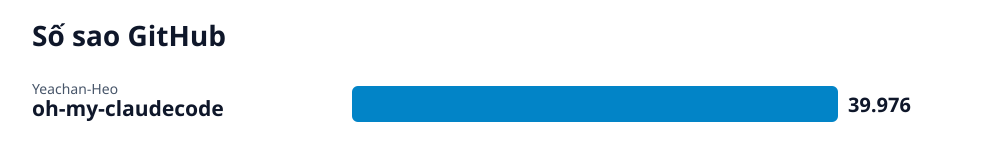

# Radar GitHub · 2026-10-17-3

## Các repo của lần quét này

- **[Điều phối đa tác nhân AI với oh-my-claudecode](oh-my-claudecode/vi.md)** (AI) — Hệ thống điều phối đa tác nhân (multi-agent orchestration) ưu tiên làm việc nhóm dành cho Claude Code.
  - 🎯 Cài đặt và thiết lập thành công oh-my-claudecode để chạy lệnh tự động hoá /autopilot xây dựng ứng dụng. · 🪜 4 bước
