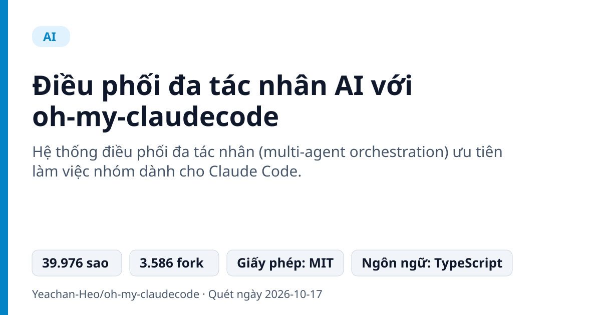
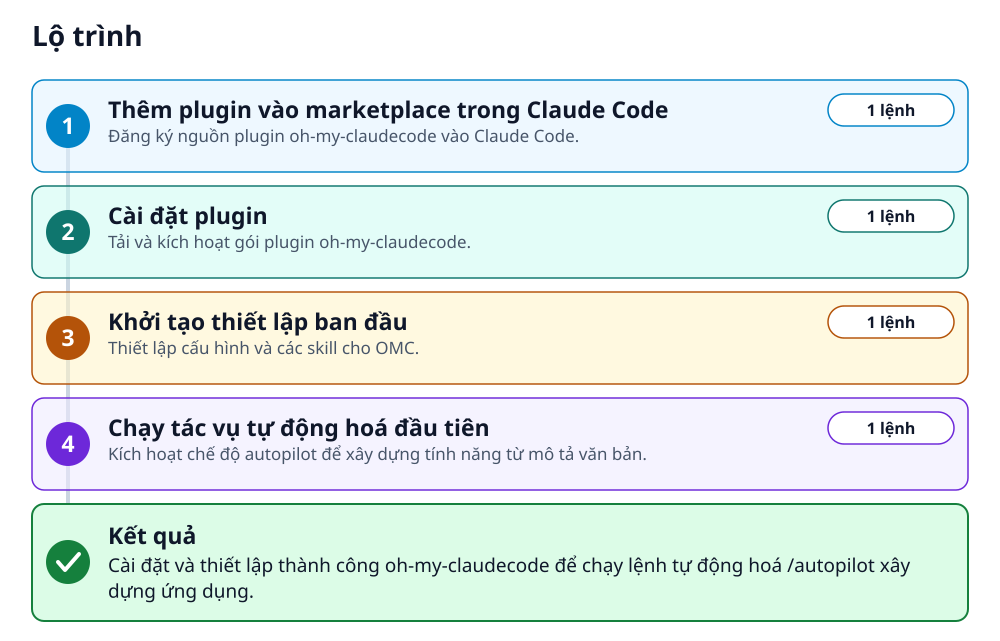
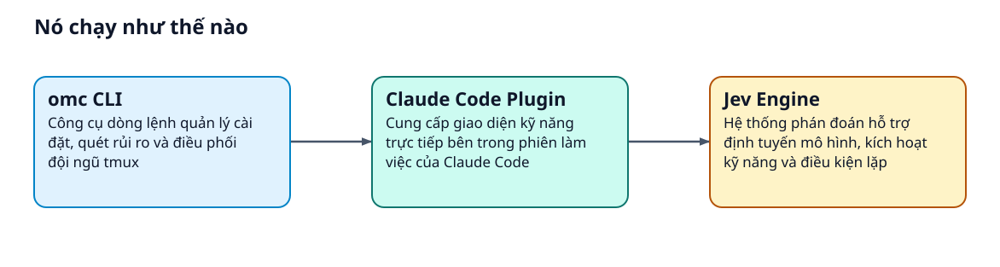
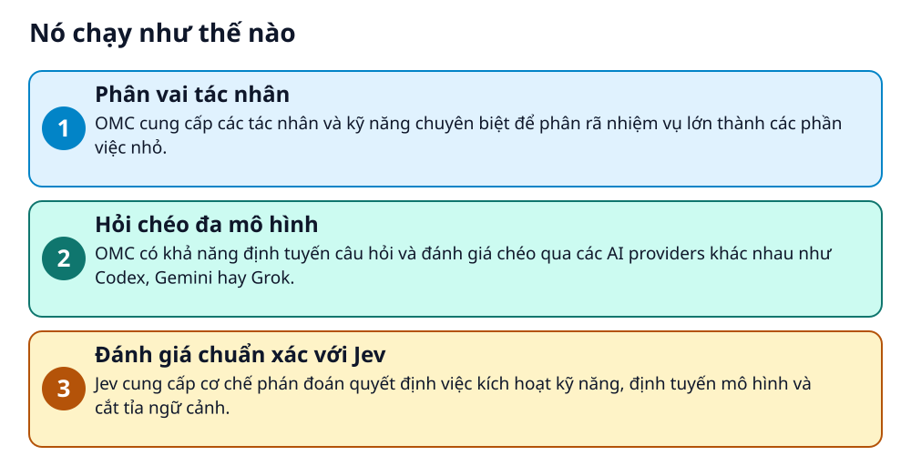

# Điều phối đa tác nhân AI với oh-my-claudecode



> Biến Claude Code thành nhóm AI tự động hoá với đa tác nhân song song.

**Hệ thống điều phối đa tác nhân (multi-agent orchestration) ưu tiên làm việc nhóm dành cho Claude Code.**

## 🎯 Bạn sẽ làm ra được gì

Cài đặt và thiết lập thành công oh-my-claudecode để chạy lệnh tự động hoá /autopilot xây dựng ứng dụng.

## Vấn đề nó giải quyết

Người dùng Claude Code thường phải tự gõ từng lệnh và chỉ đạo một AI duy nhất xử lý từ đầu đến cuối. Khi dự án lớn, việc thiếu kiểm tra chéo, thiếu quy trình lập kế hoạch và thực thi tự động làm giảm tốc độ phát triển phần mềm.

> 💡 **Hình dung đời thường:** Giống như thay vì tự bạn làm việc với một lập trình viên duy nhất, bạn có một quản lý dự án chia việc cho cả nhóm chuyên viên làm song song.

## Ai nên xem

- Lập trình viên muốn tự động hoá viết mã với Claude Code theo nhóm tác nhân
- Nhóm phát triển cần phối hợp nhiều AI (Claude, Codex, Gemini) để kiểm tra chéo kiến trúc
- Người dùng Claude Code cần quy trình phỏng vấn Socratic để làm rõ yêu cầu dự án

## ⚠️ Lưu ý trước khi dùng

- Các lệnh slash (/autopilot, /team, v.v.) yêu cầu phiên Claude Code đang chạy, không dùng được trực tiếp trong CI/CD không tương tác
- Tính năng đặt tên workflow stage profile v1 hiện yêu cầu hệ điều hành Linux có tiện ích flock
- omc team và phát hiện giới hạn tốc độ yêu cầu cài đặt tmux (hoặc psmux trên Windows)

## 🧰 Chuẩn bị trước khi bắt đầu

_Đánh dấu từng mục khi đã có đủ._

- [ ] **Claude Code CLI**: Công cụ dòng lệnh Claude Code từ Anthropic  
  Liên kết trong README: [Claude Code](https://docs.anthropic.com/claude-code)  
  <sub>Căn cứ: `README`</sub>
- [ ] **Claude Max/Pro subscription hoặc Anthropic API key**: Tài khoản hoặc khoá API để sử dụng Claude Code  
  <sub>Căn cứ: `README`</sub>
- [ ] **tmux hoặc psmux**: Yêu cầu cho tính năng omc team và phát hiện giới hạn tốc độ (tmux trên Linux/macOS, psmux trên Windows)  
  Liên kết trong README: [tmux](https://github.com/tmux/tmux)  
  <sub>Căn cứ: `README`</sub>

## 🗺️ Lộ trình



## 🪜 Làm theo từng bước

### Bước 1 · Thêm plugin vào marketplace trong Claude Code

**Mục đích:** Đăng ký nguồn plugin oh-my-claudecode vào Claude Code.

1. Mở phiên làm việc Claude Code
2. Nhập lệnh plugin marketplace add (chạy từng dòng một, không dán cả 2 dòng cùng lúc)

_Gõ hoặc dán từng dòng, theo thứ tự._

```bash
/plugin marketplace add https://github.com/Yeachan-Heo/oh-my-claudecode
```

<sub>Căn cứ: `README`</sub>

### Bước 2 · Cài đặt plugin

**Mục đích:** Tải và kích hoạt gói plugin oh-my-claudecode.

1. Nhập lệnh /plugin install trong phiên Claude Code

```bash
/plugin install oh-my-claudecode
```

<sub>Căn cứ: `README`</sub>

### Bước 3 · Khởi tạo thiết lập ban đầu

**Mục đích:** Thiết lập cấu hình và các skill cho OMC.

1. Chạy lệnh thiết lập bên trong phiên Claude Code (hoặc chạy omc setup ngoài terminal)

```bash
/omc-setup
```

<sub>Căn cứ: `README`</sub>

### Bước 4 · Chạy tác vụ tự động hoá đầu tiên

**Mục đích:** Kích hoạt chế độ autopilot để xây dựng tính năng từ mô tả văn bản.

1. Chạy lệnh /autopilot trong phiên Claude Code

```bash
/autopilot "build a REST API for managing tasks"
```

<sub>Căn cứ: `README`</sub>

## ✔️ Kiểm tra kết quả

Phiên Claude Code nhận lệnh /autopilot và bắt đầu tự động triển khai tác vụ 'build a REST API for managing tasks'.

## 🩹 Lỗi thường gặp

| Hiện tượng | Cách xử lý | Căn cứ |
|---|---|---|
| npm cảnh báo deprecated prebuild-install@7.1.3 khi cài đặt qua CLI | Cảnh báo này đến từ gói phụ thuộc better-sqlite3 và không đồng nghĩa với việc cài đặt CLI thất bại. | `README` |

## 🚀 Làm tiếp

- Dùng lệnh /deep-interview "I want to build a task management app" nếu chưa rõ yêu cầu thiết kế
- Thử nghiệm cấu hình quy trình theo giai đoạn bằng lệnh /autopilot --workflow plan-build-qa

## 🔍 Bên trong nó hoạt động ra sao





1. **Phân vai tác nhân**: OMC cung cấp các tác nhân và kỹ năng chuyên biệt để phân rã nhiệm vụ lớn thành các phần việc nhỏ. _(Căn cứ: `README`)_
2. **Hỏi chéo đa mô hình**: OMC có khả năng định tuyến câu hỏi và đánh giá chéo qua các AI providers khác nhau như Codex, Gemini hay Grok. _(Căn cứ: `README`)_
3. **Đánh giá chuẩn xác với Jev**: Jev cung cấp cơ chế phán đoán quyết định việc kích hoạt kỹ năng, định tuyến mô hình và cắt tỉa ngữ cảnh. _(Căn cứ: `README`)_

### Các mảnh ghép

| | Các mảnh ghép | Căn cứ |
|---|---|---|
| **Claude Code Plugin** | Cung cấp giao diện kỹ năng trực tiếp bên trong phiên làm việc của Claude Code | `README` |
| **omc CLI** | Công cụ dòng lệnh quản lý cài đặt, quét rủi ro và điều phối đội ngũ tmux | `README` |
| **Jev Engine** | Hệ thống phán đoán hỗ trợ định tuyến mô hình, kích hoạt kỹ năng và điều kiện lặp | `README` |

## Học được gì từ thiết kế này

- Cách chia tách bề mặt giao tiếp giữa Terminal CLI và In-session skills trong AI agents
- Mô hình tích hợp plugin trực tiếp qua lệnh slash command của Claude Code
- Chiến lược phòng vệ rủi ro và phán đoán quyết định (Jev) trước khi thực thi mã nguồn

## Từ khóa

- **tmux**: Bộ dồn kênh thiết bị cuối (terminal multiplexer) cho phép chạy nhiều tiến trình song song trong cùng một cửa sổ.
- **Jev**: Cơ chế đưa ra phán đoán quyết định trong việc điều phối luồng thực thi của OMC.

---

Nguồn dữ kiện: [Yeachan-Heo/oh-my-claudecode](https://github.com/Yeachan-Heo/oh-my-claudecode) · Giấy phép: MIT · 39.976 sao · Quét ngày 2026-10-17

_Nội dung do AI tóm tắt từ README và cấu trúc repo; hãy đọc repo gốc trước khi dùng._
