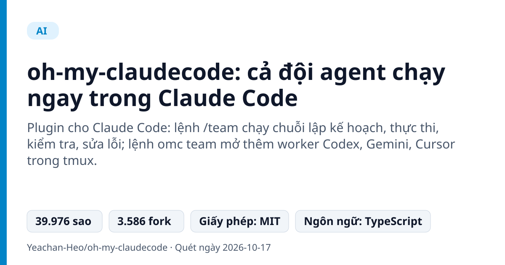
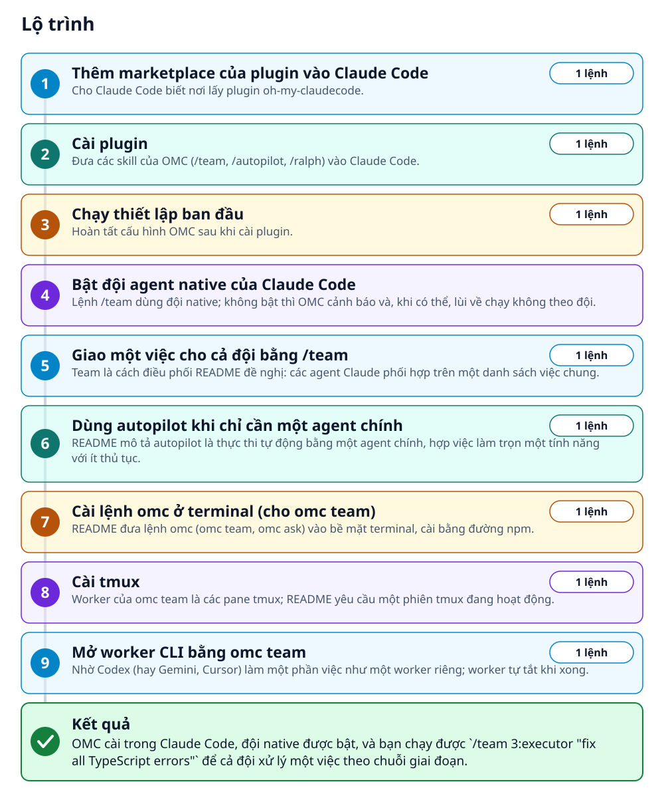
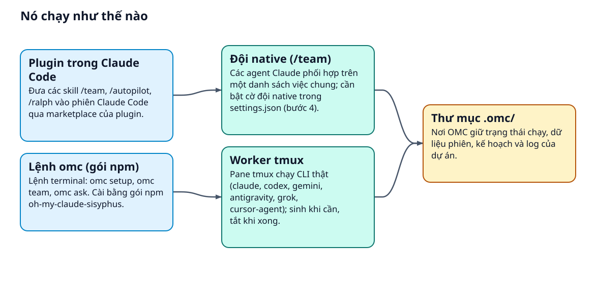
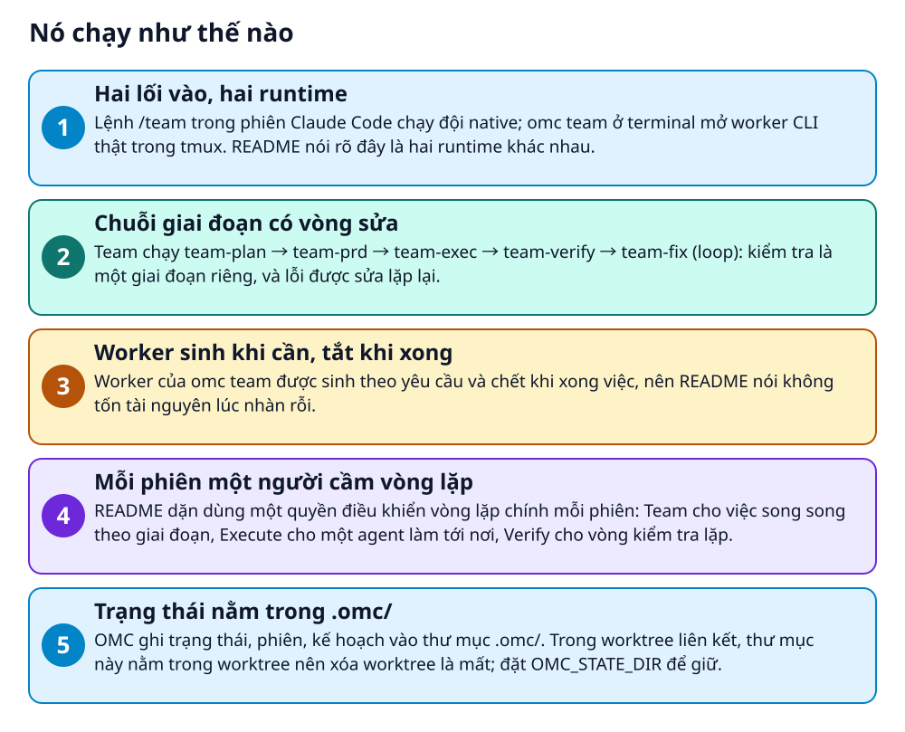

# oh-my-claudecode: cả đội agent chạy ngay trong Claude Code



> Một lệnh /team để Claude Code chia việc, kiểm tra và sửa lỗi theo vòng, thay vì một agent làm hết.

**Plugin cho Claude Code: lệnh /team chạy chuỗi lập kế hoạch, thực thi, kiểm tra, sửa lỗi; lệnh omc team mở thêm worker Codex, Gemini, Cursor trong tmux.**

## 🎯 Bạn sẽ làm ra được gì

OMC cài trong Claude Code, đội native được bật, và bạn chạy được `/team 3:executor "fix all TypeScript errors"` để cả đội xử lý một việc theo chuỗi giai đoạn.

## Vấn đề nó giải quyết

Một agent AI làm từ kế hoạch đến kiểm tra thì bạn phải tự chia việc và canh từng bước. oh-my-claudecode (OMC) đặt thêm một lớp điều phối lên Claude Code: Team chạy các agent theo chuỗi giai đoạn có vòng sửa lỗi, còn omc team mở worker CLI thật trong tmux khi bạn muốn nhờ Codex hay Gemini.

> 💡 **Hình dung đời thường:** Giống một tổ trưởng công trình: bạn nói cần sửa gì, tổ trưởng chia cho từng thợ, có người nghiệm thu, chỗ nào chưa đạt thì quay lại làm tiếp.

## Ai nên xem

- Người dùng Claude Code muốn chia một việc lớn cho nhiều agent mà vẫn có bước kiểm tra riêng.
- Người đã có thuê bao Codex, Gemini hoặc Cursor và muốn gọi chúng làm worker cho cùng một việc.
- Người cần làm rõ yêu cầu mơ hồ trước khi viết mã (lệnh /deep-interview).

## ⚠️ Lưu ý trước khi dùng

- Cần Claude Code CLI và gói Max/Pro hoặc khóa API Anthropic. Với omc team, mỗi CLI (codex, gemini, agy, grok, cursor-agent) tự cài và đăng nhập riêng.
- Đội native cần đặt `CLAUDE_CODE_EXPERIMENTAL_AGENT_TEAMS`; nếu tắt, OMC cảnh báo và lùi về chạy không theo đội khi có thể.
- Lệnh slash như /team, /autopilot cần phiên Claude Code đang chạy nên không dùng trong CI; omc team cần tmux.
- Jev (lớp phán đoán tùy chọn, bật bằng biến môi trường) cần khóa riêng. README cũng gợi ý gajae-code cho ai thấy OMC hơi quá tay.

## 🧰 Chuẩn bị trước khi bắt đầu

_Đánh dấu từng mục khi đã có đủ._

- [ ] **Claude Code CLI**: OMC chạy bên trong phiên Claude Code; README đặt nó làm điều kiện đầu tiên.  
  Liên kết trong README: [Claude Code](https://docs.anthropic.com/claude-code)  
  <sub>Căn cứ: `README`</sub>
- [ ] **Gói Claude Max/Pro hoặc khóa API Anthropic**: README ghi cần một trong hai để dùng Claude Code.  
  <sub>Căn cứ: `README`</sub>
- [ ] **npm (chỉ khi cài lệnh omc)**: README cài lệnh omc ở terminal bằng gói npm; các lệnh slash trong Claude Code không cần bước này.  
  <sub>Căn cứ: `README`</sub>
- [ ] **tmux (chỉ cho omc team)**: Windows: psmux, bản tmux chạy thẳng; WSL2: tmux cài bên trong WSL.  
  Liên kết trong README: [tmux](https://github.com/tmux/tmux)  
  <sub>Căn cứ: `README`</sub>
- [ ] **CLI của agent khác (tùy chọn)**: codex, gemini, agy, grok, cursor-agent: mỗi cái cài và đăng nhập riêng. OMC chạy đủ khi không có chúng.  
  <sub>Căn cứ: `README`</sub>
- [ ] **Chi phí nếu dùng đủ ba hãng (tùy chọn)**: README ước tính ba gói Pro (Claude, Antigravity/Gemini, ChatGPT) khoảng 60 USD mỗi tháng; các hãng ngoài Claude không bắt buộc.  
  <sub>Căn cứ: `README`</sub>

## 🗺️ Lộ trình



## 🪜 Làm theo từng bước

### Bước 1 · Thêm marketplace của plugin vào Claude Code

**Mục đích:** Cho Claude Code biết nơi lấy plugin oh-my-claudecode.

1. Mở một phiên Claude Code và gõ lệnh dưới đây.
2. README dặn nhập từng lệnh một; dán cả hai lệnh cùng lúc sẽ lỗi.

_Gõ hoặc dán từng dòng, theo thứ tự._

```bash
/plugin marketplace add https://github.com/Yeachan-Heo/oh-my-claudecode
```

<sub>Căn cứ: `README`</sub>

### Bước 2 · Cài plugin

**Mục đích:** Đưa các skill của OMC (/team, /autopilot, /ralph) vào Claude Code.

1. Gõ lệnh dưới đây trong cùng phiên, sau khi lệnh trước chạy xong.

```bash
/plugin install oh-my-claudecode
```

<sub>Căn cứ: `README`</sub>

### Bước 3 · Chạy thiết lập ban đầu

**Mục đích:** Hoàn tất cấu hình OMC sau khi cài plugin.

1. Gõ lệnh dưới đây trong phiên Claude Code.
2. Ở terminal, lệnh tương đương là `omc setup` (cần cài lệnh omc ở bước 7).

```bash
/omc-setup
```

<sub>Căn cứ: `README`</sub>

### Bước 4 · Bật đội agent native của Claude Code

**Mục đích:** Lệnh /team dùng đội native; không bật thì OMC cảnh báo và, khi có thể, lùi về chạy không theo đội.

1. Mở `~/.claude/settings.json`.
2. Trong khóa `env`, thêm dòng `"CLAUDE_CODE_EXPERIMENTAL_AGENT_TEAMS": "1"`. Giá trị 1 là giá trị thật, giữ nguyên.
3. Nếu file đã có khóa env, thêm dòng đó vào khóa sẵn có thay vì thay cả file.

<sub>Căn cứ: `README`</sub>

### Bước 5 · Giao một việc cho cả đội bằng /team

**Mục đích:** Team là cách điều phối README đề nghị: các agent Claude phối hợp trên một danh sách việc chung.

1. Mở một dự án có lỗi TypeScript và gõ lệnh dưới đây trong phiên Claude Code.
2. Số đứng trước dấu hai chấm có dạng N:loại-agent; README dùng 3:executor cho /team và 2:codex cho omc team.
3. Đội đi theo chuỗi `team-plan → team-prd → team-exec → team-verify → team-fix (loop)`.

```bash
/team 3:executor "fix all TypeScript errors"
```

<sub>Căn cứ: `README`</sub>

### Bước 6 · Dùng autopilot khi chỉ cần một agent chính

**Mục đích:** README mô tả autopilot là thực thi tự động bằng một agent chính, hợp việc làm trọn một tính năng với ít thủ tục.

1. Gõ lệnh dưới đây trong phiên Claude Code để xây một tính năng từ mô tả.
2. README dặn mỗi phiên chỉ dùng một cơ chế cầm vòng lặp chính (/goal, Execute, Team hoặc Verify). Autopilot cũng có thể được cấu hình để chạy giai đoạn thực thi qua team.

```bash
/autopilot "build a REST API for managing tasks"
```

<sub>Căn cứ: `README`</sub>

### Bước 7 · Cài lệnh omc ở terminal (cho omc team)

**Mục đích:** README đưa lệnh omc (omc team, omc ask) vào bề mặt terminal, cài bằng đường npm.

1. Chạy lệnh dưới đây trong terminal, không phải trong phiên Claude Code.
2. Tên gói npm khác tên repo; nó cài cả `oh-my-claudecode` lẫn lệnh ngắn `omc`.
3. README đưa đường npm như lựa chọn thay cho marketplace, nhưng bảng CLI và skill trong phiên liệt kê cả hai bề mặt; bước này chỉ thêm lệnh omc.

```bash
npm i -g oh-my-claude-sisyphus@latest
```

<sub>Căn cứ: `README`</sub>

### Bước 8 · Cài tmux

**Mục đích:** Worker của omc team là các pane tmux; README yêu cầu một phiên tmux đang hoạt động.

1. Lệnh dưới đây dành cho macOS (Homebrew).
2. Ubuntu/Debian: `sudo apt install tmux`. Fedora: `sudo dnf install tmux`. Arch: `sudo pacman -S tmux`. Windows: `winget install psmux`; WSL2 dùng tmux trong WSL.

```bash
brew install tmux
```

🔗 Liên kết trong README: [tmux](https://github.com/tmux/tmux)

<sub>Căn cứ: `README`</sub>

### Bước 9 · Mở worker CLI bằng omc team

**Mục đích:** Nhờ Codex (hay Gemini, Cursor) làm một phần việc như một worker riêng; worker tự tắt khi xong.

1. Làm trong một phiên tmux đang hoạt động: README yêu cầu điều này nhưng không ghi cách mở phiên.
2. Cài và đăng nhập CLI bạn định dùng (ở đây là codex) trước.
3. Chạy lệnh dưới đây (một ví dụ trong bảng của README) để mở hai worker Codex xem xét luồng xác thực.
4. `omc team status` và `omc team shutdown` cần tên đội đã mở; README không nói cách lấy tên. Xem `docs/REFERENCE.md`: việc review auth flow có tên đội review-auth-flow.

```bash
omc team 2:codex "review auth flow"
```

<sub>Căn cứ: `README`</sub>

## ✔️ Kiểm tra kết quả

Trong Claude Code, /team bắt đầu chuỗi giai đoạn của Team. Ở terminal, omc team status với tên đội cho biết trạng thái; README không mô tả chi tiết đầu ra.

## 🩹 Lỗi thường gặp

| Hiện tượng | Cách xử lý | Căn cứ |
|---|---|---|
| npm cảnh báo deprecated prebuild-install@7.1.3 khi cài CLI | README nói cảnh báo đến từ phụ thuộc `better-sqlite3` và không có nghĩa là cài thất bại. | `README` |
| Dán hai lệnh /plugin cùng lúc thì lỗi | Nhập từng lệnh một và đợi lệnh trước chạy xong, như README dặn. | `README` |
| Chạy /team khi chưa bật đội native | OMC cảnh báo và lùi về chạy không theo đội khi có thể. Đặt `CLAUDE_CODE_EXPERIMENTAL_AGENT_TEAMS` ở bước 4. | `README` |
| Gặp lỗi sau khi cập nhật plugin | Cập nhật bằng `/plugin marketplace update omc` rồi `/omc-setup`; nếu vẫn lỗi, README bảo xóa cache plugin cũ bằng `/omc-doctor`. | `README` |
| Chạy /team hay /autopilot trong CI không có người ngồi | README: các lệnh slash cần phiên Claude Code đang chạy; trong CI dùng lệnh terminal xác định như `omc setup`. | `README` |

## 🚀 Làm tiếp

- Làm rõ yêu cầu mơ hồ trước khi chia việc: `/deep-interview "I want to build a task management app"`.
- Hỏi một nhà cung cấp khác xem xét giúp: `/ask codex "Review this PR — architecture"`.
- Chạy OMC trong worktree? Đặt `OMC_STATE_DIR` để trạng thái `.omc/` không mất khi xóa worktree.

## 🔍 Bên trong nó hoạt động ra sao





1. **Hai lối vào, hai runtime**: Lệnh /team trong phiên Claude Code chạy đội native; omc team ở terminal mở worker CLI thật trong tmux. README nói rõ đây là hai runtime khác nhau. _(Căn cứ: `README`)_
2. **Chuỗi giai đoạn có vòng sửa**: Team chạy team-plan → team-prd → team-exec → team-verify → team-fix (loop): kiểm tra là một giai đoạn riêng, và lỗi được sửa lặp lại. _(Căn cứ: `README`)_
3. **Worker sinh khi cần, tắt khi xong**: Worker của omc team được sinh theo yêu cầu và chết khi xong việc, nên README nói không tốn tài nguyên lúc nhàn rỗi. _(Căn cứ: `README`)_
4. **Mỗi phiên một người cầm vòng lặp**: README dặn dùng một quyền điều khiển vòng lặp chính mỗi phiên: Team cho việc song song theo giai đoạn, Execute cho một agent làm tới nơi, Verify cho vòng kiểm tra lặp. _(Căn cứ: `README`)_
5. **Trạng thái nằm trong .omc/**: OMC ghi trạng thái, phiên, kế hoạch vào thư mục .omc/. Trong worktree liên kết, thư mục này nằm trong worktree nên xóa worktree là mất; đặt OMC_STATE_DIR để giữ. _(Căn cứ: `README`)_

### Các mảnh ghép

| | Các mảnh ghép | Căn cứ |
|---|---|---|
| **Plugin trong Claude Code** | Đưa các skill /team, /autopilot, /ralph vào phiên Claude Code qua marketplace của plugin. | `README` |
| **Lệnh omc (gói npm)** | Lệnh terminal: omc setup, omc team, omc ask. Cài bằng gói npm oh-my-claude-sisyphus. | `README` |
| **Đội native (/team)** | Các agent Claude phối hợp trên một danh sách việc chung; cần bật cờ đội native trong settings.json (bước 4). | `README` |
| **Worker tmux** | Pane tmux chạy CLI thật (claude, codex, gemini, antigravity, grok, cursor-agent); sinh khi cần, tắt khi xong. | `README` |
| **Thư mục .omc/** | Nơi OMC giữ trạng thái chạy, dữ liệu phiên, kế hoạch và log của dự án. | `README` |

## Học được gì từ thiết kế này

- Tách hai runtime: đội chạy trong phiên và worker chạy ngoài phiên, mỗi bên hợp một loại việc.
- Đặt kiểm tra thành giai đoạn riêng và cho nó vòng sửa lỗi, thay vì kiểm tra một lần ở cuối.
- Mỗi phiên chỉ một cơ chế cầm vòng lặp chính, theo lời dặn của README.
- Worker sinh khi cần và tắt khi xong: trả tài nguyên ngay sau mỗi việc.
- Giữ trạng thái cục bộ cạnh dự án và nói rõ nó sống hay chết theo worktree.

## Từ khóa

- **tmux**: Công cụ chia một cửa sổ terminal thành nhiều pane chạy song song; omc team dùng nó cho worker.
- **Worker**: Một tiến trình agent do omc team mở để làm một phần việc, tự tắt khi xong.
- **Skill**: Lệnh slash do plugin cung cấp trong Claude Code, như /team hay /autopilot.
- **Worktree**: Bản làm việc riêng của git cho một nhánh; .omc/ của OMC nằm trong worktree liên kết.

---

Nguồn dữ kiện: [Yeachan-Heo/oh-my-claudecode](https://github.com/Yeachan-Heo/oh-my-claudecode) · Giấy phép: MIT · 39.976 sao · Quét ngày 2026-10-17

_Nội dung do AI tóm tắt từ README và cấu trúc repo; hãy đọc repo gốc trước khi dùng._
