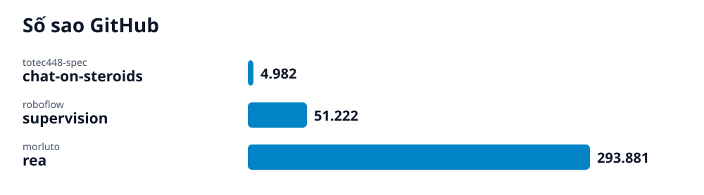

# Radar GitHub · 2026-10-17-5

## Các repo của lần quét này

- **[Chat On Steroids: Kết nối MCP và công cụ cục bộ cho ChatGPT](chat-on-steroids/vi.md)** (Giải pháp) — Không gian làm việc mã nguồn mở mang MCP cục bộ lên ChatGPT với tích hợp Chrome, chia việc đa agent và duy trì phiên làm việc.
  - 🎯 ChatGPT được kết nối qua MCP cục bộ để đọc sửa tệp, mở terminal và phối hợp agent ngay trên máy tính của bạn. · 🪜 5 bước
- **[Làm chủ Supervision: Bộ công cụ thị giác máy tính toàn diện](supervision/vi.md)** (Giải pháp) — Supervision là thư viện Python mã nguồn mở cung cấp các khối xây dựng tái sử dụng cho ứng dụng thị giác máy tính từ Roboflow.
  - 🎯 Cài đặt thành công Supervision, tải kết quả nhận diện vào cấu trúc sv.Detections và hiển thị bounding box lên hình ảnh bằng BoxAnnotator. · 🪜 4 bước
- **[REA: Dịch ngược ứng dụng và binary cùng AI Agent qua MCP](rea/vi.md)** (AI) — REA là máy chủ MCP kết nối AI Agent với các công cụ dịch ngược để phân tích binary gốc, ứng dụng JavaScript, Electron và website ngay trên máy cục bộ.
  - 🎯 Đăng ký thành công REA MCP server vào AI Agent hoặc chạy phân tích ứng dụng JavaScript/Electron trực tiếp từ terminal của bạn. · 🪜 4 bước
