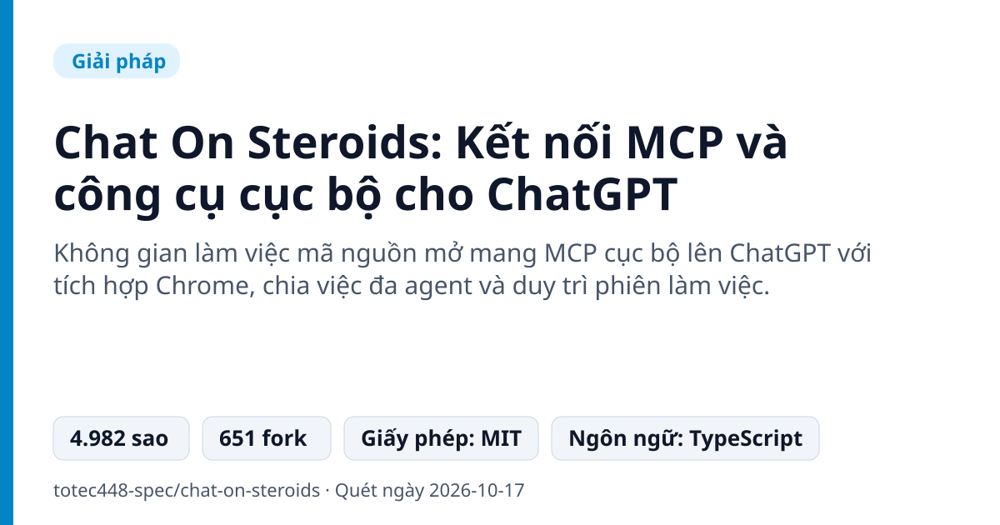
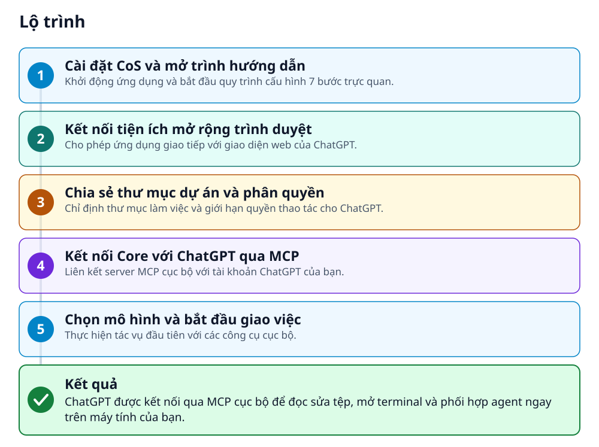
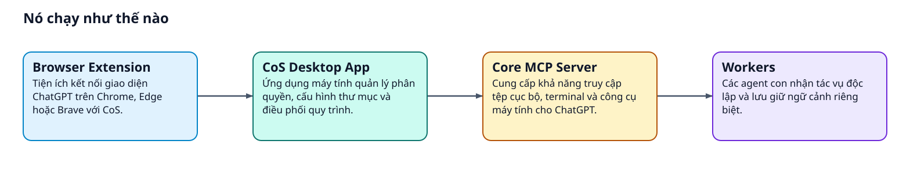
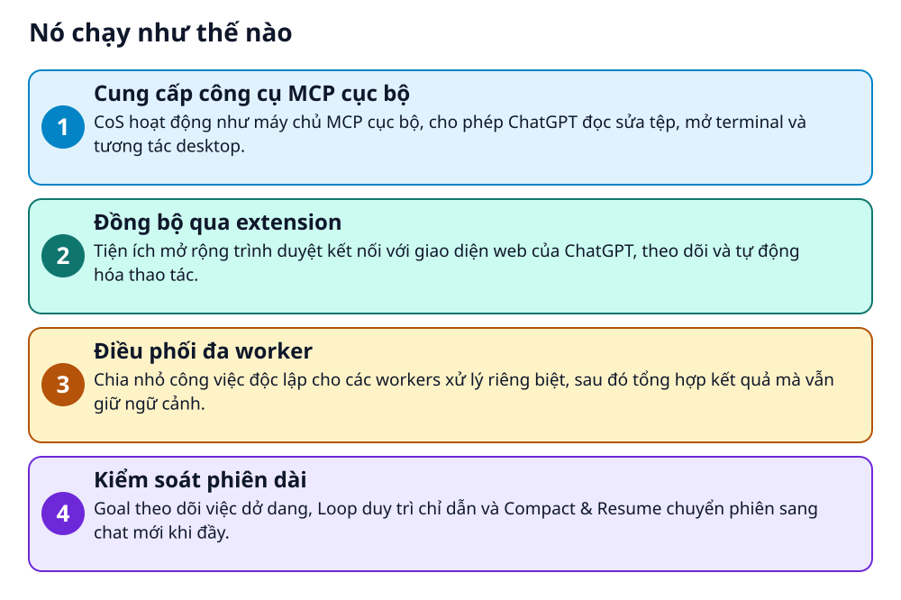

# Chat On Steroids: Kết nối MCP và công cụ cục bộ cho ChatGPT

> Biến ChatGPT trên trình duyệt thành trợ lý lập trình cục bộ với MCP và quy trình đa agent.

**Không gian làm việc mã nguồn mở mang MCP cục bộ lên ChatGPT với tích hợp Chrome, chia việc đa agent và duy trì phiên làm việc.**

## 🎯 Bạn sẽ làm ra được gì

ChatGPT được kết nối qua MCP cục bộ để đọc sửa tệp, mở terminal và phối hợp agent ngay trên máy tính của bạn.

## Vấn đề nó giải quyết

ChatGPT trên web không thể thao tác trực tiếp với tệp tin trên máy, giữ terminal mở hay điều khiển màn hình cục bộ. Người dùng cũng gặp khó khăn khi duy trì ngữ cảnh cho các dự án lập trình dài và phức tạp.

> 💡 **Hình dung đời thường:** Tương tự như việc cấp thẻ ra vào và bàn làm việc trực tiếp tại công ty cho một trợ lý từ xa, thay vì chỉ trao đổi qua tin nhắn điện thoại.

## Ai nên xem

- Lập trình viên muốn ChatGPT đọc sửa mã nguồn và chạy terminal trực tiếp trên máy.
- Người dùng cần tự động hóa các tác vụ dài hạn và phối hợp nhiều agent cùng lúc.

## ⚠️ Lưu ý trước khi dùng

- Bản beta độc lập, chưa được ký số trên Windows và chưa notarize trên macOS.
- Không giúp vượt qua hạn mức sử dụng (quota) hay giới hạn truy cập mô hình của OpenAI.
- Lệnh shell chạy với toàn bộ quyền của tài khoản người dùng hiện tại trên máy tính.

## 🧰 Chuẩn bị trước khi bắt đầu

_Đánh dấu từng mục khi đã có đủ._

- [ ] **Hệ điều hành tương thích**: Windows 10/11, macOS 13 Ventura trở lên, hoặc bản Linux desktop hiện tại.  
  Căn cứ: `README`
- [ ] **Trình duyệt web**: Chrome phiên bản 125 trở lên, hoặc Edge / Brave bản hiện tại.  
  Căn cứ: `README`
- [ ] **Tài khoản ChatGPT hỗ trợ MCP**: Tài khoản hoặc workspace có quyền tạo custom MCP apps.  
  Liên kết trong README: [Check account availability](https://help.openai.com/en/articles/12584461-developer-mode-and-mcp-apps-in-chatgpt)  
  Căn cứ: `README`
- [ ] **Gói cài đặt CoS**: Bộ cài đặt tải về phù hợp với hệ điều hành của bạn.  
  Liên kết trong README: [All downloads](https://github.com/totec448-spec/chat-on-steroids/releases/latest)  
  Căn cứ: `README`
- [ ] **Secret Service keyring cho Linux**: Yêu cầu bắt buộc nếu bạn cài đặt trên Linux.  
  Căn cứ: `README`

## 🗺️ Lộ trình

## 🪜 Làm theo từng bước

### Bước 1 · Cài đặt CoS và mở trình hướng dẫn

**Mục đích:** Khởi động ứng dụng và bắt đầu quy trình cấu hình 7 bước trực quan.

1. Cài đặt ứng dụng CoS trên máy tính của bạn.
2. Mở mục Settings → Setup trong ứng dụng.

✅ **Bạn sẽ thấy:** Giao diện hiển thị 7 bước hướng dẫn kèm hình ảnh minh họa vị trí thao tác.

Căn cứ: `README`

### Bước 2 · Kết nối tiện ích mở rộng trình duyệt

**Mục đích:** Cho phép ứng dụng giao tiếp với giao diện web của ChatGPT.

1. Mở trang quản lý extensions trên Chrome, Edge hoặc Brave và bật Developer mode.
2. Bấm Load unpacked và chọn thư mục được chỉ định bởi nút Open extension folder.

✅ **Bạn sẽ thấy:** Trình duyệt và ứng dụng CoS tự động ghép nối thành công.

Căn cứ: `README`

### Bước 3 · Chia sẻ thư mục dự án và phân quyền

**Mục đích:** Chỉ định thư mục làm việc và giới hạn quyền thao tác cho ChatGPT.

1. Ở các bước 2–3 của Setup, chọn thư mục dự án mà ChatGPT được phép can thiệp.
2. Thiết lập quyền truy cập cho phép ChatGPT thực hiện trong thư mục đó.

Căn cứ: `README`

### Bước 4 · Kết nối Core với ChatGPT qua MCP

**Mục đích:** Liên kết server MCP cục bộ với tài khoản ChatGPT của bạn.

1. Tạo tunnel và restricted API key tại OpenAI theo hướng dẫn.
2. Bấm Connect trong CoS.
3. Trong ChatGPT, thêm ứng dụng tại Plugins → Add → Add custom MCP server.

Căn cứ: `README`

### Bước 5 · Chọn mô hình và bắt đầu giao việc

**Mục đích:** Thực hiện tác vụ đầu tiên với các công cụ cục bộ.

1. Chọn mô hình mong muốn trong ChatGPT.
2. Nhập mô tả công việc cần xử lý và nhấn gửi.

✅ **Bạn sẽ thấy:** ChatGPT đọc, sửa tệp và trả về kết quả công cụ trực tiếp theo thời gian thực.

Căn cứ: `README`

## ✔️ Kiểm tra kết quả

ChatGPT trong trình duyệt nhận diện được custom MCP app, thực hiện thao tác trên tệp và trả về kết quả công cụ trực tiếp.

## 🩹 Lỗi thường gặp

| Hiện tượng | Cách xử lý | Căn cứ |
|---|---|---|
| macOS yêu cầu mật khẩu đăng nhập sau khi cập nhật phiên bản mới | Chọn Always Allow khi macOS hỏi quyền truy cập chat-on-steroids Safe Storage để ứng dụng đọc khóa bảo mật. | `README` |
| Bản Linux AppImage gặp lỗi unprivileged user namespaces bị tắt | Khởi chạy AppImage với cờ --no-sandbox hoặc chuyển sang sử dụng gói cài đặt DEB. | `README` |

## 🚀 Làm tiếp

- Thử nghiệm chia việc độc lập cho các workers để xử lý song song.
- Sử dụng tính năng Compact & Resume để chuyển lịch sử phiên làm việc sang cửa sổ chat mới.

## 🔍 Bên trong nó hoạt động ra sao

1. **Cung cấp công cụ MCP cục bộ**: CoS hoạt động như máy chủ MCP cục bộ, cho phép ChatGPT đọc sửa tệp, mở terminal và tương tác desktop. _(Căn cứ: `README`)_
2. **Đồng bộ qua extension**: Tiện ích mở rộng trình duyệt kết nối với giao diện web của ChatGPT, theo dõi và tự động hóa thao tác. _(Căn cứ: `README`)_
3. **Điều phối đa worker**: Chia nhỏ công việc độc lập cho các workers xử lý riêng biệt, sau đó tổng hợp kết quả mà vẫn giữ ngữ cảnh. _(Căn cứ: `README`)_
4. **Kiểm soát phiên dài**: Goal theo dõi việc dở dang, Loop duy trì chỉ dẫn và Compact & Resume chuyển phiên sang chat mới khi đầy. _(Căn cứ: `README`)_

### Các mảnh ghép

| | Các mảnh ghép | Căn cứ |
|---|---|---|
| **CoS Desktop App** | Ứng dụng máy tính quản lý phân quyền, cấu hình thư mục và điều phối quy trình. | `README` |
| **Browser Extension** | Tiện ích kết nối giao diện ChatGPT trên Chrome, Edge hoặc Brave với CoS. | `README` |
| **Core MCP Server** | Cung cấp khả năng truy cập tệp cục bộ, terminal và công cụ máy tính cho ChatGPT. | `README` |
| **Workers** | Các agent con nhận tác vụ độc lập và lưu giữ ngữ cảnh riêng biệt. | `README` |

## Học được gì từ thiết kế này

- Cách mở rộng khả năng của mô hình AI web bằng giao thức Model Context Protocol (MCP).
- Kỹ thuật chia nhỏ tác vụ cho các worker độc lập mà vẫn bảo toàn ngữ cảnh làm việc.
- Giải pháp Compact & Resume để quản lý giới hạn ngữ cảnh trong các phiên làm việc dài.

## Từ khóa

- **MCP**: Model Context Protocol, giao thức kết nối công cụ và tài nguyên bên ngoài với mô hình AI.
- **Compact & Resume**: Tính năng nén và chuyển tiếp phiên làm việc cùng lịch sử worker sang cuộc trò chuyện mới.

---

Nguồn dữ kiện: [totec448-spec/chat-on-steroids](https://github.com/totec448-spec/chat-on-steroids) · Giấy phép: MIT · 4.982 sao · Quét ngày 2026-10-17

_Nội dung do AI tóm tắt từ README và cấu trúc repo; hãy đọc repo gốc trước khi dùng._
