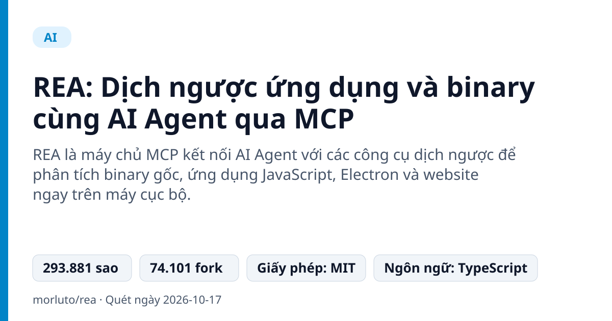
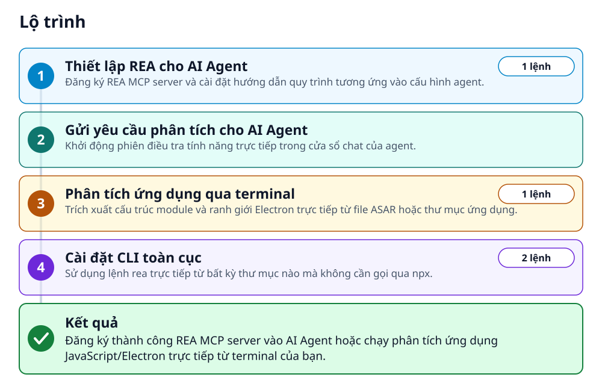
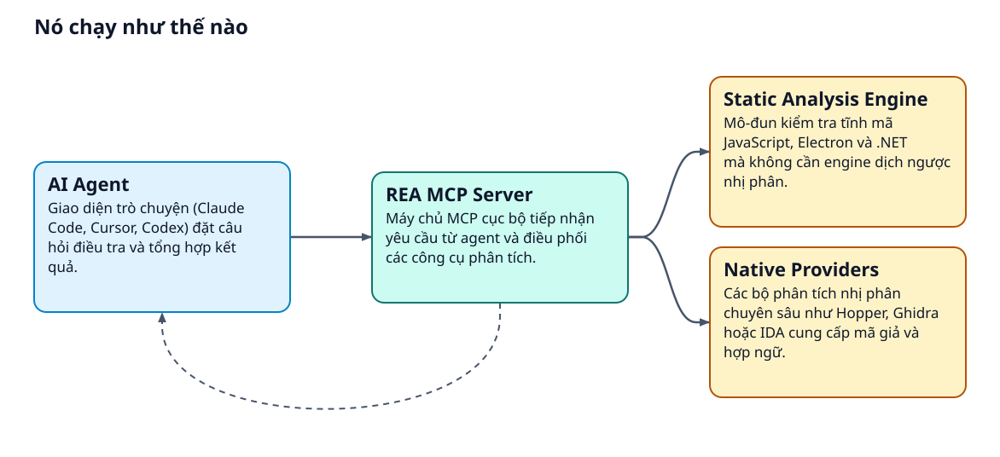
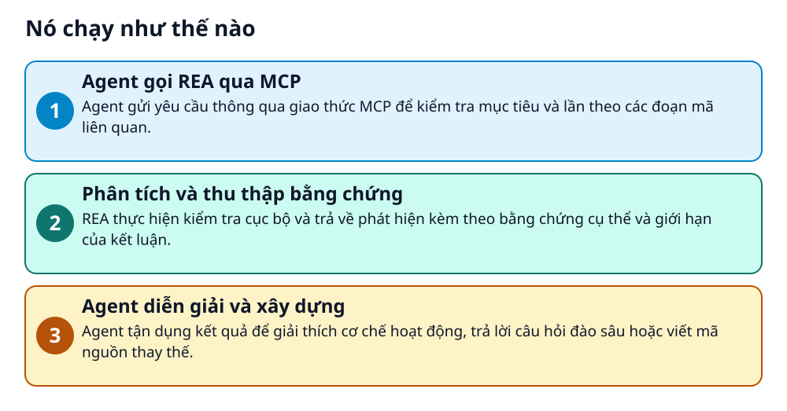

# REA: Dịch ngược ứng dụng và binary cùng AI Agent qua MCP



> Thấy một tính năng hay trong app bất kỳ? AI Agent có thể soi mã nguồn và tái hiện lại cho bạn.

**REA là máy chủ MCP kết nối AI Agent với các công cụ dịch ngược để phân tích binary gốc, ứng dụng JavaScript, Electron và website ngay trên máy cục bộ.**

## 🎯 Bạn sẽ làm ra được gì

Đăng ký thành công REA MCP server vào AI Agent hoặc chạy phân tích ứng dụng JavaScript/Electron trực tiếp từ terminal của bạn.

## Vấn đề nó giải quyết

Khi muốn học hỏi hoặc tái hiện một tính năng phần mềm nhưng không có mã nguồn, việc tự phân tích nhị phân đòi hỏi kỹ năng dịch ngược chuyên sâu và mất nhiều thời gian. Các công cụ truyền thống tách rời khiến việc kết hợp với AI gặp nhiều trở ngại.

> 💡 **Hình dung đời thường:** Giống như việc trang bị cho trợ lý ảo một bộ kính hiển vi và đồ nghề tháo lắp chuyên dụng: trợ lý mở bung cỗ máy phần mềm, ghi nhận bằng chứng cấu tạo và chỉ cho bạn cách làm ra cái tương tự.

## Ai nên xem

- Lập trình viên muốn nghiên cứu kiến trúc và tính năng của các phần mềm khác mà không có mã nguồn.
- Kỹ sư dịch ngược (reverse engineer) muốn tăng tốc điều tra bằng cách tự động hóa qua AI Agent.
- Nhà phát triển ứng dụng JavaScript/Electron cần kiểm tra ranh giới bảo mật và cấu trúc module ứng dụng.

## ⚠️ Lưu ý trước khi dùng

- Phân tích sâu mã nhị phân native yêu cầu cài đặt hoặc cấu hình thêm công cụ bên ngoài như Hopper, Ghidra hoặc IDA.
- Mặc dù REA phân tích hoàn toàn cục bộ trên máy, dữ liệu phản hồi trả về cho agent vẫn tuân theo chính sách dữ liệu của nhà cung cấp mô hình AI đó.
- Trên Linux, các công cụ phân tích tiến trình yêu cầu lệnh ps tương thích procps sẵn có trong PATH.

## 🧰 Chuẩn bị trước khi bắt đầu

_Đánh dấu từng mục khi đã có đủ._

- [ ] **Node.js và npm**: Cần được cài đặt sẵn trên máy trước khi chạy thiết lập.  
  <sub>Căn cứ: `README`</sub>
- [ ] **Công cụ ps tương thích procps trên Linux**: Bắt buộc trên Linux đối với Ghidra, JADX và phân tích tĩnh JavaScript/Electron để kiểm tra tiến trình.  
  <sub>Căn cứ: `README`</sub>
- [ ] **AI Agent hỗ trợ MCP cục bộ**: Hỗ trợ Claude Code, Codex, Cursor, Gemini CLI, Grok Build và các agent tương thích MCP.  
  <sub>Căn cứ: `README`</sub>

## 🗺️ Lộ trình



## 🪜 Làm theo từng bước

### Bước 1 · Thiết lập REA cho AI Agent

**Mục đích:** Đăng ký REA MCP server và cài đặt hướng dẫn quy trình tương ứng vào cấu hình agent.

1. Mở terminal trên máy tính và chạy lệnh setup.
2. Chọn agent bạn đang dùng, kiểm tra các thay đổi được đề xuất và bấm phê duyệt (approve).
3. Khởi động lại agent sau khi hoàn tất thiết lập.

_Gõ hoặc dán từng dòng, theo thứ tự._

```bash
npx rea-agents setup
```

✅ **Bạn sẽ thấy:** Setup adds REA's MCP server and matching workflow instructions, with backups of existing configuration.

<sub>Căn cứ: `README`</sub>

### Bước 2 · Gửi yêu cầu phân tích cho AI Agent

**Mục đích:** Khởi động phiên điều tra tính năng trực tiếp trong cửa sổ chat của agent.

1. Gửi câu lệnh mẫu vào giao diện chat của agent đã tích hợp REA.
2. Thay thế tên app Notes và tính năng tìm kiếm bằng đối tượng bạn muốn phân tích.

_Nội dung mẫu trong README (thay giá trị giữ chỗ bằng giá trị của bạn)_

```text
Understand how search works in the Notes app, show me the evidence, and build a
similar feature for my project.
```

<sub>Căn cứ: `README`</sub>

### Bước 3 · Phân tích ứng dụng qua terminal

**Mục đích:** Trích xuất cấu trúc module và ranh giới Electron trực tiếp từ file ASAR hoặc thư mục ứng dụng.

1. Chạy lệnh phân tích trong terminal, thay thế đường dẫn mẫu bằng đường dẫn ứng dụng hoặc file ASAR cần kiểm tra.

```bash
npx -y rea-agents@latest analyze-javascript-application /absolute/path/to/app --json
```

✅ **Bạn sẽ thấy:** The result includes modules, imports, Electron boundaries and their evidence.

<sub>Căn cứ: `README`</sub>

### Bước 4 · Cài đặt CLI toàn cục

**Mục đích:** Sử dụng lệnh rea trực tiếp từ bất kỳ thư mục nào mà không cần gọi qua npx.

1. Chạy lệnh cài đặt global qua npm trong terminal.
2. Kiểm tra danh sách lệnh trợ giúp của rea.

```bash
npm install --global rea-agents
rea --help
```

<sub>Căn cứ: `README`</sub>

## ✔️ Kiểm tra kết quả

Agent nhận diện được công cụ của REA hoặc lệnh terminal trả về kết quả JSON chi tiết bao gồm modules, imports và bằng chứng ranh giới ứng dụng.

## 🩹 Lỗi thường gặp

| Hiện tượng | Cách xử lý | Căn cứ |
|---|---|---|
| Gặp lỗi trong quá trình sử dụng lệnh hoặc tương tác agent | Chạy rea update hoặc npx rea-agents@latest setup, khởi động lại agent và thử lại; nếu lỗi tiếp diễn, mở issue đính kèm phiên bản, target type, các bước và thông báo lỗi. | `README` |

## 🚀 Làm tiếp

- Cấu hình các provider như Hopper, Ghidra hoặc IDA để kích hoạt khả năng phân tích native binary sâu.
- Tham khảo tài liệu hướng dẫn và các trường hợp mẫu tại website dự án.

## 🔍 Bên trong nó hoạt động ra sao





1. **Agent gọi REA qua MCP**: Agent gửi yêu cầu thông qua giao thức MCP để kiểm tra mục tiêu và lần theo các đoạn mã liên quan. _(Căn cứ: `README`)_
2. **Phân tích và thu thập bằng chứng**: REA thực hiện kiểm tra cục bộ và trả về phát hiện kèm theo bằng chứng cụ thể và giới hạn của kết luận. _(Căn cứ: `README`)_
3. **Agent diễn giải và xây dựng**: Agent tận dụng kết quả để giải thích cơ chế hoạt động, trả lời câu hỏi đào sâu hoặc viết mã nguồn thay thế. _(Căn cứ: `README`)_

### Các mảnh ghép

| | Các mảnh ghép | Căn cứ |
|---|---|---|
| **AI Agent** | Giao diện trò chuyện (Claude Code, Cursor, Codex) đặt câu hỏi điều tra và tổng hợp kết quả. | `README` |
| **REA MCP Server** | Máy chủ MCP cục bộ tiếp nhận yêu cầu từ agent và điều phối các công cụ phân tích. | `README` |
| **Static Analysis Engine** | Mô-đun kiểm tra tĩnh mã JavaScript, Electron và .NET mà không cần engine dịch ngược nhị phân. | `README` |
| **Native Providers** | Các bộ phân tích nhị phân chuyên sâu như Hopper, Ghidra hoặc IDA cung cấp mã giả và hợp ngữ. | `README` |

## Học được gì từ thiết kế này

- Giao thức Model Context Protocol (MCP) giúp mở rộng năng lực của AI Agent xuống tầng hệ thống cục bộ.
- Mọi kết luận dịch ngược của agent đều cần gắn liền với bằng chứng (evidence) và giới hạn cụ thể để tránh suy đoán sai.
- Phân tích tĩnh JavaScript và Electron có thể chạy độc lập mà không nhất thiết phải có môi trường decompiler nhị phân.

## Từ khóa

- **MCP**: Model Context Protocol - giao thức mở cho phép các AI Agent kết nối an toàn với công cụ và dữ liệu ngoài.
- **ASAR**: Định dạng tệp lưu trữ gói mã nguồn và tài nguyên thường thấy trong các ứng dụng Electron.

---

Nguồn dữ kiện: [morluto/rea](https://github.com/morluto/rea) · Giấy phép: MIT · 293.881 sao · Quét ngày 2026-10-17

_Nội dung do AI tóm tắt từ README và cấu trúc repo; hãy đọc repo gốc trước khi dùng._
