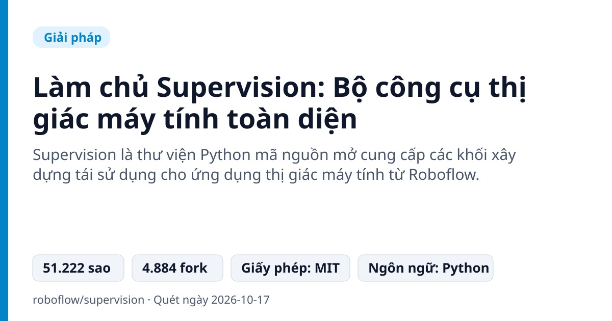
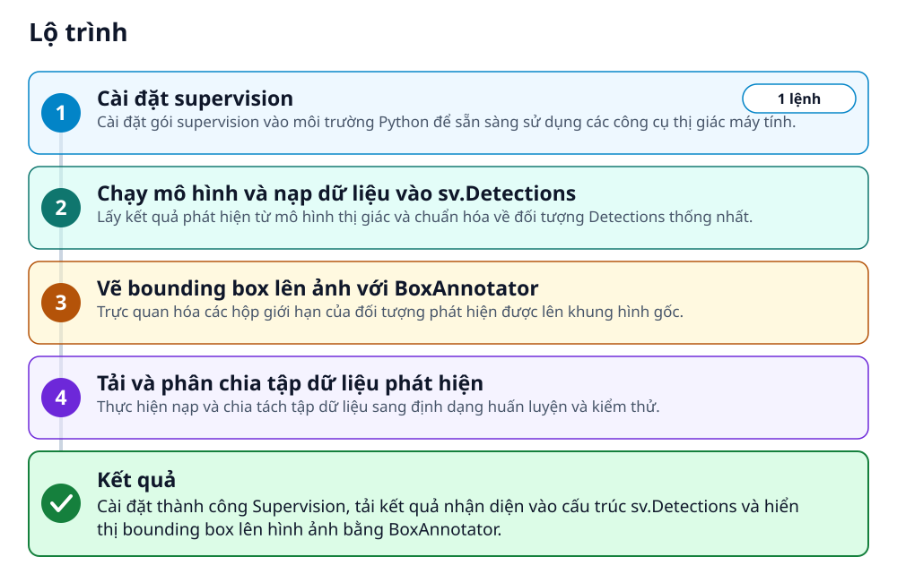
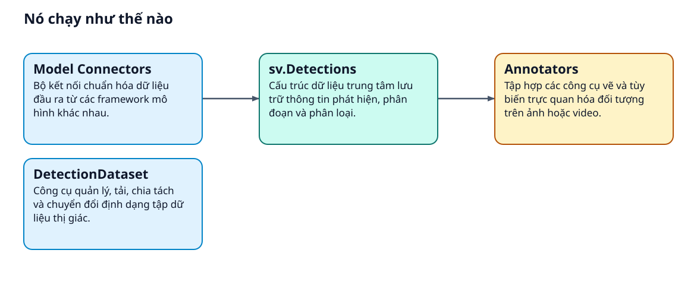
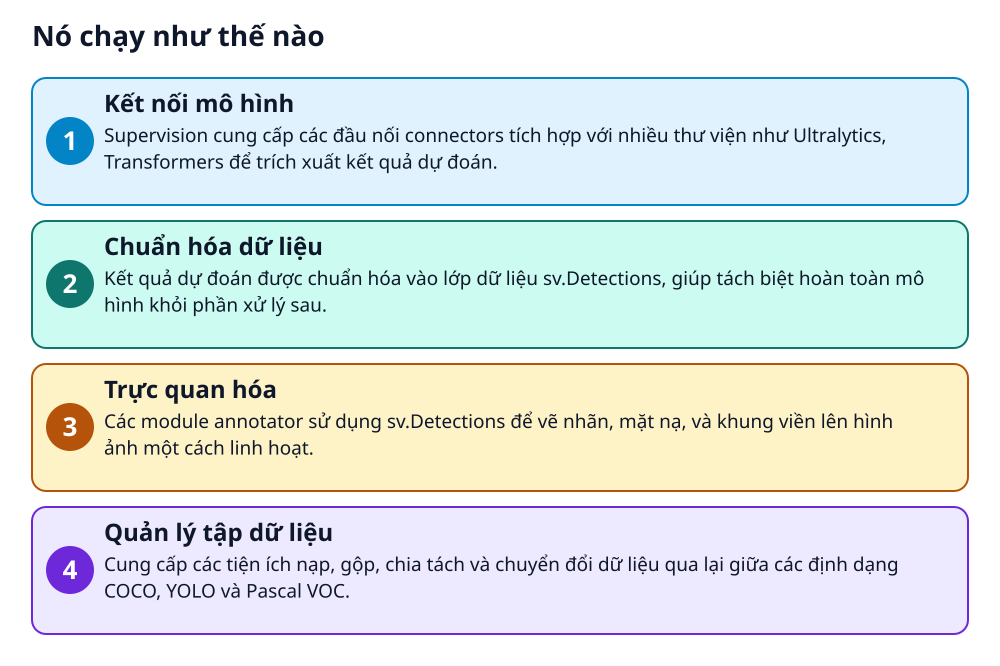

# Làm chủ Supervision: Bộ công cụ thị giác máy tính toàn diện



> Xử lý và trực quan hóa kết quả Computer Vision cực nhanh chỉ với vài dòng code Python

**Supervision là thư viện Python mã nguồn mở cung cấp các khối xây dựng tái sử dụng cho ứng dụng thị giác máy tính từ Roboflow.**

## 🎯 Bạn sẽ làm ra được gì

Cài đặt thành công Supervision, tải kết quả nhận diện vào cấu trúc sv.Detections và hiển thị bounding box lên hình ảnh bằng BoxAnnotator.

## Vấn đề nó giải quyết

Lập trình viên thị giác máy tính thường mất nhiều thời gian viết lại mã để vẽ bounding box, theo dõi vật thể và chuyển đổi định dạng dữ liệu giữa các mô hình. Mỗi mô hình lại trả về cấu trúc kết quả khác nhau gây phức tạp khi tích hợp vào ứng dụng.

> 💡 **Hình dung đời thường:** Supervision giống như bộ đầu chuyển adapter đa năng kết hợp cọ vẽ chuyên dụng, giúp bạn cắm bất kỳ mô hình AI nào vào và vẽ ngay kết quả lên màn hình mà không cần chế dây nối phức tạp.

## Ai nên xem

- Kỹ sư Computer Vision muốn tái sử dụng mã nguồn hậu xử lý và vẽ nhãn mà không cần viết lại từ đầu.
- Nhà phát triển Python xây dựng ứng dụng đếm người, phân tích giao thông hoặc đo tốc độ vật thể.
- Người làm dữ liệu cần chuyển đổi và chia tách tập dữ liệu giữa COCO, YOLO và Pascal VOC.

## ⚠️ Lưu ý trước khi dùng

- Yêu cầu môi trường chạy Python tối thiểu từ phiên bản 3.10 trở lên.
- Chỉ đóng vai trò là bộ công cụ hỗ trợ và trực quan hóa, không tự đảm nhận việc huấn luyện mô hình.
- Một số mô hình cụ thể đòi hỏi cài đặt thêm gói phụ trợ như pillow hoặc rfdetr.

## 🧰 Chuẩn bị trước khi bắt đầu

_Đánh dấu từng mục khi đã có đủ._

- [ ] **Python>=3.10**: Môi trường thực thi Python phiên bản từ 3.10 trở lên.  
  Liên kết trong README: [Python=3.10](https://www.python.org/)  
  <sub>Căn cứ: `README`</sub>

## 🗺️ Lộ trình



## 🪜 Làm theo từng bước

### Bước 1 · Cài đặt supervision

**Mục đích:** Cài đặt gói supervision vào môi trường Python để sẵn sàng sử dụng các công cụ thị giác máy tính.

1. Mở terminal trên máy tính của bạn.
2. Chạy lệnh pip install để tải và cài đặt gói supervision.

_Gõ hoặc dán từng dòng, theo thứ tự._

```bash
pip install supervision
```

<sub>Căn cứ: `README`</sub>

### Bước 2 · Chạy mô hình và nạp dữ liệu vào sv.Detections

**Mục đích:** Lấy kết quả phát hiện từ mô hình thị giác và chuẩn hóa về đối tượng Detections thống nhất.

1. Mở trình soạn thảo mã nguồn hoặc notebook.
2. Khởi tạo mô hình và gọi hàm dự đoán trên ảnh để thu về đối tượng detections.

✅ **Bạn sẽ thấy:** Thu được đối tượng Detections với số lượng nhận diện có thể kiểm tra qua len(detections).

<sub>Căn cứ: `README`</sub>

### Bước 3 · Vẽ bounding box lên ảnh với BoxAnnotator

**Mục đích:** Trực quan hóa các hộp giới hạn của đối tượng phát hiện được lên khung hình gốc.

1. Đọc ảnh đầu vào bằng OpenCV.
2. Khởi tạo sv.BoxAnnotator và truyền ảnh cùng đối tượng detections vào hàm annotate.

<sub>Căn cứ: `README`</sub>

### Bước 4 · Tải và phân chia tập dữ liệu phát hiện

**Mục đích:** Thực hiện nạp và chia tách tập dữ liệu sang định dạng huấn luyện và kiểm thử.

1. Sử dụng sv.DetectionDataset để nạp dữ liệu từ định dạng hỗ trợ.
2. Gọi hàm split để phân chia tập dữ liệu thành các tập train và test.

_Nội dung mẫu trong README (thay giá trị giữ chỗ bằng giá trị của bạn)_

```python
train_dataset, test_dataset = dataset.split(split_ratio=0.7)
test_dataset, valid_dataset = test_dataset.split(split_ratio=0.5)

len(train_dataset), len(test_dataset), len(valid_dataset)
# (700, 150, 150)
```

<sub>Căn cứ: `README`</sub>

## ✔️ Kiểm tra kết quả

Kiểm tra số lượng phát hiện được qua len(detections) trả về kết quả số nguyên và ảnh sau khi gọi hàm annotate có hiển thị khung bounding box.

## 🚀 Làm tiếp

- Tìm hiểu thêm các annotators khác tại tài liệu hướng dẫn của Supervision.
- Thử nghiệm kết nối với các thư viện mô hình như Ultralytics, Transformers hoặc MMDetection.
- Áp dụng theo dõi đối tượng và đếm số lượng người hoặc phương tiện trong vùng quan sát.

## 🔍 Bên trong nó hoạt động ra sao





1. **Kết nối mô hình**: Supervision cung cấp các đầu nối connectors tích hợp với nhiều thư viện như Ultralytics, Transformers để trích xuất kết quả dự đoán. _(Căn cứ: `README`)_
2. **Chuẩn hóa dữ liệu**: Kết quả dự đoán được chuẩn hóa vào lớp dữ liệu sv.Detections, giúp tách biệt hoàn toàn mô hình khỏi phần xử lý sau. _(Căn cứ: `README`)_
3. **Trực quan hóa**: Các module annotator sử dụng sv.Detections để vẽ nhãn, mặt nạ, và khung viền lên hình ảnh một cách linh hoạt. _(Căn cứ: `README`)_
4. **Quản lý tập dữ liệu**: Cung cấp các tiện ích nạp, gộp, chia tách và chuyển đổi dữ liệu qua lại giữa các định dạng COCO, YOLO và Pascal VOC. _(Căn cứ: `README`)_

### Các mảnh ghép

| | Các mảnh ghép | Căn cứ |
|---|---|---|
| **Model Connectors** | Bộ kết nối chuẩn hóa dữ liệu đầu ra từ các framework mô hình khác nhau. | `README` |
| **sv.Detections** | Cấu trúc dữ liệu trung tâm lưu trữ thông tin phát hiện, phân đoạn và phân loại. | `README` |
| **Annotators** | Tập hợp các công cụ vẽ và tùy biến trực quan hóa đối tượng trên ảnh hoặc video. | `README` |
| **DetectionDataset** | Công cụ quản lý, tải, chia tách và chuyển đổi định dạng tập dữ liệu thị giác. | `README` |

## Học được gì từ thiết kế này

- Tách rời logic hiển thị hình ảnh khỏi framework mô hình học sâu cụ thể.
- Chuẩn hóa dữ liệu trung gian giúp dễ dàng hoán đổi mô hình dự đoán mà không sửa đổi ứng dụng.
- Tổ chức quy trình xử lý dữ liệu ảnh và tập dữ liệu thị giác máy tính một cách có cấu trúc.

## Từ khóa

- **sv.Detections**: Cấu trúc dữ liệu chuẩn hóa của Supervision dùng để lưu trữ kết quả phát hiện vật thể.
- **Annotator**: Lớp tiện ích trực quan hóa dùng để vẽ bounding box, nhãn hoặc mặt nạ lên hình ảnh.
- **Model Agnostic**: Khả năng hoạt động độc lập và tương thích với nhiều kiến trúc mô hình AI khác nhau.

---

Nguồn dữ kiện: [roboflow/supervision](https://github.com/roboflow/supervision) · Giấy phép: MIT · 51.222 sao · Quét ngày 2026-10-17

_Nội dung do AI tóm tắt từ README và cấu trúc repo; hãy đọc repo gốc trước khi dùng._
