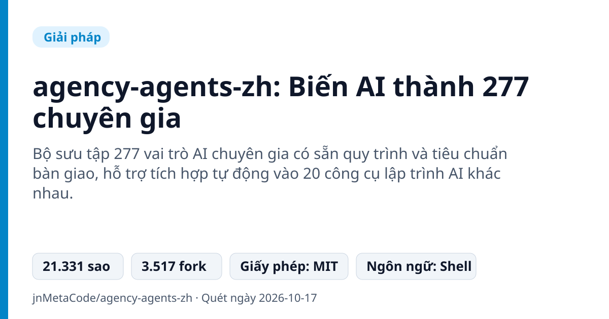
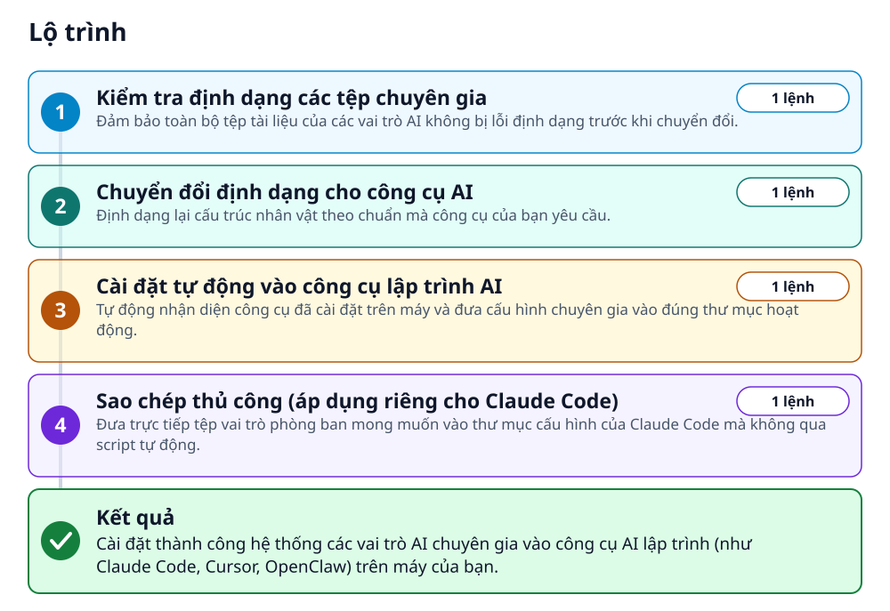
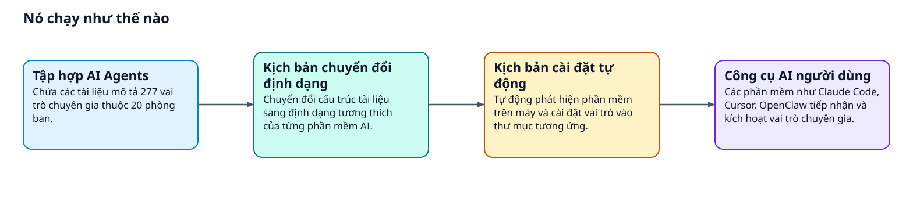
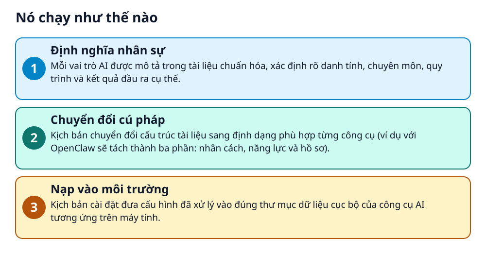

# agency-agents-zh: Biến AI thành 277 chuyên gia



> Biến Cursor, Claude Code thành đội ngũ 277 chuyên gia AI đa lĩnh vực chỉ với một dòng lệnh.

**Bộ sưu tập 277 vai trò AI chuyên gia có sẵn quy trình và tiêu chuẩn bàn giao, hỗ trợ tích hợp tự động vào 20 công cụ lập trình AI khác nhau.**

## 🎯 Bạn sẽ làm ra được gì

Cài đặt thành công hệ thống các vai trò AI chuyên gia vào công cụ AI lập trình (như Claude Code, Cursor, OpenClaw) trên máy của bạn.

## Vấn đề nó giải quyết

Người dùng thường mất nhiều thời gian viết prompt chi tiết cho từng tác vụ chuyên môn trong công việc. Các prompt thông thường thiếu ngữ cảnh sâu, không có quy trình nghiệp vụ rõ ràng và khó đồng bộ qua các công cụ AI khác nhau.

> 💡 **Hình dung đời thường:** Dự án như một cuốn cẩm nang mô tả công việc và hồ sơ nhân sự chuẩn chỉnh, sẵn sàng phát cho từng trợ lý AI để họ bắt tay vào làm việc ngay.

## Ai nên xem

- Lập trình viên muốn biến Cursor, Claude Code thành đồng đội chuyên môn đa lĩnh vực
- Nhân viên văn phòng, marketing muốn tham khảo các mẫu prompt chuyên sâu có quy trình chuẩn
- Người xây dựng hệ thống multi-agent cần kịch bản phối hợp nhiều vai trò tự động

## ⚠️ Lưu ý trước khi dùng

- Claude Code và Copilot có thể dùng trực tiếp, nhưng các công cụ khác cần thực hiện lệnh chuyển đổi định dạng trước khi cài
- Một số công cụ yêu cầu khởi động lại ứng dụng hoặc cổng kết nối (như OpenClaw gateway) để nhận diện cấu hình mới

## 🧰 Chuẩn bị trước khi bắt đầu

_Đánh dấu từng mục khi đã có đủ._

- [ ] **Môi trường dòng lệnh Bash**: Terminal trên macOS, Linux hoặc môi trường hỗ trợ shell script để chạy các tệp cài đặt.  
  <sub>Căn cứ: `README`</sub>
- [ ] **Một trong 20 công cụ AI được hỗ trợ**: Đã cài đặt sẵn Claude Code, Cursor, OpenClaw, GitHub Copilot, Trae hoặc các công cụ tương thích khác.  
  <sub>Căn cứ: `README`</sub>
- [ ] **Kho mã nguồn agency-agents-zh**: Tải mã nguồn dự án về máy tính cá nhân để chuẩn bị chạy các kịch bản cài đặt.  
  Liên kết trong README: [github.com](https://github.com/jnMetaCode/agency-agents-zh)  
  <sub>Căn cứ: `README`</sub>

## 🗺️ Lộ trình



## 🪜 Làm theo từng bước

### Bước 1 · Kiểm tra định dạng các tệp chuyên gia

**Mục đích:** Đảm bảo toàn bộ tệp tài liệu của các vai trò AI không bị lỗi định dạng trước khi chuyển đổi.

1. Mở terminal tại thư mục gốc của dự án agency-agents-zh.
2. Chạy lệnh kiểm tra cú pháp và định dạng của các tệp chuyên gia.

_Gõ hoặc dán từng dòng, theo thứ tự._

```bash
./scripts/lint-agents.sh
```

<sub>Căn cứ: `README`</sub>

### Bước 2 · Chuyển đổi định dạng cho công cụ AI

**Mục đích:** Định dạng lại cấu trúc nhân vật theo chuẩn mà công cụ của bạn yêu cầu.

1. Gõ lệnh chuyển đổi trong terminal.
2. Nếu dùng Claude Code hoặc GitHub Copilot, bạn có thể bỏ qua bước này. Nếu dùng Cursor, có thể chạy kèm cờ --tool cursor.

```bash
./scripts/convert.sh
```

<sub>Căn cứ: `README`</sub>

### Bước 3 · Cài đặt tự động vào công cụ lập trình AI

**Mục đích:** Tự động nhận diện công cụ đã cài đặt trên máy và đưa cấu hình chuyên gia vào đúng thư mục hoạt động.

1. Chạy lệnh cài đặt tự động trên terminal.
2. Chờ script tự dò tìm công cụ phù hợp và sao chép cấu hình.

```bash
./scripts/install.sh
```

<sub>Căn cứ: `README`</sub>

### Bước 4 · Sao chép thủ công (áp dụng riêng cho Claude Code)

**Mục đích:** Đưa trực tiếp tệp vai trò phòng ban mong muốn vào thư mục cấu hình của Claude Code mà không qua script tự động.

1. Nếu sử dụng Claude Code, sao chép thư mục vai trò phòng ban mong muốn (ví dụ: marketing) vào thư mục agents của Claude Code.

```bash
cp -r marketing/*.md ~/.claude/agents/
```

<sub>Căn cứ: `README`</sub>

## ✔️ Kiểm tra kết quả

Kiểm tra thư mục cấu hình của công cụ AI (ví dụ: ~/.openclaw/ nếu dùng OpenClaw hoặc ~/.claude/agents/) đã có các tệp chuyên gia tương ứng.

## 🚀 Làm tiếp

- Khởi động lại công cụ AI (như OpenClaw gateway) để các vai trò vừa cài đặt có hiệu lực.
- Tra cứu trực tuyến nội dung prompt của từng chuyên gia trên trang web dự án để tuỳ biến thêm.

## 🔍 Bên trong nó hoạt động ra sao





1. **Định nghĩa nhân sự**: Mỗi vai trò AI được mô tả trong tài liệu chuẩn hóa, xác định rõ danh tính, chuyên môn, quy trình và kết quả đầu ra cụ thể. _(Căn cứ: `README`)_
2. **Chuyển đổi cú pháp**: Kịch bản chuyển đổi cấu trúc tài liệu sang định dạng phù hợp từng công cụ (ví dụ với OpenClaw sẽ tách thành ba phần: nhân cách, năng lực và hồ sơ). _(Căn cứ: `README`)_
3. **Nạp vào môi trường**: Kịch bản cài đặt đưa cấu hình đã xử lý vào đúng thư mục dữ liệu cục bộ của công cụ AI tương ứng trên máy tính. _(Căn cứ: `README`)_

### Các mảnh ghép

| | Các mảnh ghép | Căn cứ |
|---|---|---|
| **Tập hợp AI Agents** | Chứa các tài liệu mô tả 277 vai trò chuyên gia thuộc 20 phòng ban. | `README` |
| **Kịch bản chuyển đổi định dạng** | Chuyển đổi cấu trúc tài liệu sang định dạng tương thích của từng phần mềm AI. | `README` |
| **Kịch bản cài đặt tự động** | Tự động phát hiện phần mềm trên máy và cài đặt vai trò vào thư mục tương ứng. | `README` |
| **Công cụ AI người dùng** | Các phần mềm như Claude Code, Cursor, OpenClaw tiếp nhận và kích hoạt vai trò chuyên gia. | `README` |

## Học được gì từ thiết kế này

- Thiết kế prompt theo dạng nhân sự: cần phân định rõ vai trò, quy trình và chuẩn bàn giao thay vì chỉ hỏi đáp
- Cách tổ chức vai trò đa nền tảng: chuyển đổi một định dạng gốc sang nhiều cấu hình công cụ khác nhau
- Chuẩn hóa mô-đun hoá AI: chia nhỏ nhân cách, năng lực và hồ sơ tóm tắt

## Từ khóa

- **OpenClaw**: Một công cụ lập trình AI hỗ trợ kiến trúc đa tác tử với cấu hình nhân vật chuyên sâu.
- **SOUL**: Phần cấu hình định nghĩa tính cách, phong cách giao tiếp và nguyên tắc ứng xử của nhân vật AI.

---

Nguồn dữ kiện: [jnMetaCode/agency-agents-zh](https://github.com/jnMetaCode/agency-agents-zh) · Giấy phép: MIT · 21.331 sao · Quét ngày 2026-10-17

_Nội dung do AI tóm tắt từ README và cấu trúc repo; hãy đọc repo gốc trước khi dùng._
