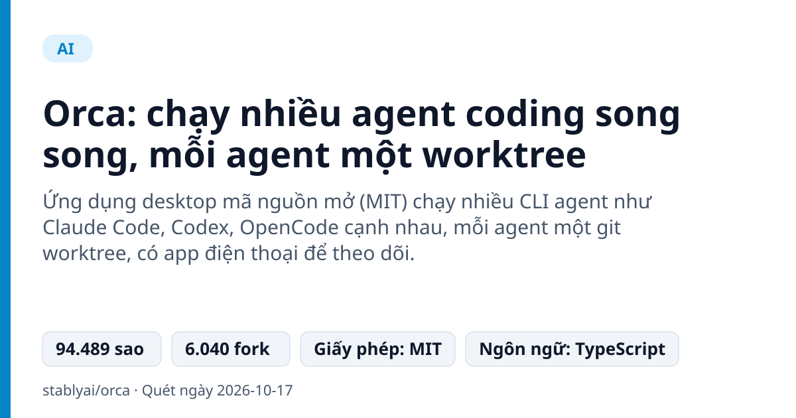
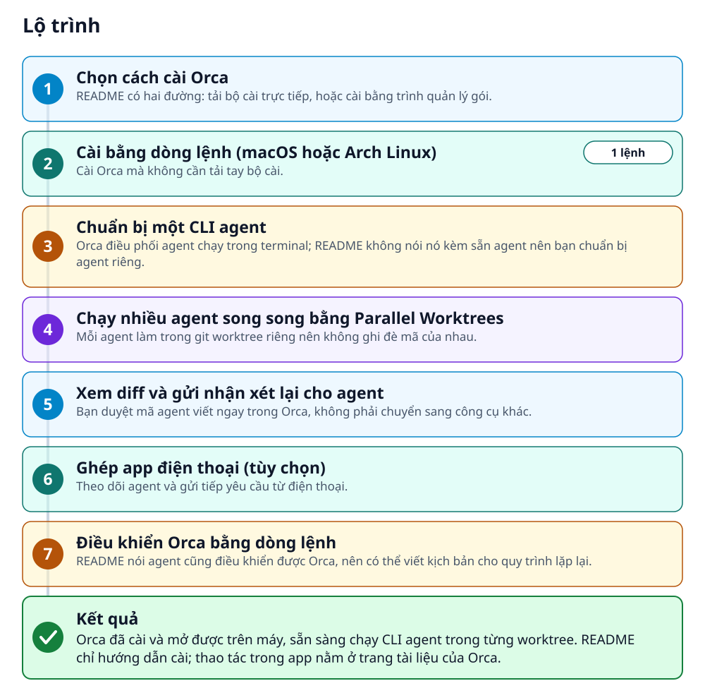
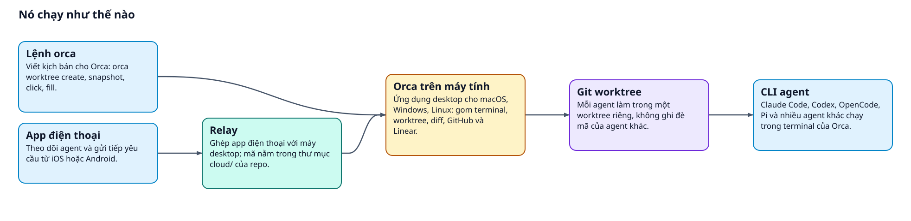
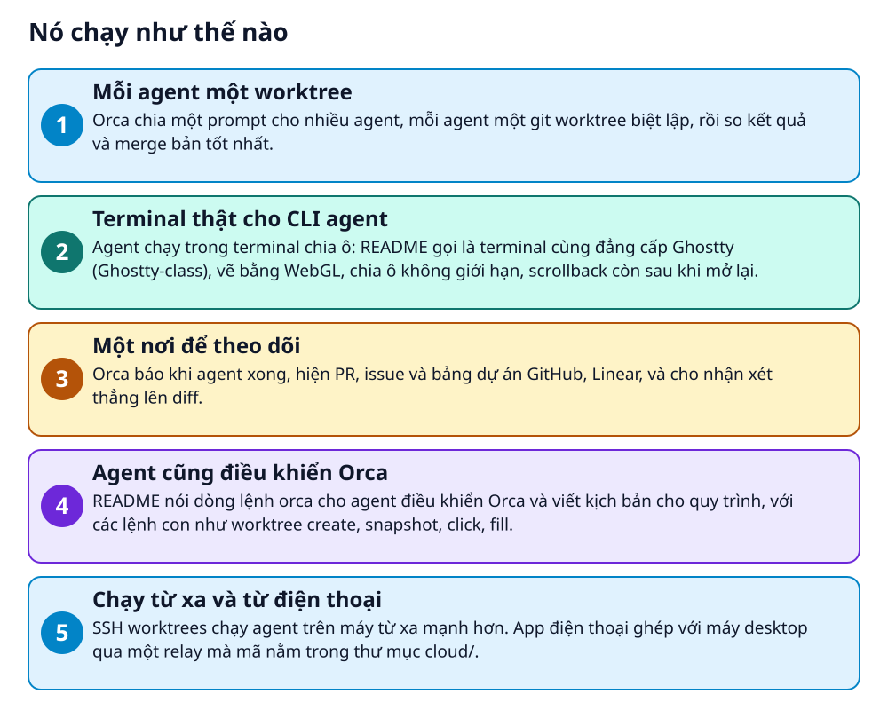

# Orca: chạy nhiều agent coding song song, mỗi agent một worktree



> Giao một prompt cho năm agent, mỗi agent một nhánh riêng, rồi so kết quả và chọn bản tốt nhất.

**Ứng dụng desktop mã nguồn mở (MIT) chạy nhiều CLI agent như Claude Code, Codex, OpenCode cạnh nhau, mỗi agent một git worktree, có app điện thoại để theo dõi.**

## 🎯 Bạn sẽ làm ra được gì

Orca đã cài và mở được trên máy, sẵn sàng chạy CLI agent trong từng worktree. README chỉ hướng dẫn cài; thao tác trong app nằm ở trang tài liệu của Orca.

## Vấn đề nó giải quyết

Cho nhiều agent làm trên cùng một dự án thì dễ đạp lên nhau: chung thư mục, chung nhánh, khó biết ai đang làm gì. Orca cho mỗi agent một git worktree riêng và gom tất cả vào một cửa sổ, để bạn so kết quả rồi merge bản tốt nhất.

> 💡 **Hình dung đời thường:** Giống một lớp có năm bàn riêng: mỗi bạn làm cùng một đề trên bàn của mình, cuối giờ thầy đặt các bài cạnh nhau và chọn bài tốt nhất.

## Ai nên xem

- Người dùng nhiều CLI agent muốn so kết quả cùng một yêu cầu mà không đụng nhau.
- Người muốn xem và nhận xét diff của agent ngay trong một app, kèm GitHub và Linear.
- Người cần nhìn tiến độ agent từ điện thoại hoặc chạy agent trên máy từ xa.

## ⚠️ Lưu ý trước khi dùng

- Dự án mới và đổi nhanh: README nói phát hành hằng ngày và danh sách tính năng luôn cũ hơn changelog.
- README không nói Orca kèm sẵn agent: mỗi CLI agent bạn dùng phải tự cài và chạy được trong terminal.
- Có thu thập dữ liệu sử dụng ẩn danh; README dẫn tới trang nói rõ thu gì và cách tắt.
- README không nói relay của app điện thoại chạy ở đâu; chỉ nói mã relay nằm trong cloud/.

## 🧰 Chuẩn bị trước khi bắt đầu

_Đánh dấu từng mục khi đã có đủ._

- [ ] **Máy macOS, Windows hoặc Linux**: README có bản cài cho cả ba: macOS (Apple Silicon và Intel), Windows (.exe), Linux (AppImage).  
  Liên kết trong README: [Download Orca](https://onorca.dev/download)  
  <sub>Căn cứ: `README`</sub>
- [ ] **Ít nhất một CLI agent đã cài**: README: Orca chạy mọi CLI agent nếu nó chạy được trong terminal (Claude Code, Codex, OpenCode, Pi...).  
  <sub>Căn cứ: `README`</sub>
- [ ] **Homebrew (macOS) hoặc yay (Arch Linux)**: Chỉ cần nếu muốn cài bằng dòng lệnh thay vì tải bộ cài.  
  <sub>Căn cứ: `README`</sub>
- [ ] **iPhone hoặc Android (tùy chọn)**: Cho app điện thoại đi kèm, ghép với app Orca trên máy tính.  
  <sub>Căn cứ: `README`</sub>

## 🗺️ Lộ trình



## 🪜 Làm theo từng bước

### Bước 1 · Chọn cách cài Orca

**Mục đích:** README có hai đường: tải bộ cài trực tiếp, hoặc cài bằng trình quản lý gói.

1. Muốn tải bộ cài: mở trang tải của Orca (liên kết bên dưới) hoặc chọn bản đúng hệ điều hành trong mục Releases.
2. Muốn cài bằng dòng lệnh: làm tiếp bước 2.
3. Bản dựng cho Windows ghi dùng chữ ký của SignPath Foundation.

🔗 Liên kết trong README: [Download Orca](https://onorca.dev/download)

<sub>Căn cứ: `README`</sub>

### Bước 2 · Cài bằng dòng lệnh (macOS hoặc Arch Linux)

**Mục đích:** Cài Orca mà không cần tải tay bộ cài.

1. Trên macOS, gõ lệnh dưới đây trong terminal.
2. Trên Arch Linux (AUR), dùng `yay -S stably-orca-bin`; README cũng nêu `stably-orca-git` nếu muốn dựng từ mã nguồn.

_Gõ hoặc dán từng dòng, theo thứ tự._

```bash
brew install --cask stablyai/orca/orca
```

<sub>Căn cứ: `README`</sub>

### Bước 3 · Chuẩn bị một CLI agent

**Mục đích:** Orca điều phối agent chạy trong terminal; README không nói nó kèm sẵn agent nên bạn chuẩn bị agent riêng.

1. Chọn agent bạn muốn dùng trong danh sách README (Claude Code, Codex, OpenCode, Pi, Cursor, Goose, Cline...).
2. Cài agent đó theo trang của chính nó; README dẫn liên kết đến trang của từng agent.

<sub>Căn cứ: `README`</sub>

### Bước 4 · Chạy nhiều agent song song bằng Parallel Worktrees

**Mục đích:** Mỗi agent làm trong git worktree riêng nên không ghi đè mã của nhau.

1. README mô tả: gửi một prompt cho năm agent, mỗi agent một worktree, so kết quả rồi merge bản thắng.
2. README không ghi từng thao tác trong app; mục Parallel Worktrees của README có liên kết Docs đến trang hướng dẫn.

<sub>Căn cứ: `README`</sub>

### Bước 5 · Xem diff và gửi nhận xét lại cho agent

**Mục đích:** Bạn duyệt mã agent viết ngay trong Orca, không phải chuyển sang công cụ khác.

1. README: thả nhận xét lên bất kỳ dòng diff nào và gửi lại cho agent; xem, sửa và commit không rời Orca.
2. README cũng liệt kê xem PR, issue, bảng dự án GitHub và Linear trong app, mở worktree từ một task.

<sub>Căn cứ: `README`</sub>

### Bước 6 · Ghép app điện thoại (tùy chọn)

**Mục đích:** Theo dõi agent và gửi tiếp yêu cầu từ điện thoại.

1. Cài app: iOS từ App Store, Android bằng tệp APK (README có trang hướng dẫn cài APK).
2. Ghép app với app Orca trên máy tính; README nói app nhắc khi agent làm xong.
3. Mã relay dùng để ghép nằm trong thư mục `cloud/` của repo, có hướng dẫn riêng.

🔗 Liên kết trong README: [Install guide](https://www.onorca.dev/docs/android-apk)

<sub>Căn cứ: `README`</sub>

### Bước 7 · Điều khiển Orca bằng dòng lệnh

**Mục đích:** README nói agent cũng điều khiển được Orca, nên có thể viết kịch bản cho quy trình lặp lại.

1. README nêu các lệnh con `orca worktree create`, `snapshot`, `click` và `fill`.
2. README không ghi đối số của từng lệnh; xem trang tài liệu CLI mà liên kết bên dưới dẫn tới.

🔗 Liên kết trong README: [Docs →](https://www.onorca.dev/docs/cli/overview)

<sub>Căn cứ: `README`</sub>

## ✔️ Kiểm tra kết quả

README không nêu cách kiểm tra sau khi cài. Orca mở được và agent bạn chọn chạy được trong terminal của nó là dấu hiệu cài thành công; README không mô tả đầu ra.

## 🚀 Làm tiếp

- Xem changelog trong mục Releases: README nói danh sách tính năng luôn cũ hơn bản phát hành.
- Đọc hướng dẫn đóng góp mà README nêu (tệp trong thư mục .github) nếu muốn chạy Orca từ mã nguồn.
- Xem trang tài liệu quyền riêng tư và telemetry mà README dẫn tới để biết cách tắt.

## 🔍 Bên trong nó hoạt động ra sao





1. **Mỗi agent một worktree**: Orca chia một prompt cho nhiều agent, mỗi agent một git worktree biệt lập, rồi so kết quả và merge bản tốt nhất. _(Căn cứ: `README`)_
2. **Terminal thật cho CLI agent**: Agent chạy trong terminal chia ô: README gọi là terminal cùng đẳng cấp Ghostty (Ghostty-class), vẽ bằng WebGL, chia ô không giới hạn, scrollback còn sau khi mở lại. _(Căn cứ: `README`)_
3. **Một nơi để theo dõi**: Orca báo khi agent xong, hiện PR, issue và bảng dự án GitHub, Linear, và cho nhận xét thẳng lên diff. _(Căn cứ: `README`)_
4. **Agent cũng điều khiển Orca**: README nói dòng lệnh orca cho agent điều khiển Orca và viết kịch bản cho quy trình, với các lệnh con như worktree create, snapshot, click, fill. _(Căn cứ: `README`)_
5. **Chạy từ xa và từ điện thoại**: SSH worktrees chạy agent trên máy từ xa mạnh hơn. App điện thoại ghép với máy desktop qua một relay mà mã nằm trong thư mục cloud/. _(Căn cứ: `README`)_

### Các mảnh ghép

| | Các mảnh ghép | Căn cứ |
|---|---|---|
| **Orca trên máy tính** | Ứng dụng desktop cho macOS, Windows, Linux: gom terminal, worktree, diff, GitHub và Linear. | `README` |
| **Git worktree** | Mỗi agent làm trong một worktree riêng, không ghi đè mã của agent khác. | `README` |
| **CLI agent** | Claude Code, Codex, OpenCode, Pi và nhiều agent khác chạy trong terminal của Orca. | `README` |
| **Lệnh orca** | Viết kịch bản cho Orca: orca worktree create, snapshot, click, fill. | `README` |
| **App điện thoại** | Theo dõi agent và gửi tiếp yêu cầu từ iOS hoặc Android. | `README` |
| **Relay** | Ghép app điện thoại với máy desktop; mã nằm trong thư mục cloud/ của repo. | `cloud/` |

## Học được gì từ thiết kế này

- Cách ly bằng git worktree: mỗi agent một bản làm việc, nên chạy song song mà không giẫm chân nhau.
- Giao cùng một đề cho nhiều agent rồi so kết quả và chọn bản tốt nhất.
- Để agent điều khiển công cụ quản lý chúng qua dòng lệnh, nên quy trình lặp lại viết thành kịch bản được.
- Đặt phần ghép điện thoại thành một relay riêng trong cùng repo, có workspace và hướng dẫn cài riêng.

## Từ khóa

- **Worktree**: Bản làm việc riêng của git cho một nhánh, nằm ở thư mục khác nhưng cùng một repo.
- **CLI agent**: Trợ lý lập trình AI chạy trong terminal, như Claude Code hay Codex.
- **Relay**: Máy chủ trung gian giúp app điện thoại tìm và nói chuyện với app trên máy tính.

---

Nguồn dữ kiện: [stablyai/orca](https://github.com/stablyai/orca) · Giấy phép: MIT · 94.489 sao · Quét ngày 2026-10-17

_Nội dung do AI tóm tắt từ README và cấu trúc repo; hãy đọc repo gốc trước khi dùng._
