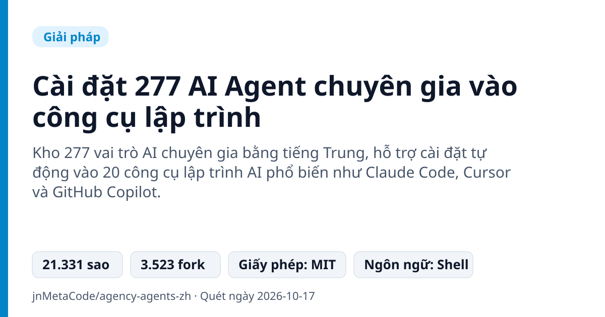
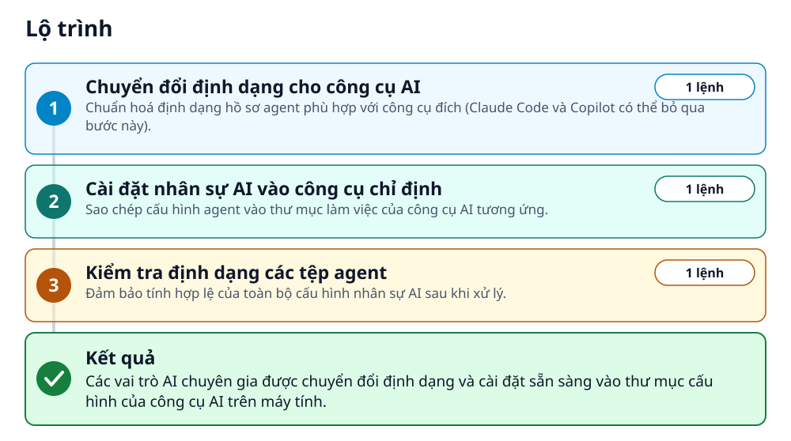
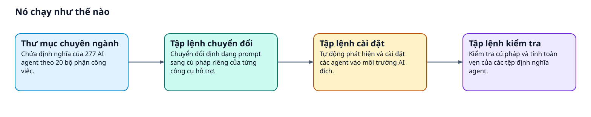
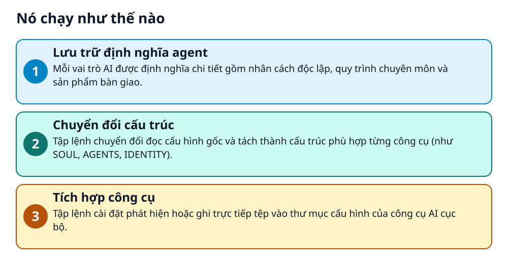

# Cài đặt 277 AI Agent chuyên gia vào công cụ lập trình



> Tích hợp 277 nhân sự AI chuyên môn hoá vào Claude Code, Cursor hay Copilot chỉ bằng vài dòng lệnh shell.

**Kho 277 vai trò AI chuyên gia bằng tiếng Trung, hỗ trợ cài đặt tự động vào 20 công cụ lập trình AI phổ biến như Claude Code, Cursor và GitHub Copilot.**

## 🎯 Bạn sẽ làm ra được gì

Các vai trò AI chuyên gia được chuyển đổi định dạng và cài đặt sẵn sàng vào thư mục cấu hình của công cụ AI trên máy tính.

## Vấn đề nó giải quyết

Người dùng AI thường phải tự viết system prompt dài dòng mỗi khi cần giải quyết việc chuyên môn trong từng phòng ban. Các prompt chung chung thiếu vai trò, quy trình chuẩn và định dạng kết quả bàn giao cụ thể.

> 💡 **Hình dung đời thường:** Giống như việc tuyển dụng sẵn một danh bạ hàng trăm chuyên gia với bản mô tả công việc hoàn chỉnh và nạp thẳng vào máy tính của bạn thay vì phải đào tạo từ đầu.

## Ai nên xem

- Lập trình viên sử dụng Cursor, Claude Code, Copilot muốn bổ sung nhiều vai trò chuyên gia
- Nhóm phát triển phần mềm cần mẫu phân vai rõ ràng cho các phòng ban kỹ thuật, vận hành, thiết kế

## ⚠️ Lưu ý trước khi dùng

- Dữ liệu nhân sự AI và tài liệu chủ yếu viết bằng tiếng Trung
- Claude Code và Copilot hỗ trợ cài trực tiếp, các công cụ khác bắt buộc chạy lệnh chuyển đổi trước

## 🧰 Chuẩn bị trước khi bắt đầu

_Đánh dấu từng mục khi đã có đủ._

- [ ] **Môi trường dòng lệnh Unix hoặc Shell**: Hệ thống hỗ trợ chạy các tệp lệnh sh (Linux, macOS hoặc môi trường tương thích trên Windows).  
  <sub>Căn cứ: `README`</sub>
- [ ] **Một công cụ lập trình AI được hỗ trợ**: Đã cài đặt sẵn một trong 20 công cụ như Claude Code, Cursor, GitHub Copilot, OpenClaw,...  
  <sub>Căn cứ: `README`</sub>

## 🗺️ Lộ trình



## 🪜 Làm theo từng bước

### Bước 1 · Chuyển đổi định dạng cho công cụ AI

**Mục đích:** Chuẩn hoá định dạng hồ sơ agent phù hợp với công cụ đích (Claude Code và Copilot có thể bỏ qua bước này).

1. Mở terminal tại thư mục gốc của dự án agency-agents-zh.
2. Chạy lệnh chuyển đổi sang định dạng của Cursor hoặc toàn bộ các công cụ.

_Gõ hoặc dán từng dòng, theo thứ tự._

```bash
./scripts/convert.sh --tool cursor
```

<sub>Căn cứ: `README`</sub>

### Bước 2 · Cài đặt nhân sự AI vào công cụ chỉ định

**Mục đích:** Sao chép cấu hình agent vào thư mục làm việc của công cụ AI tương ứng.

1. Chạy lệnh cài đặt vào công cụ đã chọn (ví dụ Cursor) trong terminal.

```bash
./scripts/install.sh --tool cursor
```

<sub>Căn cứ: `README`</sub>

### Bước 3 · Kiểm tra định dạng các tệp agent

**Mục đích:** Đảm bảo tính hợp lệ của toàn bộ cấu hình nhân sự AI sau khi xử lý.

1. Thực thi tập lệnh kiểm tra chất lượng tệp trong terminal.

```bash
./scripts/lint-agents.sh
```

<sub>Căn cứ: `README`</sub>

## ✔️ Kiểm tra kết quả

Mở công cụ lập trình AI (như Claude Code hoặc Cursor) và kích hoạt chế độ làm việc với chuyên gia tương ứng.

## 🚀 Làm tiếp

- Sao chép trực tiếp tệp từ thư mục marketing vào ~/.claude/agents/ bằng lệnh cp
- Khám phá thư viện trực tuyến hoặc tải ứng dụng máy tính agency-orchestrator

## 🔍 Bên trong nó hoạt động ra sao





1. **Lưu trữ định nghĩa agent**: Mỗi vai trò AI được định nghĩa chi tiết gồm nhân cách độc lập, quy trình chuyên môn và sản phẩm bàn giao. _(Căn cứ: `README`)_
2. **Chuyển đổi cấu trúc**: Tập lệnh chuyển đổi đọc cấu hình gốc và tách thành cấu trúc phù hợp từng công cụ (như SOUL, AGENTS, IDENTITY). _(Căn cứ: `README`)_
3. **Tích hợp công cụ**: Tập lệnh cài đặt phát hiện hoặc ghi trực tiếp tệp vào thư mục cấu hình của công cụ AI cục bộ. _(Căn cứ: `README`)_

### Các mảnh ghép

| | Các mảnh ghép | Căn cứ |
|---|---|---|
| **Thư mục chuyên ngành** | Chứa định nghĩa của 277 AI agent theo 20 bộ phận công việc. | `README` |
| **Tập lệnh chuyển đổi** | Chuyển đổi định dạng prompt sang cú pháp riêng của từng công cụ hỗ trợ. | `README` |
| **Tập lệnh cài đặt** | Tự động phát hiện và cài đặt các agent vào môi trường AI đích. | `README` |
| **Tập lệnh kiểm tra** | Kiểm tra cú pháp và tính toàn vẹn của các tệp định nghĩa agent. | `README` |

## Học được gì từ thiết kế này

- Cách đóng gói vai trò AI với đầy đủ nhân cách, quy trình và kết quả bàn giao thay vì prompt đơn lẻ
- Phương pháp tổ chức script tự động chuyển đổi prompt giữa nhiều công cụ lập trình AI khác nhau
- Kỹ thuật chuẩn hóa cấu trúc định nghĩa agent nhiều tệp (SOUL, AGENTS, IDENTITY)

## Từ khóa

- **OpenClaw**: Một nền tảng hỗ trợ tích hợp và điều phối đa agent thông qua các tệp SOUL, AGENTS và IDENTITY.
- **DAG**: Đồ thị có hướng không chu trình, mô hình dùng để phối hợp thứ tự làm việc tự động giữa các agent.

---

Nguồn dữ kiện: [jnMetaCode/agency-agents-zh](https://github.com/jnMetaCode/agency-agents-zh) · Giấy phép: MIT · 21.331 sao · Quét ngày 2026-10-17

_Nội dung do AI tóm tắt từ README và cấu trúc repo; hãy đọc repo gốc trước khi dùng._
