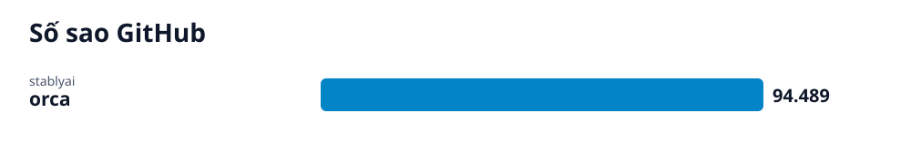

# Radar GitHub · 2026-10-17

## Các repo của lần quét này

- **[Orca: Môi trường ADE điều phối song song nhiều AI coding agent](orca/vi.md)** (AI) — ADE mã nguồn mở cho phép chạy song song nhiều AI coding agent bằng gói thuê bao cá nhân trên máy tính để bàn, điện thoại và máy chủ từ xa.
  - 🎯 Cài đặt thành công Orca Desktop để chạy song song các CLI agent trên các git worktree độc lập, có thể theo dõi tiến độ từ máy tính hoặc điện thoại. · 🪜 3 bước
