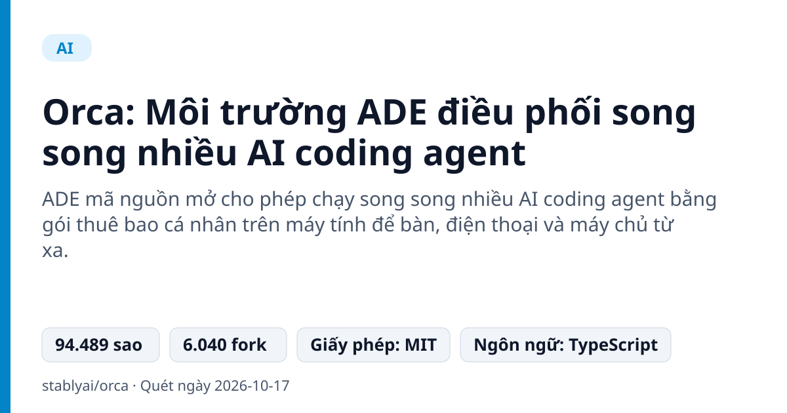
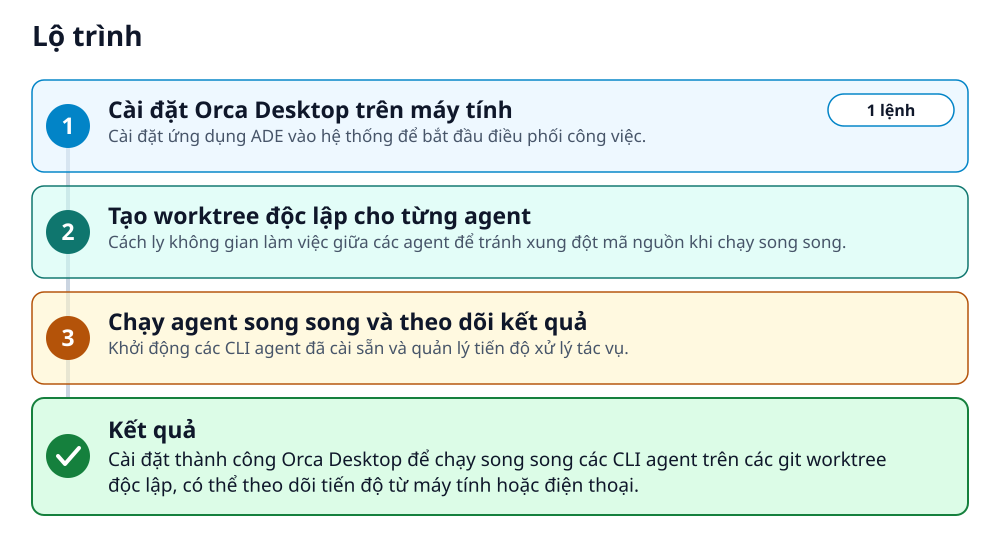
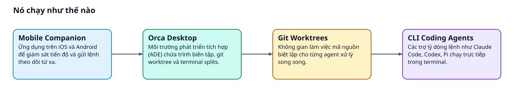
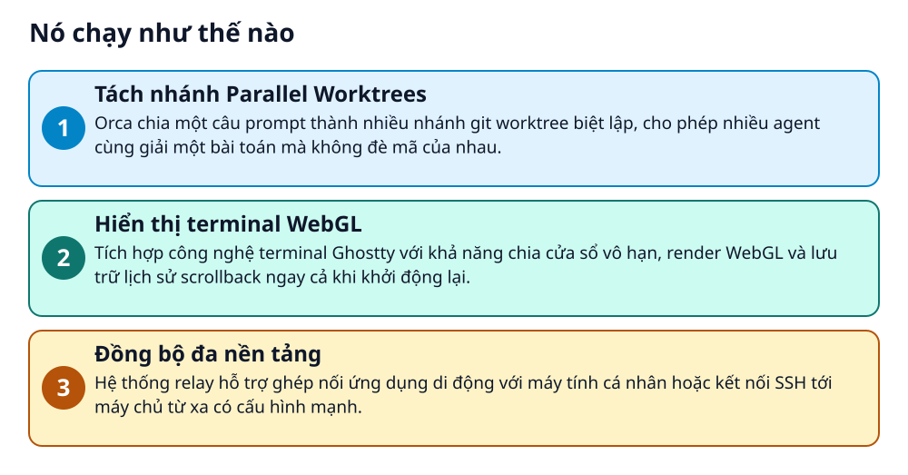

# Orca: Môi trường ADE điều phối song song nhiều AI coding agent



> Chạy Codex, Claude Code và Pi song song trên từng git worktree riêng biệt trong một cửa sổ.

**ADE mã nguồn mở cho phép chạy song song nhiều AI coding agent bằng gói thuê bao cá nhân trên máy tính để bàn, điện thoại và máy chủ từ xa.**

## 🎯 Bạn sẽ làm ra được gì

Cài đặt thành công Orca Desktop để chạy song song các CLI agent trên các git worktree độc lập, có thể theo dõi tiến độ từ máy tính hoặc điện thoại.

## Vấn đề nó giải quyết

Lập trình viên muốn thử nghiệm nhiều agent AI cùng lúc trên cùng một dự án nhưng gặp khó khăn khi quản lý xung đột mã nguồn, tài nguyên dòng lệnh và phải liên tục chuyển đổi ngữ cảnh làm việc.

> 💡 **Hình dung đời thường:** Giống như một người quản đốc điều phối cùng lúc nhiều thợ lập trình làm việc trên các bản sao công trình độc lập, sau đó chọn bản hoàn thiện tốt nhất để ghép lại.

## Ai nên xem

- Lập trình viên muốn so sánh song song giải pháp của nhiều AI coding agent như Codex, Claude Code, OpenCode.
- Kỹ sư phần mềm cần quản lý nhiều nhánh git và agent độc lập mà không bị gián đoạn mạch làm việc.
- Người xây dựng sản phẩm muốn giám sát và phản hồi tiến độ chạy code của agent từ điện thoại.

## ⚠️ Lưu ý trước khi dùng

- Dự án được khởi tạo từ năm 2026 và có lượng lớn open issues phản ánh tốc độ cập nhật liên tục.
- Người dùng phải tự chuẩn bị tài khoản và gói thuê bao cá nhân cho từng CLI agent sử dụng.
- Tương tác qua điện thoại cần cài thêm ứng dụng di động và thiết lập kết nối relay.

## 🧰 Chuẩn bị trước khi bắt đầu

_Đánh dấu từng mục khi đã có đủ._

- [ ] **Hệ điều hành macOS, Windows hoặc Linux**: Orca cung cấp bộ cài đặt trực tiếp cho macOS (Apple Silicon / Intel), Windows (.exe) và Linux (AppImage).  
  Liên kết trong README: [Download Orca](https://onorca.dev/download)  
  <sub>Căn cứ: `README`</sub>
- [ ] **Trình quản lý gói Homebrew (macOS) hoặc yay (Arch Linux)**: Tùy chọn thay thế nếu bạn muốn cài đặt qua dòng lệnh thay vì tải file bộ cài đặt trực tiếp.  
  <sub>Căn cứ: `README`</sub>
- [ ] **Gói thuê bao và công cụ dòng lệnh của agent**: Bất kỳ CLI agent nào như Claude Code, Codex, OpenCode, Cursor, Pi hoặc Goose.  
  <sub>Căn cứ: `README`</sub>

## 🗺️ Lộ trình



## 🪜 Làm theo từng bước

### Bước 1 · Cài đặt Orca Desktop trên máy tính

**Mục đích:** Cài đặt ứng dụng ADE vào hệ thống để bắt đầu điều phối công việc.

1. Mở terminal trên macOS và chạy lệnh brew install.
2. Nếu dùng Arch Linux, gõ lệnh yay thay thế, hoặc tải file cài đặt trực tiếp theo hệ điều hành tương ứng.

_Gõ hoặc dán từng dòng, theo thứ tự._

```bash
brew install --cask stablyai/orca/orca
```

🔗 Liên kết trong README: [Download Orca](https://onorca.dev/download)

✅ **Bạn sẽ thấy:** Orca được tải về và cài đặt hoàn tất vào thư mục ứng dụng của máy tính.

🩹 **Nếu không được:** Kiểm tra kết nối mạng hoặc chuyển sang tải trực tiếp bộ cài đặt cho hệ điều hành của bạn.

<sub>Căn cứ: `README`</sub>

### Bước 2 · Tạo worktree độc lập cho từng agent

**Mục đích:** Cách ly không gian làm việc giữa các agent để tránh xung đột mã nguồn khi chạy song song.

1. Mở ứng dụng Orca vừa cài đặt trên máy tính.
2. Sử dụng tính năng Parallel Worktrees để tách một yêu cầu prompt ra các git worktree biệt lập.

✅ **Bạn sẽ thấy:** Các git worktree được khởi tạo riêng biệt cho từng agent trong giao diện điều phối.

<sub>Căn cứ: `README`</sub>

### Bước 3 · Chạy agent song song và theo dõi kết quả

**Mục đích:** Khởi động các CLI agent đã cài sẵn và quản lý tiến độ xử lý tác vụ.

1. Chạy các CLI agent (Codex, Claude Code, OpenCode...) trong từng cửa sổ terminal split.
2. So sánh kết quả giữa các agent và hợp nhất (merge) phiên bản tốt nhất.
3. Cài thêm ứng dụng Mobile Companion trên điện thoại nếu muốn theo dõi và điều khiển từ xa.

✅ **Bạn sẽ thấy:** Các agent chạy song song trong các terminal split hiển thị WebGL, diff mã nguồn hiển thị trực tiếp để chú thích và hợp nhất.

<sub>Căn cứ: `README`</sub>

## ✔️ Kiểm tra kết quả

Mở Orca Desktop, các phân vùng terminal split hiển thị đầy đủ, gõ lệnh gọi agent hoạt động bình thường trên từng worktree.

## 🚀 Làm tiếp

- Ghép nối ứng dụng Mobile Companion trên iOS hoặc Android để nhận thông báo khi agent hoàn thành công việc.
- Khai thác chế độ Design Mode trong cửa sổ Chromium để gửi HTML, CSS và ảnh chụp trực tiếp vào prompt của agent.

## 🔍 Bên trong nó hoạt động ra sao





1. **Tách nhánh Parallel Worktrees**: Orca chia một câu prompt thành nhiều nhánh git worktree biệt lập, cho phép nhiều agent cùng giải một bài toán mà không đè mã của nhau. _(Căn cứ: `README`)_
2. **Hiển thị terminal WebGL**: Tích hợp công nghệ terminal Ghostty với khả năng chia cửa sổ vô hạn, render WebGL và lưu trữ lịch sử scrollback ngay cả khi khởi động lại. _(Căn cứ: `README`)_
3. **Đồng bộ đa nền tảng**: Hệ thống relay hỗ trợ ghép nối ứng dụng di động với máy tính cá nhân hoặc kết nối SSH tới máy chủ từ xa có cấu hình mạnh. _(Căn cứ: `README`)_

### Các mảnh ghép

| | Các mảnh ghép | Căn cứ |
|---|---|---|
| **Orca Desktop** | Môi trường phát triển tích hợp (ADE) chứa trình biên tập, git worktree và terminal splits. | `README` |
| **CLI Coding Agents** | Các trợ lý dòng lệnh như Claude Code, Codex, Pi chạy trực tiếp trong terminal. | `README` |
| **Git Worktrees** | Không gian làm việc mã nguồn biệt lập cho từng agent xử lý song song. | `README` |
| **Mobile Companion** | Ứng dụng trên iOS và Android để giám sát tiến độ và gửi lệnh theo dõi từ xa. | `README` |

## Học được gì từ thiết kế này

- Sử dụng Git Worktree để cô lập môi trường làm việc khi cho nhiều AI cùng chỉnh sửa một dự án.
- Tối ưu giao diện terminal bằng WebGL để duy trì hiệu năng cao khi mở nhiều tab chia nhỏ.
- Kết nối thiết bị di động với môi trường runtime máy tính để quản trị tác vụ nền linh hoạt.

## Từ khóa

- **ADE**: Agent Development Environment - Môi trường chuyên dụng để phát triển và điều phối các AI agent.
- **Worktree**: Tính năng của Git cho phép làm việc trên nhiều nhánh mã nguồn đồng thời trong các thư mục tách biệt.
- **Terminal Split**: Tính năng chia nhỏ một màn hình dòng lệnh thành nhiều khung nhìn song song cạnh nhau.

---

Nguồn dữ kiện: [stablyai/orca](https://github.com/stablyai/orca) · Giấy phép: MIT · 94.489 sao · Quét ngày 2026-10-17

_Nội dung do AI tóm tắt từ README và cấu trúc repo; hãy đọc repo gốc trước khi dùng._
