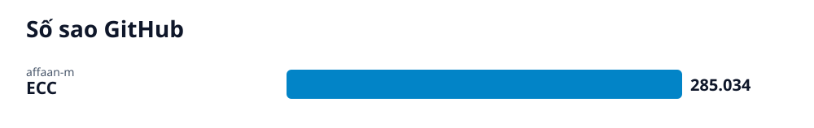

# Radar GitHub · 2026-10-21

## Các repo của lần quét này

- **[Tối ưu hóa trợ lý AI với ECC cho Claude Code và các harness](ecc/vi.md)** (AI) — Hệ thống tối ưu hóa hiệu năng trợ lý AI (agent harness) cung cấp kỹ năng, trí nhớ, bảo mật và công cụ phát triển cho Claude Code, Codex, Kimi Code và nhiều công cụ khác.
  - 🎯 Cài đặt thành công plugin `ecc@ecc` qua trình hướng dẫn hoặc dòng lệnh npx, sẵn sàng sử dụng trên Claude Code hoặc các harness được hỗ trợ. · 🪜 3 bước
