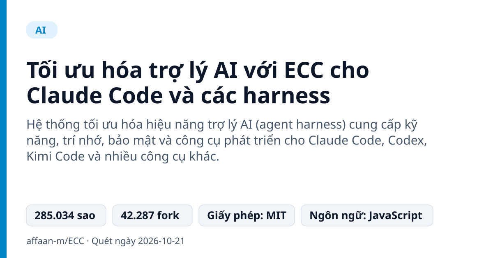
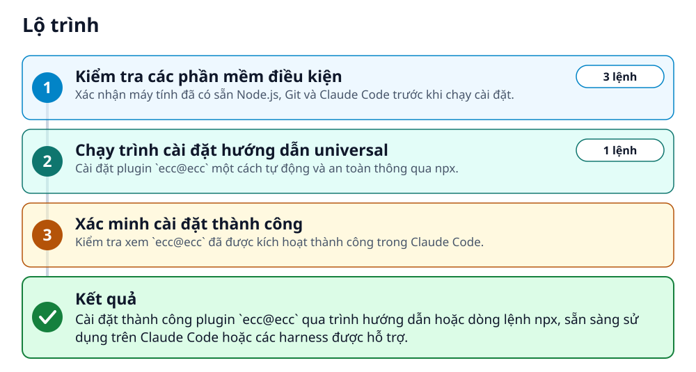
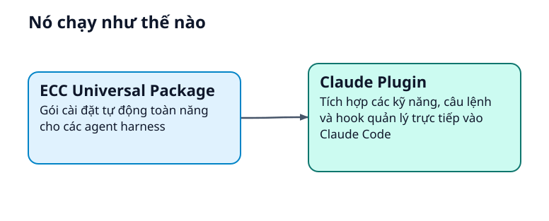
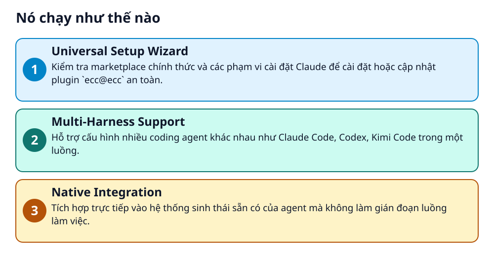

# Tối ưu hóa trợ lý AI với ECC cho Claude Code và các harness



> Nâng cấp kỹ năng, bộ nhớ và độ bảo mật cho Claude Code, Codex, Cursor chỉ trong vài bước.

**Hệ thống tối ưu hóa hiệu năng trợ lý AI (agent harness) cung cấp kỹ năng, trí nhớ, bảo mật và công cụ phát triển cho Claude Code, Codex, Kimi Code và nhiều công cụ khác.**

## 🎯 Bạn sẽ làm ra được gì

Cài đặt thành công plugin `ecc@ecc` qua trình hướng dẫn hoặc dòng lệnh npx, sẵn sàng sử dụng trên Claude Code hoặc các harness được hỗ trợ.

## Vấn đề nó giải quyết

Lập trình viên sử dụng trợ lý AI thường gặp tình trạng thiếu kỹ năng chuyên sâu, thiếu bộ nhớ ngữ cảnh và khó quản lý cấu hình đồng bộ giữa nhiều công cụ code khác nhau. Việc cài đặt thủ công dễ gây xung đột hoặc trùng lặp lệnh.

> 💡 **Hình dung đời thường:** Giống như việc lắp thêm các mô-đun động cơ phản lực và hộp đen ghi nhớ cho một chiếc xe đua AI có sẵn, giúp nó chạy nhanh và thông minh hơn hẳn.

## Ai nên xem

- Lập trình viên sử dụng Claude Code
- Người dùng muốn tối ưu hóa hiệu năng và kỹ năng cho trợ lý AI

## ⚠️ Lưu ý trước khi dùng

- Yêu cầu Node.js 18+ và Claude Code 2.1+
- Cần chọn đúng một phương pháp cài đặt cho mỗi harness để tránh trùng lặp

## 🧰 Chuẩn bị trước khi bắt đầu

_Đánh dấu từng mục khi đã có đủ._

- [ ] **Node.js 18 hoặc mới hơn**: Yêu cầu bắt buộc để chạy gói universal setup  
  <sub>Căn cứ: `README`</sub>
- [ ] **Git**: Cần có sẵn trên PATH  
  <sub>Căn cứ: `README`</sub>
- [ ] **Claude Code phiên bản 2.1 hoặc mới hơn**: Cần có sẵn trên PATH  
  <sub>Căn cứ: `README`</sub>

## 🗺️ Lộ trình



## 🪜 Làm theo từng bước

### Bước 1 · Kiểm tra các phần mềm điều kiện

**Mục đích:** Xác nhận máy tính đã có sẵn Node.js, Git và Claude Code trước khi chạy cài đặt.

1. Mở PowerShell từ menu Start trên Windows.
2. Chạy lệnh kiểm tra phiên bản các công cụ cần thiết.

_Gõ hoặc dán từng dòng, theo thứ tự._

_PowerShell_

```powershell
node --version
git --version
claude --version
```

🩹 **Nếu không được:** Cài đặt hoặc sửa lỗi phần mềm thiếu trước khi chạy lại ECC setup.

<sub>Căn cứ: `README`</sub>

### Bước 2 · Chạy trình cài đặt hướng dẫn universal

**Mục đích:** Cài đặt plugin `ecc@ecc` một cách tự động và an toàn thông qua npx.

1. Chạy lệnh cài đặt universal setup trong terminal.

```bash
npx ecc-universal@2.2.3 setup
```

🩹 **Nếu không được:** Kiểm tra lại phiên bản registry bằng lệnh npm view ecc-universal version trước khi thử lại.

<sub>Căn cứ: `README`</sub>

### Bước 3 · Xác minh cài đặt thành công

**Mục đích:** Kiểm tra xem `ecc@ecc` đã được kích hoạt thành công trong Claude Code.

1. Khởi động phiên làm việc Claude Code mới.
2. Chạy lệnh liệt kê plugin.

✅ **Bạn sẽ thấy:** plugin `ecc@ecc` xuất hiện và đã được bật.

<sub>Căn cứ: `README`</sub>

## ✔️ Kiểm tra kết quả

Khởi động phiên làm việc Claude Code mới và chạy lệnh `/plugin list` để xác nhận `ecc@ecc` đang hoạt động.

## 🩹 Lỗi thường gặp

| Hiện tượng | Cách xử lý | Căn cứ |
|---|---|---|
| NPM báo lỗi phiên bản hoặc lỗi cache | Xác nhận lại phiên bản trên registry bằng lệnh `npm view ecc-universal version` trước khi thử lại. | `README` |

## 🚀 Làm tiếp

- Khám phá multi-harness wizard với lệnh `npx ecc-universal@2.2.3 install --guided`
- Thêm các rule pack tùy chọn cho Claude Code thủ công nếu cần

## 🔍 Bên trong nó hoạt động ra sao





1. **Universal Setup Wizard**: Kiểm tra marketplace chính thức và các phạm vi cài đặt Claude để cài đặt hoặc cập nhật plugin `ecc@ecc` an toàn. _(Căn cứ: `README`)_
2. **Multi-Harness Support**: Hỗ trợ cấu hình nhiều coding agent khác nhau như Claude Code, Codex, Kimi Code trong một luồng. _(Căn cứ: `README`)_
3. **Native Integration**: Tích hợp trực tiếp vào hệ thống sinh thái sẵn có của agent mà không làm gián đoạn luồng làm việc. _(Căn cứ: `README`)_

### Các mảnh ghép

| | Các mảnh ghép | Căn cứ |
|---|---|---|
| **ECC Universal Package** | Gói cài đặt tự động toàn năng cho các agent harness | `README` |
| **Claude Plugin** | Tích hợp các kỹ năng, câu lệnh và hook quản lý trực tiếp vào Claude Code | `README` |

## Học được gì từ thiết kế này

- Không chồng chéo nhiều phương pháp cài đặt khác nhau trên cùng một harness
- Sử dụng công cụ universal setup giúp preflight và tránh xung đột cấu hình
- Tuân thủ việc chọn đúng một phương pháp cài đặt cho mỗi loại trợ lý AI
- Kiểm tra kỹ lưỡng các điều kiện phần mềm trước khi chạy trình cài đặt tự động

## Từ khóa

- **Agent Harness**: Môi trường hoặc khung làm việc chạy các trợ lý AI lập trình
- **Hook Profile**: Cấu hình các sự kiện tự động chạy ngầm trong quá trình làm việc của trợ lý AI

---

Nguồn dữ kiện: [affaan-m/ECC](https://github.com/affaan-m/ECC) · Giấy phép: MIT · 285.034 sao · Quét ngày 2026-10-21

_Nội dung do AI tóm tắt từ README và cấu trúc repo; hãy đọc repo gốc trước khi dùng._
