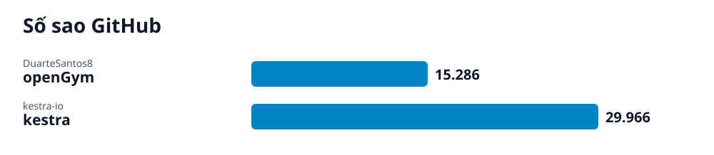

# Radar GitHub · 2026-10-24

## Các repo của lần quét này

- **[Tự host openGym: Trình theo dõi tập gym mã nguồn mở](opengym/vi.md)** (Phần mềm) — Ứng dụng mã nguồn mở theo dõi tập gym và thể hình, hỗ trợ lập lịch, ghi lại buổi tập, xem nhóm cơ hoạt động và tự host bằng Docker.
  - 🎯 Ứng dụng openGym chạy trên máy tính hoặc server của bạn, có thể truy cập qua trình duyệt ở cổng 8080 để tạo hồ sơ và lên lịch tập. · 🪜 5 bước
- **[Orchestrate everything everywhere with Kestra](kestra/vi.md)** (Giải pháp) — Nền tảng mã nguồn mở điều phối luồng công việc (workflows) cho dữ liệu, AI và hạ tầng qua giao diện YAML khai báo.
  - 🎯 Bạn sẽ có một hệ thống Kestra chạy cục bộ trên máy và truy cập được giao diện quản lý trên trình duyệt. · 🪜 3 bước
