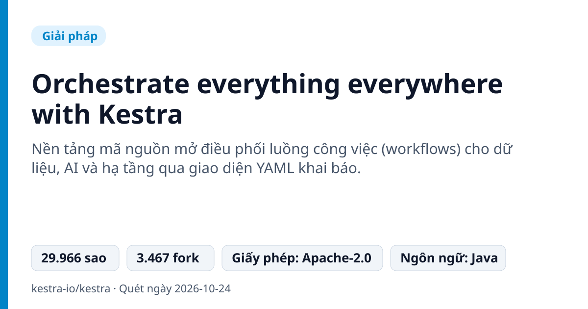
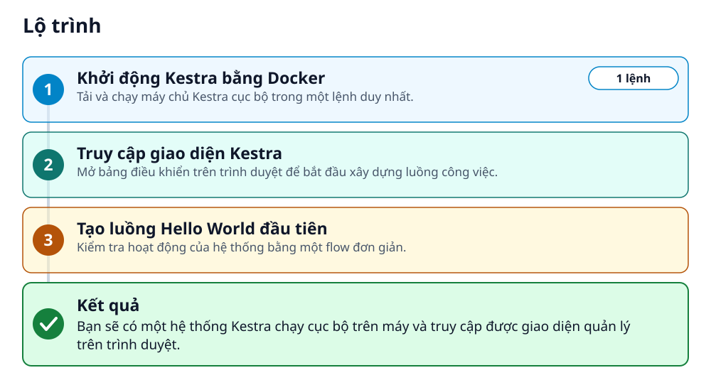
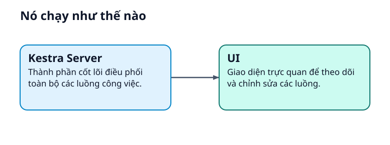
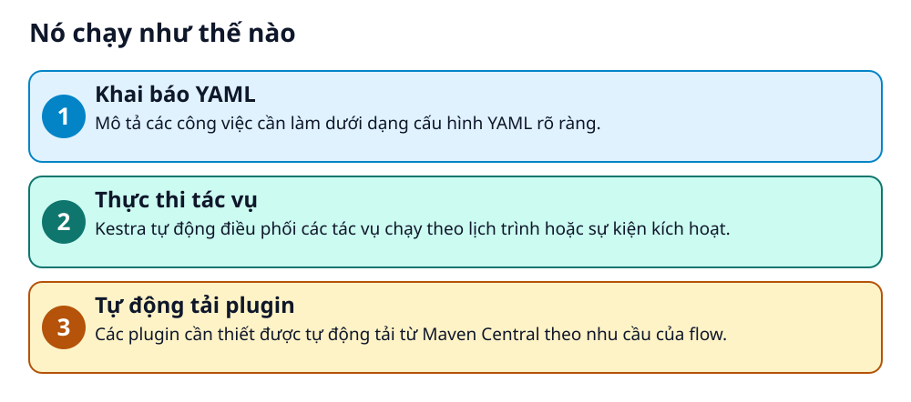

# Orchestrate everything everywhere with Kestra



> Tự động hóa quy trình dữ liệu và hạ tầng của bạn chỉ với một vài dòng YAML dễ đọc.

**Nền tảng mã nguồn mở điều phối luồng công việc (workflows) cho dữ liệu, AI và hạ tầng qua giao diện YAML khai báo.**

## 🎯 Bạn sẽ làm ra được gì

Bạn sẽ có một hệ thống Kestra chạy cục bộ trên máy và truy cập được giao diện quản lý trên trình duyệt.

## Vấn đề nó giải quyết

Các nhóm làm việc thường gặp khó khăn khi phải kết hợp nhiều công cụ rời rạc, thiếu sự đồng bộ và khó theo dõi trạng thái thực thi. Việc quản lý các quy trình thủ công tốn thời gian và dễ xảy ra lỗi khi vận hành.

> 💡 **Hình dung đời thường:** Giống như một người chỉ huy dàn nhạc giao hưởng, Kestra điều khiển từng nhạc cụ (tác vụ) cất tiếng đúng thời điểm để tạo nên một bản nhạc hoàn chỉnh.

## Ai nên xem

- Lập trình viên muốn tự động hóa quy trình
- Kỹ sư dữ liệu quản lý các luồng ETL
- Nhà quản lý hạ tầng công nghệ

## ⚠️ Lưu ý trước khi dùng

- Yêu cầu Docker hoạt động trên hệ thống
- Cần có kết nối internet để tự động tải các plugin từ Maven Central khi cần

## 🧰 Chuẩn bị trước khi bắt đầu

_Đánh dấu từng mục khi đã có đủ._

- [ ] **Docker**: Đảm bảo rằng Docker đang được bật trên máy tính của bạn.  
  <sub>Căn cứ: `README.md`</sub>

## 🗺️ Lộ trình



## 🪜 Làm theo từng bước

### Bước 1 · Khởi động Kestra bằng Docker

**Mục đích:** Tải và chạy máy chủ Kestra cục bộ trong một lệnh duy nhất.

1. Mở terminal trên máy tính.
2. Sao chép và chạy câu lệnh Docker tương ứng với hệ điều hành của bạn.

_Gõ hoặc dán từng dòng, theo thứ tự._

```bash
docker run --pull=always --rm -it -p 8080:8080 --user=root --name kestra -v kestra_data:/app/storage -v kestra_db:/app/data -v /var/run/docker.sock:/var/run/docker.sock -v /tmp:/tmp -e KESTRA_PLUGINS_AUTO_INSTALL_ENABLED=true kestra/kestra:latest-slim server local
```

✅ **Bạn sẽ thấy:** Kestra khởi động và sẵn sàng nhận kết nối trên cổng 8080.

<sub>Căn cứ: `README.md`</sub>

### Bước 2 · Truy cập giao diện Kestra

**Mục đích:** Mở bảng điều khiển trên trình duyệt để bắt đầu xây dựng luồng công việc.

1. Mở trình duyệt web và truy cập vào địa chỉ cục bộ.

🔗 Mở địa chỉ: `http://localhost:8080`

✅ **Bạn sẽ thấy:** Giao diện Kestra xuất hiện trên màn hình.

<sub>Căn cứ: `README.md`</sub>

### Bước 3 · Tạo luồng Hello World đầu tiên

**Mục đích:** Kiểm tra hoạt động của hệ thống bằng một flow đơn giản.

1. Tạo một flow mới với nội dung YAML được cung cấp.

_Nội dung mẫu trong README (thay giá trị giữ chỗ bằng giá trị của bạn)_

```yaml
id: hello_world
namespace: dev

tasks:
  - id: say_hello
    type: io.kestra.plugin.core.log.Log
    message: "Hello, World!"
```

✅ **Bạn sẽ thấy:** Flow được lưu và có thể chạy để in ra thông điệp.

<sub>Căn cứ: `README.md`</sub>

## ✔️ Kiểm tra kết quả

Truy cập thành công vào trang quản lý Kestra và chạy thử nghiệm quy trình.

## 🚀 Làm tiếp

- Thêm các tác vụ phức tạp hơn
- Khám phá AI Copilot

## 🔍 Bên trong nó hoạt động ra sao





1. **Khai báo YAML**: Mô tả các công việc cần làm dưới dạng cấu hình YAML rõ ràng. _(Căn cứ: `README.md`)_
2. **Thực thi tác vụ**: Kestra tự động điều phối các tác vụ chạy theo lịch trình hoặc sự kiện kích hoạt. _(Căn cứ: `README.md`)_
3. **Tự động tải plugin**: Các plugin cần thiết được tự động tải từ Maven Central theo nhu cầu của flow. _(Căn cứ: `README.md`)_

### Các mảnh ghép

| | Các mảnh ghép | Căn cứ |
|---|---|---|
| **Kestra Server** | Thành phần cốt lõi điều phối toàn bộ các luồng công việc. | `README.md` |
| **UI** | Giao diện trực quan để theo dõi và chỉnh sửa các luồng. | `README.md` |

## Học được gì từ thiết kế này

- Sử dụng cấu hình YAML để quản lý luồng công việc
- Vận hành nền tảng điều phối bằng Docker
- Xây dựng hệ thống tự động hóa hướng sự kiện

## Từ khóa

- **Flow**: Đơn vị cốt lõi đại diện cho một luồng công việc gồm nhiều tác vụ.
- **Task**: Từng đơn vị công việc riêng lẻ trong luồng.

---

Nguồn dữ kiện: [kestra-io/kestra](https://github.com/kestra-io/kestra) · Giấy phép: Apache-2.0 · 29.966 sao · Quét ngày 2026-10-24

_Nội dung do AI tóm tắt từ README và cấu trúc repo; hãy đọc repo gốc trước khi dùng._
