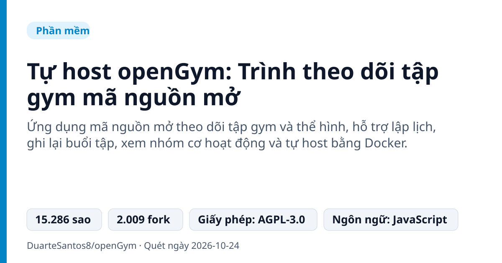
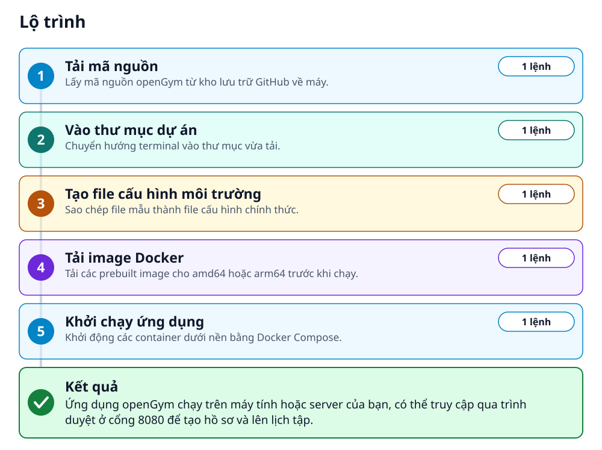
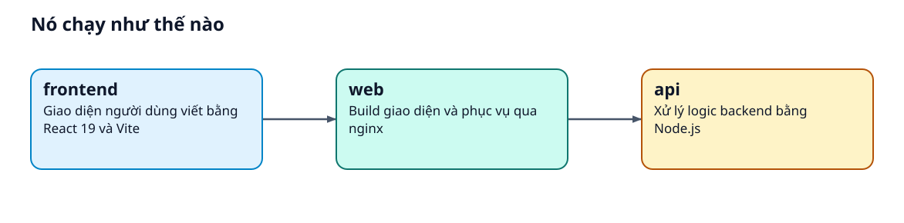
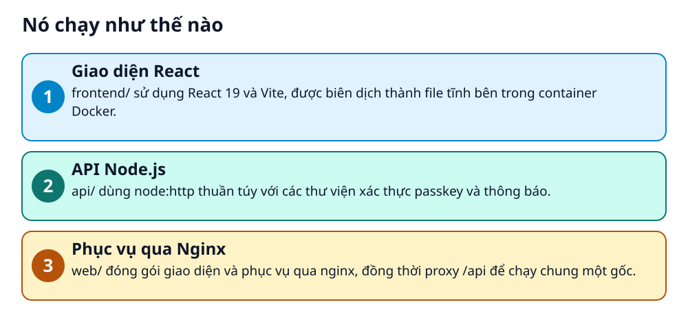

# Tự host openGym: Trình theo dõi tập gym mã nguồn mở



> Không phụ thuộc server bên thứ ba. Tự host app tập gym của riêng bạn với Docker chỉ trong vài phút.

**Ứng dụng mã nguồn mở theo dõi tập gym và thể hình, hỗ trợ lập lịch, ghi lại buổi tập, xem nhóm cơ hoạt động và tự host bằng Docker.**

## 🎯 Bạn sẽ làm ra được gì

Ứng dụng openGym chạy trên máy tính hoặc server của bạn, có thể truy cập qua trình duyệt ở cổng 8080 để tạo hồ sơ và lên lịch tập.

## Vấn đề nó giải quyết

Nhiều ứng dụng tập luyện lưu trữ dữ liệu của bạn trên server của họ, thúc đẩy bạn mua gói trả phí hoặc biến mất khi công ty đóng cửa. Bạn muốn một giải pháp tự kiểm soát dữ liệu trên máy chủ cá nhân mà vẫn hoạt động mượt mà như ứng dụng hiện đại.

> 💡 **Hình dung đời thường:** Giống như việc bạn tự xây phòng gym mini tại nhà thay vì thuê thẻ hội viên ở một trung tâm fitness.

## Ai nên xem

- Người tập gym muốn tự quản lý dữ liệu tập luyện của mình
- Người thích các ứng dụng self-hosted chạy qua Docker
- Lập trình viên muốn tuỳ chỉnh ứng dụng thể hình mã nguồn mở

## ⚠️ Lưu ý trước khi dùng

- Cần biết cơ bản về lệnh terminal và Docker
- Cấu hình HTTPS là bắt buộc nếu muốn dùng passkeys thực tế trên điện thoại
- Giấy phép sử dụng thuộc AGPL-3.0

## 🧰 Chuẩn bị trước khi bắt đầu

_Đánh dấu từng mục khi đã có đủ._

- [ ] **Docker**: Cần cài đặt sẵn Docker cùng với Compose trên máy của bạn.  
  Liên kết trong README: [Docker](https://docs.docker.com/get-docker/)  
  <sub>Căn cứ: `README`</sub>

## 🗺️ Lộ trình



## 🪜 Làm theo từng bước

### Bước 1 · Tải mã nguồn

**Mục đích:** Lấy mã nguồn openGym từ kho lưu trữ GitHub về máy.

1. Mở terminal và chạy lệnh clone repository.

_Gõ hoặc dán từng dòng, theo thứ tự._

```bash
git clone https://github.com/DuarteSantos8/openGym
```

✅ **Bạn sẽ thấy:** Thư mục openGym được tạo xuống máy tính.

<sub>Căn cứ: `README`</sub>

### Bước 2 · Vào thư mục dự án

**Mục đích:** Chuyển hướng terminal vào thư mục vừa tải.

1. Chạy lệnh cd để di chuyển vào thư mục.

```bash
cd openGym
```

✅ **Bạn sẽ thấy:** Terminal đang ở thư mục openGym.

<sub>Căn cứ: `README`</sub>

### Bước 3 · Tạo file cấu hình môi trường

**Mục đích:** Sao chép file mẫu thành file cấu hình chính thức.

1. Chạy lệnh copy file mẫu thành .env.

```bash
cp .env.example .env
```

✅ **Bạn sẽ thấy:** File .env được tạo trong thư mục hiện tại.

<sub>Căn cứ: `README`</sub>

### Bước 4 · Tải image Docker

**Mục đích:** Tải các prebuilt image cho amd64 hoặc arm64 trước khi chạy.

1. Chạy lệnh docker compose pull.

```bash
docker compose pull
```

✅ **Bạn sẽ thấy:** Các image được tải về thành công.

<sub>Căn cứ: `README`</sub>

### Bước 5 · Khởi chạy ứng dụng

**Mục đích:** Khởi động các container dưới nền bằng Docker Compose.

1. Chạy lệnh docker compose up -d.

```bash
docker compose up -d
```

✅ **Bạn sẽ thấy:** Các container khởi động và chạy ngầm.

<sub>Căn cứ: `README`</sub>

## ✔️ Kiểm tra kết quả

Mở trình duyệt truy cập localhost:8080, chạm vào Create profile để bắt đầu sử dụng.

## 🚀 Làm tiếp

- Cấu hình HTTPS trong file .env để dùng passkeys từ điện thoại.
- Nhập dữ liệu tập cũ từ Strong, Hevy hoặc FitNotes.

## 🔍 Bên trong nó hoạt động ra sao





1. **Giao diện React**: frontend/ sử dụng React 19 và Vite, được biên dịch thành file tĩnh bên trong container Docker. _(Căn cứ: `README`)_
2. **API Node.js**: api/ dùng node:http thuần túy với các thư viện xác thực passkey và thông báo. _(Căn cứ: `README`)_
3. **Phục vụ qua Nginx**: web/ đóng gói giao diện và phục vụ qua nginx, đồng thời proxy /api để chạy chung một gốc. _(Căn cứ: `README`)_

### Các mảnh ghép

| | Các mảnh ghép | Căn cứ |
|---|---|---|
| **frontend** | Giao diện người dùng viết bằng React 19 và Vite | `README` |
| **api** | Xử lý logic backend bằng Node.js | `README` |
| **web** | Build giao diện và phục vụ qua nginx | `README` |

## Học được gì từ thiết kế này

- Cách dùng Docker Compose để triển khai ứng dụng fullstack self-hosted
- Kiến trúc kết hợp React frontend và Node.js backend đơn giản không cần framework phức tạp
- Cơ chế đồng bộ dữ liệu bằng JSON document và revision

## Từ khóa

- **Docker Compose**: Công cụ định nghĩa và chạy ứng dụng Docker nhiều container.
- **Self-hosted**: Chạy ứng dụng trên máy chủ hoặc thiết bị của chính bạn thay vì đám mây của bên thứ ba.

---

Nguồn dữ kiện: [DuarteSantos8/openGym](https://github.com/DuarteSantos8/openGym) · Giấy phép: AGPL-3.0 · 15.286 sao · Quét ngày 2026-10-24

_Nội dung do AI tóm tắt từ README và cấu trúc repo; hãy đọc repo gốc trước khi dùng._
