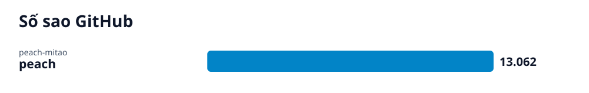

# Radar GitHub · 2026-10-28

## Các repo của lần quét này

- **[Peach: Trình quản lý và cào siêu dữ liệu video cục bộ](peach/vi.md)** (Phần mềm) — Peach là trình cào siêu dữ liệu video và quản lý phương tiện truyền thông mang tính cục bộ (local-first).
  - 🎯 Bạn sẽ cài đặt thành công Peach, chọn thư mục chứa video và bắt đầu quét, duyệt cũng như phát video với đầy đủ thông tin. · 🪜 3 bước
