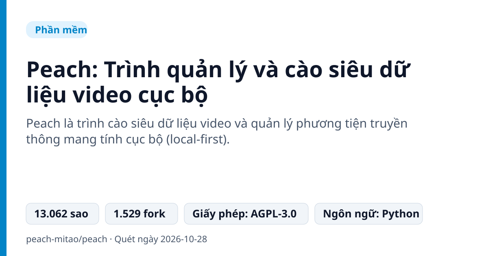
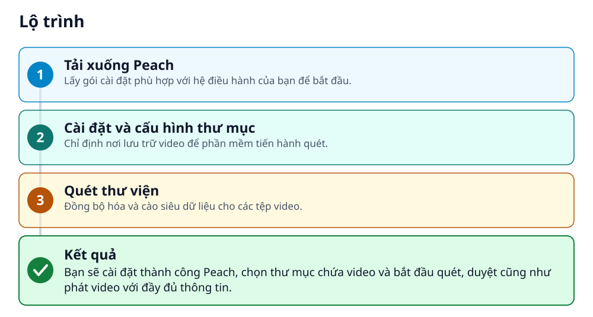
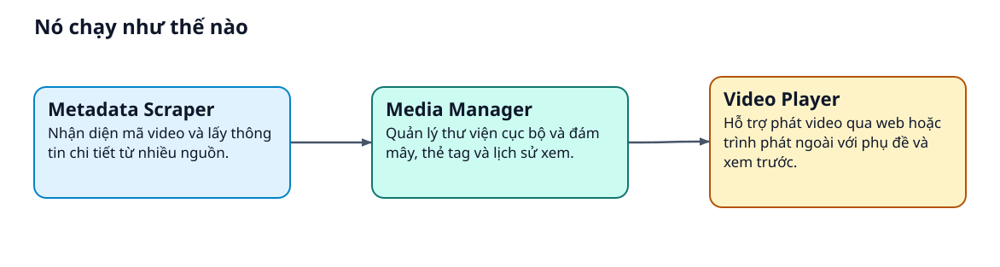
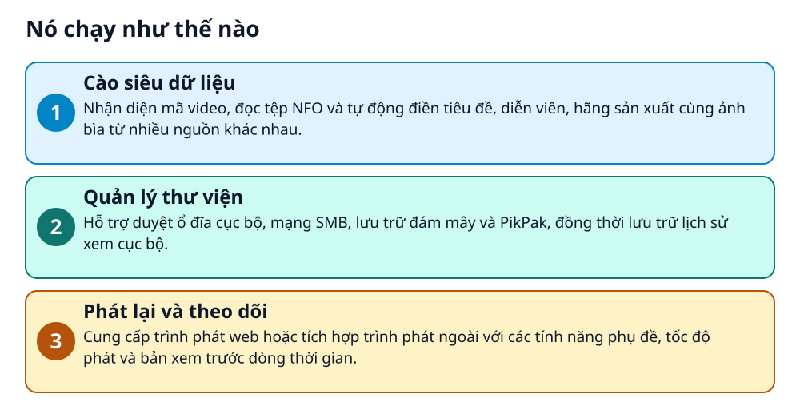

# Peach: Trình quản lý và cào siêu dữ liệu video cục bộ

> Quản lý kho video cá nhân, tự động lấy thông tin phim và phát trực tiếp trên mọi thiết bị.

**Peach là trình cào siêu dữ liệu video và quản lý phương tiện truyền thông mang tính cục bộ (local-first).**

## 🎯 Bạn sẽ làm ra được gì

Bạn sẽ cài đặt thành công Peach, chọn thư mục chứa video và bắt đầu quét, duyệt cũng như phát video với đầy đủ thông tin.

## Vấn đề nó giải quyết

Người dùng có kho video lớn trên ổ cứng hoặc đám mây thường gặp khó khăn trong việc sắp xếp, tìm kiếm thông tin diễn viên, bìa phim và theo dõi lịch sử xem. Việc quản lý thủ công rất mất thời gian và thiếu sự đồng bộ.

> 💡 **Hình dung đời thường:** Giống như việc bạn có một tủ sách khổng lồ và Peach là người thủ thư tự động dán nhãn, tìm bìa sách đẹp rồi sắp xếp gọn gàng lên kệ để bạn tìm đọc bất cứ lúc nào.

## Ai nên xem

- Người có kho video cá nhân lớn trên máy tính hoặc đám mây.
- Người dùng muốn tự động sắp xếp và tìm kiếm thông tin phim ảnh.
- Người thích giải pháp quản lý media mang tính cục bộ (local-first).

## ⚠️ Lưu ý trước khi dùng

- Bản dựng thử nghiệm trên máy tính để bàn chưa được ký mã nguồn và các bản macOS chưa được công chứng.
- Peach không cung cấp tài nguyên video hoặc quyền truy cập vào nội dung trả phí.
- Người dùng phải tự chịu trách nhiệm về bản quyền và tuân thủ pháp luật đối với nội dung quản lý.

## 🧰 Chuẩn bị trước khi bắt đầu

_Đánh dấu từng mục khi đã có đủ._

- [ ] **Windows x64**: Chọn trình cài đặt hoặc bản portable  
  Liên kết trong README: [Installer](https://github.com/peach-mitao/peach/releases/download/v0.50.0/Peach-0.50.0-windows-x64-setup.exe)  
  Căn cứ: `README`
- [ ] **macOS**: Hỗ trợ Apple Silicon / ARM64 hoặc Intel / x86_64  
  Liên kết trong README: [Apple Silicon / ARM64](https://github.com/peach-mitao/peach/releases/download/v0.50.0/Peach-0.50.0-macos-arm64.dmg)  
  Căn cứ: `README`
- [ ] **Docker / NAS**: Dành cho việc triển khai trên máy chủ  
  Căn cứ: `README`
- [ ] **Git, uv và Python 3.14+**: Yêu cầu khi chạy từ mã nguồn  
  Căn cứ: `README`

## 🗺️ Lộ trình

## 🪜 Làm theo từng bước

### Bước 1 · Tải xuống Peach

**Mục đích:** Lấy gói cài đặt phù hợp với hệ điều hành của bạn để bắt đầu.

1. Nhấp vào liên kết tải xuống tương ứng với hệ điều hành Windows hoặc macOS của bạn trên trang web hoặc tài liệu.

🔗 Liên kết trong README: [Installer](https://github.com/peach-mitao/peach/releases/download/v0.50.0/Peach-0.50.0-windows-x64-setup.exe)

✅ **Bạn sẽ thấy:** Tệp cài đặt được tải về thiết bị.

Căn cứ: `README`

### Bước 2 · Cài đặt và cấu hình thư mục

**Mục đích:** Chỉ định nơi lưu trữ video để phần mềm tiến hành quét.

1. Cài đặt ứng dụng và chọn thư mục chứa phương tiện truyền thông của bạn sau khi cài đặt xong.

✅ **Bạn sẽ thấy:** Giao diện ứng dụng hiển thị và sẵn sàng quét.

Căn cứ: `README`

### Bước 3 · Quét thư viện

**Mục đích:** Đồng bộ hóa và cào siêu dữ liệu cho các tệp video.

1. Thực hiện quét thư viện trong ứng dụng để bắt đầu duyệt và phát video.

✅ **Bạn sẽ thấy:** Danh sách video xuất hiện kèm theo thông tin, hình ảnh và tiêu đề được cập nhật.

Căn cứ: `README`

## ✔️ Kiểm tra kết quả

Bạn có thể duyệt qua danh sách video với đầy đủ thông tin diễn viên, ảnh bìa và phát video trực tiếp từ giao diện.

## 🚀 Làm tiếp

- Khám phá thêm các nguồn dữ liệu tùy chỉnh
- Kết nối với các trình phát bên ngoài

## 🔍 Bên trong nó hoạt động ra sao

1. **Cào siêu dữ liệu**: Nhận diện mã video, đọc tệp NFO và tự động điền tiêu đề, diễn viên, hãng sản xuất cùng ảnh bìa từ nhiều nguồn khác nhau. _(Căn cứ: `README`)_
2. **Quản lý thư viện**: Hỗ trợ duyệt ổ đĩa cục bộ, mạng SMB, lưu trữ đám mây và PikPak, đồng thời lưu trữ lịch sử xem cục bộ. _(Căn cứ: `README`)_
3. **Phát lại và theo dõi**: Cung cấp trình phát web hoặc tích hợp trình phát ngoài với các tính năng phụ đề, tốc độ phát và bản xem trước dòng thời gian. _(Căn cứ: `README`)_

### Các mảnh ghép

| | Các mảnh ghép | Căn cứ |
|---|---|---|
| **Metadata Scraper** | Nhận diện mã video và lấy thông tin chi tiết từ nhiều nguồn. | `README` |
| **Media Manager** | Quản lý thư viện cục bộ và đám mây, thẻ tag và lịch sử xem. | `README` |
| **Video Player** | Hỗ trợ phát video qua web hoặc trình phát ngoài với phụ đề và xem trước. | `README` |

## Học được gì từ thiết kế này

- Cách tổ chức kho phương tiện truyền thông kỹ thuật số với kiến trúc local-first.
- Tự động hóa việc lấy siêu dữ liệu và hình ảnh bìa cho video.
- Quản lý và phát video kết hợp giữa ổ cứng cục bộ và lưu trữ đám mây.

## Từ khóa

- **Local-first**: Mô hình lưu trữ dữ liệu ưu tiên lưu ngay trên thiết bị của người dùng để đảm bảo quyền riêng tư.
- **Siêu dữ liệu (Metadata)**: Thông tin chi tiết về video như tên phim, diễn viên, đạo diễn, thể loại và ảnh bìa.

---

Nguồn dữ kiện: [peach-mitao/peach](https://github.com/peach-mitao/peach) · Giấy phép: AGPL-3.0 · 13.062 sao · Quét ngày 2026-10-28

_Nội dung do AI tóm tắt từ README và cấu trúc repo; hãy đọc repo gốc trước khi dùng._
