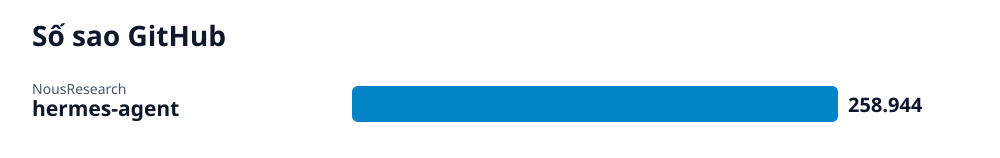

# Radar GitHub · 2026-10-31

## Các repo của lần quét này

- **[Cài Đặt và Sử Dụng Hermes Agent trên Máy Tính](hermes-agent/vi.md)** (AI) — Hermes Agent là trợ lý AI tự cải thiện có vòng lặp học tập tích hợp, hỗ trợ đa nền tảng và chạy được trên mọi hạ tầng.
  - 🎯 Cài đặt thành công Hermes Agent trên máy tính, tải lại cấu hình shell và khởi động giao diện dòng lệnh trò chuyện với trợ lý AI. · 🪜 3 bước
