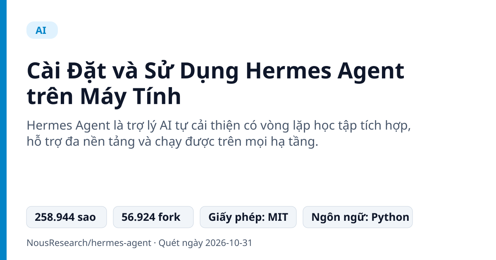
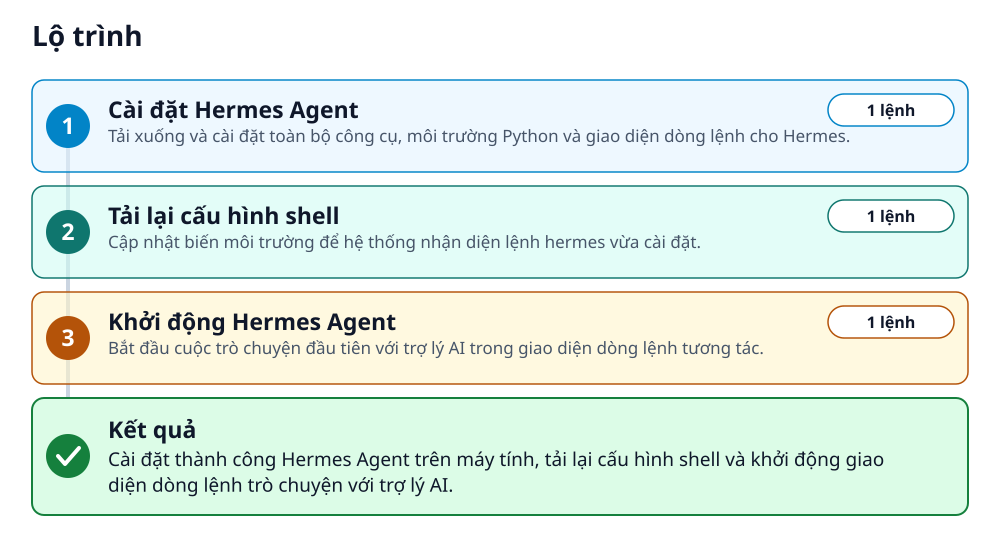
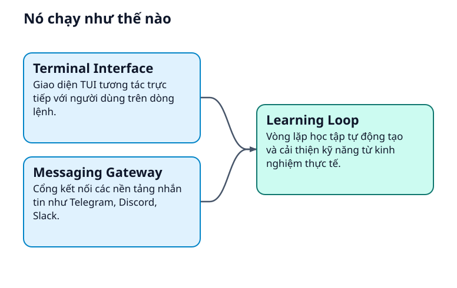
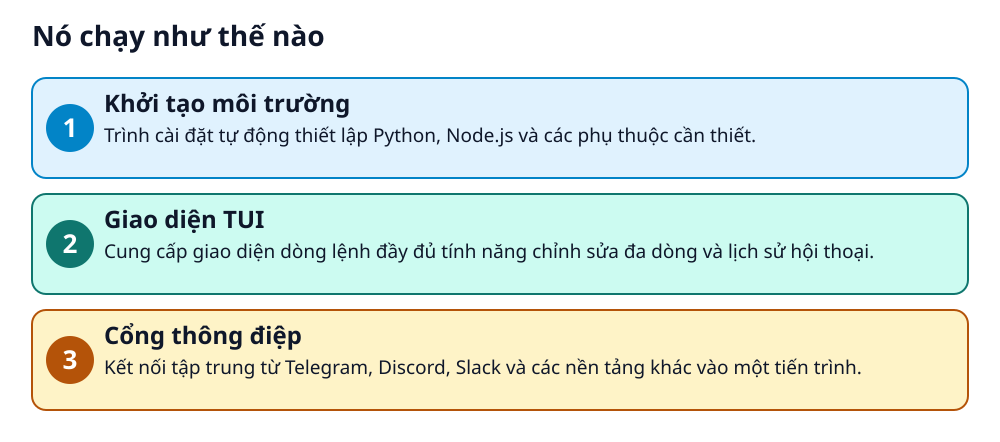

# Cài Đặt và Sử Dụng Hermes Agent trên Máy Tính



> Tạo một trợ lý AI tự học, kết nối Telegram và chạy tự động với Hermes Agent ngay hôm nay.

**Hermes Agent là trợ lý AI tự cải thiện có vòng lặp học tập tích hợp, hỗ trợ đa nền tảng và chạy được trên mọi hạ tầng.**

## 🎯 Bạn sẽ làm ra được gì

Cài đặt thành công Hermes Agent trên máy tính, tải lại cấu hình shell và khởi động giao diện dòng lệnh trò chuyện với trợ lý AI.

## Vấn đề nó giải quyết

Dân văn phòng và lập trình viên mới thường gặp khó khăn khi phải cấu hình nhiều công cụ AI rời rạc, không nhớ ngữ cảnh cũ và thiếu kết nối với các ứng dụng nhắn tin hàng ngày như Telegram. Việc quản lý nhiều khóa API phức tạp cũng làm mất nhiều thời gian.

> 💡 **Hình dung đời thường:** Giống như việc thuê một trợ lý riêng: không chỉ làm việc theo lệnh, trợ lý này còn tự rút kinh nghiệm sau mỗi nhiệm vụ và luôn sẵn sàng nghe điện thoại từ bất cứ đâu.

## Ai nên xem

- Dân văn phòng muốn tự động hóa công việc hàng ngày bằng AI
- Lập trình viên mới tìm kiếm một trợ lý AI có khả năng tự học và ghi nhớ ngữ cảnh
- Người dùng muốn trò chuyện với trợ lý AI qua Telegram hoặc giao diện dòng lệnh

## ⚠️ Lưu ý trước khi dùng

- Trình cài đặt yêu cầu quyền thực thi lệnh hệ thống trên máy tính
- Một số trình diệt virus có thể nhận diện nhầm gói quản lý phụ thuộc (uv.exe) trên Windows

## 🧰 Chuẩn bị trước khi bắt đầu

_Đánh dấu từng mục khi đã có đủ._

- [ ] **Hệ điều hành Linux, macOS hoặc WSL2 trên Windows**: Môi trường dòng lệnh Unix để chạy lệnh cài đặt nhanh  
  <sub>Căn cứ: `README`</sub>
- [ ] **Hệ điều hành Windows nguyên bản (tuỳ chọn)**: Dùng PowerShell để cài đặt trực tiếp trên Windows  
  <sub>Căn cứ: `README`</sub>

## 🗺️ Lộ trình



## 🪜 Làm theo từng bước

### Bước 1 · Cài đặt Hermes Agent

**Mục đích:** Tải xuống và cài đặt toàn bộ công cụ, môi trường Python và giao diện dòng lệnh cho Hermes.

1. Mở terminal trên Linux/macOS/WSL2 và chạy lệnh cài đặt curl.

_Gõ hoặc dán từng dòng, theo thứ tự._

```bash
curl -fsSL https://hermes-agent.nousresearch.com/install.sh | bash
```

<sub>Căn cứ: `README`</sub>

### Bước 2 · Tải lại cấu hình shell

**Mục đích:** Cập nhật biến môi trường để hệ thống nhận diện lệnh hermes vừa cài đặt.

1. Chạy lệnh tải lại tệp cấu hình bashrc trên terminal.

```bash
source ~/.bashrc
```

<sub>Căn cứ: `README`</sub>

### Bước 3 · Khởi động Hermes Agent

**Mục đích:** Bắt đầu cuộc trò chuyện đầu tiên với trợ lý AI trong giao diện dòng lệnh tương tác.

1. Gõ lệnh hermes trên terminal và bắt đầu trò chuyện.

```bash
hermes
```

✅ **Bạn sẽ thấy:** Hiển thị giao diện dòng lệnh TUI để bắt đầu trò chuyện với trợ lý.

<sub>Căn cứ: `README`</sub>

## ✔️ Kiểm tra kết quả

Gõ lệnh hermes trên terminal hiển thị giao diện tương tác và cho phép bắt đầu trò chuyện.

## 🩹 Lỗi thường gặp

| Hiện tượng | Cách xử lý | Căn cứ |
|---|---|---|
| Windows Defender hoặc phần mềm diệt virus báo nhầm uv.exe là mã độc | Đây là cảnh báo giả đối với gói quản lý Python written in Rust của Astral. Hãy làm theo hướng dẫn xác thực hoặc thêm thư mục vào danh sách ngoại trừ. | `README` |

## 🚀 Làm tiếp

- Chạy hermes model để chọn nhà cung cấp LLM và mô hình
- Chạy hermes gateway để bắt đầu kết nối nhắn tin Telegram, Discord
- Chạy hermes setup --portal để dùng gói Nous Portal không cần thu thập nhiều khóa API

## 🔍 Bên trong nó hoạt động ra sao





1. **Khởi tạo môi trường**: Trình cài đặt tự động thiết lập Python, Node.js và các phụ thuộc cần thiết. _(Căn cứ: `README`)_
2. **Giao diện TUI**: Cung cấp giao diện dòng lệnh đầy đủ tính năng chỉnh sửa đa dòng và lịch sử hội thoại. _(Căn cứ: `README`)_
3. **Cổng thông điệp**: Kết nối tập trung từ Telegram, Discord, Slack và các nền tảng khác vào một tiến trình. _(Căn cứ: `README`)_

### Các mảnh ghép

| | Các mảnh ghép | Căn cứ |
|---|---|---|
| **Terminal Interface** | Giao diện TUI tương tác trực tiếp với người dùng trên dòng lệnh. | `README` |
| **Messaging Gateway** | Cổng kết nối các nền tảng nhắn tin như Telegram, Discord, Slack. | `README` |
| **Learning Loop** | Vòng lặp học tập tự động tạo và cải thiện kỹ năng từ kinh nghiệm thực tế. | `README` |

## Học được gì từ thiết kế này

- Cách cài đặt một công cụ AI dòng lệnh tiên tiến bằng một dòng lệnh duy nhất
- Cách quản lý cấu hình mô hình và nhà cung cấp AI linh hoạt
- Cách sử dụng giao diện tương tác dòng lệnh (TUI) để trò chuyện và tra cứu lịch sử

## Từ khóa

- **TUI**: Giao diện người dùng dựa trên văn bản chạy ngay trong cửa sổ terminal
- **Gateway**: Tiến trình trung gian kết nối trợ lý AI với các nền tảng nhắn tin bên ngoài

---

Nguồn dữ kiện: [NousResearch/hermes-agent](https://github.com/NousResearch/hermes-agent) · Giấy phép: MIT · 258.944 sao · Quét ngày 2026-10-31

_Nội dung do AI tóm tắt từ README và cấu trúc repo; hãy đọc repo gốc trước khi dùng._
