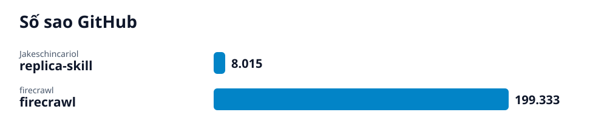

# Radar GitHub · 2026-11-07

## Các repo của lần quét này

- **[Sao chép mọi ứng dụng với Claude Skills](replica-skill/vi.md)** (Khởi nghiệp) — Eleven free Claude skills that clone any app: reverse-engineer it, rebuild it, test it for bugs, then fix what its users hate.
  - 🎯 Bạn sẽ có một bộ công cụ Claude skill và script Python để phân tích, thiết kế, xây dựng, kiểm thử và triển khai phiên bản clone của ứng dụng mục tiêu một cách sạch sẽ. · 🪜 9 bước
- **[Firecrawl: API TÌm Kiếm, Trích Xuất và Tương Tác Web Cho AI](firecrawl/vi.md)** (AI) — Firecrawl là API thu thập dữ liệu web nguồn mở giúp agent AI tìm kiếm, cào, phân tích và tương tác với bất kỳ trang web nào một cách dễ dàng.
  - 🎯 Bạn sẽ có thể gọi API Firecrawl để tìm kiếm thông tin, cào nội dung trang web hoặc tương tác trực tiếp với các trang web động. · 🪜 4 bước
