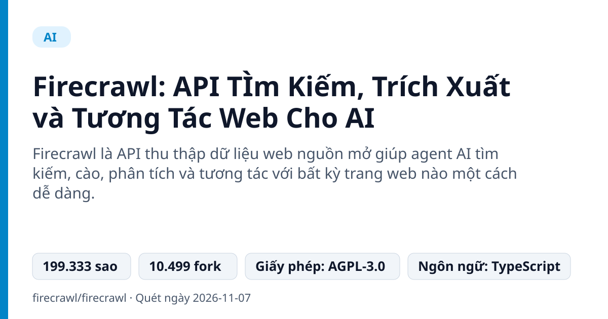
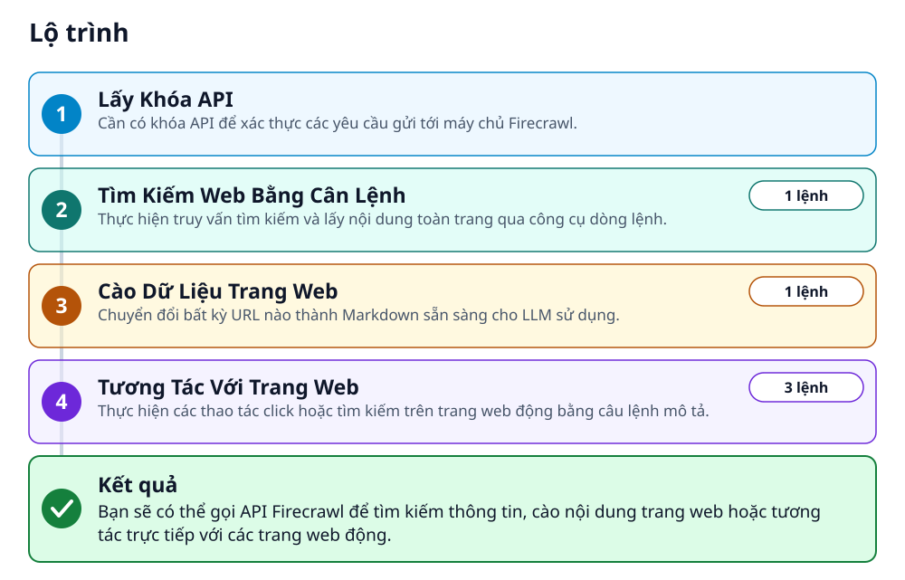
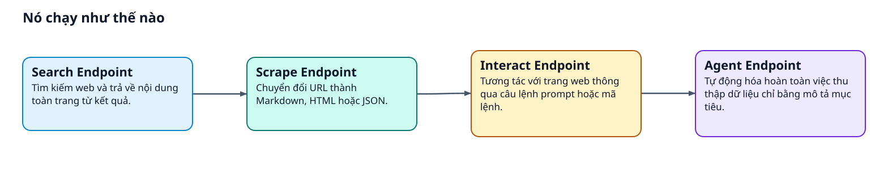
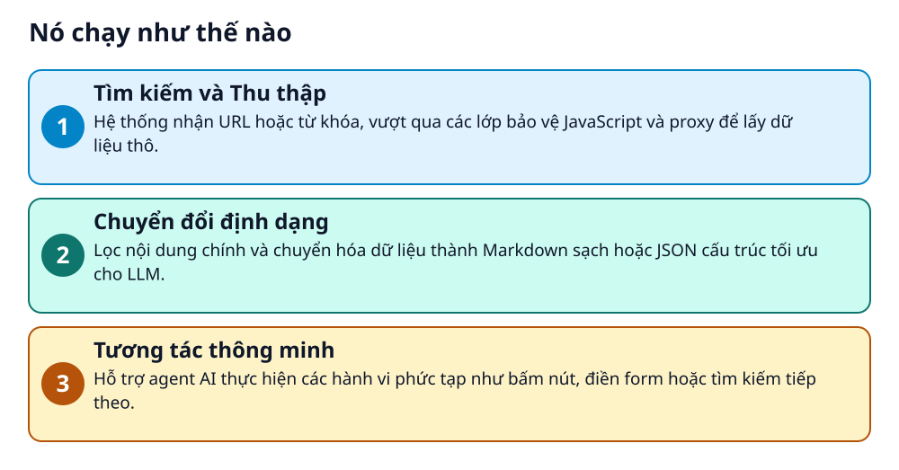

# Firecrawl: API TÌm Kiếm, Trích Xuất và Tương Tác Web Cho AI



> Biến mọi trang web thành Markdown hoặc JSON sạch để cấp nguồn cho trợ lý AI.

**Firecrawl là API thu thập dữ liệu web nguồn mở giúp agent AI tìm kiếm, cào, phân tích và tương tác với bất kỳ trang web nào một cách dễ dàng.**

## 🎯 Bạn sẽ làm ra được gì

Bạn sẽ có thể gọi API Firecrawl để tìm kiếm thông tin, cào nội dung trang web hoặc tương tác trực tiếp với các trang web động.

## Vấn đề nó giải quyết

Các lập trình viên và nhà nghiên cứu AI thường gặp khó khăn khi lấy dữ liệu sạch từ các trang web phức tạp do bị chặn hoặc cấu trúc lộn xộn. Firecrawl giải quyết việc này bằng cách tự động xử lý proxy xoay vòng, nội dung nặng JavaScript và trả về dữ liệu chuẩn cho LLM.

> 💡 **Hình dung đời thường:** Giống như việc thuê một thư ký thông minh chuyên đọc mọi trang web trên Internet rồi tóm tắt lại gọn gàng bằng định dạng bạn muốn trước khi giao cho bạn.

## Ai nên xem

- Lập trình viên AI muốn cấp nguồn dữ liệu thời gian thực cho trợ lý
- Nhà phát triển cần công cụ cào web không lo về proxy và cấu hình phức tạp
- Người làm dữ liệu cần tự động chuyển đổi tài liệu và website thành Markdown sạch

## ⚠️ Lưu ý trước khi dùng

- Dịch vụ yêu cầu khóa API và có thể phát sinh chi phí theo hạn mức sử dụng
- Phụ thuộc vào dịch vụ máy chủ trực tuyến của Firecrawl

## 🧰 Chuẩn bị trước khi bắt đầu

_Đánh dấu từng mục khi đã có đủ._

- [ ] **Tài khoản Firecrawl**: Đăng ký tại trang web chính thức để nhận khóa API.  
  Liên kết trong README: [firecrawl.dev](https://firecrawl.dev)  
  <sub>Căn cứ: `README`</sub>

## 🗺️ Lộ trình



## 🪜 Làm theo từng bước

### Bước 1 · Lấy Khóa API

**Mục đích:** Cần có khóa API để xác thực các yêu cầu gửi tới máy chủ Firecrawl.

1. Truy cập trang đăng ký chính thức.

🔗 Liên kết trong README: [firecrawl.dev](https://firecrawl.dev)

✅ **Bạn sẽ thấy:** Nhận được khóa API dạng fc-YOUR_API_KEY.

<sub>Căn cứ: `README`</sub>

### Bước 2 · Tìm Kiếm Web Bằng Cân Lệnh

**Mục đích:** Thực hiện truy vấn tìm kiếm và lấy nội dung toàn trang qua công cụ dòng lệnh.

1. Chạy lệnh tìm kiếm trong terminal của bạn.

_Gõ hoặc dán từng dòng, theo thứ tự._

```bash
firecrawl search "firecrawl" --limit 5
```

✅ **Bạn sẽ thấy:** Nhận được danh sách kết quả kèm URL và tiêu đề.

<sub>Căn cứ: `README`</sub>

### Bước 3 · Cào Dữ Liệu Trang Web

**Mục đích:** Chuyển đổi bất kỳ URL nào thành Markdown sẵn sàng cho LLM sử dụng.

1. Chạy lệnh cào dữ liệu URL mục tiêu trong terminal.

```bash
firecrawl scrape https://firecrawl.dev
```

✅ **Bạn sẽ thấy:** Nhận được nội dung trang web dưới dạng văn bản cấu trúc Markdown sạch sẽ.

<sub>Căn cứ: `README`</sub>

### Bước 4 · Tương Tác Với Trang Web

**Mục đích:** Thực hiện các thao tác click hoặc tìm kiếm trên trang web động bằng câu lệnh mô tả.

1. Thực hiện cào trang web và chạy lệnh tương tác.

```bash
firecrawl scrape https://amazon.com
firecrawl interact exec --prompt "Search for 'mechanical keyboard'"
firecrawl interact exec --prompt "Click the first result"
```

✅ **Bạn sẽ thấy:** Trang web thực hiện hành động theo câu lệnh và trả về kết quả tương tác.

<sub>Căn cứ: `README`</sub>

## ✔️ Kiểm tra kết quả

Xác nhận các câu lệnh CLI gọi API thành công và trả về dữ liệu đúng định dạng JSON hoặc Markdown.

## 🚀 Làm tiếp

- Thử nghiệm tính năng Crawl toàn bộ website
- Tích hợp Firecrawl vào MCP client
- Khám phá các endpoint Agent tự động

## 🔍 Bên trong nó hoạt động ra sao





1. **Tìm kiếm và Thu thập**: Hệ thống nhận URL hoặc từ khóa, vượt qua các lớp bảo vệ JavaScript và proxy để lấy dữ liệu thô. _(Căn cứ: `README`)_
2. **Chuyển đổi định dạng**: Lọc nội dung chính và chuyển hóa dữ liệu thành Markdown sạch hoặc JSON cấu trúc tối ưu cho LLM. _(Căn cứ: `README`)_
3. **Tương tác thông minh**: Hỗ trợ agent AI thực hiện các hành vi phức tạp như bấm nút, điền form hoặc tìm kiếm tiếp theo. _(Căn cứ: `README`)_

### Các mảnh ghép

| | Các mảnh ghép | Căn cứ |
|---|---|---|
| **Search Endpoint** | Tìm kiếm web và trả về nội dung toàn trang từ kết quả. | `README` |
| **Scrape Endpoint** | Chuyển đổi URL thành Markdown, HTML hoặc JSON. | `README` |
| **Interact Endpoint** | Tương tác với trang web thông qua câu lệnh prompt hoặc mã lệnh. | `README` |
| **Agent Endpoint** | Tự động hóa hoàn toàn việc thu thập dữ liệu chỉ bằng mô tả mục tiêu. | `README` |

## Học được gì từ thiết kế này

- Cách kết nối ứng dụng với API thu thập dữ liệu web tiên tiến
- Tận dụng định dạng Markdown tối ưu hóa cho token của LLM
- Cách xây dựng agent tự động tương tác trực tiếp với giao diện trang web

## Từ khóa

- **Scrape**: Hành động tải và trích xuất nội dung từ một trang web đơn lẻ.
- **Markdown**: Định dạng văn bản nhẹ, dễ đọc, rất tối ưu cho các mô hình ngôn ngữ lớn (LLM).

---

Nguồn dữ kiện: [firecrawl/firecrawl](https://github.com/firecrawl/firecrawl) · Giấy phép: AGPL-3.0 · 199.333 sao · Quét ngày 2026-11-07

_Nội dung do AI tóm tắt từ README và cấu trúc repo; hãy đọc repo gốc trước khi dùng._
