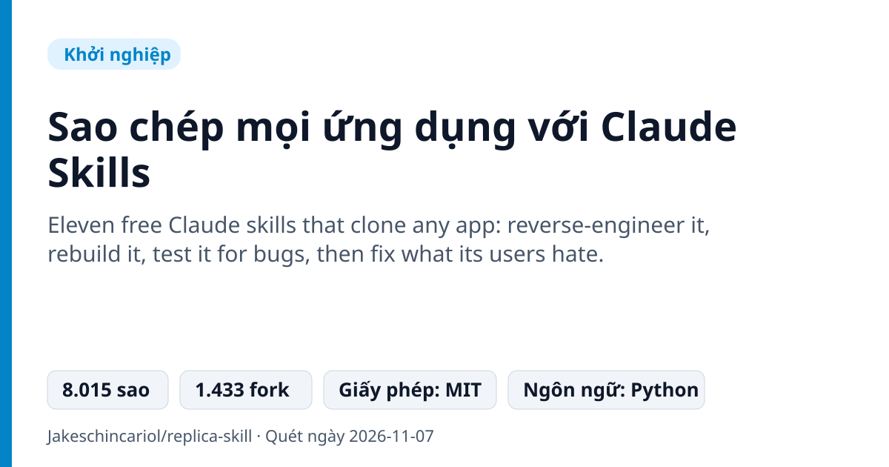
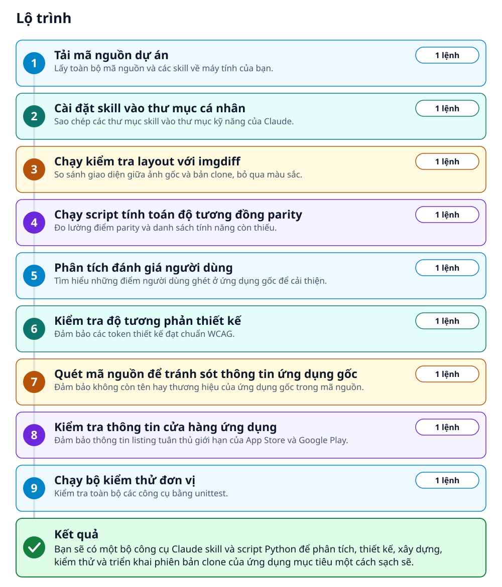
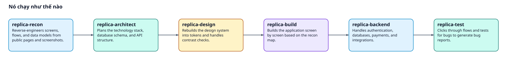
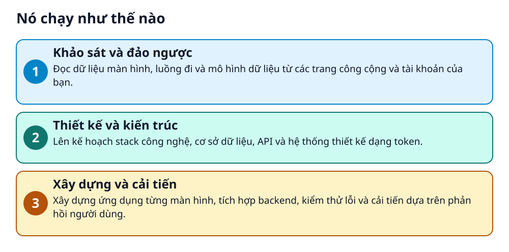

# Sao chép mọi ứng dụng với Claude Skills



> 11 Claude skill miễn phí giúp đảo ngược, xây dựng lại và sửa lỗi ứng dụng bạn muốn clone.

**Eleven free Claude skills that clone any app: reverse-engineer it, rebuild it, test it for bugs, then fix what its users hate.**

## 🎯 Bạn sẽ làm ra được gì

Bạn sẽ có một bộ công cụ Claude skill và script Python để phân tích, thiết kế, xây dựng, kiểm thử và triển khai phiên bản clone của ứng dụng mục tiêu một cách sạch sẽ.

## Vấn đề nó giải quyết

Lập trình viên muốn xây dựng lại các ứng dụng phổ biến nhưng thường mất rất nhiều thời gian để lập kế hoạch, thiết kế và kiểm thử. Việc thiếu một quy trình chuẩn từ khâu khảo sát đến triển khai khiến quá trình clone sản phẩm gặp nhiều sai sót và khó kiểm soát chất lượng.

> 💡 **Hình dung đời thường:** Giống như việc bạn có một đội ngũ chuyên gia thiết kế, kỹ sư và kiểm thử làm việc tuần tự để tháo rắp và ráp lại một cỗ máy hoàn hảo hơn.

## Ai nên xem

- Indie hacker muốn xây dựng sản phẩm SaaS mới dựa trên ứng dụng có sẵn.
- Lập trình viên muốn học cách cấu trúc và thiết kế hệ thống của ứng dụng lớn.
- Nhà sáng lập muốn tự động hóa quy trình phân tích đối thủ cạnh tranh.

## ⚠️ Lưu ý trước khi dùng

- Không sao chép mã nguồn, tài sản độc quyền hoặc API riêng tư của ứng dụng gốc.
- Kết quả phụ thuộc vào độ phức tạp của ứng dụng mục tiêu.
- Cần kiểm tra kỹ vấn đề thương hiệu và pháp lý trước khi thương mại hóa.

## 🧰 Chuẩn bị trước khi bắt đầu

_Đánh dấu từng mục khi đã có đủ._

- [ ] **Python 3.8 hoặc mới hơn**: Cần thiết cho các công cụ Python chuẩn, không cần pip install.  
  <sub>Căn cứ: `README`</sub>
- [ ] **Claude hoặc Claude Code**: Môi trường để chạy các skill.  
  <sub>Căn cứ: `README`</sub>

## 🗺️ Lộ trình



## 🪜 Làm theo từng bước

### Bước 1 · Tải mã nguồn dự án

**Mục đích:** Lấy toàn bộ mã nguồn và các skill về máy tính của bạn.

1. Mở terminal và chạy lệnh git clone.

_Gõ hoặc dán từng dòng, theo thứ tự._

```bash
git clone https://github.com/Jakeschincariol/replica-skill.git
```

✅ **Bạn sẽ thấy:** Thư mục replica-skill được tạo xuống máy.

<sub>Căn cứ: `README`</sub>

### Bước 2 · Cài đặt skill vào thư mục cá nhân

**Mục đích:** Sao chép các thư mục skill vào thư mục kỹ năng của Claude.

1. Chạy lệnh copy các thư mục replica-\* vào thư mục kỹ năng của Claude.

```bash
cp -r replica-skill/replica-* ~/.claude/skills/
```

✅ **Bạn sẽ thấy:** Các skill đã sẵn sàng để sử dụng.

<sub>Căn cứ: `README`</sub>

### Bước 3 · Chạy kiểm tra layout với imgdiff

**Mục đích:** So sánh giao diện giữa ảnh gốc và bản clone, bỏ qua màu sắc.

1. Chạy lệnh Python cho công cụ imgdiff trong terminal.

```bash
python3 replica-diff/imgdiff.py original.png clone.png --out diff.png
```

✅ **Bạn sẽ thấy:** Tạo ra tệp diff.png hiển thị các vùng khác biệt.

<sub>Căn cứ: `README`</sub>

### Bước 4 · Chạy script tính toán độ tương đồng parity

**Mục đích:** Đo lường điểm parity và danh sách tính năng còn thiếu.

1. Chạy lệnh parity với tệp features.csv trong thư mục replica/.

```bash
python3 replica-diff/parity.py replica/features.csv
```

✅ **Bạn sẽ thấy:** Hiển thị điểm parity và danh sách tính năng.

<sub>Căn cứ: `README`</sub>

### Bước 5 · Phân tích đánh giá người dùng

**Mục đích:** Tìm hiểu những điểm người dùng ghét ở ứng dụng gốc để cải thiện.

1. Chạy script phân tích đánh giá với tệp reviews.csv.

```bash
python3 replica-entrepreneur/reviews.py replica/reviews.csv
```

✅ **Bạn sẽ thấy:** Hiển thị các phàn nàn của người dùng được xếp hạng và đính kèm liên kết.

<sub>Căn cứ: `README`</sub>

### Bước 6 · Kiểm tra độ tương phản thiết kế

**Mục đích:** Đảm bảo các token thiết kế đạt chuẩn WCAG.

1. Chạy script kiểm tra độ tương phản với tệp tokens.json.

```bash
python3 replica-design/contrast.py replica/design/tokens.json
```

✅ **Bạn sẽ thấy:** Kết quả kiểm tra độ tương phản màu sắc.

<sub>Căn cứ: `README`</sub>

### Bước 7 · Quét mã nguồn để tránh sót thông tin ứng dụng gốc

**Mục đích:** Đảm bảo không còn tên hay thương hiệu của ứng dụng gốc trong mã nguồn.

1. Chạy script quét mã nguồn.

```bash
python3 replica-brand/sweep.py . --avoid "Original App"
```

✅ **Bạn sẽ thấy:** Báo cáo nếu còn sót lại thông tin ứng dụng gốc.

<sub>Căn cứ: `README`</sub>

### Bước 8 · Kiểm tra thông tin cửa hàng ứng dụng

**Mục đích:** Đảm bảo thông tin listing tuân thủ giới hạn của App Store và Google Play.

1. Chạy script kiểm tra listing.

```bash
python3 replica-launch/listing.py replica/launch/listing.json
```

✅ **Bạn sẽ thấy:** Kiểm tra giới hạn ký tự và từ khóa.

<sub>Căn cứ: `README`</sub>

### Bước 9 · Chạy bộ kiểm thử đơn vị

**Mục đích:** Kiểm tra toàn bộ các công cụ bằng unittest.

1. Chạy lệnh unittest discover.

```bash
python3 -m unittest discover -s tests -v
```

✅ **Bạn sẽ thấy:** Tất cả các bài kiểm tra chạy thành công.

<sub>Căn cứ: `README`</sub>

## ✔️ Kiểm tra kết quả

Các script Python chạy không lỗi và thư mục replica/ chứa đầy đủ các tệp phân tích, thiết kế và kiểm thử cho ứng dụng clone.

## 🚀 Làm tiếp

- Chạy chuỗi skill lần lượt từ recon đến deploy.
- Thử nghiệm quét đánh giá ứng dụng khác với replica-entrepreneur.

## 🔍 Bên trong nó hoạt động ra sao





1. **Khảo sát và đảo ngược**: Đọc dữ liệu màn hình, luồng đi và mô hình dữ liệu từ các trang công cộng và tài khoản của bạn. _(Căn cứ: `README`)_
2. **Thiết kế và kiến trúc**: Lên kế hoạch stack công nghệ, cơ sở dữ liệu, API và hệ thống thiết kế dạng token. _(Căn cứ: `README`)_
3. **Xây dựng và cải tiến**: Xây dựng ứng dụng từng màn hình, tích hợp backend, kiểm thử lỗi và cải tiến dựa trên phản hồi người dùng. _(Căn cứ: `README`)_

### Các mảnh ghép

| | Các mảnh ghép | Căn cứ |
|---|---|---|
| **replica-recon** | Reverse-engineers screens, flows, and data models from public pages and screenshots. | `README` |
| **replica-architect** | Plans the technology stack, database schema, and API structure. | `README` |
| **replica-design** | Rebuilds the design system into tokens and handles contrast checks. | `README` |
| **replica-build** | Builds the application screen by screen based on the recon map. | `README` |
| **replica-backend** | Handles authentication, databases, payments, and integrations. | `README` |
| **replica-test** | Clicks through flows and tests for bugs to generate bug reports. | `README` |

## Học được gì từ thiết kế này

- Cách cấu trúc quy trình reverse-engineer một ứng dụng sạch-phòng (clean-room).
- Phương pháp chuyển đổi dữ liệu giao diện thành hệ thống token thiết kế.
- Kỹ thuật viết script Python tiêu chuẩn để kiểm tra mã nguồn và giao diện.

## Từ khóa

- **Clean-room**: Phương pháp nghiên cứu chức năng và thiết kế để viết lại mã hoàn toàn mới mà không sao chép mã nguồn gốc.
- **Parity Score**: Điểm số đo lường mức độ hoàn thiện tính năng của bản clone so với ứng dụng gốc.

---

Nguồn dữ kiện: [Jakeschincariol/replica-skill](https://github.com/Jakeschincariol/replica-skill) · Giấy phép: MIT · 8.015 sao · Quét ngày 2026-11-07

_Nội dung do AI tóm tắt từ README và cấu trúc repo; hãy đọc repo gốc trước khi dùng._
