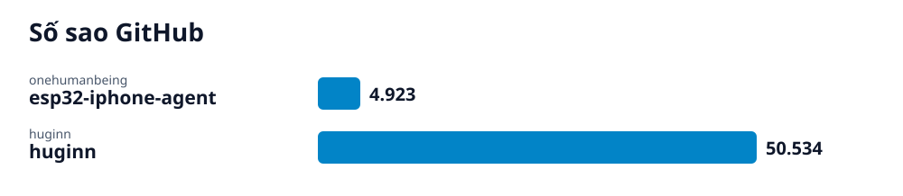

# Radar GitHub · 2026-11-14

## Các repo của lần quét này

- **[ESP32 iPhone Agent: Điều khiển iPhone bằng AI qua bo mạch $7](esp32-iphone-agent/vi.md)** (Giải pháp) — Giúp mô hình AI tương tác với iPhone thật bằng cách kết hợp truyền màn hình AirPlay và chuột bàn phím USB HID.
  - 🎯 AI có thể tự nhận diện màn hình iPhone và thực hiện các tác vụ theo yêu cầu của bạn. · 🪜 3 bước
- **[Tạo các tác vụ tự động hóa với Huginn](huginn/vi.md)** (Giải pháp) — Huginn là hệ thống giúp tạo các agent thực hiện tác vụ tự động, đọc web, theo dõi sự kiện giống như IFTTT hoặc Zapier nhưng chạy trên server của bạn.
  - 🎯 Khởi chạy thành công ứng dụng Huginn bằng Docker hoặc chuẩn bị môi trường phát triển cục bộ từ mã nguồn. · 🪜 7 bước
